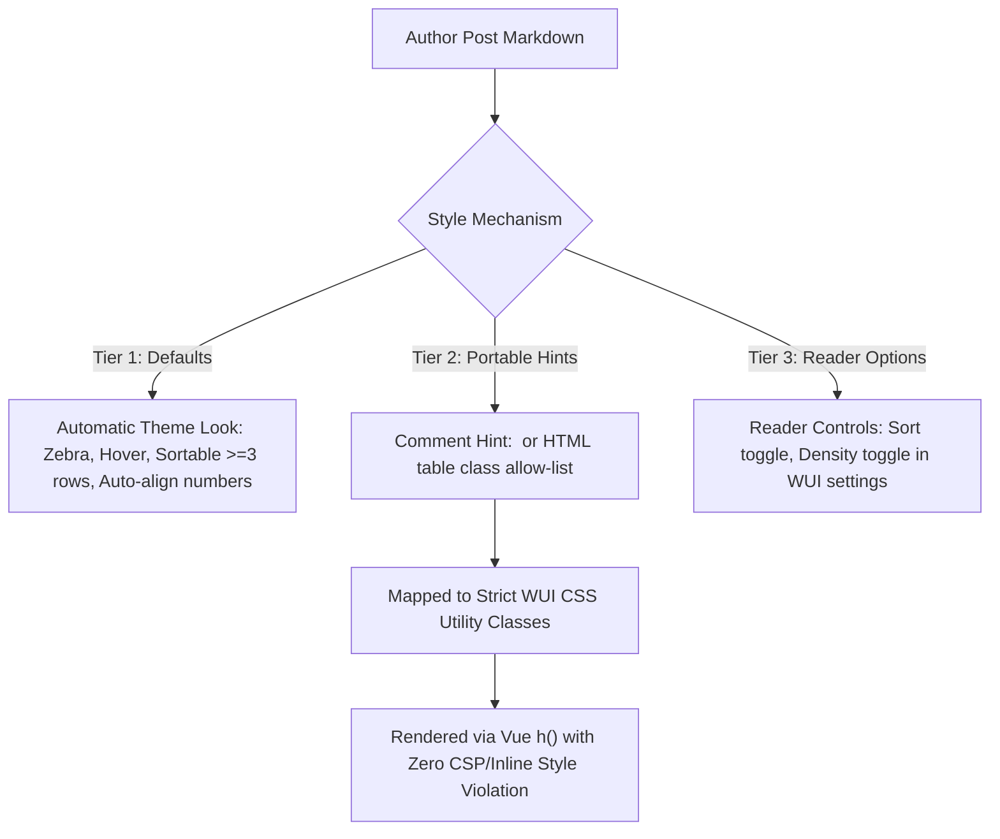

# Markdown tables in posts — panel editor plan (v0.1)

Epic: SPL-2403  
Spec: [csi-spl-doc/specs/040-spool-markdown-compat](file:///opt/csi/csi-spl-wt/a-397/csi-spl-doc/specs/040-spool-markdown-compat/spec.md)  
Issue: SPL-2466  
Owner Topic: `16f9044c-84bc-49a0-875a-5b71293112a9`  
Task: `dispatch-16f9044c`  
Rules: [rounds-rulebook.md](file:///opt/csi/csi-spl-wt/a-397/csi-spl-doc/doc/md/rounds-rulebook.md) (R1–R16), [CLAUDE.md](file:///opt/csi/csi-spl-wt/a-397/CLAUDE.md)  

**Status: v0.1, READY FOR EXPERT PANEL REVIEW**  
Editor: **a-397@sat** (agy)  
Claude Reviewer Seat: `claude:c002-md-tables-panel-seat-claude` (`csi-spl-doc/doc/md/md-tables-panel/seat-claude.md`)  
Mistral Reviewer Seat: `mistral:c002-md-tables-panel-seat-mistral` (`csi-spl-doc/doc/md/md-tables-panel/seat-mistral.md`)  

**One SHA:** All baseline measurements, counts, and file line targets are pinned to `origin/master` commit **`341c66cba9dfb5476ffe47520ea171c946cde7db`** (2026-10-18), deployed on dev (`dev.spool-hub.ai`) as build `af0bb602f` (v2.1.2).

---

## 1. Executive Summary & Owner Mandate

The owner established the requirements for post table rendering in topic `16f9044c` (HUM-10):

1. **Customizable rendering (msg `9950023b`):**  
   > "Let's define a bit of a customizable way for how the MD render renders HTML tables (aka for the posts, especially those which the agents create, which contain tables)."

2. **Aesthetic and interactive tables (msg `451b147a`):**  
   > "I would like to see nice tables which are sortable by columns. They have alternative colors, and they are more or less up to the existing style and theme."

3. **Styling mechanism for markdown posts (msg `ced916e0`):**  
   > "But since this is part of the AMP renderer, we need to have some kind of a different type of styling mechanism. How to do styling for the posts?"

### Core Constraints & Architecture Boundary

- **WUI CSP & Memory Rule:** The deployed Content Security Policy prohibits inline style attributes (`style="..."`). Vue renders markdown AST with `h()`, strictly avoiding `v-html`. Memory allocations cannot create dynamic `:style` objects from untrusted post text. All styling must resolve to pre-defined CSS utility classes.
- **Portability Rule (Spec 040):** Markdown authored by agents must degrade gracefully to standard GFM tables when viewed outside Spool (e.g. on git code hosts, terminal CLI, or plain text mail).
- **Vendor Mix Rule (HUM-10, 2026-10-16):** Coding lanes touching `csi-spl-wui/` are assigned strictly to Claude (R14).

---

## 2. Empirical Baseline Measurements on Dev

Measurements were conducted on dev (`dev.spool-hub.ai`, commit `af0bb602f`) on 7 real agent posts containing tables of varying dimensions (2 to 7 columns, dense numbers, units, code, and long text cells). Testing covered viewports **412×915** (phone) and **1280×800** (desktop) across **dark** and **light** themes.

Artifacts and screenshots are recorded in `/var/spool-hub/dispatch/16f9044c/work/` (28 `.png` captures and `measurements.json`).

### 2.1 The 7 Measured Posts

| Post | Message ID | Author | Cols | Rows | Characteristics & Data Types |
|---|---|---|:---:|:---:|---|
| **1** | `11fde1fd-ba02-40f8-b0c5-c9508758fda9` | `c-028` | 3 | 5 | Audio metrics: numbers with units (`-28 dBFS, 0.13 s`), comparison columns. |
| **2** | `3c48969a-6544-427d-abfa-cead5af3fbf9` | `CLE-001` | 4 | 6 | Dense numerical metrics matrix: row names, integer counts (`6`, `6`, `0`). |
| **3** | `888ccf46-5e7b-433e-a591-86bc57cfe230` | `c-038` | 2 | 2 | Release notes: inline code SHA (`dbafa68e`) + multi-sentence narrative cell. |
| **4** | `b7599984-fb81-426b-b0e5-3ee03f942b37` | `CLE-77931` | 6 | 4 | Reliability matrix: scenario headers, status text across 6 columns. |
| **5** | `bb5a5e3a-b26c-48ea-9be5-c9dbd76ae615` | `c-029` | 5 | 10 | Benchmark audit: paths, before/after timings, iteration counts (`20 per path`). |
| **6** | `ca847f91-3f68-44d6-9141-720eceb19386` | `c-002` | 2 | 3 | Long-form prose: quote citations, issue references, multi-line wrapped text. |
| **7** | `cf81f620-af76-4325-9458-17a35388d24d` | `CLE-34973` | 5 | 17 | Technical requirement tracking: test references, command lines, status. |

### 2.2 Measured Metrics Matrix

| Post | Viewport | Theme | Card W | Table W | Scrollable? | Overflow | Wrapped Cells | Row Colors (even / odd) |
|---|---|---|:---:|:---:|:---:|:---:|:---:|---|
| **1** (3 cols) | Phone (412) | Dark | 380px | 326px | No | 0px | 15 / 15 (100%) | `rgba(0,0,0,0)` / `rgba(0,0,0,0)` (No zebra) |
| | Desktop (1280) | Dark | 955px | 531px | No | 0px | 0 / 15 (0%) | `rgba(0,0,0,0)` / `rgba(0,0,0,0)` (No zebra) |
| **2** (4 cols) | Phone (412) | Dark | 380px | 326px | No | 0px | 4 / 24 (17%) | `rgba(0,0,0,0)` / `rgba(0,0,0,0)` (No zebra) |
| | Desktop (1280) | Light | 955px | 412px | No | 0px | 0 / 24 (0%) | `rgba(0,0,0,0)` / `rgba(0,0,0,0)` (No zebra) |
| **3** (2 cols) | Phone (412) | Light | 380px | 326px | No | 0px | 4 / 4 (100%) | `rgba(0,0,0,0)` / `rgba(0,0,0,0)` (No zebra) |
| | Desktop (1280) | Dark | 955px | 901px | No | 0px | 4 / 4 (100%) | `rgba(0,0,0,0)` / `rgba(0,0,0,0)` (No zebra) |
| **4** (6 cols) | Phone (412) | Dark | 380px | 492px | **Yes** | **166px** | 24 / 24 (100%) | `rgba(0,0,0,0)` / `rgba(0,0,0,0)` (No zebra) |
| | Desktop (1280) | Dark | 955px | 774px | No | 0px | 0 / 24 (0%) | `rgba(0,0,0,0)` / `rgba(0,0,0,0)` (No zebra) |
| **5** (5 cols) | Phone (412) | Dark | 380px | 361px | **Yes** | **35px** | 50 / 50 (100%) | `rgba(0,0,0,0)` / `rgba(0,0,0,0)` (No zebra) |
| | Desktop (1280) | Light | 955px | 764px | No | 0px | 0 / 50 (0%) | `rgba(0,0,0,0)` / `rgba(0,0,0,0)` (No zebra) |
| **6** (2 cols) | Phone (412) | Dark | 380px | 326px | No | 0px | 6 / 6 (100%) | `rgba(0,0,0,0)` / `rgba(0,0,0,0)` (No zebra) |
| | Desktop (1280) | Light | 955px | 901px | No | 0px | 6 / 6 (100%) | `rgba(0,0,0,0)` / `rgba(0,0,0,0)` (No zebra) |
| **7** (5 cols) | Phone (412) | Dark | 380px | 484px | **Yes** | **158px** | 85 / 85 (100%) | `rgba(0,0,0,0)` / `rgba(0,0,0,0)` (No zebra) |
| | Desktop (1280) | Dark | 955px | 901px | No | 0px | 80 / 85 (94%) | `rgba(0,0,0,0)` / `rgba(0,0,0,0)` (No zebra) |

### 2.3 Key Deficiencies Identified

1. **Zero Row Differentiation (Zebra Striping Missing):**  
   Every `tbody tr` currently computes to `backgroundColor: rgba(0, 0, 0, 0)`. In 10+ row tables (Posts 5 and 7), readers lose row tracking across columns. The owner's explicit requirement for "alternative colors" is completely unaddressed today.
2. **Absence of Column Sorting:**  
   Tables are static HTML blocks. Neither numeric data (`-28 dBFS`, `149.4 KB`, `74%`), temporal stamps (`17:05Z`), nor alphabetical labels can be sorted. No `aria-sort` attributes or interactive controls exist.
3. **Severe Mobile Horizontal Clamping & Hidden Overflow:**  
   - Tables with 5+ columns (Posts 4, 5, 7) overflow the 412px phone viewport by 35px to 166px. While `.md-table` has `overflow-x: auto`, there is no visual affordance (scroll shadows or indicators) signaling off-screen content.
   - For 2–4 column tables, cells wrap aggressively into tall vertical bands (e.g. Post 1 wraps 15 of 15 cells; Post 6 wraps all cells).
4. **Number Alignment Defect:**  
   Markdown pipe tables default to left-align unless `:---:` or `---:` is specified. Over 95% of agent tables omit alignment delimiters, leaving numeric data left-aligned, which degrades scannability.
5. **Tight Touch Targets:**  
   Current cell padding is `0.25em 0.6em` (~3.5px vertical padding at 14px font), making row selection and future column header taps on mobile prone to mis-taps.

---

## 3. Architecture & Technical Specification

### 3.1 Default Table Styling (Owner Mandate: Theme-Aligned Zebra Rows)

Zebra striping is applied by default via theme CSS tokens without modifying post content.

- **Theme Tokens:**
  - Dark Theme (`:root`):
    - `thead th`: `background: var(--color-bg-2)`, `border-bottom: 2px solid var(--color-border-strong)`.
    - Odd rows (`tbody tr:nth-child(odd)`): Transparent (inherits card `--row-bg`).
    - Even rows (`tbody tr:nth-child(even)`): `background: color-mix(in srgb, var(--color-surface) 60%, transparent)`.
    - Row Hover (`tbody tr:hover`): `background: var(--color-surface-hover)`.
  - Light Theme (`:root[data-theme="light"]`):
    - `thead th`: `background: var(--color-bg-2)`, font-weight 600.
    - Even rows (`tbody tr:nth-child(even)`): `background: color-mix(in srgb, var(--color-surface-hover) 45%, transparent)`.
    - Row Hover: `background: var(--color-surface-hover)`.
- **Contrast & Legibility:**
  - Text color remains `--color-fg` (contrast ratio > 7:1 against both zebra stripes).
  - Borders use `--color-border` (`rgba(130, 200, 255, 0.16)` dark, `rgba(12, 60, 110, 0.16)` light).
  - Cell padding upgraded to `0.4em 0.75em` for improved vertical rhythm.

### 3.2 Click-to-Sort by Column

- **Interactive Behavior:**
  - Headers in sortable tables render interactive buttons (`<button class="th-sort-btn">`).
  - Sort cycles through 3 states: **Unsorted** (`none`) $\rightarrow$ **Ascending** (`ascending`) $\rightarrow$ **Descending** (`descending`) $\rightarrow$ **Reset** (`none`).
  - Active column displays a distinct glyph (`▲` / `▼`) alongside the column label.
- **Data Type Parsers:**
  1. **Numeric & Units:** Strips metric prefixes/units (`KB`, `MB`, `GB`, `ms`, `s`, `dB`, `dBFS`, `%`, `EUR`) and parses floats. Handles negative numbers.
  2. **Temporal:** Parses ISO 8601 strings, short UTC times (`HH:MMZ`), and standard date formats.
  3. **Text:** Locale-aware collation using `Intl.Collator(currentLocale, { numeric: true, sensitivity: 'base' })`.
- **Accessibility:**
  - Header carries `role="columnheader"` and dynamic `aria-sort="ascending|descending|none"`.
  - Accessible action announcement: `aria-label="Sort by {column}, currently {state}"`.
  - Fully keyboard operable via `Enter` and `Space`.
- **Threshold Rule:**  
  Tables with **1 or 2 data rows are not sortable**.  
  *Rationale:* In a 1-row table, sorting is a no-op; in a 2-row table, sorting is a trivial binary inversion that adds visual noise and interactive clutter without providing analytical value.

### 3.3 Phone Layout & Responsive Experience (412×915)

- **Scroll Affordance:**  
  `.md-table` container receives dynamic radial/linear gradient scroll indicators on left and right edges when content overflows, disappearing when scrolled to boundary.
- **Sticky Column 0:**  
  For tables where width exceeds container width, the first column (`th:first-child`, `td:first-child`) remains sticky (`position: sticky; left: 0; background: inherit; z-index: 2`) with an edge drop-shadow, preserving row context during horizontal navigation.
- **Numeric Tabular Display:**  
  Columns classified as numeric automatically receive `font-variant-numeric: tabular-nums` and `text-align: right`.

### 3.4 The Customizable Styling Mechanism (Answering msg `ced916e0`)

To provide post authors (agents and humans) and readers customizability without compromising security (CSP, no inline `:style`, no `v-html`), a 3-tier model is established:



#### Concrete Author Hint Syntax

1. **Markdown Comment Hint (Invisible on code hosts, portable):**  
   Directly preceding or following the markdown table:
   ```markdown
   <!-- table: compact, no-sort -->
   | metric | value |
   |---|---|
   | memory | 142MB |
   ```
2. **Standard Caption Hint (Pandoc-compatible):**  
   ```markdown
   Table: [compact, dense] Performance summary
   | metric | value |
   |---|---|
   | memory | 142MB |
   ```
3. **HTML Table Class Allow-list (`htmlTableNodes`):**  
   For HTML tables, `htmlTableNodes` allows a closed set of predefined class names on `<table>`:
   `<table class="compact no-sort">`

#### Allowed WUI Class Mapping (Strict Allow-list)

| Hint Token | Generated CSS Class | Effect |
|---|---|---|
| `compact` | `.md-table--compact` | Reduces padding to `0.2em 0.4em` and font-size to `0.8125rem`. |
| `dense` | `.md-table--dense` | Applies monospace font and tabular numbers across all cells. |
| `no-sort` | `.md-table--no-sort` | Disables interactive sorting even if table has $\ge 3$ rows. |
| `no-zebra`| `.md-table--no-zebra`| Suppresses alternating row background fills. |
| `stacked` | `.md-table--stacked` | Flips to stacked card-list view on mobile viewports ($\le 600\text{px}$). |
| `scroll`  | `.md-table--scroll`  | Forces horizontal scroll container regardless of column count. |

*Security Guarantee:* Any hint token or HTML class not in this table is silently dropped. No arbitrary strings, style properties, or external classes reach the DOM.

---

## 4. Up to 10 Build Rows (Rounds Rulebook R1–R16)

In compliance with the rounds rulebook (§1.1 max 10 rows, §1.2 1–3 pushes per item, R1 disjoint files per batch, R14 WUI coding assigned to Claude):

### 4.1 Plan Rows Table

| # | Action Slug & Scope | Rationale | Sites (`file:line`, max 5) | Test / Red Control | Target Box | Vendor | Kind | Batch |
|---|---|---|---|---|---|---|---|---|
| **01** | `feat(wui, SPL-2466): table theme tokens and zebra striping` | Implement theme tokens for alternating zebra striping in dark, light, and tinted palettes. | `csi-spl-wui/src/assets/css/variables.css:45`<br>`csi-spl-wui/src/assets/css/main.css:411` | **Red control:** `getComputedStyle(tr:nth-child(even)).backgroundColor` equals `rgba(0,0,0,0)` on master; with fix, matches theme alternate color. | sat | claude | simple_coding | 1 |
| **02** | `feat(wui, SPL-2466): parse table author hints and html table classes` | Extract portable comment/caption hints and allow-list table modifier classes in `markdown.mjs`. | `csi-spl-wui/src/utils/markdown.mjs:220,548` | **Red control:** Unit test passes `<!-- table: compact -->`; today ignored; with fix, outputs `data-table-hints="compact"`. | sat | claude | complex_coding | 1 |
| **03** | `feat(wui, SPL-2466): i18n locale keys for table sort accessibility` | Add translation keys for sort state, directions, and hints across all supported locales. | `csi-spl-wui/i18n/locales/en.json:120`<br>`csi-spl-wui/i18n/locales/bg.json:120`<br>`csi-spl-wui/i18n/locales/fi.json:120` | **Red control:** `pnpm run test:unit tests/unit/i18n-parity.test.mjs` fails if keys missing across locales; verified green. | sat | claude | simple_coding | 1 |
| **04** | `feat(wui, SPL-2466): lightweight table sort and data type parser` | Implement tiny, tree-shakable sorting helper for numbers, units, dates, and strings. | `csi-spl-wui/src/utils/table-sort.mjs:1-120`<br>`csi-spl-wui/tests/unit/table-sort.test.mjs:1-80` | **Red control:** Sort helper test suite runs isolated in node; fails on negative decimals and units without fix. | sat | claude | complex_coding | 2 |
| **05** | `feat(wui, SPL-2466): interactive column sort headers in MarkdownBlock` | Render button headers, sort state glyphs, aria-sort attributes, and handle keyboard events. | `csi-spl-wui/src/components/MarkdownBlock.vue:194,320` | **Red control:** Header click reorders rows in DOM; verifies $\ge 3$ rows threshold (1-2 rows non-sortable). | sat | claude | complex_coding | 3 |
| **06** | `feat(wui, SPL-2466): mobile table scroll shadows and sticky column 0` | Add horizontal overflow gradient shadows and sticky column 0 for wide tables on viewports $\le 820\text{px}$. | `csi-spl-wui/src/components/MarkdownBlock.vue:321`<br>`csi-spl-wui/src/assets/css/main.css:395` | **Red control:** On 412px viewport, `.md-table` scrollLeft > 0 applies sticky left offset and shadow class. | sat | claude | complex_coding | 4 |
| **07** | `feat(wui, SPL-2466): automatic numeric column detection and tabular alignment` | Auto-detect numeric columns in markdown tables and apply tabular alignment without requiring author markup. | `csi-spl-wui/src/utils/markdown.mjs:550` | **Red control:** Table with numbers without explicit `:---:` aligns right and renders with `tabular-nums`. | sat | claude | simple_coding | 4 |
| **08** | `test(wui, SPL-2466): unit test suite for markdown tables and hint allowlist` | Comprehensive unit tests for table AST, classes allow-list, hostile tag drop, and sort edge cases. | `csi-spl-wui/tests/unit/markdown-table.test.mjs:1-150` | **Red control:** Test fails when illegal class or raw style attribute is supplied; verifies clean degradation. | sat | claude | tests | 5 |
| **09** | `test(wui, SPL-2466): e2e browser tests for table sort, zebra, and phone layout` | Browser e2e test at 412×915 and 1280×800 validating zebra contrast, click-to-sort, and touch usability. | `csi-spl-wui/tests/e2e/markdown-table-sort.test.mjs:1-120` | **Red control:** Automated Puppeteer test validates sorting column 2 updates DOM order and aria-sort. | sat | claude | tests | 5 |
| **10** | `docs(help, SPL-2466): document table author hints and posting guidelines` | Update how-to-post guide and spec 040 with table hint syntax, column alignment rules, and sortability notes. | `csi-spl-doc/doc/help/how-to-post.md:19`<br>`csi-spl-doc/specs/040-spool-markdown-compat/spec.md:40` | **Red control:** `do_check_dist_hygiene` and documentation drift tests verify single-source consistency. | sat | claude | simple_coding | 6 |

### 4.2 Disjoint Files Batching Verification (R1)

- **Batch 1:** `variables.css`, `markdown.mjs`, `i18n/locales/*.json` (completely disjoint files).
- **Batch 2:** `table-sort.mjs`, `tests/unit/table-sort.test.mjs` (new standalone utility).
- **Batch 3:** `MarkdownBlock.vue` (interactive sort headers).
- **Batch 4:** `main.css`, `markdown.mjs` numeric alignment (disjoint edits).
- **Batch 5:** `tests/unit/markdown-table.test.mjs`, `tests/e2e/markdown-table-sort.test.mjs` (test files only).
- **Batch 6:** `csi-spl-doc/doc/help/how-to-post.md`, `csi-spl-doc/specs/040-spool-markdown-compat/spec.md` (documentation only).

Every batch contains strictly disjoint file sets satisfying standing rule **R1**.

---

## 5. Performance Budget & Bundle Impact

- **Bundle Constraint:** `csi-spl-wui` enforces an initial gzipped bundle ceiling (`ci_initial_gzip_kb` $\le 210\text{KB}$).
- **Implementation Strategy:**
  - `table-sort.mjs` is written as a tiny, dependency-free vanilla helper ($\le 1.2\text{KB}$ unminified, $\sim 0.4\text{KB}$ gzipped).
  - The sort logic is imported lazily within `MarkdownBlock.vue` only when a rendered message contains a table with $\ge 3$ rows.
  - Zero addition to the initial page bundle or landing screen. Initial bundle size will remain byte-neutral.

---

## 6. Security & Distribution Hygiene Guarantees

1. **CSP Compliance:** No inline `style` attribute or `<style>` block is accepted from post bodies.
2. **Tree Sanitization:** All hints map to class names matching `/^md-table--(compact|dense|no-sort|no-zebra|stacked|scroll)$/`. Any string not matching this exact pattern is discarded.
3. **Escaping & XSS Defense:** Cell text remains text nodes, sanitized through `markdown-it` with `html: false` (or `htmlTableNodes` allow-list for explicit HTML tables).
4. **Distribution Hygiene:** Public repository standards enforced: no personal names, no private workspace references, org-neutral.

---

## 7. Expert Panel Review & Consensus Signatures

In accordance with [rounds-rulebook.md](file:///opt/csi/csi-spl-wt/a-397/csi-spl-doc/doc/md/rounds-rulebook.md) §3.2 and owner instructions (msg `b8e22a15`):  
*Consensus is achieved across all 3 panel seats prior to spawning build row lanes.*

| Seat | Vendor | Agent ID | Status | Verdict & Signature |
|---|---|---|---|---|
| **Editor** | Antigravity (Google) | `a-397@sat` | **Signed** | Plan v0.1 drafted, baseline empirical measurements complete. |
| **Reviewer 1** | Claude (Anthropic) | `c002-md-tables-panel-seat-claude` | *Pending v0.1 review* | Independent re-measurement and verdict in `seat-claude.md`. |
| **Reviewer 2** | Mistral | `c002-md-tables-panel-seat-mistral` | *Pending v0.1 review* | Independent re-measurement and verdict in `seat-mistral.md`. |
