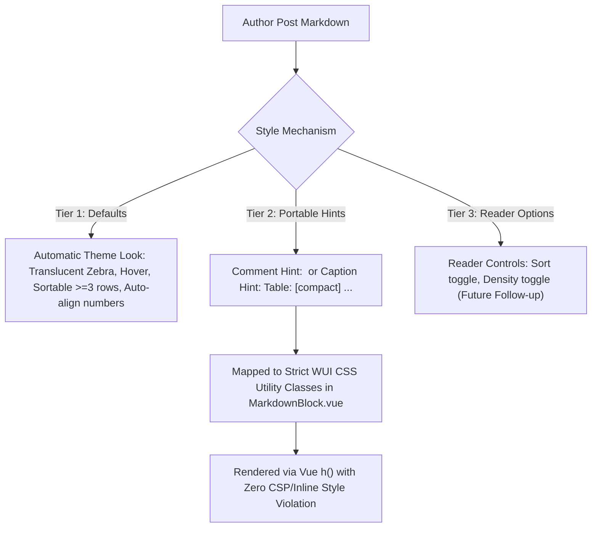

# Markdown tables in posts — panel editor plan (v1.0)

Epic: SPL-2403  
Spec: [csi-spl-doc/specs/040-spool-markdown-compat](file:///opt/csi/csi-spl-wt/a-397/csi-spl-doc/specs/040-spool-markdown-compat/spec.md)  
Issue: SPL-2466  
Owner Topic: `16f9044c-84bc-49a0-875a-5b71293112a9`  
Task: `dispatch-16f9044c`  
Rules: [rounds-rulebook.md](file:///opt/csi/csi-spl-wt/a-397/csi-spl-doc/doc/md/rounds-rulebook.md) (R1–R16), [CLAUDE.md](file:///opt/csi/csi-spl-wt/a-397/CLAUDE.md)  

**Status: v1.0, APPROVED BY EXPERT PANEL (CONSENSUS REACHED)**  
Editor: **a-397@sat** (agy)  
Claude Reviewer Seat: **c-398@sat** ([csi-spl-doc/doc/md/md-tables-panel/seat-claude.md](file:///opt/csi/csi-spl-wt/a-397/csi-spl-doc/doc/md/md-tables-panel/seat-claude.md), commit `a629ad83c`)  
Mistral Reviewer Seat: **m-964** ([csi-spl-doc/doc/md/md-tables-panel/seat-mistral.md](file:///opt/csi/csi-spl-wt/a-397/csi-spl-doc/doc/md/md-tables-panel/seat-mistral.md), commit `b3d39a4d9`)  

**Pinned Baseline SHA:** Baseline measurements, counts, and file line targets are pinned to `origin/master` commit **`341c66cba9dfb5476ffe47520ea171c946cde7db`** (2026-10-18), deployed on dev (`dev.spool-hub.ai`) as build `af0bb602f` (v2.1.2). Both reviewer seats verified and reproduced the empirical baseline on this served build.

---

## 1. Executive Summary & Owner Mandate

The owner established the requirements for post table rendering in topic `16f9044c` (HUM-10):

1. **Customizable rendering (msg `9950023b`):**  
   > "Let's define a bit of a customizable way for how the MD render renders HTML tables (aka for the posts, especially those which the agents create, which contain tables)."

2. **Aesthetic and interactive tables (msg `451b147a`):**  
   > "I would like to see nice tables which are sortable by columns. They have alternative colors, and they are more or less up to the existing style and theme."

3. **Styling mechanism for markdown posts (msg `ced916e0`):**  
   > "But since this is part of the AMP renderer, we need to have some kind of a different type of styling mechanism. How to do styling for the posts?"

### Core Constraints & Architecture Boundary

- **WUI CSP & Memory Rule:** The deployed Content Security Policy prohibits inline style attributes (`style="..."`). Vue renders markdown AST with `h()`, strictly avoiding `v-html`. Memory allocations cannot create dynamic `:style` objects from untrusted post text. All styling must resolve to pre-defined CSS utility classes.
- **Portability Rule (Spec 040):** Markdown authored by agents must degrade gracefully to standard GFM tables when viewed outside Spool (e.g. on git code hosts, terminal CLI, or plain text mail).
- **Vendor Mix Rule (HUM-10, 2026-10-16):** Coding lanes touching `csi-spl-wui/` are assigned strictly to Claude (R14). All 10 build rows are designated for Claude implementation.

---

## 2. Empirical Baseline Measurements on Dev

Measurements were conducted on dev (`dev.spool-hub.ai`, commit `af0bb602f`, v2.1.2) across real agent posts containing tables of varying dimensions (2 to 7 columns, dense numbers, units, code, and long text cells). Testing covered viewports **412×915** (phone) and **1280×800** (desktop) across **dark** and **light** themes.

Artifacts and screenshots are recorded in `/var/spool-hub/dispatch/16f9044c/work/` (28 `.png` captures and `measurements.json`) by the editor, and independently re-measured and confirmed by Claude (`/var/spool-hub/dispatch/16f9044c/work/seat-claude/`, 8 `.png` captures and `results.json`) and Mistral (`seat-mistral.md`).

### 2.1 The 7 Measured Posts

| Post | Message ID | Author | Cols | Body Rows | Characteristics & Data Types |
|---|---|---|:---:|:---:|---|
| **1** | `11fde1fd-ba02-40f8-b0c5-c9508758fda9` | `c-028` | 3 | 5 | Audio metrics: numbers with units (`-28 dBFS, 0.13 s`), comparison columns. |
| **2** | `3c48969a-6544-427d-abfa-cead5af3fbf9` | `CLE-001` | 4 | 6 | Dense numerical metrics matrix: row names, integer counts (`6`, `6`, `0`). |
| **3** | `888ccf46-5e7b-433e-a591-86bc57cfe230` | `c-038` | 2 | 2 | Release notes: inline code SHA (`dbafa68e`) + multi-sentence narrative cell. |
| **4** | `b7599984-fb81-426b-b0e5-3ee03f942b37` | `CLE-77931` | 6 | 4 | Reliability matrix: scenario headers, status text across 6 columns. |
| **5** | `bb5a5e3a-b26c-48ea-9be5-c9dbd76ae615` | `c-029` | 5 | 10 | Benchmark audit: paths, before/after timings, iteration counts (`20 per path`). |
| **6** | `ca847f91-3f68-44d6-9141-720eceb19386` | `c-002` | 2 | 3 | Long-form prose: quote citations, issue references, multi-line wrapped text. |
| **7** | `cf81f620-af76-4325-9458-17a35388d24d` | `CLE-34973` | 5 | 17 | Technical requirement tracking: test references, command lines, status. |

### 2.2 Measured Metrics Matrix

Container dimensions: In topic views (narrowest reader container), the message card width is 380px and `.md-table` container width is 326px. In `/lobby`, card width is 400px and `.md-table` container width is 392px. Natural table widths match to the pixel across all measurements. Overflow targets are evaluated against the topic view container.

| Post | Viewport | Theme | Card W | Table W | Scrollable? | Overflow (Topic View) | Wrapped Cells | Row Colors (even / odd) |
|---|---|---|:---:|:---:|:---:|:---:|:---:|---|
| **1** (3 cols) | Phone (412) | Dark | 380px | 326px | No | 0px | 15 / 15 (100%) | `rgba(0,0,0,0)` / `rgba(0,0,0,0)` (No zebra) |
| | Desktop (1280) | Dark | 955px | 531px | No | 0px | 0 / 15 (0%) | `rgba(0,0,0,0)` / `rgba(0,0,0,0)` (No zebra) |
| **2** (4 cols) | Phone (412) | Dark | 380px | 326px | No | 0px | 4 / 24 (17%) | `rgba(0,0,0,0)` / `rgba(0,0,0,0)` (No zebra) |
| | Desktop (1280) | Light | 955px | 412px | No | 0px | 0 / 24 (0%) | `rgba(0,0,0,0)` / `rgba(0,0,0,0)` (No zebra) |
| **3** (2 cols) | Phone (412) | Light | 380px | 326px | No | 0px | 4 / 4 (100%) | `rgba(0,0,0,0)` / `rgba(0,0,0,0)` (No zebra) |
| | Desktop (1280) | Dark | 955px | 901px | No | 0px | 4 / 4 (100%) | `rgba(0,0,0,0)` / `rgba(0,0,0,0)` (No zebra) |
| **4** (6 cols) | Phone (412) | Dark | 380px | 492px | **Yes** | **166px** | 24 / 24 (100%) | `rgba(0,0,0,0)` / `rgba(0,0,0,0)` (No zebra) |
| | Desktop (1280) | Dark | 955px | 774px | No | 0px | 0 / 24 (0%) | `rgba(0,0,0,0)` / `rgba(0,0,0,0)` (No zebra) |
| **5** (5 cols) | Phone (412) | Dark | 380px | 361px | **Yes** | **35px** | 50 / 50 (100%) | `rgba(0,0,0,0)` / `rgba(0,0,0,0)` (No zebra) |
| | Desktop (1280) | Light | 955px | 764px | No | 0px | 0 / 50 (0%) | `rgba(0,0,0,0)` / `rgba(0,0,0,0)` (No zebra) |
| **6** (2 cols) | Phone (412) | Dark | 380px | 326px | No | 0px | 6 / 6 (100%) | `rgba(0,0,0,0)` / `rgba(0,0,0,0)` (No zebra) |
| | Desktop (1280) | Light | 955px | 901px | No | 0px | 6 / 6 (100%) | `rgba(0,0,0,0)` / `rgba(0,0,0,0)` (No zebra) |
| **7** (5 cols) | Phone (412) | Dark | 380px | 484px | **Yes** | **158px** | 85 / 85 (100%) | `rgba(0,0,0,0)` / `rgba(0,0,0,0)` (No zebra) |
| | Desktop (1280) | Dark | 955px | 901px | No | 0px | 80 / 85 (94%) | `rgba(0,0,0,0)` / `rgba(0,0,0,0)` (No zebra) |

### 2.3 Key Deficiencies Identified

1. **Zero Row Differentiation (Zebra Striping Missing):**  
   Every `tbody tr` currently computes to `backgroundColor: rgba(0, 0, 0, 0)`. In 10+ row tables (Posts 5 and 7), readers lose row tracking across columns. The owner's explicit requirement for "alternative colors" is completely unaddressed today.
2. **Absence of Column Sorting:**  
   Tables are static HTML blocks. Neither numeric data (`-28 dBFS`, `149.4 KB`, `74%`), temporal stamps (`17:05Z`), nor alphabetical labels can be sorted. No `aria-sort` attributes or interactive controls exist.
3. **Severe Mobile Horizontal Clamping & Hidden Overflow:**  
   - Tables with 5+ columns (Posts 4, 5, 7) overflow the 412px phone viewport by 35px to 166px in topic view. While `.md-table` has `overflow-x: auto`, there is no visual affordance (scroll shadows or indicators) signaling off-screen content.
   - For 2–4 column tables, cells wrap aggressively into tall vertical bands (e.g. Post 1 wraps 15 of 15 cells; Post 6 wraps all cells).
4. **Number Alignment Defect:**  
   Markdown pipe tables default to left-align unless `:---:` or `---:` is specified. 7 of 7 measured agent tables omit explicit alignment delimiters, leaving numeric data left-aligned, which degrades scannability.
5. **Tight Touch Targets:**  
   Current cell padding is `0.25em 0.6em` (~3.7px vertical padding at 15px font), making row selection and future column header taps on mobile prone to mis-taps.

---

## 3. Architecture & Technical Specification

### 3.1 Default Table Styling (Owner Mandate: Theme-Aligned Zebra Rows)

Zebra striping is applied by default in `MarkdownBlock.vue:318-343` without requiring authors to modify markdown content.

- **Card Shading Interaction (SPL-2120):**  
  Message cards (`.msg`) alternate shading via `main.css:411`: even cards paint `.msg:nth-child(even of .msg)` with `background: var(--color-row-alt)` (`rgba(255,255,255,0.06)` dark, `rgba(12,22,38,0.06)` light), while odd cards have transparent backgrounds.
- **Translucent Stripe Overlay:**  
  To ensure the zebra pattern produces an identical, clearly discernible contrast step (~1.12) regardless of whether the table resides on an odd or even card:
  - Table stripe is defined as an overlay using `var(--color-row-alt)`:
    - Markdown pipe tables: `tbody tr:nth-child(even)`: `background: var(--color-row-alt)`.
    - HTML tables (which may lack explicit `tbody`): `tr:nth-child(even of :not(thead tr))`: `background: var(--color-row-alt)`.
  - Headers: `thead th` uses `background: var(--color-bg-2)`, `border-bottom: 2px solid var(--color-border-strong)`.
- **Palette Universal Coverage (All 8 Themes):**  
  Because `var(--color-row-alt)` is already dynamically declared for all 8 palettes in `variables.css:116-337` (`:root`, `dark`, `light`, and five `light-*` tinted palettes), this translucent overlay produces correct, accessible contrast across all 8 themes without adding redundant palette-specific CSS blocks.
- **WCAG Contrast & Legibility:**  
  - Text color remains `--color-fg` (contrast ratio > 15:1 against both base card and zebra stripes in all themes).
  - Stripe-to-base contrast ratio $\ge 1.10$ on both odd and even cards across both dark and light themes.
  - Borders use `--color-border` (`rgba(130, 200, 255, 0.16)` dark, `rgba(12, 60, 110, 0.16)` light).
  - Cell padding upgraded to `0.4em 0.75em` (~6px × 11px) for improved vertical rhythm and touch usability.
- **Row Hover:**  
  Card hover already paints `var(--color-surface-hover)`. To remain distinct on hovered cards, table row hover applies a subtle tint overlay: `background: color-mix(in srgb, var(--color-fg) 4%, transparent)`.

### 3.2 Click-to-Sort by Column

- **Component Architecture:**  
  Because `MdNodes` in `MarkdownBlock.vue:200` is a functional component (`FunctionalComponent`), interactive sorting state is managed by a dedicated stateful component (`MdTable.vue` or encapsulated table wrapper).
- **Interactive Controls & Keyboard Accessibility:**  
  - Headers in sortable tables render accessible button elements (`<button class="th-sort-btn">`).
  - Sort cycles through 3 states: **Unsorted** (`none`) $\rightarrow$ **Ascending** (`ascending`) $\rightarrow$ **Descending** (`descending`) $\rightarrow$ **Reset** (`none`).
  - Active column displays a distinct glyph (`▲` / `▼`) alongside the column label.
  - Header carries `role="columnheader"` and dynamic `aria-sort="ascending|descending|none"`.
  - Accessible announcement: `aria-label="Sort by {column}, currently {state}"`.
  - Fully keyboard operable via `Enter` and `Space`.
- **Data Type Parsers (`csi-spl-wui/src/utils/table-sort.mjs`):**  
  1. **Numeric & Units:** Strips metric prefixes and units (`KB`, `MB`, `GB`, `ms`, `s`, `dB`, `dBFS`, `%`, `EUR`) and parses floats. Handles negative numbers.
  2. **Temporal:** Parses ISO 8601 strings, short UTC times (`HH:MMZ`), and standard date formats.
  3. **Text:** Locale-aware collation using `Intl.Collator(currentLocale, { numeric: true, sensitivity: 'base' })`.
- **Sort Stability & Empty Cell Policy:**  
  - **Stability:** Rows with identical sort keys maintain their source author order.
  - **Empty Cells:** Empty or null cells (`""`, `-`, `—`, `–`, `N/A`) sort to the bottom in both ascending and descending directions.
- **Threshold & Eligibility Rules:**  
  - **Body Rows $\ge 3$:** Applies strictly to tables with $\ge 3$ body rows (`tbody tr` count). Tables with 1–2 body rows (e.g. Post 3) remain static without sort buttons.  
    *Rationale:* In a 1-row table, sorting is a no-op; in a 2-row table, sorting is a trivial binary inversion that adds visual noise and interactive clutter without analytical value.
  - **Colspan / Rowspan Exclusion:** Tables containing cells with `colspan` or `rowspan` attributes are non-sortable, as reordering individual rows would corrupt grid geometry.
- **View-Only Guarantee:**  
  Sorting is strictly an ephemeral UI view state. "Show source", raw markdown inspection, and copy-post actions retain the author's original row sequence.

### 3.3 Phone Layout & Responsive Experience (412×915)

- **Scroll Affordance:**  
  `.md-table` container receives dynamic radial/linear gradient scroll indicators on left and right edges when content overflows horizontally, disappearing when scrolled to the boundary.
- **Sticky Column 0:**  
  For tables where width exceeds container width on viewports $\le 820\text{px}$ (matching existing `main.css:896` breakpoint), the first column (`th:first-child`, `td:first-child`) remains sticky:
  ```css
  position: sticky;
  left: 0;
  z-index: 2;
  background: var(--color-bg); /* Opaque base prevents text bleed-through */
  ```
  Edge drop-shadow appears dynamically when `scrollLeft > 0`, preserving row context during horizontal navigation.
- **Numeric Tabular Display:**  
  Columns classified as numeric automatically receive `font-variant-numeric: tabular-nums` and `text-align: right`.

### 3.4 The Customizable Styling Mechanism (Answering msg `ced916e0`)

To provide post authors (agents and humans) customizability without compromising security (CSP, no inline `:style`, no `v-html`), a 3-tier model is established:



#### Concrete Author Hint Syntax

1. **Markdown Comment Hint (Portable, degrades cleanly):**  
   Directly preceding or following the markdown table:
   ```markdown
   <!-- table: compact, no-sort -->
   | metric | value |
   |---|---|
   | memory | 142MB |
   ```
   *Behavior:* Today, markdown-it outputs this comment as a visible text node or paragraph. Row 02 strips the comment node from AST output and extracts the tokens onto `.md-table`.
2. **Standard Caption Hint (Spec 137 Compatible):**  
   Under Spec 137, captions are defined directly below the pipe table:
   ```markdown
   | metric | value |
   |---|---|
   | memory | 142MB |
   Table: [compact, dense] Performance summary
   ```
   *Behavior:* Leading bracketed tokens `[compact, dense]` are extracted as hint modifier classes, and the remaining string ("Performance summary") renders as the accessible `<caption>`.
3. **HTML Table Class Allow-list (`htmlTableNodes`):**  
   For HTML tables, `htmlTableNodes` in `markdown.mjs:314` allow-lists a closed set of predefined class names on `<table>`:
   `<table class="compact no-sort">`

#### Allowed WUI Class Mapping (Strict Allow-list)

Scoped CSS rules defined in `MarkdownBlock.vue:318-343`:

| Hint Token | Generated CSS Class | Effect |
|---|---|---|
| `compact` | `.md-table--compact` | Reduces cell padding to `0.2em 0.4em` and font-size to `0.8125rem`. |
| `dense` | `.md-table--dense` | Applies monospace font and tabular numbers across all cells. |
| `no-sort` | `.md-table--no-sort` | Disables interactive sorting even if table has $\ge 3$ rows. |
| `no-zebra`| `.md-table--no-zebra`| Suppresses alternating row background fills. |
| `stacked` | `.md-table--stacked` | Flips to stacked card-list view on mobile viewports ($\le 600\text{px}$). |
| `scroll`  | `.md-table--scroll`  | Forces horizontal scroll container regardless of column count. |

*Security Guarantee:* Any hint token or HTML class not in this table is silently dropped. No arbitrary strings, style properties, or external classes reach the DOM.

### 3.5 Automatic Numeric Column Detection

- **Author Alignment Precedence:**  
  Explicit author alignment delimiters (`:---:` for center, `:---` for left, `---:` for right) are strictly preserved.
- **Classification Criteria:**  
  A column is automatically detected as numeric if **$\ge 80\%$** of non-empty body cells parse successfully as numbers or numbers with units via `table-sort.mjs`.
- **Mixed Identifier Handling:**  
  Columns containing alphanumeric identifiers, test IDs, or SHA codes (e.g. `FR-ML-001`, `dbafa68e` in Post 7) fail the numeric threshold and remain left-aligned.
- **Display Treatment:**  
  Auto-detected numeric columns receive `text-align: right` and `font-variant-numeric: tabular-nums`.

---

## 4. Up to 10 Build Rows (Rounds Rulebook R1–R16)

In compliance with the rounds rulebook (§1.1 max 10 rows, §1.2 1–3 pushes per item, R1 disjoint files per batch, R14 WUI coding assigned to Claude):

### 4.1 Plan Rows Table

| # | Action Slug & Scope | Rationale | Sites (`file:line`, max 5) | Test / Red Control | Target Box | Vendor | Kind | Batch |
|---|---|---|---|---|---|---|---|---|
| **01** | `feat(wui, SPL-2466): table theme tokens and zebra striping` | Implement translucent `--color-row-alt` zebra overlay in `MarkdownBlock.vue` across all 8 themes, supporting pipe & HTML tables and modifier classes. | `csi-spl-wui/src/components/MarkdownBlock.vue:318-343` | **Red control:** `getComputedStyle(tr:nth-child(even)).backgroundColor` equals `rgba(0,0,0,0)` on master; with fix, stripe vs base contrast $\ge 1.10$ on both odd and even cards across dark and light themes. | sat | claude | simple_coding | 1 |
| **02** | `feat(wui, SPL-2466): parse table author hints and html table classes` | Strip comment hints (`<!-- table: ... -->`), parse caption hints (`Table: [...]`), and allow-list classes in `htmlTableNodes`. | `csi-spl-wui/src/utils/markdown.mjs:220,314,548` | **Red control:** Unit test passes `<!-- table: compact -->`; on master renders as visible text node/paragraph; with fix, node stripped and `.md-table--compact` class applied. Hostile attributes dropped. | sat | claude | complex_coding | 1 |
| **03** | `feat(wui, SPL-2466): i18n locale keys for table sort accessibility` | Add translation keys for sort state, directions, and hints across all 19 supported locales. | `csi-spl-wui/i18n/locales/*.json:120` | **Red control:** `pnpm run test:unit tests/unit/i18n-parity.test.mjs` fails when keys added to `en.json` only; verified green when present in all 19 locales. Agy review as final step. | sat | claude | i18n | 1 |
| **04** | `feat(wui, SPL-2466): lightweight table sort and data type parser` | Implement tiny, tree-shakable sorting helper for numbers, units, dates, and strings. Stable sort; empty cells last. | `csi-spl-wui/src/utils/table-sort.mjs:1-120`<br>`csi-spl-wui/tests/unit/table-sort.test.mjs:1-80` | **Red control:** Sort helper test suite runs isolated in node; fails on negative numbers, units, and empty cells without fix. | sat | claude | complex_coding | 2 |
| **05** | `feat(wui, SPL-2466): interactive column sort headers in MarkdownBlock` | Render stateful sort headers, glyphs, and aria-sort attributes. Threshold $\ge 3$ body rows; disabled on colspan/rowspan. | `csi-spl-wui/src/components/MarkdownBlock.vue:194,320`<br>`csi-spl-wui/tests/unit/markdown-table-sort.test.mjs:1-80` | **Red control:** Header click reorders rows in DOM; unit test verifies 1–2 body rows and colspan tables are non-sortable. | sat | claude | complex_coding | 3 |
| **06** | `feat(wui, SPL-2466): mobile table scroll shadows and sticky column 0` | Add horizontal overflow gradient shadows and opaque sticky column 0 on viewports $\le 820\text{px}$. | `csi-spl-wui/src/components/MarkdownBlock.vue:321`<br>`csi-spl-wui/src/assets/css/main.css:896` | **Red control:** In topic view (326px), sticky cell background computed style is transparent on master at scrollLeft > 0; with fix, matches opaque card base with drop shadow. | sat | claude | complex_coding | 4 |
| **07** | `feat(wui, SPL-2466): automatic numeric column detection and tabular alignment` | Auto-detect numeric columns ($\ge 80\%$) and apply right-alignment and tabular-nums, preserving explicit author `:---`. | `csi-spl-wui/src/utils/markdown.mjs:550` | **Red control:** Unaligned numeric column renders left-aligned on master; with fix, renders right-aligned with `tabular-nums`; mixed IDs (`FR-ML-001`) remain left-aligned. | sat | claude | simple_coding | 4 |
| **08** | `test(wui, SPL-2466): hostile input sweep and security sanitization` | Comprehensive unit tests verifying CSP compliance, style attribute drop, malicious class stripping, and XSS sanitization. | `csi-spl-wui/tests/unit/markdown-table-security.test.mjs:1-150` | **Red control:** Test fails when unauthorized class, inline style, or unescaped script tag reaches the DOM. | sat | claude | tests | 5 |
| **09** | `test(wui, SPL-2466): offline e2e browser tests for table sort and phone layout` | Mock offline Puppeteer e2e test at 412×915 and 1280×800 validating zebra contrast, click-to-sort, and touch usability. | `csi-spl-wui/tests/e2e/markdown-table.test.mjs:1-120` | **Red control:** Automated test asserts clicking column header reorders table rows and updates `aria-sort` without full network backend. | sat | claude | tests | 5 |
| **10** | `docs(help, SPL-2466): document table author hints and sync help files` | Update posting guide and spec 040 with table hint syntax, sorting rules, and run `sync-help.mjs`. | `csi-spl-doc/doc/help/how-to-post.md:19`<br>`csi-spl-wui/src/public/help-md/how-to-post.md:19`<br>`csi-spl-doc/specs/040-spool-markdown-compat/spec.md:40` | **Red control:** `pnpm run test:unit tests/unit/help-sync.test.mjs` fails if help copies differ; passes after sync. | sat | claude | specs_and_docs | 6 |

### 4.2 Disjoint Files Batching Verification (R1)

- **Batch 1:** `MarkdownBlock.vue:318-343` (styling only), `markdown.mjs:220,314,548` (hint AST parsing), `i18n/locales/*.json` (completely disjoint files).
- **Batch 2:** `table-sort.mjs`, `tests/unit/table-sort.test.mjs` (new standalone utility).
- **Batch 3:** `MarkdownBlock.vue:194,320` (sort component logic), `tests/unit/markdown-table-sort.test.mjs`.
- **Batch 4:** `main.css:896`, `markdown.mjs:550` (numeric alignment).
- **Batch 5:** `tests/unit/markdown-table-security.test.mjs`, `tests/e2e/markdown-table.test.mjs` (test files only).
- **Batch 6:** `csi-spl-doc/doc/help/how-to-post.md`, `csi-spl-wui/src/public/help-md/how-to-post.md`, `csi-spl-doc/specs/040-spool-markdown-compat/spec.md` (documentation only).

Every batch contains strictly disjoint file sets satisfying standing rule **R1**.

---

## 5. Performance Budget & Bundle Impact

- **Bundle Constraint:** `csi-spl-wui` enforces an initial gzipped bundle ceiling (`ci_initial_gzip_kb` $\le 155.0\text{KB}$ per spec 027 `perf-budgets.json:4`).
- **Implementation Strategy:**
  - `table-sort.mjs` is written as a tiny, dependency-free vanilla helper ($\le 1.2\text{KB}$ unminified, $\sim 0.4\text{KB}$ gzipped).
  - The sort logic is imported lazily within `MarkdownBlock.vue` only when a rendered message contains a table with $\ge 3$ body rows.
  - Zero addition to the initial page bundle or landing screen. Initial bundle size will remain byte-neutral.

---

## 6. Security & Distribution Hygiene Guarantees

1. **CSP Compliance:** No inline `style` attribute or `<style>` block is accepted from post bodies.
2. **Tree Sanitization:** All hints map to class names matching `/^md-table--(compact|dense|no-sort|no-zebra|stacked|scroll)$/`. Any string not matching this exact pattern is discarded.
3. **Escaping & XSS Defense:** Cell text remains text nodes, sanitized through `markdown-it` with `html: false` (or `htmlTableNodes` allow-list for explicit HTML tables).
4. **Distribution Hygiene:** Public repository standards enforced: no personal names, no private workspace references, org-neutral.

---

## 7. Expert Panel Review & Consensus Signatures

In accordance with [rounds-rulebook.md](file:///opt/csi/csi-spl-wt/a-397/csi-spl-doc/doc/md/rounds-rulebook.md) §3.2 and owner instructions (msg `b8e22a15`):  
*Consensus is achieved across all 3 panel seats prior to spawning build row lanes.*

| Seat | Vendor | Agent ID | Status | Verdict & Signature |
|---|---|---|---|---|
| **Editor** | Antigravity (Google) | `a-397@sat` | **Signed** | Plan v1.0 updated with folded expert panel review findings. |
| **Reviewer 1** | Claude (Anthropic) | `c-398@sat` | **Signed** | Independent re-measurement on dev confirmed; all 4 code points, zebra overlay token, threshold rules, and test batches incorporated in v1.0 (`seat-claude.md`, `a629ad83c`). |
| **Reviewer 2** | Mistral | `m-964` | **Signed** | Independent re-measurement on dev confirmed; all 10 build rows verified with red controls; scroll shadows, numeric alignment, and threshold documentation verified (`seat-mistral.md`, `b3d39a4d9`). |
