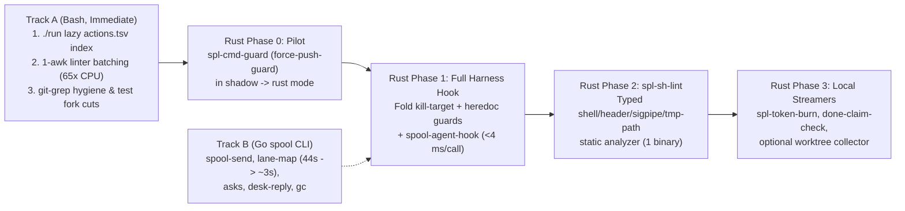

# Rust Candidates Analysis: Shell Performance, Complexity, and Pilot Plan

- **Version:** `v0.4 (rc3)`
- **Status:** Release candidate 3 for panel review and sign-off (analysis only; no code or conversion issues)
- **Issue:** `SPL-5274` (Epic `SPL-2402`)
- **Spec:** `csi-spl-doc/specs/011-spool-project-refactor` ([spec.md](spec.md))
- **Discussion:** `/t/fc3b7ac3-54cd-4ac4-84b4-5528647fca12`
- **Baseline commit:** `9cda5fdaeb5c2850c091927b8bcd19f305846881` (`origin/master`; Rust startup and single-`awk` ratios also verified on `c10b3ce97`)

This repository holds 2,314 shell scripts (362,133 lines) and 99 Python helpers (25,485 lines) beside 1,938 Go files (398,703 lines) that build the 66.8 MB `spool` CLI. Measurements across two 16-core fleet boxes show 90,281 to 112,308 process starts per minute alongside 45% kernel `sys` CPU (`n = 1`, `30 s`) on `sat`, pointing to process creation rather than Bash syntax speed as the main machine tax. Thin wrappers around `gcloud`, `docker`, `terraform`, and `git` spend over 95% of wall time in external tools, so rewriting them saves nothing. Two cheap Bash fixes pay off first with no new compiler: a lazy action index for `./run` (`1.00 s` CPU and `162` processes per start across `12,293+` logged `orc` runs/day and `185.7 h/week` of Bash push-gate tests) and collapsing per-file `awk` loops into one `awk` call (`bash-cleancode.tst.sh` drops `65x` in CPU, from `2.36 s` and `1,245` processes to `36.4 ms` and `2` processes in Bash alone). Actions that speak hub HTTP, Ed25519 signing, or ask and desk JSON (`spool-send.sh`, `lane-map`, `asks`, `desk-reply`, `gc`) belong in the existing Go `spool` binary. Rust fits stateless per-call command security guards, harness hooks, typed shell analyzers, and local stream scanners—where `spool` (`446` Go package inits, `155.5 ms` startup under load) is too heavy and Python cold starts (`64.7–113.5 ms` CPU and `9–11` processes per shell call in `force-push-guard-hook.sh`) cannot be batched. We recommend one pure-Rust pilot first: `spl-cmd-guard` backing `force-push-guard-hook.sh` in fail-closed `shadow` mode, where Python stays authoritative until 10,000 real calls match 100%.

---

## 1. Shell Inventory and Ranked Candidate Table

### 1.1 Repository Shell Inventory

All counts below were measured on commit `9cda5fdaeb5c2850c091927b8bcd19f305846881` over tracked files (`git ls-files`). The inventory script counts `.sh` and `.bash` files plus extension-less files carrying a `#!/...sh` or `#!/...bash` shebang. Files matching `*.tst.sh`, `*/tests/*`, or `*/test-*` are classified as test scripts.

| Sub-project | Prod shell files | Prod shell lines | Test shell files | Test shell lines | Total shell files | Total shell lines | Primary role |
|---|---:|---:|---:|---:|---:|---:|---|
| `csi-spl-orc` | 962 | 148,509 | 816 | 144,038 | 1,778 | 292,547 | Fleet orchestration, spawn, crons, desk, watchdogs |
| `csi-spl-iac` | 189 | 21,110 | 239 | 30,122 | 428 | 51,232 | Pre-push deploy gate, static linters, CI/GCP provisioning |
| `csi-spl-utl` | 36 | 6,561 | 21 | 5,112 | 57 | 11,673 | Workdir sweeps, local utility actions |
| `csi-spl-doc` | 12 | 2,615 | 3 | 628 | 15 | 3,243 | Spec-kit helpers and doc checks |
| `csi-spl-api` | 8 | 573 | 25 | 2,457 | 33 | 3,030 | Offline Go toolchain and module-cache build wrappers |
| `csi-spl-rdb` | 0 | 0 | 1 | 196 | 1 | 196 | SQL migration test wrapper |
| `csi-spl-cnf` | 0 | 0 | 1 | 149 | 1 | 149 | Config test wrapper |
| `csi-spl-wui` | 1 | 63 | 0 | 0 | 1 | 63 | WUI helper script |
| **Total (shell)** | **1,208** | **179,431** | **1,106** | **182,702** | **2,314** | **362,133** | **All tracked shell scripts** |
| *Comparison: Python (`.py`)* | *99 (all)* | *25,485* | *—* | *—* | *99* | *25,485* | *Embedded CLI, gate, and stream helpers under `src/bash/`* |
| *Comparison: Go (`.go`)* | *1,938 (all)* | *398,703* | *—* | *—* | *1,938* | *398,703* | *Hub server + `spool` CLI (`66.8 MB` stripped binary, `spool 1.1.3`)* |

> **Binary size and structural totals:** `csi-spl-api/src/bash/build.sh:44` holds an older comment citing `42.2 MB` (`CLE-35076`). Measured via `stat -Lc '%s'` on 2026-11-11, the installed `spool 1.1.3` binary is `66,752,777` bytes (`66.8 MB`) on the desk box and `66,773,257` bytes (`66.8 MB`) on `sat`. Across the production `.sh`/`.bash` files (`1,195` extension-matched prod files, `177,676 L`), regex structural scan counts **`6,922` functions, `18,934` branch keywords, `12,236` pipes, `16,382` `$()` command substitutions, `826` `python`, `862` `awk`, and `1,374` `jq` call sites**. The eight largest single production files are `spl-dispatch-lease.func.sh` (`2,740 L`, `141 fn`, `304 $()`), `spl-watchdog.func.sh` (`2,170 L`, `126 fn`, `260 $()`), `spl-rotate-lib.func.sh` (`1,623 L`, `93 fn`, `177 $()`), `spl-spawn-place.func.sh` (`1,480 L`, `64 fn`, `235 $()`, `75 jq`), `check-pre-push.func.sh` (`1,352 L`, `64 fn`, `111 $()`), `spool-install/install.sh` (`1,142 L`, `34 fn`, `108 $()`), `spl-dispatch-rotate.func.sh` (`1,114 L`, `53 fn`, `133 $()`), and `spool-env.inc.sh` (`1,110 L`, `62 fn`, `98 $()`).

Reproducible inventory command (`n = 1`, deterministic on `9cda5fdaeb5c2850c091927b8bcd19f305846881`):

```bash
python3 - <<'PY'
import os, subprocess
files = subprocess.check_output(["git", "ls-files"], text=True).splitlines()
sh = []
for f in files:
    if not os.path.isfile(f) or os.path.islink(f): continue
    if f.endswith((".sh", ".bash")): sh.append(f)
    else:
        with open(f, "rb") as fh: b = fh.readline(128)
        if b.startswith(b"#!") and (b"bash" in b or b"/sh" in b): sh.append(f)
is_tst = lambda f: f.endswith(".tst.sh") or "/tests/" in f or "/test-" in f
pf = pl = tf = tl = 0
for f in sh:
    txt = open(f, errors="replace").read()
    n = txt.count("\n") + (1 if txt and not txt.endswith("\n") else 0)
    if is_tst(f): tf += 1; tl += n
    else: pf += 1; pl += n
print(f"TOTAL={len(sh)} ({pl+tl} L) PROD={pf} ({pl} L) TEST={tf} ({tl} L)")
PY
```

Output on `9cda5fdaeb5c2850c091927b8bcd19f305846881`:

```text
TOTAL=2314 (362133 L) PROD=1208 (179431 L) TEST=1106 (182702 L)
```

### 1.2 Execution Cadence Across the Fleet

1. **Every agent tool call (`~54,000` hook events/day on `sat`, measured as `376` events in `10 min` across seat `heartbeat.log` files):** `spool-agent-hook.sh` runs on `PreToolUse`, `PostToolUse`, `UserPromptSubmit`, and `Stop`. On every shell `PreToolUse` call (`7,657` foreground Bash calls/24h on the desk box; higher on `sat`), `force-push-guard-hook.sh` also runs—spawning 2 to 4 `python3` processes (`force-push-guard.inc.sh` on **every** shell call, plus `kill-target-guard.inc.sh` whenever the command contains `kill` or `send`, plus `heredoc-collision-guard.inc.sh` on `<<`).
2. **Installed crontabs (`34,953` scheduled runs/day on `sat` across `64` entries):** While `csi-spl-orc/cnf/box-crons/box-crons.manifest` lists 14 every-minute entries, inspecting both installed user crontabs (`sudo crontab -u <box-user> -l` and `sudo crontab -u <agent-user> -l`) on `sat` shows **64 active entries totaling `34,953` runs/day**: **20 every-minute jobs** (`wd-start`, `unanswered-sweep`, `spawn-remote`, `spawn-place`, `review-go`, `poll-ack`, `gh-runner-cpu-budget`, `uplink-probe`, `token-burn`, `rel-tmux-health`, `rel-external-api`, `rel-box-beat`, `push-orphan-check`, `lane-rotate`, `gc`, `file-streams`, `box-save-sessions`, `box-link-watch`, `agent-login-check`, `agent-identity-reconcile`), **2 every-3-minute jobs**, and **16 every-5-minute jobs**. On `2026-11-10`, `csi-spl-orc` logged **`12,293` `./run` action starts** on `sat` (`grep -c 'do_run_actions: actions='`), a lower bound because quiet actions skip file logging. Besides crons, `do_spl_watchdog` runs 3 persistent `WD_TICK=30s` background loops.
3. **Every inter-agent message and desk reply (`~500+x/day/box`):** `spool-send.sh` (`379` foreground calls/24h on the desk box, plus cron sends; also triggers `*send*` in `kill-target-guard` when run by an agent!) and `do_spl_desk_reply` (`116` calls/24h).
4. **Every git push and CI run (`15,274` executed gate part runs = `418.6 h` in 7 days on `sat`, `SKIP` and `PASS-cached` excluded):** Triggered by the worktree `pre-push` hook and `.github/workflows/10_ci-quality.yml`:
   - `orc` (`119.4 h/7d`), `orc-features` (`46.2 h/7d`), and `iac` (`20.1 h/7d`) Bash test suites account for **`185.7 h/week` (`44.4%` of all gate wait)** on `sat`.
   - `check-dist-hygiene.func.sh` runs on **every push** (`1,202` runs, `5.5 h/7d`), even under `SPL_PREPUSH_OVERRIDE=1`.
   - `gcloud-account-pinned.tst.sh` runs whole-tree on **every non-override push** (`iac` suite, or `iac-cross` `_PPX_MAP` `.` rule on `919` runs / `2.8 h/7d`).
   - `bash-cleancode.tst.sh` walks all `1,182` `.sh` files under its 8 `ROOTS` (`tests/` and `node_modules/` excluded, `6,794` functions—distinct from the inventory's `1,208` whole-repo prod count) on **every `orc` push** (`check-pre-push.func.sh:667`), **every `iac` push**, and CI workflow 10.
   - `action-header-tags.tst.sh` runs whole-tree on **every `iac` push** (`78` runs/7d) and CI workflow 10 `iac-suite`.
   - `sigpipe-lint.sh` (`lint-sigpipe`) runs **only on touched `.sh` files** (`check-pre-push-lint.func.sh:277, 422`; `375` runs, `0 s` median, **`0.1 h/7d`**), never whole-tree.

### 1.3 Ranked Candidate Table (Top 23 Candidates)

Line counts (`wc -l`), complexity counts (`fn`, `br`, `$()`, `py/jq/awk`), and test references were measured on `9cda5fdaeb5c2850c091927b8bcd19f305846881`. Every unmeasured post-change latency, speedup ratio, and target LOC is marked `est.`. Candidates are ranked by **net practical value** (real wait/CPU saved + complexity retired minus operational blast radius), separating cheap Bash fixes from Rust and Go targets.

| Rank | Candidate (`path` / action) | Size & complexity (`LOC`, `fn`, `br`, `$()`, `py/jq/awk`) | Actual run cadence | Measured baseline (`9cda5fdae`, CPU + procs + wall) | Dominant cost | Est. speed gain | Complexity cut | Fleet / prd risk | Shell tests today | Est. rewrite size | Best-fit target |
|---:|---|---|---|---|---|---|---|---|---:|---|---|
| **1** | `force-push-guard-hook.sh` + `force-push-guard.inc.sh` + `kill-target-guard.inc.sh` + `heredoc-collision-guard.inc.sh` | `138 + 430 + 515 + 102 = 1,185 L`, `4` Python `json`/`shlex` scripts | **Every agent shell tool call** (`>7,600–27,000x/day/box`) | Ordinary cmd: `64.7 ms` CPU, `9` procs (`71.3 ms` desk); `*kill*`/`*send*` cmd: `113.5 ms` CPU, `11` procs (`109.0 ms` desk) | **2 to 4 sequential `python3` cold starts** (`29–38 ms` each) per tool call; unbatchable in Bash | **`est. ~15x–25x`** (`est. <4 ms` wall, `1` proc vs `9–11` procs) | **Very High** (replaces 4 Bash+Python tokenizers/hooks with 1 pure-Rust lexer + JSON reader) | **Low in `shadow` mode** (Python stays authoritative during burn-in; fail-closed fallback) | 10 (`force-push-guard.tst.sh`, `kill-target-guard.tst.sh`, `heredoc-collision-guard.tst.sh`, `y13`) | `est. ~450` LOC (Pilot) / `~850` LOC (all 3) | **Rust (PILOT: `spl-cmd-guard`)** |
| **2** | `orc` + `orc-features` + `iac` Bash test suites in `do_check_pre_push` | `1,106` test files, `182,702 L` | `726` suite runs/7d on `sat` (**`185.7 h/week` = `44.4%` of all push-gate wait**) | `orc` med `469 s` (`p90 3,680 s`); `desk-move.tst.sh` = **`39,886` procs** (`18.9 min`), `lane-rotate.tst.sh` = **`35,892` procs** (`6.3 min`) on `sat` | Process starts (`36k–40k` procs/file: `./run`, `jq`, `awk`, subshells) + test sleeps | **`est. ~2x–4x`** likely via Rank #3 `./run` index + inner helper consolidation | **Medium** (keep tests in Bash; speed up `./run` and inner helpers they call) | **None** (test suites only) | 1,106 | Shape fix (not a test rewrite) | **Bash shape fix (#3) + Go/Rust inner helpers** |
| **3** | `csi-spl-orc/run` + `csi-spl-iac/run` (`do_load_functions` + `do_run_log_tee`) | `669 L` each; `orc` sources `695` `*.func.sh` (`111,115 L`, `4,619` fns) per call | `>= 12,293` logged `orc` starts/day on `sat` + every test `./run` | `orc`: `1,002.0 ms` CPU, `162` procs (`960 ms` desk; **`~4.3 s` med wall `sat`**, `3,672..5,271 ms`, `n=5`); `iac`: `1,085.8 ms` CPU, `291` procs | Eager `find` + `source` of 695 unused `.func.sh` files + `tee`/`sed` log pipes | **`est. ~12x`** (`est. <80 ms` CPU via generated `actions.tsv` lazy-load map) | **Medium** (small Bash index removes `1.0 s` CPU / `~4.3 s` `sat` wall floor everywhere) | **Medium** (cross-file helper calls need fallback `source` on missing fn) | 1 direct (`run-log.tst.sh`) + all suites | `est. ~80` LOC Bash + generator | **Bash shape fix first (Tier C0)** |
| **4** | `spl-lane-map.func.sh` + `lane-map.sh` | `778 + 107 = 885 L`, `32 fn`, `70 br`, `195 pipes`, `95 $()`, `31 jq` | Every edit check (`--check`), `152` cron + fg runs/day | Desk: `7.69 s` CPU (`5.23 s` `sys`), `1,290` procs (`8.89 s` live); `sat` (129 wts): **`44.4 s` med wall, `1,683` procs** (`11.3 s` `sys`) | **>1,300 Bash subshell forks** (`$()`, pipes) + `143 jq` + `74 git` calls; hub HTTPS is ~15% | **`est. ~8x–15x`** (`44.4 s -> est. ~3 s` on `sat`; `8.9 s -> est. ~1.2 s` desk) | **High** (eliminates per-worktree subshell loops and 31 `jq` pipelines) | **Medium** (collision safety gate `exit 3/4/5` for all lanes) | 27 | `est. ~800` LOC Go | **Go (`spool lane map`)** |
| **5** | `csi-spl-iac/src/bash/tests/bash-cleancode.tst.sh` | `135 L`, `awk` function-length scanner over `1,182` 8-root `.sh` (`6,794` fns) | Every `orc` push (`check-pre-push.func.sh:667`), every `iac` push, CI wf 10 | Today: `2,363.5 ms` CPU, `1,245` procs (`2.38 s` desk; **`12.07–23.4 s` `sat`**). **1-`awk` Bash fix: `36.4 ms` CPU, `2` procs (`24.9 ms` desk; `569–1,870 ms` `sat`)** | `1,182` per-file `awk` forks (**98% removed by 1-`awk` Bash fix!**); regex brace heuristics (`r8-04`/`r9-05`) | **`65x` CPU via 1-`awk` Bash**; then **`est. ~2x–3x` more** (`est. <15 ms`) in Rust | **High in Rust** (replaces regex brace/quote heuristics with real shell lexer) | **None** (static test gate only) | 3 (9 built-in `CONTROL` cases) | `5 L` Bash first; `est. ~250` LOC Rust (`spl-sh-lint`) | **Bash 1-`awk` now -> Rust `spl-sh-lint` (Phase 2)** |
| **6** | `csi-spl-iac/src/bash/tests/gcloud-account-pinned.tst.sh` | `277 L`, whole-tree `gcloud` account-pinning static rule scanner | **Every non-override push** (`iac` or `iac-cross` `.` rule: `997` runs/7d) + CI | `3,516.5 ms` CPU (`1,052.1 ms` `sys`), `569` procs, `rc=0` (`2.24 s` desk) | Per-file `grep`/`awk` forks (`569` procs) across shell files | **`est. ~15x` batched sh / `~50x` Rust** (`est. ~40 ms`) | **Medium-High** (folds `gcloud` flag/env static checks into `spl-sh-lint`) | **None** (static test gate only) | 3 | `est. ~300` LOC Rust | **Bash batching -> Rust `spl-sh-lint` (Phase 2)** |
| **7** | `csi-spl-iac/src/bash/tests/action-header-tags.tst.sh` | `135 L`, multi-file `@description` / `@param` / `@example` tag parser | Every `iac` push (`78` runs/7d) + CI wf 10 `iac-suite` | `9,312.3 ms` CPU (`2,366.6 ms` `sys`), `891` procs, `rc=0` (`10.02 s` desk) | Per-file `awk`/subshell forks across `878+` action files | **`est. ~20x` 1-`awk` / `~120x` Rust** (`est. ~75 ms`) | **High** (typed header parser + baseline ratchet in one pass) | **None** (static test gate only) | 1 (`action-header-tags.tst.sh`) | `est. ~350` LOC Rust | **Bash 1-`awk` -> Rust `spl-sh-lint` (Phase 2)** |
| **8** | `csi-spl-iac/src/bash/run/check-dist-hygiene.func.sh` + wf 10 `Sweep` | `64 L` sh + `120 L` YAML `grep -P` rules | **Every push** (`1,202` runs = `5.5 h/7d` on `sat`, incl. override) + CI | `1,183.7 ms` CPU (`851.6 ms` `sys`), `72` procs, `rc=0` (`649 ms` desk; `15 s` med `sat`) | `git ls-files \| tar \| tar` temp-tree disk copy + multiple `grep -P` sweeps | **`est. ~5x` via `git grep -P` / `~10x` Rust** (`est. ~60 ms` `RegexSet`) | **Medium** (drops temp export I/O; must read rules from workflow YAML) | **Low** (must keep workflow YAML as single source) | 19 | `est. ~20` LOC sh or `~450` LOC Rust | **Bash `git grep` first; optional Rust `spl-sh-lint`** |
| **9** | `csi-spl-orc/src/bash/features/spawn-agents/scripts/spool-agent-hook.sh` | `712 L`, `2 fn`, `154 br`, `exec python3 -S` with C `_json` scanner | `~54,000` hook events/day on `sat` (`~1.5 h/day` wall) | Desk: `37.1 ms` CPU, `1` proc (`39–41 ms` wall); `sat`: `7–9` procs, **`95 ms` Pre / `154 ms` Post** med | `python3 -S` startup (`~29–38 ms`) + inbox/heartbeat file checks | **`est. ~10x–20x`** (`est. ~3–5 ms`/call; latency win per tool step) | **High** (retires C `_json` scanner hack; merges with Rank #1 in Phase 1) | **Medium-High** (touches heartbeat, inbox poke, loop guard on live seats) | 10 (`perf-agent-hook.sh`, `test-agent-hook*.sh`) | `est. ~850` LOC Rust | **Rust (`spl-agent-hook`, Phase 1)** |
| **10** | `spool-send.sh` + `spool-env.inc.sh` (`spawn-agents/`) | `645 + 1,110 = 1,755 L`, `76 fn`, `147 br`, `150 $()` | `379` fg calls/24h desk + cron sends (`1.2%` of all box PIDs on `sat`) | Desk: `260.4 ms` CPU (`106` procs) vs `61.4 ms` `spool send`; `sat`: **`2,028 ms` (`135` procs) vs `285 ms` (`16` procs)** | Wrapper is **86% of local send wall** (sourcing 6 `.inc.sh` libs + policy guards) | **`est. ~5x–7x` local** (`2,028 ms -> ~285 ms` on `sat` by folding guards into `spool`) | **High** (moves policy/owner-order guards next to wire/signing in `spool`) | **High** (all inter-agent messaging depends on it) | 62 (`spool-send.sh`), 47 (`spool-env.inc.sh`) | `est. ~700` LOC Go | **Go (`spool send`)** |
| **11** | `csi-spl-orc/src/bash/run/spl-watchdog.func.sh` (`do_spl_watchdog`) | `2,170 L`, `126 fn`, `260 $()` | 3 persistent loops (`WD_TICK=30s`) | **`9.4%` of all sampled PIDs on `sat` (`3,361 / 35,756` in 60s; `22%` of attributed PIDs)** | Subshell/`tmux`/`ps` fork loops every 30 s across all panes (single-tick isolated count still needed) | **Measure 1 isolated tick first** (`WD_TICKS=1` on throwaway state); `est. ~3x–5x` fewer forks | **Medium if state/proc collector extracted**; poor fit for full `tmux` rewrite | **Critical** (live agent recovery daemon) | 29 | Measure first; `est. ~500` LOC Go/Rust collector | **Measure 1 tick -> cut Bash forks / Go-Rust collector** |
| **12** | `spl-lane-rotate.func.sh` + `spl-rotate-lib.func.sh` + `spl-agent-restart.func.sh` | `1,003 + 1,623 + 965 = 3,591 L`, `195 fn`, `418 $()` | Every 1 min cron: **`1,758` runs/day = `27,258 s` (`7.6 h/day`)** on `sat` | Cron med **`9 s`** (`p90 36 s`) on `sat`; fg med `2.5 s` desk | `./run` floor (`~4.3 s` wall on `sat`) + `/proc`/`tmux`/git state forks | **`est. ~2x–3x`** via Rank #3 `./run` index + batched `/proc`/`tmux` reads | **Low for full rewrite** (tightly bound to `tmux` panes and vendor CLIs) | **Critical** (hourly 60-min session handoff) | 19 (`rotate-lib`) + `lane-rotate.tst.sh` | Keep `tmux` glue in Bash | **Bash `#3` `./run` index + fork batching** |
| **13** | `csi-spl-iac/src/bash/scripts/sigpipe-lint.sh` (`lint-sigpipe`) | `130 L`, `0 fn`, hand-rolled `awk` quote/heredoc/pipe state machine | **Touched `.sh` files only** (`375` runs = **`0.1 h/7d`** on `sat`, `0 s` med) | `29.5 ms` CPU, `2` procs, `rc=0` per file (`29.8 ms` desk; `85.9 ms` `sat`); `rc=1` on legacy tree | 1 `awk` fork per touched file; fragile regex quote/heredoc lexer | **`est. ~10x` per file** (`est. <3 ms`); **parser safety, not box speed**, is the win | **High** (retires fragile `awk` quote/heredoc state machine into `spl-sh-lint`) | **None** (dev/CI lint only) | 2 (`sigpipe-lint.tst.sh`: `119 L`, 8 cases + mutation) | `est. ~300` LOC Rust | **Rust (`spl-sh-lint sigpipe`, Phase 2)** |
| **14** | `csi-spl-orc/src/bash/run/spl-token-burn-collect.func.sh` | `531 L`, `16 fn`, `115 br`, `84 pipes`, `2 py`, `4 jq`, `4 awk` | Every 1 min (`* * * * *`, `1,440x/day/box`) | `1,331.5 ms` CPU, `157` procs (`1,310 ms` desk: `960 ms` `./run` + `350 ms` JSONL scan) | `73%` `./run` startup (Rank #3); `27%` Python/jq JSONL cursor scan | **`est. ~4x` via `#3` alone**; **`est. ~25x`** (`est. ~50 ms`) as standalone Rust cron | **High** (`serde_json` byte-offset reader replaces 531 L of Bash/Python/jq) | **Low** (telemetry collector; non-blocking) | 3 (`spl-token-burn-*.tst.sh`) | `est. ~450` LOC Rust | **Bash `#3` now -> Rust `spl-token-burn` (Phase 3)** |
| **15** | `csi-spl-orc/src/bash/run/spl-done-claim-check.func.sh` | `959 L`, `39 fn`, `109 br`, `43 pipes`, `103 $()`, `23 awk` | Every 5 min (`285` runs/day = **`7,127 s` / `2.0 h/day`** on `sat`, `1.5%` of PIDs) | Cron med **`14 s`** (`p90 52 s`) on `sat` | `./run` floor + `23` `awk` & `103` `$()` forks + `git` checks | **`est. ~4x–8x`** (`14 s -> est. ~2–3 s`) | **Medium-High** (replaces `959 L` of `awk`/subshell claim verification) | **Low-Med** (audit/alert cron) | 1 (`spl-done-claim-check.tst.sh`) | `est. ~650` LOC Rust or Go | **Rust or Go (Phase 3)** |
| **16** | High-frequency `orc` audit crons: `agent-login-check`, `issue-close-landed`, `uplink-probe` | `3` actions (`1,422` + `575` + `1,326` = `3,323` runs/day on `sat`) | Every 1–5 min (**`26,804 s` = `7.4 h/day`** combined wall on `sat`) | Medians `6 s`, `5 s`, `5 s` on `sat` (mostly `./run` `4.3 s` floor!) | `70%–85%` of median wall is `orc ./run` eager-loading 695 files | **`est. ~3x`** immediately from Rank #3 `./run` lazy index | **Low** (`issue-close-landed.py` is already Python) | **Low-Med** | Covered by per-action `.tst.sh` | `0` LOC beyond Rank #3 | **Solved primarily by Bash `#3` `./run` index** |
| **17** | `csi-spl-iac/src/bash/run/check-pre-push-lint.func.sh` + `.py` linters | `600 L` sh (`44 fn`, `65 br`, `18 py`) + `config-syntax-check.py`, `tmp-path-lint.py` | Every push (`do_check_pre_push` fast tier, touched files) | `~1.5–12 s` wall depending on touched files | Per-check `python3` / `awk` startups on touched files | **`est. ~3x–5x`** on pure-repo checks (`shellcheck`/`trufflehog`/`gitleaks` stay external) | **Medium** (folds `lint-tmp-path`, `lint-mdlinks`, `lint-migration` into `spl-sh-lint`) | **Low** (`PRE_PUSH_LINT=0` rollback exists) | 7 | `est. ~750` LOC Rust incremental | **Rust (`spl-sh-lint` subcommands, Phase 2)** |
| **18** | `csi-spl-orc/src/bash/run/spl-lane-mix.func.sh` | `631 L`, `29 fn`, `76 br`, `45 $()` | Every spawn placement + `lane-mix` checks | `2,355.7 ms` CPU (`1,183.8 ms` `sys`), `426` procs (`2.15 s` wall desk) | `./run` startup (`1.00 s` CPU) + `264` subshell/grep path-rule forks | **`est. ~8x` via `#3` + batching**; **`est. ~40x`** (`est. ~50 ms`) in Go/Rust | **Medium** (deterministic glob/table rule engine) | **Low-Med** (vendor routing policy) | 5 | `est. ~350` LOC Go or Rust | **Go (`spool`) or Rust** |
| **19** | `csi-spl-orc/src/bash/run/spl-gc.func.sh` | `619 L`, `44 fn`, `55 br`, `100 $()`, `7 jq`, `11 awk` | Every 1 min cron (`1,541 s/d` `sat` + `2,034 s/d` fg desk) | `1,134.5 ms` CPU, `197` procs empty; `4.3–6.0 s` live median | `./run` startup + per-inbox/archive `stat`/`jq`/`awk` forks | **`est. ~5x–8x`** (`est. ~0.6 s` via native `readdir` + JSON in `spool`) | **Medium** (replaces 100 `$()` + `jq`/`awk` loops with 1 walk) | **Medium** (prunes spool dirs; `DRY_RUN=1` parity required) | 1 (`gc-agent.tst.sh`) | `est. ~550` LOC Go | **Go (`spool gc`)** |
| **20** | `spl-asks-tick.func.sh` + `do_spl_asks_open` / `do_spl_ask_ack` | `535 L`, `27 fn`, `56 br`, `90 $()`, `23 jq` | `50` `ask_ack` (`21.9 s` med) + `22` `asks_open` (`7.7 s` med) / 24h desk | `1,085.4 ms` CPU, `173` procs local 200-ask book; `7.7–21.9 s` live | `./run` (`1.00 s` CPU) + `jq` forks + sequential hub `spool` round-trips | **`est. ~3x–5x`** (batching hub calls + native JSON merge in `spool`) | **High** (retires 23 `jq` pipelines and local/hub glue) | **Medium** (dispatcher ask ledger) | 18 | `est. ~600` LOC Go | **Go (`spool ask`)** |
| **21** | `csi-spl-orc/src/bash/run/spl-desk-reply.func.sh` | `607 L`, `16 fn`, `72 br`, `9 py` | `116` fg calls/24h desk (`5.6 s` med, `p90 12.0 s`) | `5.6 s` live median (`~1.0 s` `./run` + 9 Python pickers/guards + hub I/O) | `./run` startup + multiple `spool` + Python calls + hub HTTPS | **`est. ~2x–3x`** (`est. ~2.0 s`; remaining wait is hub HTTPS) | **High** (folds 9 inline Python blocks + topic-stealing guards into `spool`) | **High** (human-facing WUI DM replies) | 35 | `est. ~700` LOC Go | **Go (`spool desk reply`)** |
| **22** | `check-pre-push.func.sh` (`1,352 L`) + `spl-spawn-place` / `spawn-remote` / `spawn-window` (`2,937 L`, `85 jq`) | `4,289 L` combined orchestration | Every git push + every-minute spawn queue (`17.3 s` med) | `check-pre-push` override: `10.82 s` CPU, `1,356` procs; `spawn_queue`: `17.3 s` med | Child suites (`orc`/`wui`/`api`), `git worktree`, `ssh`, `tmux`, plus `85 jq` forks | **`est. ~2x–3x` on fast path** by speeding leaves (`#2,#3,#5–#8`); `~1.5x` on spawn | **Good if JSON/leaves move; bad if OS/`tmux` glue rewritten** | **High** (trunk deploy gate + fleet placer) | 32 + 25 | Keep Bash orchestrators; `est. ~600` LOC Go for spawn JSON | **Keep Bash orchestrators; Go/Rust leaves** |
| **23** | `spl-dispatch-lease.func.sh` + `spl-dispatch-rotate.func.sh` (`3,854 L`) + `tmux-close-window.sh` + `install.sh` (`2,245 L`) | `6,099 L` combined (`265 fn`, `633 br`, `24 jq`, `15 py`) | `lease`: `220` fg/24h (`1.7 s` med) + cron (`4.2%` of `sat` PIDs); `close`: `22`/24h | `LEASE_CMD=show`: `1,064.3 ms` (`960 ms` `./run` + **`~104 ms` lease read**); `close`: `8.7 s` (`--defer` sleep) | `90%` `./run` eager-load on `show`; intentional timer/`git`/`sudo` on `close`/`install` | **`est. ~6x` on `lease show` via `#3` `./run` fix alone**; `~1.0x` on `close`/`install` | Porting `141` failover functions to a new language now carries unacceptable risk | **Critical** (`c-001..c-003` cross-box failover) | 41 + 30 | Do not port | **Stay Bash (apply `#3` `./run` lazy load only)** |

### 1.4 Shell-Shape Fixes vs Language Rewrites — and the Control Group Where Rewrites Save ~0%

1. **Critical Panel Finding — Per-file `awk` loops are a shell-shape bug, not a language ceiling (`c-565` + editor verification):**
   `bash-cleancode.tst.sh` (`lines 44–51`) and `sigpipe-lint.sh` (`line 32`) run `for f in "$@"; do awk ... "$f"; done`, forking one `awk` process per file. Passing all `1,182` walked `.sh` files to **one `awk` invocation** (`FNR==1 { n = "" }`, using `FNR` and `FILENAME`) produces **byte-identical output (`6,794` lines, `exact_match=True`)**:
   - **Desk box (`load 5.4–5.8`):** `2,363.5 ms` CPU / `1,245` procs / `2,381.9 ms` wall -> **`36.4 ms` CPU (`30.1 ms` usr + `6.3 ms` sys) / `2` procs / `24.9 ms` wall** (**`65x` CPU cut, `95x` wall cut**).
   - **`sat` under load:** `12,068 ms -> 569 ms` median wall (**`21.2x` wall cut** at `load 136–151`, `n = 5`, `c-565`), and `23.4 s -> 1.87 s` median wall (**`12.5x` wall cut** at `load 118–135`, `n = 3`, `c-553`).
   - **Takeaway:** Bank this 5-line Bash fix (and Rank #3's `./run` lazy index) immediately regardless of Rust. Rust's remaining job on static linters is **parser correctness and complexity reduction**, not rescuing `for f` `awk` loops.
2. **Control Group — External I/O Wrappers Where Rewriting Bash Saves ~0% ([lesson-speed-up-measure-first.md](../../doc/md/lesson-speed-up-measure-first.md)):**

| Action / command | 24h calls (desk box) | 24h wait (`s`) | Median (`s`) | What dominates wall time | Why a Rust rewrite does NOT help (and what does) |
|---|---:|---:|---:|---|---|
| `do_spl_db_query` (`40 L` sh) | 196 | 8,418 | 10.5 | 4 `gcloud` starts (key activation + token) + cold Cloud SQL proxy (`~8.7 s`); `psql` is `0.13 s` | Wrapper is 40 lines (`spl-db-query.func.sh`). Keeping one warm Cloud SQL proxy + token per env cuts ~80%. |
| `do_spl_unanswered_sweep` | 30 | 6,150 | 11.6 | Paginated hub HTTPS reads across active topics + outlier stalls (`max 5,817 s`) | Network/hub bound. Server-side filtering or cursor caching fixes it, not client language. |
| `wui`, `api`, `wui-e2e` push parts | 770 / 7d (`sat`) | 721,440 (`200.4 h/7d`) | 540–845 | Node/Nuxt/Vite, `go test -race`, and headless Chrome | Already Node and Go; shell only invokes `pnpm` and `go test`. |
| `git push` / `gh run watch` | 13 / 2 | 1,830 / 616 | 43.8 / 308.0 | Remote git pack transfer, child test suites, and remote CI job runtime | External network/CI wait; tree-pass caching (`PRE_PUSH_SKIP_PASSED=1`) targets the real cost. |
| `do_tf_*` / `docker` actions | < 10 | varies | 15–120+ | `terraform plan/apply`, cloud APIs, container builds | Thin wrappers around `terraform` and `docker`. Stay Bash. |

---

## 2. Measurements: Where Time Really Goes

### 2.1 Box Saturation by Process Creation (`sat`, `9cda5fdae`, `2026-11-11 07:25–08:20Z`, Load `78–147`)

Every wall-time number on a fleet box depends on scheduler contention caused by fork storms. Shell + Performance seat `c-559@sat` measured kernel process creation and CPU split directly from `/proc/stat` on `sat` (16-core `x86_64`, `e2-standard-16`):

| Measure on `sat` (`9cda5fdae`) | Measured value | `n` | Exact command |
|---|---|---:|---|
| **Process starts per 60 s** | **`93,049` / `90,281` / `112,308`** (`1,505–1,872` forks/s) | 3 | `awk '/^processes/{print $2}' /proc/stat` before and after a `60 s` wait |
| **Box CPU split over 30 s** | **`user 53%`, `sys 45%`, `idle 0%`** | 1 | `cpu` aggregate line of `/proc/stat` before and after `30 s` |
| **`uptime` load average** | **`78 .. 147`** on `sat` (vs **`5.4 .. 17.2`** on the desk box) | — | `uptime` during each benchmark window |
| **Top PID spawners (`60 s` sample)** | `do_spl_watchdog` **`9.0%`**, `orc *.tst.sh` **`>10%`**, scratch scripts `6.1%`, `dispatch_lease` `4.2%`, `done_claim_check` `1.5%`, `check_pre_push` `1.5%`, `spawn-remote` `1.4%`, `spool-send` `1.2%`, `lane_map` `1.1%` | `51,530` PIDs | `sudo python3 -I pidrun.py 60` (lower bound: `42.5%` exited before parent read); direct `subtree.py 60` on the 3 `watchdog` loop PIDs counted **`3,361 / 35,756` (`9.4%` of all sampled, `22%` of attributed)** |

A **45% kernel `sys` CPU share** (`n = 1`, `30 s` window; `sys` also covers I/O, page faults, and scheduling) alongside `90k–112k` process starts per minute points to short-lived child process creation—not Bash interpreting loops—as the main box tax. Therefore, every benchmark below reports **the machine, load average, CPU time (`usr + sys`), and process count (`procs`)** alongside wall time.

### 2.2 Largest Shell Wait on the Box: 7 Days of Pre-Push Gate Runs (`sat`, `2026-11-04..11`)

Parsed by `c-559@sat` and verified by `c-553@sat` from `/mnt/data/home/<box-user>/.cache/csi-spl/pre-push.log` (`2026-11-04T07:50Z..2026-11-11T07:50Z`, `n = 44,476` `PART` lines; executed filter `$3=="PART" && $5 !~ /^SKIP|cached/` counts `PASS`, `FAIL`, `WARN-*`, and `PASS-tree` while excluding `SKIP` and `PASS-cached` = **`15,274` executed runs** / `418.6–418.8 h`; `PASS` + `FAIL` alone is `13,462 + 398 = 13,860` runs / `329.5 h`):

| Pre-push gate part | Runs (`7d`) | Median (`s`) | p90 (`s`) | Total hours (`7d`) | Share of `418.6 h` | Underlying runtime |
|---|---:|---:|---:|---:|---:|---|
| `orc` | 357 | 469 | 3,680 | **119.4** | 28.5% | **Bash test suites** (`*.tst.sh`) |
| `wui` | 368 | 845 | 848 | 84.5 | 20.2% | Node / TypeScript / Vitest |
| `api` | 241 | 540 | 3,173 | 76.7 | 18.3% | Go (`go test`) |
| `orc-features` | 291 | 521 | 996 | **46.2** | 11.0% | **Bash feature tests** |
| `wui-e2e` | 161 | 834 | 1,210 | 39.2 | 9.4% | Node + headless Chrome |
| `iac` | 78 | 583 | 1,778 | **20.1** | 4.8% | **Bash test suites** (incl. `cleancode`, `header-tags`, `gcloud-pinned`) |
| `lint-gosec` | 123 | 380 | 659 | 14.7 | 3.5% | External Go scanner |
| `hygiene` | 1,202 | 15 | 25 | **5.5** | 1.3% | **Bash (`tar` copy + `grep -P`)** |
| `lint-trufflehog` | 1,077 | 9 | 15 | 3.1 | 0.7% | External Go/Rust binary |
| `iac-cross` | 919 | 8 | 21 | **2.8** | 0.7% | **Bash (`gcloud-account-pinned.tst.sh` + cross checks)** |
| `commit-links` | 1,090 | 7 | 13 | **2.6** | 0.6% | **Bash + hub CLI** |
| `lint-shellcheck` | 341 | 3 | 14 | 0.6 | 0.1% | External Haskell binary |
| `lint-sigpipe` | 375 | 0 | 2 | **0.1** | 0.02% | **`awk` (`sigpipe-lint.sh` on touched `.sh` only)** |
| **Total (`7` days, `sat`)** | **15,274** *(executed: `PASS`, `FAIL`, `WARN-*`, `PASS-tree`)* | — | — | **418.6** | **100%** | **Bash test suites (`orc`+`orc-features`+`iac`) = `185.7 h` (`44.4%`)** |

**Single-test traces (`n = 1` each on `sat`, `sudo unshare -n -fp --mount-proc`):**
- `desk-move.tst.sh` (`9cda5fdae`, load `80..147`, `07:50–08:09Z`, `165` PASS / `2` 429-backoff timing FAILs under load): **`1,133.9 s` (`18.9 min`) wall**, **`103.9 s` user CPU + `145.1 s` `sys` CPU** (`249.0 s` CPU = `22%` of wall), **`39,886` processes spawned** (`~6.2 ms` CPU/fork).
- `spl-lane-issue.tst.sh` (mixed tree `9cda5fdae -> c10b3ce97`: WUI + 2 `csi-spl-doc/specs/087-*` files changed, `0` `orc` files changed; load `136..147`, `174` PASS / `0` FAIL): **`717.0 s` (`12.0 min`) wall**, **`105.3 s` user CPU + `148.3 s` `sys` CPU** (`253.6 s` CPU = `35%` of wall; process counter lost across session rotation).
- `lane-rotate.tst.sh` (`c10b3ce97` pinned, load `117..126`, `148` PASS / `0` FAIL): **`377.6 s` (`6.3 min`) wall**, **`52.6 s` user CPU + `36.1 s` `sys` CPU** (`88.7 s` CPU = `23.5%` of wall), **`35,892` processes spawned**.
- In all three tests CPU is `22%–35%` of wall and each counted test starts **`35.9k–39.9k` processes** (`sys` exceeds `user` in two of three). The common cost is process starts, not shell interpretation; speeding up `orc` test suites likely comes from cutting `./run` startup (Rank #3) and inner helper forks, not porting 1,106 test scripts to Rust.

### 2.3 Installed Cron Duration (`sat`, `2026-11-10`) and Foreground Agent Wait (Desk Box, `24h`)

**A. Top `csi-spl-orc` cron wall consumers on `sat` (`2026-11-10`, `python3 -I logdur.py` pairing `START` to `run completed` in `csi-spl-orc.20261110.log`, whole-second timestamps):**

| Cron / background `./run` action | Logged runs / day (`n`) | Median (`s`) | p90 (`s`) | Total wall (`s/day`) | Hours / day (`sat`) |
|---|---:|---:|---:|---:|---:|
| `do_spl_lane_rotate` | 1,758 | 9 | 36 | **27,258** | **7.57 h** |
| `do_spl_agent_login_check` | 1,422 | 6 | 17 | **12,153** | **3.38 h** |
| `do_spl_issue_close_landed` | 575 | 5 | 38 | **7,531** | **2.09 h** |
| `do_spl_done_claim_check` | 285 | 14 | 52 | **7,127** | **1.98 h** |
| `do_spl_uplink_probe` | 1,326 | 5 | 7 | **7,120** | **1.98 h** |
| `do_spl_weekly_limit_alert` | 288 | 8 | 19 | 2,937 | 0.82 h |
| `do_spl_lane_map` | 152 | 13 | 36 | 2,840 | 0.79 h |
| `do_spl_release_notes_lag_alarm` | 96 | 22 | 48 | 2,088 | 0.58 h |
| `do_spl_push_orphan_check` | 1,440 | 1 | 3 | 2,068 | 0.57 h |
| `do_spl_gc` | 207 | 6 | 16 | 1,541 | 0.43 h |

**B. Foreground agent wait on the desk box (`9cda5fdae`, `2026-11-10T07:00Z..2026-11-11T07:00Z`, 16 cores, `uptime` load `7–17`, `n = 7,657` calls = `69,059 s` / `19.2 h`):**

Command: `cd csi-spl-orc && SINCE=2026-11-10T07:00:00Z UNTIL=2026-11-11T07:00:00Z CMD_TIME_TOP=25 ./run -a do_spl_cmd_time_report`

> **Row selection note:** All repo `./run` actions and scripts in the top 25 are shown below (plus `#38`, `#39`, `#47`). Ad-hoc non-repo commands in the top 25 are omitted: `#3 <other>` (`21` calls, `7,181 s`), `#6 grep` (`631`, `2,217 s`), `#9 cat` (`1,234`, `1,626 s`), `#10 tail` (`110`, `1,498 s`), `#11 poll-loop grep` (`21`, `1,446 s`), `#16 git add` (`21`, `812 s`), `#19 pnpm run` (`7`, `707 s`), `#20 rm` (`14`, `704 s`), `#21 python3` (`299`, `662 s`), `#23 pwd` (`17`, `629 s`), `#24 gh run watch` (`2`, `616 s`), alongside `#25 do_spl_take` (`20`, `616 s`, `10.6 s` med, hub claim).

| # | Repo action / script | Calls (`n`) | Total wait (`s`) | Share (`%`) | Median (`s`) | p90 (`s`) | Dominant bottleneck |
|---:|---|---:|---:|---:|---:|---:|---|
| 1 | `do_spl_db_query` | 196 | 8,418 | 12.2 | 10.5 | 17.2 | `gcloud` auth + cold Cloud SQL proxy (external I/O) |
| 2 | `do_spl_ask_ack` | 50 | 7,226 | 10.5 | 21.9 | 55.0 | `./run` startup + sequential hub `spool` calls + `jq` |
| 4 | `do_spl_unanswered_sweep` | 30 | 6,150 | 8.9 | 11.6 | 19.2 | Hub HTTPS topic/post queries |
| 5 | `do_check_pre_push` | 27 | 2,782 | 4.0 | 12.1 | 283.6 | Fast tier: `1,356+` forks; slow tail: child test suites |
| 7 | `do_spl_gc` | 329 | 2,034 | 2.9 | 4.3 | 10.8 | `./run` startup + per-file `stat`/`jq`/`awk` forks |
| 8 | `git push` | 13 | 1,830 | 2.7 | 43.8 | 486.6 | `pre-push` hook gate + remote git pack transfer |
| 12 | `do_spl_spawn_queue` | 54 | 1,138 | 1.6 | 17.3 | 41.7 | Hub issue/ask round-trips + `./run` + `jq` |
| 13 | `do_spl_dispatch_lease` | 220 | 1,073 | 1.6 | 1.7 | 4.0 | `./run` startup (`1.00 s` CPU) + hub lease read |
| 14 | `do_spl_push_master` | 44 | 1,004 | 1.5 | 1.9 | 27.2 | Fast-forward ref check + `pre-push` gate |
| 15 | `spool-send.sh` | 379 | 935 | 1.4 | 1.8 | 3.8 | `106–135` local wrapper forks + hub relay + poke |
| 17 | `do_spl_desk_reply` | 116 | 773 | 1.1 | 5.6 | 12.0 | `./run` (`1.00 s` CPU) + 9 Python guards/pickers + hub I/O |
| 18 | `do_spl_asks_open` | 22 | 772 | 1.1 | 7.7 | 16.3 | `./run` (`1.00 s` CPU) + `jq` merge + hub read |
| 22 | `do_spl_lane_rotate` | 194 | 643 | 0.9 | 2.5 | 5.8 | `./run` (`1.00 s` CPU) + `tmux` + worktree/hub state |
| 38 | `tmux-close-window.sh` | 22 | 347 | 0.5 | 8.7 | 19.6 | Deferred close timer + lane-map/git checks |
| 39 | `lane-map.sh` | 37 | 333 | 0.5 | 10.1 | 15.8 | **85% local worktree/subshell forks (`7.69 s` CPU)**, 15% hub read |
| 47 | `do_check_dist_hygiene` | 24 | 208 | 0.3 | 7.6 | 18.4 | `./run` + `tar` tracked-tree copy + `grep -P` sweeps |

### 2.4 Controlled Microbenchmarks Across Both Load Regimes (Desk Box `load 5.4–17.2` vs `sat` `load 78–151`)

Each probe ran on commit `9cda5fdaeb5c2850c091927b8bcd19f305846881` inside an isolated PID namespace (`unshare -r --pid --fork`) against `SPOOL_TEST=1` throwaway inputs (`2026-11-11 07:25–08:20Z`). Desk `procs` (`ns_last_pid - 1`) subtracts 1 so an empty `true` run reads `1`, whereas `sat` `nsfork.sh` `procs` includes ~5 setup processes (`true` reads `procs=6`). Where `c-553@sat`, `c-559@sat`, or `c-565@sat` also timed the target on `sat`, both load regimes are shown side by side:

```bash
uptime
unshare -r --pid --fork python3 -c '
import resource, subprocess, sys, time
t0 = time.perf_counter()
p = subprocess.run(["bash", "-c", sys.argv[1]], stdout=subprocess.DEVNULL, stderr=subprocess.DEVNULL)
w = (time.perf_counter() - t0) * 1000
ru = resource.getrusage(resource.RUSAGE_CHILDREN)
procs = int(open("/proc/sys/kernel/ns_last_pid").read().strip()) - 1
print(f"usr={ru.ru_utime*1000:.1f}ms sys={ru.ru_stime*1000:.1f}ms procs={procs} rc={p.returncode} wall={w:.1f}ms")
' "bash csi-spl-iac/src/bash/tests/bash-cleancode.tst.sh"
```

| Category | Target & throwaway input | `n` (desk) | Desk `usr` + `sys` CPU (`ms`) | `procs` | `rc` | Desk med wall (`ms`, `load 5.4–12.3`) | `sat` med wall (`ms`, `load 78–151`) | What dominates |
|---|---|---:|---:|---:|---:|---:|---:|---|
| **Guard hook (Pilot)** | `force-push-guard-hook.sh` (`"git status"` JSON stdin) | 7 | `51.0 + 13.7` (**64.7**) | **9** | `0` | **71.3** (`58.7..74.0`) | **269.0** med (`210..369`, `n=5`, `load 116–126`, `88 ms` CPU, `c-553`) | **2 `python3` cold starts** (JSON extract + `force-push-guard` `shlex`) on **every** shell call |
| **Guard hook (Pilot)** | `force-push-guard-hook.sh` (`"git push --force..."` JSON) | 7 | `73.8 + 24.0` (**97.8**) | **10** | `2` | **106.7** (`76.0..121.6`) | — | **3 `python3` cold starts** (adds `refuse()` JSON formatter) |
| **Guard hook (Pilot)** | `force-push-guard-hook.sh` (`"kill $!"` or `*send*` JSON) | 7 | `88.1 + 25.4` (**113.5**) | **11** | `0` | **109.0** (`87.2..186.1`) | — | **3 `python3` cold starts** (adds `kill-target-guard`; also hit by every `spool-send.sh`!) |
| **Guard matcher only** | `force-push-guard.inc.sh --check "git push"` | 7 | `26.9 + 11.4` (**38.3**) | **2** | `0` | **38.7** (`27.8..43.1`) | — | 1 `python3` + `shlex` cold start |
| **Guard matcher only** | `kill-target-guard.inc.sh --check` (`"git status"` / `"kill $!"`) | 7 | `2.2` / **44.8** | **1 / 2** | `0` | **3.1 / 48.5** | — | Bash substring skip (`3.1 ms`) vs `python3` `shlex` (`48.5 ms`) |
| **Agent hook** | `spool-agent-hook.sh` (`PreToolUse` / `PostToolUse`) | 7 | `29.1 + 8.1` (**37.2**) | **1–9** | `0` | **38.9** (`30.2..41.9`) | **95.0** Pre / **154.0** Post (`n=6`) | `exec python3 -S` startup (`38.2 ms` empty on `sat`) + state I/O |
| **`./run` dispatch** | `csi-spl-orc/run` (`695` `*.func.sh`, no-op/minimal action) | 5 | `567.6 + 434.4` (**1,002.0**) | **162** | `0` | **960.3** (`745..1,606`) | **4,339.0** med (`3,672..5,271`, `n=5`; `5,593` med on `do_spl_post_time`, `n=5`, `c-553`) | Sourcing `111,115 L` (`4,619` fns: `2.4–3.2 s` wall on `sat`) + log pipes |
| **`./run` dispatch** | `csi-spl-iac/run` (`183` `*.func.sh`) / `utl/run` (`28`) | 5 | **1,085.8** / **162.4** | **291 / 70** | `0` | **943.4 / 153.5** | **814.0** *(iac no-such-action)* | Scales linearly with sourced `*.func.sh` count |
| **Spool messaging** | Go `spool send` direct (`SPOOL_TEST=1` local sandbox) | 7 | `32.1 + 29.3` (**61.4**) | **12–16** | `0` | **39.5** (`27.5..49.1`) | **285.0** (`181..299`, `n=5`) | Single compiled Go `spool` binary (`446` package inits = `155.5 ms` on `sat`) |
| **Spool messaging** | `spool-send.sh` wrapper (`SPOOL_TEST=1` local sandbox) | 7 | `152.0 + 108.4` (**260.4**) | **106–136** | `0/5` | **232.9** (`167.9..251.0`) | **2,028.0** (`1,674..2,370`, `n=7`) | **Wrapper is 83%–86% of local wall** (`~100–120` extra Bash/subshell forks) |
| **Static linters** | `bash-cleancode.tst.sh` (today: 1 `awk` per file, `1,182` 8-root `.sh`) | 3 | `1,401.6 + 961.9` (**2,363.5**) | **1,245** | `0` | **2,381.9** (`1,990..3,231`) | **12,068 – 23,400** (`n=3..5`) | `1,182` sequential `awk` process forks |
| **Static linters** | `bash-cleancode` **1-`awk` control** (`awk prog "${files[@]}"`) | 1 / 5 | `30.1 + 6.3` (**36.4**) | **2** | `0` | **24.9** (`load 5.8`) | **569.0** (`n=5`, `load 136–151`) / **1,870** (`n=3`, `load 118–135`) | **Exact `6,794`-line parity (`cmp` 0 diff); `65x` CPU / `12.5x–95x` wall cut in Bash** |
| **Static linters** | `gcloud-account-pinned.tst.sh` (whole-repo scan) | 3 | `2,464.4 + 1,052.1` (**3,516.5**) | **569** | `0` | **2,242.4** (`2,136..2,367`) | — | Per-file `grep`/`awk` forks (`569` procs), paid on every push |
| **Static linters** | `action-header-tags.tst.sh` (all repo `./run` actions) | 3 | `6,945.7 + 2,366.6` (**9,312.3**) | **891** | `0` | **10,017.7** (`9,482..13,570`) | — | Per-file `awk`/subshell tag parsing (`891` procs), paid on `iac` pushes |
| **Static linters** | `do_check_dist_hygiene` (full tracked tree) | 3 | `332.1 + 851.6` (**1,183.7**) | **72** | `0` | **649.4** (`570..681`) | **15,000.0** *(7d live med)* | `git ls-files \| tar \| tar` disk copy (`851.6 ms` `sys`) + `grep -P` |
| **Static linters** | `sigpipe-lint.sh`, 1 touched file (`check-pre-push.func.sh`) | 5 | `29.5 + 0.0` (**29.5**) | **2** | `0` | **29.8** (`29.3..33.8`) | **85.9** (`n=5`, `load 120–128`) | Real push workload (`0.1 h/7d` total on `sat`) |
| **Static linters** | `sigpipe-lint.sh` *(synthetic `182`-file `iac` 2-dir glob)* | 3 | `573.7 + 220.5` (**794.2**) | **183** | **`1`** | **796.7** (`787..844`) | **2,708.0** (`n=3`, `load 120–128`) | *Synthetic batch probe (`rc=1` on legacy files; `find` hits `183` incl. `help/print-help.func.sh`)* |
| **Fleet / state** | `lane-map.sh` (`local-only` desk / `--check` live `sat`) | 5 | `2,458.7 + 5,232.9` (**7,691.6**) | **1,290** | `0` | **7,572.1** (`8,893.9` live) | **44,400.0** (`1,683` procs, `n=5`) | `sat` `xtrace` (`40.7 s`, `129` wts): `local_row` `13.0 s`, `wt_changes` `8.6 s`, `load` `4.0 s` (>1,300 subshells) |
| **Fleet / state** | `do_spl_dispatch_lease LEASE_CMD=show` (live read-only) | 5 | — | — | `0` | **1,064.3** (`997..1,161`) | — | `~960 ms` `orc ./run` startup + `~104 ms` actual lease check |
| **Fleet / state** | `do_spl_lane_mix` / `token_burn` / `asks_open` / `gc` (sandbox) | 3–5 | `2,356 / 1,332 / 1,085 / 1,135` | **157–426** | `0` | **2,150 / 1,310 / 1,066 / 1,099** | — | Dominated by `1.00 s` `orc ./run` floor + `jq`/Python/subshell loops |

---

## 3. Value Summary by Action Tier

| Tier | Candidates (by Rank) | Action | Expected payoff |
|---|---|---|---|
| **Tier C0 — Cheap Bash Shape Fixes First (No New Compiler)** | **#3** `orc/iac ./run` lazy `actions.tsv` index; **#5–#7** 1-`awk` batching in `bash-cleancode`, `gcloud-pinned`, `action-header-tags`; **#8** `git grep -P` in `dist-hygiene`; **#2, #11, #12, #16** test & cron fork cuts | Source only the called `.func.sh` in `./run`; pass `"${files[@]}"` to a single `awk`; measure 1 `watchdog` tick (`WD_TICKS=1`) and drop inner subshells | Cuts `orc ./run` floor from `1.00 s` CPU (`~4.3 s` median wall on `sat`) to `est. < 80 ms` CPU across `12,293+` daily runs and `185.7 h/week` of Bash test suites; cuts `bash-cleancode` `12.5x–95x` immediately. |
| **Tier A — Move to Rust (Standalone Native Binaries)** | **#1** `spl-cmd-guard` *(Pilot: `force-push-guard-hook.sh` + command guards)*, **#9** `spl-agent-hook`, **#5–#8, #13, #17** `spl-sh-lint` (typed shell/repo static analyzer), **#14** `spl-token-burn`, **#15** `done-claim-check` | Ship **`spl-cmd-guard`** (`shadow` -> `rust` on `PreToolUse`), expand to **`spl-agent-hook`**, then consolidate static shell/header/sigpipe/tmp-path lexers into **`spl-sh-lint`** and stream scanners | Cuts per-tool-call guard latency from `65–114 ms` CPU (`9–11` procs) to `est. < 4 ms` (`1` proc); retires fragile Bash+Python+`awk` shell tokenizers into `#![forbid(unsafe_code)]` Rust. |
| **Tier B — Fold into Existing Go `spool` CLI** | **#4** `lane-map`, **#10** `spool-send.sh` + `spool-env`, **#18** `lane-mix`, **#19** `spl-gc`, **#20** `asks-tick`/`asks_open`/`ask_ack`, **#21** `desk-reply` | Extend `spool` (`csi-spl-api/src/go/spool-hub-api/cmd/spool`) where Ed25519 signing, hub HTTP client, ask schemas, and inbox JSON already live | Cuts `lane-map` on `sat` from `44.4 s` (`1,683` procs) to `est. ~3 s` and `spool-send` local wrapper from `2,028 ms` to `~285 ms` on `sat` without duplicating hub wire code in Rust. |
| **Tier D — Keep in Bash (Do Not Rewrite)** | **#22** `check-pre-push` & `spawn` OS/tmux orchestrators, **#23** `dispatch-lease` failover & `install.sh`, **#12** `lane-rotate` `tmux` glue, plus **Section 1.4** external I/O wrappers (`db_query`, `wui`/`api`, `git`, `terraform`, `docker`) | Keep shell orchestration where `tmux`, `sudo`, `git`, `gcloud`, or `docker` do the real work; fix I/O waits via warm Cloud SQL proxy and tree-pass caching | Avoids high-blast-radius rewrites of cross-box failover and `tmux` session control where a compiled rewrite saves `< 1.5x`. |

---

## 4. Rust vs What We Already Have (Go `spool` CLI and Bash)

### 4.1 Measured Startup Floor on `sat` (`c10b3ce97`, 16 Cores, Load `136–151`)

Rust Expert `c-565@sat` measured empty execution startup across runtimes under identical `sat` load (`n = 41` each; `spool version` `n = 21`), and we verified `spool`'s `inittrace` on the desk box:

| Runtime / binary | Median wall on `sat` (`ms`) | `min .. max` (`ms`) | Why this matters for candidate selection |
|---|---:|---:|---|
| `/bin/true` *(native C binary; stand-in floor since `rustc` is not installed)* | **3.9** | `0.9 .. 16.5` | Floor for a small static C or Rust binary (`0` VM/GC init). |
| Small standalone Go binary (`1.4 MB`, `CGO_ENABLED=0 -ldflags='-s -w'`, `go1.26.10`) | **16.0** | `2.7 .. 55.3` | Go runtime + scheduler init costs `~12 ms` extra under heavy load, still fast if kept tiny. |
| `python3 -I -S -c pass` | **28.8** | `16.2 .. 91.9` | Bare Python interpreter floor before importing `json`, `re`, or `shlex`. |
| `python3 -S -c pass` *(the form `spool-agent-hook.sh:101` execs)* | **38.2** | `12.6 .. 94.6` | Today's floor *per Python invocation* (`force-push-guard-hook.sh` pays 2–3x this per call). |
| Installed `spool version` (`66.8 MB`, `spool 1.1.3`, `n = 21`) | **155.5** | `82.5 .. 345.1` | `GODEBUG=inittrace=1 spool version` runs **`446` package `init` functions** (`internal/store`, Envoy, AWS, OpenTelemetry). **Never put per-tool-call hooks inside `spool`!** |

### 4.2 Per-Candidate Language Fit and Weighing the Owner's Rust Skill Goal Openly

| Candidate group | Best technical fit | Reason |
|---|---|---|
| **Ranks #1 & #9** (`force-push-guard-hook`, `kill-target-guard`, `heredoc-collision-guard`, `spool-agent-hook`) | **Rust (`spl-cmd-guard` / `spl-agent-hook`), standalone binary — never inside `spool`** | Synchronous on every tool call (`~54,000` hook events/day on `sat`). `spool` (`155.5 ms`) is 4x slower than Python here; Rust's zero-runtime floor (`~4 ms` under load) and algebraic tokenizers shine. |
| **Ranks #5–#8, #13, #17** (`cleancode`, `gcloud-pinned`, `header-tags`, `sigpipe`, `tmp-path`, `dist-hygiene`) | **Bash 1-`awk` / `git grep` first, then Rust (`spl-sh-lint`)** | Batching into 1 `awk` takes ~95% of the fork speedup immediately. Rust's win is retiring fragile `awk`/regex quote and heredoc state machines into one typed static analyzer. |
| **Ranks #4, #10, #18–#21** (`lane-map`, `spool-send`, `lane-mix`, `gc`, `asks`, `desk-reply`) | **Go (`spool` CLI subcommands)** | Runs per command or cron (where `155 ms` init is minor) and directly reuses `csi-spl-api`'s Ed25519 signing, hub HTTP client, and wire types. |
| **Ranks #14 & #15** (`token-burn-collect`, `done-claim-check`) | **Bash `#3` `./run` fix first, then Rust (`spl-token-burn`) or Go** | Local file/JSONL stream scanners with no hub signing dependency; clean Phase 3 Rust targets. |
| **Ranks #2, #3, #12, #16, #22, #23** (`./run`, test suites, `rotate`, `lease`, `spawn`, `install`) | **Stay Bash (with `#3` lazy action index)** | OS/`tmux`/`sudo` glue or mission-critical failover where rewriting in Rust adds high risk for little wall gain. |

**Weighing the owner's Rust skill-building goal openly (`topic fc3b7ac3`, msg `b6d4854c`):**
- If our *only* goal were latency with minimum toolchain surface, a **second tiny standalone Go binary (`cmd/spl-guard`, ~1.4 MB, importing zero hub/cloud packages)** would start in `~16 ms` under `sat` load (`est. ~3–5 ms` lightly loaded; `min 2.7 ms` under load, `n = 41`) and capture roughly **two-thirds** of Rust's per-call hook latency win using the existing Go compiler.
- With **gaining real team Rust capability** as an explicit goal alongside speed and lower parser complexity, scoping Rust to **standalone stateless binaries (`spl-cmd-guard`, `spl-sh-lint`, `spl-token-burn`)** while keeping **100% of hub wire/signing/cloud code in Go `spool`** is the cleanest architecture. Every Rust binary stays small, local, `#![forbid(unsafe_code)]`, and easy to roll back via a single env var.

---

## 5. Runtime and Toolchain Cost

Neither `sat` nor the desk box has `rustc`, `cargo`, or `rustup` installed today (`command -v rustc cargo rustup` returns nothing; `git grep` finds zero Rust setup in workflows).

### 5.1 Toolchain Pinning, Footprint, and `/mnt/data` Disk Rule

- **Exact version pin (`rust-toolchain.toml`):** Pin `channel` to **the exact current upstream stable release when the pilot starts** (`1.99.1` as of `2026-10-13` in `static.rust-lang.org/dist/channel-rust-stable.toml`, mirroring `go 1.26.10` in `go.mod`), with `profile = "minimal"` and `components = ["rustfmt", "clippy"]`. Never float on `stable` or `nightly`.
- **Download size:** From upstream `channel-rust-stable.toml` `xz` content-lengths for `x86_64` Linux: `rustc` `80 MB`, `rust-std` (`gnu`) `30 MB`, `rust-std` (`musl`) `39 MB`, `cargo` `10 MB`, `clippy` `5 MB`, `rustfmt` `2 MB` = **`~166 MB` compressed** (installed size unmeasured; for scale, `/usr/local/go` on `sat` is `270 MB`).
- **Critical disk placement (`/` vs `/mnt/data`):** On `sat`, `/` is a `30 GB` disk with only **`11 GB` free**, whereas `/mnt/data` has **`122 GB` free** (the desk box uses a single `889 GB` NVMe `/` with `334 GB` free). Any installed Rust toolchain (`RUSTUP_HOME`, `CARGO_HOME`) and any shared `CARGO_TARGET_DIR` **must live under `/mnt/data` when mounted** (e.g. `/mnt/data/var/csi/rust`), never under `/usr/local` on a `30 GB` root volume.
- **Zero C toolchain dependency for the pilot:** Crates that wrap C parsers (such as `tree-sitter-bash` via `cc`) require `gcc` and `musl-gcc` for static `musl` builds. Writing `spl-cmd-guard`'s POSIX word/quote/heredoc tokenizer in **pure Rust (`#![forbid(unsafe_code)]`, zero `-sys`/`cc` crates)** keeps compilation self-contained.

### 5.2 CI Workflow, Architecture Scope, and Safe Box Distribution

1. **CI setup (`10_ci-quality.yml` and `70_supply-chain.yml`):**
   - Self-hosted `["self-hosted", "spool-ci"]` Debian 13 jobs forbid assuming preinstalled compilers (`10_ci-quality.yml:18-22`). Install the pinned Rust tarball verified against a committed SHA256 checksum—the exact pattern enforced in `70_supply-chain.yml` by `workflow-70-pinned-checksums.tst.sh`—or pin the setup action by full 40-char commit SHA.
   - Gate `rust-suite` behind `ci-doc-only.sh`, set `CARGO_INCREMENTAL=0` and `[profile.dev] debug = 1`, and guard runner disk with `ci-disk-guard.sh` and `ci-cache-save-cap.sh` (`SPL-4790` lesson). Cold compile of a lean 3–5 crate binary is `est. ~20–40 s`; warm `fmt` + `clippy` + `test` is `est. ~5–15 s`.
2. **`x86_64` Linux only for fleet tools (skip cross-arch bloat):**
   - In `csi-spl-cnf/csi-spl/{dev,prd}.env.yaml`, both fleet VMs are `e2-standard-*` (`e2-standard-2` dev, `e2-standard-16` prd) — **`x86_64` Linux only**. Box-internal binaries (`spl-cmd-guard`, `spl-sh-lint`) only need `x86_64-unknown-linux-musl` (or `gnu`), avoiding `darwin` and `aarch64` cross-compilation (`55_release-stable.yml`) unless a tool later ships to external developer laptops.
3. **Boxes download verified binaries — no box-wide `rustup` needed (`install.sh` swap contract):**
   - Fleet boxes should **download the CI-built binary + `SHA256SUMS`** (`CLI_FROM=download` pattern in `install.sh:776`) rather than compiling Rust on every box. Only CI and agent lanes actively editing `*/src/rust/**` need Cargo.
   - Reuse `spool_swap` (`install.sh:701-737` and `do_spl_spool_refresh`): write `<bin>.new`, verify `<bin>.new --version` prints the expected commit SHA and passes `--self-test`, keep `<bin>.bak`, atomically `mv -Tf <bin>.new <bin>` under `/var/csi/csi-spl/spool/bin/<bin>`, and symlink into `$HOME/.local/bin/<bin>` for `<box-user>` and `<agent-user>`.
4. **Gates (`do_check_dist_hygiene` & `do_check_pre_push_lint`):**
   - Ignore `target/` in `.gitignore`; `do_check_dist_hygiene` automatically sweeps all tracked `.rs` and `.toml` files.
   - Add `lint-rust` (triggered only when `*.rs` / `Cargo.*` / `rust-toolchain.toml` change): `cargo fmt --check`, `cargo clippy --locked --offline --all-targets -- -D warnings`, and the repo's **75-line max function cap**.

---

## 6. The Pilot ("Start Slowly at Once")

### 6.1 Recommended Pilot: `spl-cmd-guard` (Backing `force-push-guard-hook.sh` in Shadow Mode)

We evaluated three candidate pilots against the panel's measurements:
- **Recommended Pilot: `spl-cmd-guard`** (pure-Rust standalone binary, zero C crates), replacing the JSON payload extractor + `force-push-guard` matcher in `force-push-guard-hook.sh` (Rank #1), rolled out in **fail-closed `shadow` mode first**.
- **Rejected as speed pilot #1: `sigpipe-lint.sh`** (Rank #13) — only scans touched `.sh` files on push (`0.1 h/week` total across `375` runs on `sat`). Cannot prove a meaningful speed win.
- **Deferred to Phase 2 after 5-line Bash fix: `bash-cleancode.tst.sh`** (Rank #5) — switching its per-file loop to **one `awk` call in Bash** already cuts runtime `65x` in CPU (`2,363.5 ms -> 36.4 ms` desk; `12,068 ms -> 569 ms` wall on `sat`). Claiming that `20x+` win for Rust would be dishonest; `spl-sh-lint` remains the best **zero-hook alternative pilot** only if the owner prefers starting in pre-push purely as a toolchain and parser exercise.

**Why `spl-cmd-guard` is the cleanest, most honest first Rust binary:**
1. **Genuine native-binary win that Bash and `spool` cannot match:** Every agent shell call invokes `force-push-guard-hook.sh` in a fresh process (`64.7 ms` CPU / `71.3 ms` wall / `9` procs for `"git status"`, rising to `113.5 ms` CPU / `109.0 ms` wall / `11` procs on `*kill*|*send*`). Bash cannot batch across separate tool calls, and `spool` (`66.8 MB`, `155.5 ms` startup on `sat`) would make every call slower.
2. **Small, fixed, well-tested specification:** `force-push-guard-hook.sh` (`138 L`) + `force-push-guard.inc.sh` (`430 L`) take one JSON blob on stdin and output `allow` (`rc=0`) or `refuse` (`rc=2` + harness deny JSON). Existing suites (`force-push-guard.tst.sh` and `test-y13-force-push-guard.sh`) already test wrapper unwrapping (`sudo`, `env -S`, `bash -c`, `eval`, heredocs, `+refspec`, `SPL_PREPUSH_OVERRIDE`, `.git-credentials`). `kill-target-guard` and `heredoc-collision-guard` stay in Python during Phase 0 and move into `spl-cmd-guard` in Phase 1 only after Phase 0 passes.
3. **Bounded risk via fail-closed `shadow` mode:** Python keeps 100% authority over allow/refuse decisions throughout burn-in.

### 6.2 Fail-Closed Fallback Design (`SPL_CMD_GUARD_IMPL=py|shadow|rust`)

Both command guards are **fail-closed** (`force-push-guard.inc.sh:43`, `force-push-guard-hook.sh:30`): a missing tool or unreadable payload refuses the command rather than waving it through. The fallback preserves that invariant strictly:

1. **`SPL_CMD_GUARD_IMPL=py` (instant one-variable rollback):** Runs today's unmodified Python path only.
2. **`SPL_CMD_GUARD_IMPL=shadow` (Phase 0 default during burn-in):** Runs today's Python path as the **sole authoritative verdict**, also invokes `spl-cmd-guard`, and appends one line to a local shadow log (`verdict_match`, `py_ms`, `rust_ms`) without ever blocking or allowing a call on Rust's behalf. During the 7-day burn-in, `shadow` adds `est. ~4 ms` wall and `+1` process per shell call on top of Python's unchanged latency.
3. **`SPL_CMD_GUARD_IMPL=rust` (after all Section 6.3 gates pass):** Invokes `spl-cmd-guard` (`rc=0` allow, `rc=2` refuse). **If the binary is missing, non-executable, times out, or exits with any code other than `0` or `2`, `force-push-guard-hook.sh` immediately delegates to today's fail-closed Python path—never to "allow".**

### 6.3 Quantitative Success Criteria to Justify "Massively Later On"

Before cutting over from `shadow` to `rust`—and before starting Phase 1—**all six criteria must pass**:

| # | Criterion | Required empirical threshold |
|---:|---|---|
| 1 | **Shadow parity** | **`0` verdict mismatches** between Python and `spl-cmd-guard` across **`>= 7` days and `>= 10,000` real `PreToolUse` shell calls** on one fleet box, plus `100%` pass on all cases in `force-push-guard.tst.sh` and `test-y13-force-push-guard.sh`. |
| 2 | **Measured latency & fork cut** | Median `force-push-guard-hook.sh` wall time drops to **`<= 1/4` of the Python baseline at the same load band** (e.g. `<= 16 ms` vs `62–107 ms` on the desk box; `< 10 ms` binary runtime) and processes per ordinary shell call drop from **`9` to `<= 2`**. |
| 3 | **Fail-closed red controls** | Automated tests prove both failure modes: (a) removing `spl-cmd-guard` falls back to Python and still refuses `git push --force` (`rc=2`), and (b) a simulated binary crash (`exit 101`) falls back to Python and still refuses `git push --force`. |
| 4 | **CI, binary, & disk budget** | Warm CI `rust-suite` job finishes in **`<= 60 s`** on `spool-ci`; stripped `x86_64` binary is **`<= 5 MB`**; fleet boxes install via verified download + `.bak` swap (no box-wide `rustup`); `0 MB` added to `sat`'s `30 GB` `/` partition. |
| 5 | **Code hygiene** | Pure Rust (`#![forbid(unsafe_code)]`, zero C `-sys`/`cc` crates), every function **`<= 75` lines**, zero `clippy` warnings. |
| 6 | **Team Rust skill proof** | At least **two lanes/agents other than the pilot author** land green changes to the Rust crate (verifying fleet maintainability, not one-off authorship). |

---

## 7. Rollout Shape for Later (Phases, Not Issues)

First bank the cheap Bash fixes (Track A), run the bounded Rust pilot (Phase 0), and advance only if Section 6.3 passes:



- **Track A — Immediate Bash Shape Fixes (Do Regardless of Rust):**
  Land `./run` lazy `actions.tsv` loading (`#3`, saving `1.00 s` CPU / `4.3 s` `sat` wall per call across crons and the `185.7 h/week` Bash test suites), switch `bash-cleancode` / `sigpipe-lint` / `action-header-tags` to single-`awk` passes (`#5–#7`), switch `dist-hygiene` from `tar | tar` copy to index scan (`#8`), and measure + trim 1 `watchdog` tick (`#11`).
- **Track B — Go `spool` CLI Consolidation (Parallel, Zero New Toolchain):**
  Fold hub-speaking wrappers into `spool`: `lane-map` (`#4`, cutting `44.4 s` / `1,683` procs on `sat`), `spool-send.sh` (`#10`), `asks` (`#20`), `desk-reply` (`#21`), and `gc` (`#19`).
- **Rust Phase 0 — Pilot (`spl-cmd-guard` on `force-push-guard-hook.sh`):**
  Pin `rust-toolchain.toml`, wire checksum-pinned CI + download-only `spool_swap` distribution, ship `spl-cmd-guard` in `shadow` mode for 7 days / `10,000+` calls, and evaluate Section 6.3.
- **Rust Phase 1 — Complete Pre/Post-Tool Harness Binary (`spl-cmd-guard` + `spl-agent-hook`):**
  Fold `kill-target-guard` (`#1`), `heredoc-collision-guard` (`#1`), and `spool-agent-hook.sh` (`#9`) into the same pure-Rust hook binary so every tool call runs **one** `< 4 ms` native process instead of two hooks and 2–4 Python interpreters.
- **Rust Phase 2 — Unified Static Repo & Shell Analyzer (`spl-sh-lint`):**
  Consolidate `bash-cleancode`, `gcloud-account-pinned`, `action-header-tags`, `sigpipe-lint`, `tmp-path-lint`, and `mdlinks` into subcommands of **one** static analyzer binary (`spl-sh-lint`), retiring fragile `awk`/regex shell lexers.
- **Rust Phase 3 — High-Cadence Local Stream & Claim Scanners:**
  Port stateless local scanners `spl-token-burn` (`#14`, invoked directly from cron without `./run`) and `done-claim-check` (`#15`).
- **Explicit Non-Goals (Even "Massively Later On"):**
  Never port Go `spool` hub HTTP, Ed25519 signing, Postgres, or GCS code to Rust. Never rewrite thin `gcloud`, `terraform`, `docker`, or `git` wrappers. Never rewrite `dispatch-lease` cross-box failover or `tmux`-bound rotation loops wholesale in Rust.

---

## 8. Signatures

### Fold Summary (`v0.1` -> `v0.4 (rc3)`)

- **Reviewer `c-553@sat` (`v0.1` `F1`–`F9` + `v0.3 rc2` `M1`–`M2`, `N1`–`N3`):** Corrected `sigpipe-lint` cadence (`touched .sh only`), added exit codes (`rc=1` on synthetic legacy globs; `182` vs `183` glob note), updated `spool 1.1.3` size (`66.8 MB`), added `do_spl_cmd_time_report` omitted-row note and box names, added `uptime` load to every timing table, marked all unmeasured numbers `est.`, pinned `rust-toolchain.toml` rule to current stable at pilot start, aligned Section 1.2 & 2.2 `pre-push.log` executed run count (`15,274` executed `PASS`/`FAIL`/`WARN-*`/`PASS-tree` = `418.6 h` vs `13,860` `PASS`+`FAIL` = `329.5 h`), distinguished `bash-cleancode`'s `1,182` 8-root `.sh` walk set from the `1,208` whole-repo prod count, replaced the `sat` `force-push-guard-hook.sh` estimate with measured `269.0 ms` median (`n=5`, `load 116–126`), added the `12.5x` (`load 118–135`) 1-`awk` `sat` wall point, and noted `shadow` mode's `est. +4 ms` / `+1` proc burn-in overhead.
- **Shell + Performance Expert `c-559@sat` (`v0.1` `F1`–`F10` + 3 `orc` test traces + `v0.2 rc1` `C1`–`C3`):** Added Section 2.1 box fork saturation (`90k–112k` procs/min, `45%` `sys` CPU in `n=1` 30 s window pointing to process starts, `pidrun.py`/`subtree.py` attribution), added Section 2.2 7-day `pre-push.log` telemetry (`418.6 h` total, `185.7 h` Bash test suites, plus `desk-move.tst.sh` `39,886` procs, `spl-lane-issue.tst.sh` `717 s` wall, and `lane-rotate.tst.sh` `35,892` procs) as Rank #2, corrected `orc ./run` `sat` range to `4,339.0 ms` median (`3,672..5,271 ms`, `n=5`) + `nsfork.sh` `procs=6` offset note, added installed crontab cadence (`64` entries, `34,953` runs/day) and `2026-11-10` cron wall table (`lane_rotate` `7.6 h/day`), elevated `watchdog` (`9.4%` of box PIDs -> measure 1 tick first) and `lane_rotate`, and calibrated `spool-agent-hook` total wall (`~1.5 h/day`) vs per-call latency.
- **Rust Expert `c-565@sat` (`v0.1` `F1`–`F6` + `v0.3 rc2` Section 4.2 note):** Folded and independently verified the 1-`awk` `bash-cleancode` control (`65x` CPU / `12.5x–95x` wall cut in 5 lines of Bash, `exact_match=True`), added Section 4.1 runtime startup table (`spool` `66.8 MB` = `155.5 ms` from `446` Go package inits vs `16.0 ms` small Go vs `3.9 ms` native `/bin/true`), weighed small-Go vs Rust skill goal openly (`est. ~3–5 ms` lightly loaded marked `est.`), corrected Section 5 (`1.99.1` channel facts, `/mnt/data` vs `30 GB` `/` disk rule, `x86_64`-only fleet VMs, download-only boxes without `rustup`, pure-Rust lexer with zero C crates), and adopted **`spl-cmd-guard` on `force-push-guard-hook.sh` in fail-closed `shadow` mode** as the Phase 0 pilot (backed by new `force-push-guard-hook.sh` measurements showing `9–11` procs and `64.7–113.5 ms` CPU per shell call).

### Panel Sign-Off Table

Each panel seat signs the final version with its own commit on branch `review/c002-rust-candidates-analysis` after verifying the claims and commands in its scope.

| Seat | Agent ID | Version Read | Commit SHA Read | Verdict | Signature Commit |
|---|---|---|---|---|---|
| **EDITOR** (`c002-fc3b7ac3-rust-panel-editor`) | `a-526` | `v0.4 (rc3)` | *(pending final v1.0 SHA)* | Author & editor (`v0.1`–`v0.4 rc3`) | *(signs on v1.0 declaration)* |
| **SHELL + PERFORMANCE EXPERT** (`c002-fc3b7ac3-rust-panel-shell-expert`) | `c-559@sat` | `v0.4 (rc3)` | `04b2db5690857195940f2a59d87ceabeaa9fa8c9` | Signed / Agree (`M1` re-counted from `pre-push.log`: `15,274` executed / `418.8 h`; `PASS` + `FAIL` `13,860` / `329.1 h`) | this commit (rc2: `286c0af74`) |
| **RUST EXPERT** (`c002-fc3b7ac3-rust-panel-rust-expert`) | `c-565@sat` | `v0.3 (rc2)` *(rc3 folds 4.2 `est.`)* | `94165ebdf5bf7b5fe0a2c986539bc1d1ca391b0d` | Signed / Agree (4.2 `est. ~3–5 ms` note folded in `v0.4 rc3`) | `114379712e81f8767a32f9baee5b59599fd450f0` |
| **REVIEWER** (`c002-fc3b7ac3-rust-panel-reviewer`) | `c-553@sat` | *(pending rc3 audit; `v0.1` `F1`–`F9` + `v0.3 rc2` `M1`–`M2`, `N1`–`N3` folded)* | *(pending)* | *(pending PASS/FAIL)* | *(pending)* |
