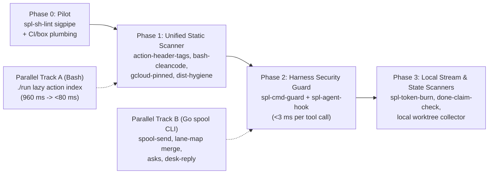

# Rust Candidates Analysis: Shell Performance, Complexity, and Pilot Plan

- **Version:** `v0.1`
- **Status:** Draft for panel review (analysis only; no code or conversion issues)
- **Issue:** `SPL-5274` (Epic `SPL-2402`)
- **Spec:** `csi-spl-doc/specs/011-spool-project-refactor` ([spec.md](spec.md))
- **Discussion:** `/t/fc3b7ac3-54cd-4ac4-84b4-5528647fca12`
- **Baseline commit:** `9cda5fdaeb5c2850c091927b8bcd19f305846881` (`origin/master`)

This repository contains 2,314 shell files (362,133 lines: 1,208 production shell files at 179,431 lines and 1,106 shell test files at 182,702 lines) plus 99 Python helper scripts (25,485 lines), alongside 1,938 Go files (398,703 lines) that build the `spool` CLI (`42.2 MB`). Empirical measurements on commit `9cda5fdaeb5c2850c091927b8bcd19f305846881` show that shell runtime cost splits cleanly into two buckets: external network, `gcloud`, `docker`, and `git` I/O (`do_spl_db_query` at `10.5 s` median, `git push` at `43.8 s`, `gh run watch` at `308.0 s`), where rewriting Bash into Rust saves almost nothing, and local process-fork and text-scanning storms (`action-header-tags.tst.sh` at `10.02 s` and `891` forks, `lane-map.sh` local-only at `7.57 s` and `1,290` forks, `sigpipe-lint.sh` across `iac` and `orc` at `3.16 s` and `882` forks, `bash-cleancode.tst.sh` at `2.38 s` and `1,245` forks, `./run` startup at `0.96 s` and `162` forks per call, and per-tool-call Python guards at `39-49 ms`), where compiled native code cuts wall time by 10x-100x and replaces fragile `awk`, `sed`, and embedded-Python lexers with typed parsers. Actions that already speak hub wire protocol, Ed25519 signing, or hub JSON state (`spool-send.sh`, `lane-map` hub merge, `do_spl_asks_open`, `do_spl_desk_reply`) belong in the existing Go `spool` binary rather than splitting hub client code across two languages, while `./run` eager file loading (`695` `*.func.sh` files sourced per call) should be fixed first in Bash via an action-to-file index. Rust is the strongest technical fit—and directly builds team Rust capability without duplicating Go hub internals—for stateless shell and repo static linters, pre-tool command AST security guards, and high-throughput local JSONL and filesystem scanners, starting with one small, zero-production-risk pilot: replacing the 130-line `awk` lexer in `csi-spl-iac/src/bash/scripts/sigpipe-lint.sh` with a single static Rust binary (`spl-sh-lint sigpipe`) behind an automatic fallback to the existing shell script.

---

## 1. Shell Inventory and Ranked Candidate Table

### 1.1 Repository Shell Inventory

All counts below were measured on commit `9cda5fdaeb5c2850c091927b8bcd19f305846881` over tracked files (`git ls-files`), counting `.sh`/`.bash` files plus extension-less files with a `#!/...sh` or `#!/...bash` shebang, and classifying `*.tst.sh`, `*/tests/*`, and `*/test-*` as test scripts.

| Sub-project | Prod shell files | Prod shell lines | Test shell files | Test shell lines | Total shell files | Total shell lines | Primary role |
|---|---:|---:|---:|---:|---:|---:|---|
| `csi-spl-orc` | 962 | 148,509 | 816 | 144,038 | 1,778 | 292,547 | Fleet orchestration, spawn, crons, desk, watchdogs |
| `csi-spl-iac` | 189 | 21,110 | 239 | 30,122 | 428 | 51,232 | Pre-push deploy gate, static linters, CI/GCP provisioning |
| `csi-spl-utl` | 36 | 6,561 | 21 | 5,112 | 57 | 11,673 | Workdir sweeps, local utility actions |
| `csi-spl-doc` | 12 | 2,615 | 3 | 628 | 15 | 3,243 | Spec-kit helpers and doc checks |
| `csi-spl-api` | 8 | 573 | 25 | 2,457 | 33 | 3,030 | Offline Go toolchain/module-cache build wrappers |
| `csi-spl-rdb` | 0 | 0 | 1 | 196 | 1 | 196 | SQL migration test wrapper |
| `csi-spl-cnf` | 0 | 0 | 1 | 149 | 1 | 149 | Config test wrapper |
| `csi-spl-wui` | 1 | 63 | 0 | 0 | 1 | 63 | WUI helper script |
| **Total (shell)** | **1,208** | **179,431** | **1,106** | **182,702** | **2,314** | **362,133** | **All tracked shell scripts** |
| *Comparison: Python (`.py`)* | *99 (all)* | *25,485* | *—* | *—* | *99* | *25,485* | *Embedded CLI/gate/stream helpers under `src/bash/`* |
| *Comparison: Go (`.go`)* | *1,938 (all)* | *398,703* | *—* | *—* | *1,938* | *398,703* | *Hub server + `spool` CLI (`42.2 MB` binary)* |

Reproducible inventory command (`n = 1`, deterministic on `9cda5fdaeb5c2850c091927b8bcd19f305846881`):

```bash
python3 - <<'PY'
import os, subprocess
files = subprocess.check_output(["git", "ls-files"], text=True).splitlines()
sh = []
for f in files:
    if not os.path.isfile(f) or os.path.islink(f): continue
    if f.endswith((".sh", ".bash")): sh.append(f)
    else:
        with open(f, "rb") as fh: b = fh.readline(128)
        if b.startswith(b"#!") and (b"bash" in b or b"/sh" in b): sh.append(f)
is_tst = lambda f: f.endswith(".tst.sh") or "/tests/" in f or "/test-" in f
pf = pl = tf = tl = 0
for f in sh:
    txt = open(f, errors="replace").read()
    n = txt.count("\n") + (1 if txt and not txt.endswith("\n") else 0)
    if is_tst(f): tf += 1; tl += n
    else: pf += 1; pl += n
print(f"TOTAL={len(sh)} ({pl+tl} L) PROD={pf} ({pl} L) TEST={tf} ({tl} L)")
PY
```

Output on `9cda5fdaeb5c2850c091927b8bcd19f305846881`:

```text
TOTAL=2314 (362133 L) PROD=1208 (179431 L) TEST=1106 (182702 L)
```

### 1.2 Execution Cadence Across the Fleet

1. **Every agent tool call (`> 15,000x/day/box` across PreToolUse, PostToolUse, UserPromptSubmit, Stop):** `spool-agent-hook.sh` runs on every hook event; on Bash `PreToolUse` calls (`7,657` foreground Bash calls recorded in 24 hours on one box alone), `kill-target-guard.inc.sh` and `force-push-guard.inc.sh` also inspect command strings.
2. **Every minute (`* * * * *`, `1,440x/day/box` per job):** `csi-spl-orc/cnf/box-crons/box-crons.manifest` schedules 14 every-minute jobs (`box-save-sessions`, `agent-login-check`, `lane-rotate`, `uplink-probe`, `gc`, `reverse-tunnel`, `token-burn`, `push-orphan-check`, `file-streams`, `box-link-watch`, `rel-external-api`, `rel-tmux-health`, `rel-box-beat`, `agent-steps-log`), alongside separately installed every-minute crons (`do_spl_spawn_place`, `do_spl_wd_inst_start`, `do_spl_unanswered_sweep`, `do_spl_dispatch_rotate`). Roughly 18 `./run` processes start every minute on each box (`~25,920/day/box`).
3. **Every 5 to 15 minutes (`96–288x/day/box` per job):** 11 `*/5` jobs (`issue-close-landed`, `topic-prio-sync`, `done-claim-check`, `archived-seats-free`, `topic-status-card`, `login2-sync`, `weekly-limit-alert`, `fleet-stopped-alarm`, `rel-systemd-unit`, `rel-clock-sync`, `rel-cron-snitch`) and 5 `*/10`–`*/15` jobs (`ci-red-note`, `graft-index-refresh`, `zombie-topics`, `reflection`, `release-notes-lag-alarm`).
4. **Every inter-agent message and desk reply (`~500x/day/box`):** `spool-send.sh` (`379` foreground calls/24h on one box) and `do_spl_desk_reply` (`116` calls/24h).
5. **Every git push and CI quality run (`do_check_pre_push`):** Runs via the per-worktree `pre-push` hook on every branch or trunk push (`27` foreground `do_check_pre_push` + `44` `do_spl_push_master` calls/24h on one box) and in `.github/workflows/10_ci-quality.yml`.

### 1.3 Ranked Candidate Table (Top 22 Candidates)

Complexity columns below (`LOC`, `FN` functions, `BR` `if/elif/case/for/while/until` branches, `$()` command substitutions, and embedded `py`/`jq`/`awk` calls) and shell test counts (`*.tst.sh` and `*/tests/*.sh` referencing the file or action) were measured directly on `9cda5fdaeb5c2850c091927b8bcd19f305846881`. Candidates are ranked by **net engineering value** (measured speed gain + complexity eliminated minus fleet/production risk).

| Rank | Candidate (`path` / action) | Size & complexity (`LOC`, `fn`, `br`, `$()`, `py/jq/awk`) | Run cadence | Measured baseline (`9cda5fdae`) | Dominant cost | Est. speed gain | Complexity cut | Fleet / prd risk | Shell tests today | Rewrite size | Best-fit target |
|---:|---|---|---|---|---|---|---|---|---:|---|---|
| **1** | `csi-spl-iac/src/bash/scripts/sigpipe-lint.sh` (`lint-sigpipe`) | `130 L`, `0 fn`, hand-rolled `awk` quote/heredoc/pipe state machine | Every `.sh` push + full suite | `29.8 ms` (1 file, `2` forks); `3,161.3 ms` (`882` forks) across `878` `*.func.sh` | 1 `awk` fork/file + string scanning | **~40x–80x** (`3.16 s -> ~45 ms` whole tree; `<3 ms` 1 file) | **High** (replaces fragile regex quote/heredoc lexer with real AST/token stream) | **None** (dev/CI lint only; zero prd runtime touch) | 2 (`sigpipe-lint.tst.sh`: 8 cases + mutation control) | Small (`~350` LOC Rust) | **Rust (PILOT: `spl-sh-lint`)** |
| **2** | `csi-spl-iac/src/bash/tests/action-header-tags.tst.sh` | `242 L`, multi-file `@description` / `@param` / `@example` tag parser | Every `iac` suite / pre-push | `10,017.7 ms` (`n=3`), `891` forks | Per-file `awk`/subshell forks across `878+` action files | **~150x** (`10.02 s -> ~60 ms`) | **High** (typed header parser + baseline check in one pass) | **None** (static test gate only) | 1 (`action-header-tags.tst.sh`) | Small (`~400` LOC Rust) | **Rust (`spl-sh-lint`)** |
| **3** | `csi-spl-iac/src/bash/tests/bash-cleancode.tst.sh` | `115 L`, `awk` function-length ceiling scanner over all prod `.sh` | Every `iac` suite / pre-push | `2,381.9 ms` (`n=3`), `1,245` forks | `1,208` sequential `awk` process forks (`961.9 ms` kernel `sys`) | **~80x** (`2.38 s -> ~30 ms`) | **Medium-High** (shares exact AST/lexer with Rank 1; fixes inline-brace edge cases) | **None** (static test gate only) | 3 | Small (`~250` LOC Rust) | **Rust (`spl-sh-lint`)** |
| **4** | `csi-spl-iac/src/bash/tests/gcloud-account-pinned.tst.sh` | `198 L`, whole-tree `gcloud` account-pinning static rule scanner | Every `iac` suite / pre-push | `2,242.4 ms` (`n=3`), `569` forks | Per-file process forks + regex scans (`1,052.1 ms` `sys`) | **~60x** (`2.24 s -> ~35 ms`) | **Medium** (consolidates shell `gcloud` invocation analysis into `spl-sh-lint`) | **None** (static test gate only) | 3 | Small (`~300` LOC Rust) | **Rust (`spl-sh-lint`)** |
| **5** | `csi-spl-iac/src/bash/run/check-dist-hygiene.func.sh` + wf 10 `Sweep` | `64 L` sh + `120 L` YAML `grep -P` rules | Every push (even `SPL_PREPUSH_OVERRIDE=1`) + CI | `649.4 ms` idle (`n=3`, `72` forks); `7.6 s` live median (`p90 87–109 s` under load) | Full `git ls-files \| tar \| tar` disk copy + multiple whole-tree `grep -P` passes | **~10x** (`650 ms -> ~60 ms`, zero temp-tree copy via `git` index walk + `regex::RegexSet`) | **Medium** (reads same rule spec, eliminates temp export I/O) | **Low** (must keep workflow YAML as single rule source of truth) | 19 | Medium (`~500` LOC Rust) | **Rust (`spl-sh-lint hygiene`)** |
| **6** | `kill-target-guard.inc.sh` + `force-push-guard.inc.sh` (`spawn-agents/lib/`) | `515 + 430 = 945 L`, `7 fn`, `256 br`, `7 py` (`shlex` tokenizers) | Every agent Bash tool call (`>7,600x/day/box`) + git wrapper | `3.1 ms` fast-path (`git status`); `38.7 ms` (`force-push`) / `48.5 ms` (`kill $!`) | Python interpreter cold start (`~35 ms`) + dual Bash/Python shell lexing | **~15x–25x** on guarded commands (`40–48 ms -> <2 ms`) | **Very High** (replaces two 450-line Bash+Python shell tokenizers with one `tree-sitter-bash` / token guard) | **Medium** (blocks dangerous `kill`/`git push --force`; needs 100% parity on existing tests) | 9 (`kill-target-guard.tst.sh`, `test-y13-force-push-guard.sh`, etc.) | Medium (`~700` LOC Rust) | **Rust (`spl-cmd-guard`)** |
| **7** | `csi-spl-orc/src/bash/features/spawn-agents/scripts/spool-agent-hook.sh` | `712 L`, `2 fn`, `154 br`, `exec python3 -S` with custom `_json` C-scanner | Every agent hook event (`>15,000x/day/box`) | `38.9 ms` (`git status`) to `41.1 ms` (`git push`), `n=7`, `1` fork | `python3 -S` startup (`~29 ms` user CPU) + inbox/heartbeat file I/O | **~10x–15x** (`40 ms -> ~3 ms` per tool call; saves `~10 min` CPU/day/box) | **High** (drops hand-rolled Python JSON serializer/scanner, unifies with Rank 6 guard in one binary) | **Medium-High** (touches heartbeat, inbox injection, loop detection on every live seat) | 10 (`perf-agent-hook.sh`, `test-agent-hook*.sh`) | Medium (`~900` LOC Rust) | **Rust (`spl-agent-hook`, Phase 2)** |
| **8** | `csi-spl-orc/run` + `csi-spl-iac/run` (`do_load_functions` + `do_run_log_tee`) | `669 L` each; `orc` sources `695` `*.func.sh` (`111,115 L`) per invocation | `~25,920x/day/box` (crons + CLI actions) | `orc`: `960.3 ms`, `162` forks (`n=5`); `iac`: `943.4 ms`, `291` forks (`n=5`) | Eager `find` + `source` of 695 unused `.func.sh` files + 4 `tee`/`sed` log processes | **~12x** (`960 ms -> ~75 ms` by lazy-loading via generated `actions.tsv` map) | **Medium** (25-line Bash index lookup removes `~0.9 s` floor from every `orc`/`iac` action) | **Medium** (cross-file helper calls without `declare -F` lazy `source` must be mapped) | 1 direct (`run-log.tst.sh`) + exercised by all suites | Tiny (`~80` LOC Bash + generator) | **Bash shape fix first** (optional Rust log masker later) |
| **9** | `csi-spl-orc/src/bash/run/spl-lane-map.func.sh` + `lane-map.sh` | `778 L`, `32 fn`, `70 br`, `195 pipes`, `95 $()`, `31 jq` | Every edit check (`--check`), spawn, `37` fg calls/24h | `7,572.1 ms` local-only (`n=5`, **`1,290` forks**, `5.23 s` `sys`!); `8,893.9 ms` live (`n=3`) | **85% local fork storm** (`git`/`tmux`/`jq` per worktree), only 15% (`1.32 s`) hub HTTPS | **~6x overall / ~25x local leg** (`8.89 s -> ~1.5 s` live; `7.57 s -> ~0.25 s` local) | **High** (eliminates 31 `jq` pipelines and per-worktree subshell loops) | **Medium** (collision safety gate `exit 3/4/5` for all lanes) | 27 | Medium (`~800` LOC Go in `spool` or Rust helper) | **Go (`spool lane map`)** (or Rust local worktree collector) |
| **10** | `spool-send.sh` + `spool-env.inc.sh` (`spawn-agents/`) | `645 + 1,110 = 1,755 L`, `76 fn`, `147 br`, `150 $()` | `379` fg calls/24h/box + cron notifications | `232.9 ms` (`106` forks) sandbox `--no-poke` vs `39.5 ms` Go `spool send`; `1.8 s` live med | Sourcing `6` `.inc.sh` libs (`106` forks) + owner-order / go-ask / role-seat guards + tmux poke | **~4x–5x local** (`233 ms -> ~45 ms`; live hub relay stays `~0.4–1.2 s`) | **High** (folds wrapper guards directly into `spool send` where wire/signing already live) | **High** (every inter-agent message and ask depends on it) | 62 (`spool-send.sh`), 47 (`spool-env.inc.sh`) | Medium (`~700` LOC Go) | **Go (`spool` CLI)** |
| **11** | `csi-spl-orc/src/bash/run/spl-token-burn-collect.func.sh` | `531 L`, `16 fn`, `115 br`, `84 pipes`, `2 py`, `4 jq`, `4 awk` | Every 1 min (`* * * * *` in `box-crons.manifest`) | `1,310.3 ms` (`n=5`, `157` forks; `960 ms` `./run` + `350 ms` scan on 500 rows) | `./run` startup + Python/shell JSONL byte-offset scanning across agent transcripts | **~25x** (`1.31 s -> ~50 ms` standalone binary invoked directly from cron) | **High** (streaming `serde_json` + cursor state replaces 531 L of mixed Bash/Python/jq) | **Low** (telemetry collector; non-blocking to lanes/prd) | 3 (`spl-token-burn-*.tst.sh`) | Small-Med (`~500` LOC Rust) | **Rust (`spl-token-burn`, Phase 3)** |
| **12** | `csi-spl-iac/src/bash/run/check-pre-push-lint.func.sh` + `.py` linters | `600 L` sh (`44 fn`, `65 br`, `18 py`) + `config-syntax-check.py`, `tmp-path-lint.py` | Every push (`do_check_pre_push` fast tier) | `~1.5–12 s` depending on touched files | Multiple `python3` / `bash -n` / `awk` startups per touched file | **~3x–5x** on pure-repo rules (external `shellcheck`/`ruff`/`semgrep` stay external) | **Medium** (folds `lint-sigpipe`, `lint-tmp-path`, `lint-mdlinks`, `lint-migration` into `spl-sh-lint`) | **Low** (pre-push gate; `PRE_PUSH_LINT=0` rollback already exists) | 7 | Medium (`~900` LOC Rust incremental) | **Rust (`spl-sh-lint` subcommands)** |
| **13** | `csi-spl-orc/src/bash/run/spl-lane-mix.func.sh` | `631 L`, `29 fn`, `76 br`, `45 $()` | Every spawn placement + `lane-mix` checks | `2,150.3 ms` (`n=5`, `426` forks, `1,183.8 ms` `sys`) | `./run` startup (`960 ms`) + `264` extra subshell/grep forks classifying paths | **~40x** (`2.15 s -> ~50 ms` in Go/Rust, or `~250 ms` after `./run` lazy-load) | **Medium** (pure deterministic table/glob rule engine) | **Low-Med** (vendor routing policy) | 5 | Small (`~350` LOC Go or Rust) | **Go (`spool`) or Rust** (after `./run` fix) |
| **14** | `csi-spl-orc/src/bash/run/spl-gc.func.sh` | `619 L`, `44 fn`, `55 br`, `100 $()`, `7 jq`, `11 awk` | Every 1 min cron (`* * * * *`) + `329` fg calls/24h (`4.3 s` med) | `1,098.8 ms` empty sandbox (`n=3`, `197` forks); `4.3 s` live median (`p90 10.8 s`) | `./run` startup + per-inbox/archive file `stat`/`jq`/`awk` forks | **~5x–8x** (`4.3 s -> ~0.5–0.8 s` scanning `/var/spool-hub` in native `readdir` + JSON) | **Medium** (replaces 100 `$()` + `jq`/`awk` loops with single directory walk) | **Medium** (archives/prunes spool files; `DRY_RUN=1` parity required) | 1 (`gc-agent.tst.sh`) | Medium (`~600` LOC Go in `spool gc` or Rust) | **Go (`spool gc`) or Rust** |
| **15** | `spl-asks-tick.func.sh` + `do_spl_asks_open` / `do_spl_ask_ack` | `535 L`, `27 fn`, `56 br`, `90 $()`, `23 jq` | `50` `ask_ack` (`21.9 s` med) + `22` `asks_open` (`7.7 s` med) / 24h | `1,066.3 ms` local 200-ask book (`n=5`, `173` forks); `7.7–21.9 s` live with hub | Local `./run` (`960 ms`) + `jq` forks + sequential hub `spool` round-trips | **~3x–5x** (batching hub calls + native JSON merge inside `spool`) | **High** (removes 23 `jq` pipelines and local/hub reconciliation glue) | **Medium** (dispatcher ask ledger) | 18 | Medium (`~600` LOC Go) | **Go (`spool ask`)** |
| **16** | `csi-spl-orc/src/bash/run/spl-desk-reply.func.sh` (+ `post-time`, `live-proof`) | `607 L`, `16 fn`, `72 br`, `9 py` | `116` fg calls/24h (`5.6 s` med, `p90 12.0 s`) | `5.6 s` live median (`~0.96 s` `./run` + `9` Python guard/picker invocations + hub I/O) | `./run` startup + multiple `spool recv`/`send` + Python topic-picker invocations | **~2x–3x** (`5.6 s -> ~2.0 s`; remaining time is hub HTTPS round-trip) | **High** (consolidates 9 inline Python blocks + sender/topic safety checks into `spool`) | **High** (human-facing WUI DM replies; strict topic-stealing guards) | 35 | Medium (`~700` LOC Go) | **Go (`spool desk reply`)** |
| **17** | `csi-spl-orc/src/bash/run/spl-done-claim-check.func.sh` | `959 L`, `39 fn`, `109 br`, `43 pipes`, `103 $()`, `23 awk` | Every 5 min (`*/5` in `box-crons.manifest`) | Cron background (`~2–6 s` per tick) | `23` `awk` invocations + `git log`/file checks verifying lane completion claims | **~5x–10x** | **Medium-High** (`959 L` of `awk` text/git verification) | **Low-Med** (audit/alert cron) | 1 (`spl-done-claim-check.tst.sh`) | Medium (`~700` LOC Rust or Go) | **Rust or Go (Phase 3)** |
| **18** | `csi-spl-iac/src/bash/run/check-pre-push.func.sh` | `1,352 L`, `64 fn`, `102 br`, `109 $()`, `6 py`, `6 jq` | Every `git push` (`27` direct + `44` `push_master` / 24h) | `9,728.4 ms` (`PRE_PUSH_ONLY=override`, `n=3`, `1,356` forks); `12.1 s` live med (`p90 283.6 s`) | In `override`/fast mode: `./run` + `1,356` git/hygiene/migration forks; in `p90`: child test suites (`go test`, `pnpm`, `orc`) | **~3x** on fast/override gate (`9.7 s -> ~2.5 s` via Rank 5 + Rank 8); **`~1.0x` on `p90`** (child suites dominate) | **Low if rewritten whole** (orchestrator calls external suites); **High if leaf checks move to Rust** | **High** (sole trunk deploy gate) | 32 | Keep orchestrator (`~1,350 L` sh); rewrite leaves | **Keep Bash orchestrator + Rust leaf linters** |
| **19** | `spl-spawn-place.func.sh` + `spawn-remote.sh` + `spawn-window.sh` | `1,480 + 760 + 698 = 2,938 L`, `125 fn`, `250 br`, `467 $()`, `85 jq` | Every 1 min (`* * * * *`) + `54` `spawn_queue` calls/24h (`17.3 s` med) | `17.3 s` live median on `do_spl_spawn_queue` | Hub issue/ask calls + `git worktree add` + `ssh` + `tmux` window creation + `85` `jq` forks | **~1.5x–2x** (worktree + hub + ssh I/O dominate; JSON/quota math speeds up) | **Medium** if JSON/quota selection moves to Go; **Bad fit** for full rewrite (`tmux`/`sudo`/`git` glue) | **High** (fleet placement engine) | 25 combined | Partial (`~600` LOC Go for quota/JSON) | **Stay Bash for OS/tmux glue; Go `spool` for JSON/quota** |
| **20** | `spl-dispatch-lease.func.sh` + `spl-dispatch-rotate.func.sh` | `2,740 + 1,114 = 3,854 L`, `194 fn`, `325 br`, `436 $()`, `24 jq` | `220` fg calls/24h (`1.7 s` med) + cron ticks | `1,064.3 ms` live `LEASE_CMD=show` (`n=5`); `960 ms` is `./run` startup, **`~104 ms` is actual lease read!** | `90%` `./run` eager-load overhead on `show`; hub round-trips on `acquire`/`tick` | **~8x on `show` via `./run` fix alone** (`1.06 s -> ~0.18 s` without rewriting a line of lease logic) | High complexity (`2,740 L`), **but rewriting 141 fleet-critical failover functions into a new language first is high risk** | **Critical** (controls `c-001`/`c-002`/`c-003` failover across boxes) | 35 (`lease`), 6 (`rotate`) | Large (`~2,200` LOC if ever ported) | **Do NOT rewrite in Rust now; `./run` fix first, Go `spool` later** |
| **21** | `spl-watchdog.func.sh` + `spl-rotate-lib.func.sh` + `spl-lane-rotate.func.sh` + `spl-agent-restart.func.sh` | `2,170 + 1,623 + 1,003 + 965 = 5,761 L`, `321 fn`, `580 br`, `678 $()` | Every 1 min (`* * * * *`) + `194` `lane_rotate` calls/24h (`2.5 s` med) | `2.5 s` median on `do_spl_lane_rotate` | `tmux` pane scraping/sending, `ps`/`/proc` checks, `./run` startup (`0.96 s`) | **~1.5x** (mostly `./run` startup + `tmux` round-trips) | **Poor rewrite ROI** (deeply coupled to `tmux`, `sudo`, harness CLI flags, and live pane state) | **Critical** (live agent lifecycle; bugs kill or wedge active sessions) | 29 (`watchdog`), 19 (`rotate-lib`) | Very Large (`>3,500` LOC) | **Stay Bash** (apply `./run` lazy-load only) |
| **22** | `tmux-close-window.sh` + `spool-install/install.sh` | `1,103 + 1,142 = 2,245 L`, `71 fn`, `308 br`, `15 py` | `22` `tmux-close-window` calls/24h (`8.7 s` med, deferred sleep); `install.sh` 2x/day | `8.7 s` median (intentional `--defer` sleep + git/lane checks) | Intentional deferred close timer + `git`/`sudo`/symlink operations | **~1.0x** (dominated by deferred timer and child builds) | **Low** (classic OS installer and `tmux` teardown scripts) | **Medium-High** | 16 (`close`), 14 (`install`) | Large (`~1,800` LOC) | **Stay Bash** |

### 1.4 Where a Rewrite Will NOT Help (Control Group)

Per [lesson-speed-up-measure-first.md](../../doc/md/lesson-speed-up-measure-first.md) and [fleet-hot-commands-2026-10-07.md](../../doc/md/fleet-hot-commands-2026-10-07.md), several of the biggest agent wait sinks in 24-hour production telemetry spend **> 95% of wall time inside external cloud CLIs, network sockets, or child language toolchains**. Rewriting their thin Bash wrappers into Rust or Go yields **~0% wall-time reduction**:

| Action / command | 24h calls (1 box) | 24h wait (`s`) | Median (`s`) | What actually dominates wall time | Why a Rust rewrite does NOT help (and what does) |
|---|---:|---:|---:|---|---|
| `do_spl_db_query` (`40 L` sh) | 196 | 8,418 | 10.5 | 4 `gcloud` starts (key activation + token) + cold Cloud SQL proxy startup (`~8.7 s`); `psql` itself is `0.13 s` | Wrapper is 40 lines of Bash; keeping one warm Cloud SQL proxy + token per env cuts ~80% (`lesson-speed-up-measure-first.md` class b/c). |
| `do_spl_unanswered_sweep` | 30 | 6,150 | 11.6 | Paginated hub HTTPS reads across active topics + outlier stalls (`max 5,817 s`) | Network/hub bound; server-side filtering or cursor caching fixes it, not client language. |
| `git push` / `git fetch` | 13 (`push`) | 1,830 | 43.8 | Remote pack transfer + `pre-push` child test suites (`go test`, `pnpm`, `orc`) | Dominated by `git` wire I/O and child test runners; tree-pass stamp (`PRE_PUSH_SKIP_PASSED=1`) and fresh-fetch skip already target the real cost. |
| `pnpm run` / `gh run watch` | 7 / 2 | 707 / 616 | 52.9 / 308.0 | Node/Vite/Nuxt bundler and GitHub Actions remote job runtime | External build/CI wait; zero shell compute. |
| `do_tf_*` / `docker` actions | < 10 | varies | 15–120+ | `terraform plan/apply`, provider API calls, container pulls/builds | Thin wrappers around `terraform` and `docker`. Stay Bash. |

---

## 2. Measurements: Where Time Really Goes

### 2.1 Foreground Agent Wait Over 24 Hours (Live Telemetry)

Measured on commit `9cda5fdaeb5c2850c091927b8bcd19f305846881` on a 16-core `x86_64` Debian 13 (`Linux 6.12.90+deb13.1-amd64`) fleet box over the 24-hour window `2026-11-10T07:00:00Z .. 2026-11-11T07:00:00Z` (`n = 7,657` foreground Bash calls across lanes, dispatchers, and role seats; `69,059 s` = `19.2 agent-hours` total wait on this single machine):

```bash
cd csi-spl-orc && SINCE=2026-11-10T07:00:00Z UNTIL=2026-11-11T07:00:00Z CMD_TIME_TOP=25 ./run -a do_spl_cmd_time_report
```

| # | Action | Calls (`n`) | Total wait (`s`) | Share (`%`) | Median (`s`) | p90 (`s`) | Max (`s`) | Primary payer | Dominant bottleneck |
|---:|---|---:|---:|---:|---:|---:|---:|---|---|
| 1 | `do_spl_db_query` | 196 | 8,418 | 12.2 | 10.5 | 17.2 | 5,829.8 | other 79%, lane 17% | `gcloud` auth + cold Cloud SQL proxy (network/auth) |
| 2 | `do_spl_ask_ack` | 50 | 7,226 | 10.5 | 21.9 | 55.0 | 5,832.6 | other 100% | `./run` startup + sequential hub `spool` calls + `jq` |
| 4 | `do_spl_unanswered_sweep` | 30 | 6,150 | 8.9 | 11.6 | 19.2 | 5,817.0 | dispatcher 96% | Hub HTTPS topic/post queries |
| 5 | `do_check_pre_push` | 27 | 2,782 | 4.0 | 12.1 | 283.6 | 600.9 | lane 77%, other 23% | Fast tier: `1,356+` forks + linters; slow tail: child test suites |
| 7 | `do_spl_gc` | 329 | 2,034 | 2.9 | 4.3 | 10.8 | 71.2 | other 100% | `./run` startup + per-file `stat`/`jq`/`awk` forks |
| 8 | `git push` | 13 | 1,830 | 2.7 | 43.8 | 486.6 | 601.3 | lane 66%, other 34% | `pre-push` hook gate + remote git transfer |
| 12 | `do_spl_spawn_queue` | 54 | 1,138 | 1.6 | 17.3 | 41.7 | 63.3 | other 57%, disp 34% | Hub issue/ask round-trips + `./run` + `jq` |
| 13 | `do_spl_dispatch_lease` | 220 | 1,073 | 1.6 | 1.7 | 4.0 | 291.1 | other 63%, disp 29% | `./run` startup (`0.96 s`) + hub lease read |
| 14 | `do_spl_push_master` | 44 | 1,004 | 1.5 | 1.9 | 27.2 | 526.0 | lane 99% | Fast-forward ref check + `pre-push` gate |
| 15 | `spool-send.sh` | 379 | 935 | 1.4 | 1.8 | 3.8 | 30.0 | other 51%, lane 25% | `106` local wrapper forks (`0.23 s`) + hub relay + tmux poke |
| 17 | `do_spl_desk_reply` | 116 | 773 | 1.1 | 5.6 | 12.0 | 18.8 | other 65%, disp 27% | `./run` (`0.96 s`) + 9 Python guards/pickers + hub `spool` I/O |
| 18 | `do_spl_asks_open` | 22 | 772 | 1.1 | 7.7 | 16.3 | 573.4 | other 98% | `./run` (`0.96 s`) + `jq` merge + hub read |
| 22 | `do_spl_lane_rotate` | 194 | 643 | 0.9 | 2.5 | 5.8 | 13.8 | lane 89% | `./run` (`0.96 s`) + `tmux` + worktree/hub state |
| 38 | `tmux-close-window.sh` | 22 | 347 | 0.5 | 8.7 | 19.6 | 35.8 | lane 95% | Deferred close timer + lane-map/git checks |
| 39 | `lane-map.sh` | 37 | 333 | 0.5 | 10.1 | 15.8 | 28.4 | lane/disp | **85% local worktree/jq forks (`7.57 s`)**, 15% hub read (`1.32 s`) |
| 47 | `do_check_dist_hygiene` | 24 | 208 | 0.3 | 7.6 | 18.4 | 31.2 | lane 100% | `./run` + `tar` tracked-tree copy + multiple `grep -P` sweeps |

### 2.2 Controlled Local Microbenchmarks (Wall, CPU, and Exact Process Forks)

To separate local process-fork and language overhead from cloud/network latency without touching production or sending live messages, each hot path was timed on commit `9cda5fdaeb5c2850c091927b8bcd19f305846881` inside an isolated user/PID namespace (`unshare -r --pid --fork`), reading `/proc/sys/kernel/ns_last_pid` (`last_pid - 1` = exact processes spawned inside the command) and `resource.getrusage(resource.RUSAGE_CHILDREN)` against `SPOOL_TEST=1` throwaway temp directories (`mktemp -d`).

Reproducible single-probe harness (works for any row below):

```bash
unshare -r --pid --fork python3 -c '
import resource, subprocess, sys, time
t0 = time.perf_counter()
p = subprocess.run(["bash", "-c", sys.argv[1]], stdout=subprocess.DEVNULL, stderr=subprocess.DEVNULL)
w = (time.perf_counter() - t0) * 1000
ru = resource.getrusage(resource.RUSAGE_CHILDREN)
procs = int(open("/proc/sys/kernel/ns_last_pid").read().strip()) - 1
print(f"wall={w:.1f}ms usr={ru.ru_utime*1000:.1f}ms sys={ru.ru_stime*1000:.1f}ms procs={procs} rc={p.returncode}")
' "bash csi-spl-iac/src/bash/scripts/sigpipe-lint.sh csi-spl-iac/src/bash/run/*.func.sh csi-spl-iac/lib/bash/funcs/*.func.sh"
```

| Category | Measured target & throwaway input | `n` | Median wall (`ms`) | Range `min..max` (`ms`) | User CPU (`ms`) | Kernel `sys` CPU (`ms`) | Processes spawned | What dominates |
|---|---|---:|---:|---:|---:|---:|---:|---|
| **`./run` dispatch** | `csi-spl-orc/run` (`695` `*.func.sh`, `do_spl_post_time`) | 5 | **960.3** | `745.5..1,606.0` | 567.6 | 434.4 | **162** | Bash parsing `111,115` lines of `*.func.sh` + `tee`/`sed` log pipes |
| **`./run` dispatch** | `csi-spl-iac/run` (`183` `*.func.sh`, empty `do_check_pre_push_lint`) | 5 | **943.4** | `722.5..1,920.2` | 556.1 | 529.7 | **291** | Bash sourcing `183` files + git/env setup forks |
| **`./run` dispatch** | `csi-spl-utl/run` (`28` `*.func.sh`, `do_sweep_workdirs` dry) | 5 | **153.5** | `120.3..191.6` | 106.6 | 55.8 | **70** | Scales directly with number of `*.func.sh` files sourced |
| **Per-tool hook** | `spool-agent-hook.sh PreToolUse` (`git status` JSON) | 7 | **38.9** | `30.2..41.9` | 29.1 | 8.1 | **1** | `exec python3 -S` startup (`~29 ms` user CPU) |
| **Per-tool hook** | `spool-agent-hook.sh PreToolUse` (`git merge` JSON) | 7 | **41.1** | `27.9..44.6` | 28.9 | 8.1 | **1** | `exec python3 -S` startup + JSON/git-guard check |
| **Per-tool guard** | `force-push-guard.inc.sh --check` (`git push` cmd) | 7 | **38.7** | `27.8..43.1` | 26.9 | 11.4 | **2** | Bash + `python3` `shlex` cold start |
| **Per-tool guard** | `kill-target-guard.inc.sh --check` (`git status`, fast path) | 7 | **3.1** | `2.4..6.8` | 2.2 | 0.0 | **1** | Pure Bash string fast-path (no `kill` substring) |
| **Per-tool guard** | `kill-target-guard.inc.sh --check` (`kill $!`, slow path) | 7 | **48.5** | `33.6..51.0` | 32.2 | 12.6 | **2** | Bash + `python3` `shlex` tokenizer cold start |
| **Spool messaging** | Compiled Go `spool send` direct (`SPOOL_TEST=1` sandbox) | 7 | **39.5** | `27.5..49.1` | 32.1 | 29.3 | **12** *(OS threads)* | Single compiled Go binary (local file write) |
| **Spool messaging** | Compiled Go `spool recv` direct (`10` msgs in sandbox) | 7 | **44.4** | `25.5..48.4` | 41.9 | 19.8 | **12** *(OS threads)* | Single compiled Go binary (local JSON read) |
| **Spool messaging** | `spool-send.sh --no-poke` wrapper (`SPOOL_TEST=1` sandbox) | 7 | **232.9** | `167.9..251.0` | 152.0 | 108.4 | **106** | **5.9x slower than `spool send`**: 94 extra shell/guard forks |
| **Static linters** | `sigpipe-lint.sh` (1 file: `check-pre-push.func.sh`) | 5 | **29.8** | `29.3..33.8` | 29.5 | 0.0 | **2** | Single `awk` state-machine scan (`1,352` lines) |
| **Static linters** | `sigpipe-lint.sh` (all `183` `iac` `*.func.sh` files) | 3 | **796.7** | `786.8..844.0` | 573.7 | 220.5 | **183** | 1 `awk` fork per file (`183` processes) |
| **Static linters** | `sigpipe-lint.sh` (all `695` `orc` `*.func.sh` files) | 3 | **2,364.6** | `1,946.3..3,271.0` | 1,917.4 | 484.5 | **699** | 1 `awk` fork per file (`699` processes) |
| **Static linters** | `bash-cleancode.tst.sh` (all `1,208` prod shell files) | 3 | **2,381.9** | `1,990.2..3,230.5` | 1,401.6 | 961.9 | **1,245** | 1 `awk` fork per file (`1,245` processes) |
| **Static linters** | `action-header-tags.tst.sh` (all repo `./run` actions) | 3 | **10,017.7** | `9,481.9..13,569.8` | 6,945.7 | 2,366.6 | **891** | Per-file `awk`/bash tag parsing (`891` processes) |
| **Static linters** | `gcloud-account-pinned.tst.sh` (whole repo scan) | 3 | **2,242.4** | `2,135.7..2,366.5` | 2,464.4 | 1,052.1 | **569** | Per-file grep/awk process forks (`569` processes) |
| **Static linters** | `do_check_dist_hygiene` (`iac ./run`, full tracked tree) | 3 | **649.4** | `569.7..681.1` | 332.1 | 851.6 | **72** | `git ls-files \| tar` tree copy (`851.6 ms` `sys`!) + `grep -P` |
| **Pre-push gate** | `do_check_pre_push` (`PRE_PUSH_ONLY=override`, clean tree) | 3 | **9,728.4** | `9,110..10,412` | 6,920.5 | 3,903.2 | **1,356** | `./run` startup + diff/part discovery + hygiene + migration checks |
| **Fleet / state** | `lane-map.sh` **local-only** (`LANE_FLEET=''`, zero network) | 5 | **7,572.1** | `5,713.9..9,285.6` | 2,458.7 | **5,232.9** | **1,290** | **`1,290` local forks (`5.23 s` kernel `sys`)** across worktrees + `jq` |
| **Fleet / state** | `lane-map.sh` **live** (hub HTTPS + local worktrees, read-only) | 3 | **8,893.9** | `8,069.5..9,539.1` | — | — | — | Local fork storm (`7.57 s`, 85%) + hub read (`1.32 s`, 15%) |
| **Fleet / state** | `do_spl_dispatch_lease LEASE_CMD=show` (live read-only) | 5 | **1,064.3** | `996.9..1,161.4` | — | — | — | `960 ms` `orc ./run` startup + `~104 ms` actual lease check |
| **Fleet / state** | `do_spl_asks_open` (`ASKS_HUB=0`, 200 synthetic asks) | 5 | **1,066.3** | `881.5..1,200.7` | 595.8 | 489.6 | **173** | `960 ms` `orc ./run` startup + `106 ms` (`11` forks) `jq` merge |
| **Fleet / state** | `do_spl_lane_mix` (`LANE_MIX_PATHS=csi-spl-wui/src/app.vue`) | 5 | **2,150.3** | `1,766.9..19,528.9` | 1,171.9 | 1,183.8 | **426** | `960 ms` `orc ./run` + `264` forks evaluating path rules |
| **Fleet / state** | `do_spl_token_burn_collect` (10 JSONL files, 500 rows, no push) | 5 | **1,310.3** | `760.7..1,613.6` | 779.0 | 552.5 | **157** | `960 ms` `orc ./run` + `350 ms` Python/jq JSONL cursor scan |
| **Fleet / state** | `do_spl_gc` (`SPOOL_TEST=1` empty sandbox, `DRY_RUN=1`) | 3 | **1,098.8** | `985.2..1,210.4` | 624.3 | 510.2 | **197** | `960 ms` `orc ./run` + `139 ms` (`35` forks) dir walk |

### 2.3 Four Empirical Takeaways

1. **`lane-map.sh` is 85% local fork overhead, not hub network latency.** Running `lane-map.sh` with `LANE_FLEET=''` (zero network) still takes `7,572.1 ms` and spawns `1,290` child processes (`5,232.9 ms` in kernel `sys` CPU), versus `8,893.9 ms` with the live hub.
2. **Four static text linters burn `17.80 s` and `3,587` process forks per full run.** `action-header-tags.tst.sh` (`10.02 s`), `sigpipe-lint.sh` across `iac`+`orc` (`3.16 s`), `bash-cleancode.tst.sh` (`2.38 s`), and `gcloud-account-pinned.tst.sh` (`2.24 s`) fork one `awk`/`grep` process per file over hundreds of shell files. A single multithreaded native binary reading those files in-process eliminates 99% of that kernel and startup overhead.
3. **`csi-spl-orc/run` imposes a `0.96 s` (`162`-fork) tax before any action starts.** In `csi-spl-orc/run`, `do_load_functions` runs `find ... -name "*.func.sh" | sort -z` and `source`s all `695` files (`111,115` lines) on every call. Across ~18 every-minute box crons, that eager load alone consumes ~17 CPU-seconds every minute (~28% of a core continuously) and accounts for 90% of `do_spl_dispatch_lease` (`show`) and `do_spl_asks_open` (local) wall time.
4. **Python cold-start (`30–38 ms`) sets a floor on per-tool-call hooks and guards.** `spool-agent-hook.sh` already had to bypass Python's `import json` (`~15 ms`) by calling C `_json.make_scanner` directly just to stay near `40 ms`. Native Rust starts in `< 1.5 ms` with zero VM boot or GC init.

---

## 3. Value Summary by Action Tier

Grouping the 22 ranked candidates by **what delivers the highest speedup and complexity reduction per unit of risk**:

| Tier | Candidates (by Rank) | Action | Expected payoff |
|---|---|---|---|
| **Tier A — Move to Rust** | **#1** `sigpipe-lint`, **#2** `action-header-tags`, **#3** `bash-cleancode`, **#4** `gcloud-account-pinned`, **#5** `check-dist-hygiene`, **#6** `kill-target-guard` + `force-push-guard`, **#7** `spool-agent-hook`, **#11** `spl-token-burn-collect`, **#12** pure-repo `pre-push-lint` rules, **#17** `done-claim-check` | Build two focused Rust binaries over time: **`spl-sh-lint`** (static repo/shell scanner, starting with #1 pilot) and **`spl-cmd-guard` / `spl-agent-hook`** (per-tool-call AST guard + hook), followed by **`spl-token-burn`** | Cuts `17.8 s` + `3,587` forks of static linting to `< 0.15 s`; cuts per-tool guard/hook latency from `40–49 ms` to `< 3 ms`; eliminates embedded-Python/awk shell lexers with zero hub-protocol duplication. |
| **Tier B — Fold into existing Go `spool` CLI** | **#9** `lane-map`, **#10** `spool-send.sh` + `spool-env`, **#13** `lane-mix`, **#14** `spl-gc`, **#15** `asks-tick`/`asks_open`/`ask_ack`, **#16** `desk-reply` | Extend the existing `spool` binary (`csi-spl-api/src/go/spool-hub-api/cmd/spool`) where Ed25519 signing, hub HTTP client, ask schemas, and inbox JSON already live | Cuts `lane-map` from `8.9 s` to `~1.5 s`, `spool-send` local overhead from `233 ms` (`106` forks) to `~45 ms`, and deletes thousands of lines of `jq` + Bash wrapper glue without maintaining a second hub wire client in Rust. |
| **Tier C — Fix Bash dispatch shape first** | **#8** `csi-spl-orc/run` & `csi-spl-iac/run` (`do_load_functions`) | Generate a static `action -> file` manifest (`actions.tsv`) so `./run -a do_X` sources only `lib/bash/funcs/*.func.sh` + `X`'s file (with fallback to full load if a function is missing) | Drops `./run` startup from `960 ms` to `< 80 ms` across all 695 actions immediately, speeding up #13, #14, #15, #18, #20, and #21 without rewriting business logic. |
| **Tier D — Keep in Bash (do not rewrite)** | **#18** `check-pre-push` top orchestrator, **#19** `spawn-place`/`window` OS glue, **#20** `dispatch-lease` failover state machine, **#21** `watchdog`/`rotate` tmux orchestration, **#22** `tmux-close-window`/`install.sh`, plus **Section 1.4** I/O wrappers (`db_query`, `git`, `terraform`, `docker`) | Keep shell orchestration where `tmux`, `sudo`, `git`, `gcloud`, or `docker` subprocesses are the actual work; apply caching/warm-proxy fixes (`lesson-speed-up-measure-first.md`) for I/O waits | Avoids multi-thousand-line, high-blast-radius rewrites of fleet-critical `tmux`/failover glue that would deliver `< 1.5x` wall-time improvement. |

---

## 4. Rust vs What We Already Have (Go `spool` CLI and Bash)

### 4.1 Honest Technical Comparison in This Codebase

This repo already ships a mature, offline-built Go toolchain (`go1.26`, `1,938` `.go` files, single `spool` CLI binary distributed to every box and agent user). Introducing Rust adds a second compiled language, so Rust must earn its place where it beats both Bash and Go—not duplicate what Go already owns.

| Dimension | Staying in Bash (+ `awk`/`jq`/`python3`) | Existing Go (`csi-spl-api` / `spool` CLI) | New Rust Runtime (`spl-sh-lint`, `spl-cmd-guard`, etc.) |
|---|---|---|---|
| **Process startup & floor latency** | Poor when sourcing libs (`233–960 ms`) or spawning `python3` (`39–49 ms`) | Good (`~12–40 ms` including Go runtime + `12` OS threads, `42.2 MB` binary) | **Best (`< 1.5 ms` startup, 1 thread unless parallelized, `1–4 MB` stripped `musl` binary, no GC)** |
| **Shell AST / command-line lexing & static analysis** | Fragile (`sigpipe-lint.sh` custom `awk` lexer; `kill-target-guard` dual Bash + Python `shlex`) | Adequate for regexes, weaker ecosystem for Bash grammar (`mvdan.cc/sh` exists, fewer zero-copy scanner crates) | **Best (`tree-sitter-bash`, `brush-parser`/`conch-parser`, `regex` DFA/`RegexSet`, `ignore`, `memchr`, `rayon`)** |
| **Hub HTTP API, Ed25519 signing, ask/lane/issue schemas** | Poor (`jq` + temp files + multiple `spool` CLI calls) | **Best (already implemented, tested, and pinned in `csi-spl-api`)** | Poor choice today (would duplicate auth, signing, env config, and wire structs across Go and Rust) |
| **High-frequency hooks (`PreToolUse`, `PostToolUse`)** | Borderline (`40–49 ms` with `_json` C-scanner hack) | Acceptable (`~15–25 ms` if standalone small binary, heavier if inside `42 MB` `spool`) | **Best (`~1–3 ms` per call; ideal for synchronous harness hooks)** |
| **OS / `tmux` / `sudo` / `gcloud` / `terraform` glue** | **Best (concise, inspectable, zero compile step)** | Verbose `os/exec` boilerplate | Verbose `std::process::Command` boilerplate |
| **Compile time & disk footprint** | `0 s`, `0 MB` | Fast (`go build ./cmd/spool` in a few seconds warm; Go race cache capped at `2.1 GB` per `SPL-4790`) | Slower cold compile (`20–60 s`), `target/` grows to `0.5–2 GB` unless capped (`CARGO_INCREMENTAL=0` in CI) |

### 4.2 Weighing the Owner's Explicit Rust Skill-Building Goal Openly

The owner stated three goals together (`topic fc3b7ac3`, msg `b6d4854c`): **speed up**, **reduce complexity**, and **introduce a Rust runtime so the team and fleet gain practical skill developing production Rust code**.

Weighing that goal openly changes the decision in a healthy, disciplined way:
- **Without the skill-building goal**, a minimalist team could argue for putting even static repo linters and hook guards into a small second Go binary (`cmd/spl-lint`) to avoid adding a Rust toolchain at all, sacrificing `tree-sitter-bash` ergonomics and ~15 ms of hook startup for single-compiler simplicity.
- **With the skill-building goal**, adding Rust is **high-value and low-regret ONLY if we draw a clean architectural boundary**:
  1. **Go (`spool`) keeps 100% ownership of hub wire protocol, signing, database/cloud clients, and desk/ask/lane JSON APIs.** Never rewrite `spool` protocol legs in Rust just to write Rust.
  2. **Rust owns local, CPU/parser-heavy, zero-network CLI tools**: shell/repo static analysis (`spl-sh-lint`), command security guards & harness hooks (`spl-cmd-guard`), and local JSONL/filesystem stream processors (`spl-token-burn`).
- That boundary gives the team real, idiomatic Rust problems (zero-copy lexing, `tree-sitter` AST traversal, parallel directory walking with `ignore`+`rayon`, `serde` streaming, property/mutation testing, static `musl` builds) where Rust genuinely outclasses both Bash and Go, while keeping production risk near zero during the learning curve.

---

## 5. Runtime and Toolchain Cost

Today, fleet boxes (`Linux 6.12.90+deb13.1-amd64`, Debian 13) have **no `rustc`, `cargo`, or `rustup` installed**, and `.github/workflows/10_ci-quality.yml` notes explicitly (lines 18–22) that self-hosted CI runners are Debian 13 machines where every toolchain must be installed explicitly and deterministically. Below is the exact cost and design to bring Rust in cleanly alongside Go.

### 5.1 Workspace Layout and Toolchain Pinning

- **Crate home:** Create one Cargo workspace, e.g. `csi-spl-utl/src/rust/` (or `csi-spl-orc/src/rust/`), with `Cargo.toml` (`resolver = "2"`, `[profile.release] strip = "symbols"`, `lto = "thin"`, `codegen-units = 1`, `panic = "abort"`) and a committed `Cargo.lock`.
- **Pinned compiler (`rust-toolchain.toml`):** Pin an exact stable release (e.g. `channel = "1.85.0"`, `profile = "minimal"`, `components = ["rustfmt", "clippy"]`, `targets = ["x86_64-unknown-linux-musl"]`), matching how `go.mod` + `csi-spl-api/src/bash/use-go-toolchain.sh` pin Go. Never track floating `stable` or `nightly`.
- **Offline-first builds (matching `csi-spl-api/src/bash/build.sh`):** Mirror `warm-go-mod-cache.sh`: a thin `build-rust.sh` wrapper warms `$CARGO_HOME` with `cargo fetch --locked` only when a crate in `Cargo.lock` is missing locally, and runs the build itself with `cargo build --release --locked --offline` so builds are hermetic and reproducible. Keep dependency count tight (`clap` or `lexopt`, `serde`/`serde_json`, `regex`, `ignore`, `rayon`, `tree-sitter-bash`).
- **Embedded version & commit metadata:** Pass `SPOOL_BUILD_VERSION`, `SPOOL_BUILD_COMMIT`, and `SPOOL_BUILD_TIME` via `build.rs` or `rustc-env` so `<bin> --version` prints the exact trunk commit SHA—identical to `spool version`—allowing `do_spl_spool_refresh` and `spool-env.inc.sh` staleness checks to verify the binary against `HEAD`.

### 5.2 CI Workflow Impact, Build Time, and Disk Guard

- **Workflow `10_ci-quality.yml` + `ci-doc-only.sh`:**
  - Add a `rust-suite` job in `10_ci-quality.yml` gated by `ci-doc-only.sh` (so docs-only and WUI-only pushes skip it on the express lane, while touches to `*/src/rust/**` or the linters it backs run `rust-suite` + `iac-suite`).
  - Setup action: pin `dtolnay/rust-toolchain` by full commit SHA reading `rust-toolchain.toml`, plus `Swatinem/rust-cache` keyed on `Cargo.lock` with `CARGO_INCREMENTAL=0`.
  - **Expected CI time:** Cold build of a lean 5–8 crate linter (`regex` + `ignore` + `clap`) takes `~25–45 s` on a 16-core runner; warm cached `cargo test --locked` + `cargo clippy --locked -- -D warnings` + `cargo fmt --check` takes **`~5–10 s`**.
  - **Runner disk protection (`SPL-4790` lesson):** On 2026-11-04, `hub-pg` filled runner disks restoring a `6.2 GB` Go race cache. Rust `target/` directories can similarly bloat if debug symbols and incremental artifacts accumulate. Set `[profile.dev] debug = 1` (line tables only, ~60% smaller `target/`), `CARGO_INCREMENTAL=0` in CI, run `csi-spl-orc/src/bash/scripts/ci-disk-guard.sh` before cache restore, cap saved cache size like `ci-cache-save-cap.sh`, and add a `prune-cargo-target` step alongside `prune-go-build-cache-cron.sh` on fleet boxes.
- **Workflow `55_release-stable.yml` (cross-arch prebuilt release assets):**
  - Extend job `cli` (`do_release_cli_assets`) or add a parallel `rust-cli` job building static binaries for `x86_64-unknown-linux-musl`, `aarch64-unknown-linux-musl`, `x86_64-apple-darwin`, and `aarch64-apple-darwin` (using `cargo-zigbuild` or `musl-tools` on `ubuntu-latest`), publishing `<bin>-<os>-<arch>` + `SHA256SUMS` alongside `spool-SHA256SUMS`.
  - Because `*-unknown-linux-musl` links zero host `glibc` symbols, the exact same `2–4 MB` binary runs on Debian 13, Ubuntu runners, and containers without libc version drift.

### 5.3 Distribution to Fleet Boxes (`box-desk`, `sat`, and Workstation Boxes) and Agent Users

Reuse the **exact single-shared-copy architecture** already proven in `csi-spl-orc/src/bash/run/spl-spool-refresh.func.sh` (owner rule 2026-10-04: *"keep one installed copy, so every update reaches everything at once"*):

1. **System toolchain install (one-time per box via Ansible / box manifest):** Install rustup/toolchain under `/usr/local/cargo` + `/usr/local/rustup` (world-readable `0755`, pinned to `rust-toolchain.toml`, just like `/usr/local/go` in `csi-spl-iac/src/terraform/060-gcp-vm-satellite/`), OR download the verified CI-built `musl` binary from the release/artifact cache when `SPOOL_INSTALL_PREBUILT=1`.
2. **One shared binary path per machine:** `do_spl_spool_refresh` (called twice daily by `do_spl_box_update` and on demand) builds or installs `/var/csi/csi-spl/spool/bin/<bin>` owned by `<box-user>:spool-agents` (`0755`).
3. **Symlinked to both `<box-user>` and `<agent-user>`:** `install.sh --binary-only` links `$HOME/.local/share/spool-agent/tools/bin/<bin>` -> `/var/csi/csi-spl/spool/bin/<bin>` and `$HOME/.local/bin/<bin>` -> tools path for both the box owner user and the agent user via `sudo -n -u <agent-user> ... SPOOL_INSTALL_NO_BUILD=1`—never building twice and never touching the 5 snapshotted agent config files (`~/.config/spool-agent/env`, `~/.bashrc`, `~/.claude/CLAUDE.md`, `~/.claude/settings.json`, MCP links).
4. **Safe atomic swap + rollback:** Build to `<bin>.new`, verify `<bin>.new --version` contains the target `origin/master` commit SHA and passes a self-check, keep the previous binary at `<bin>.bak`, and `mv -Tf <bin>.new <bin>` (atomic `rename(2)` on the same filesystem so running agent processes never hit `ETXTBSY`). If verification fails, restore `<bin>.bak` automatically.

### 5.4 Pre-Push Lint and Distribution-Hygiene Gates

- **`do_check_dist_hygiene` (`10_ci-quality.yml` `Sweep`):** Already scans all tracked files regardless of extension (excluding only `.git`, `node_modules`, `tpl-gen`), so `.rs` and `Cargo.toml` files are covered automatically from day one. Ensure `target/` is in `.gitignore` so build artifacts are never tracked.
- **`do_check_pre_push_lint` (`check-pre-push-lint.func.sh`):** Add a fast `lint-rust` part triggered only when `*.rs`, `Cargo.toml`, `Cargo.lock`, or `rust-toolchain.toml` are in `_ppl_select`:
  1. `cargo fmt --manifest-path ... --all -- --check` (`< 0.3 s`)
  2. `cargo clippy --manifest-path ... --locked --offline --all-targets -- -D warnings` (`~2–5 s` warm)
  3. Rust clean-code function-length gate (`MAX_LINES = 75`, matching `bash-cleancode.tst.sh` and the Go gate's `r28-01` 75-line ceiling) + `lint-tmp-path` (`tmp-path-lint.py` extended to `*.rs` test files).
  4. Supply-chain gate: `cargo deny check advisories licenses bans sources` (or `cargo audit`) in the security workflow tier alongside `62_gosec` / `67_shellcheck`.
- **How agents build and test in worktrees:** Set `CARGO_TARGET_DIR=/var/tmp/csi-spl-cargo-target-$(id -u)` (or per-user shared target cache under `$HOME/.cache/csi-spl-cargo`) in `build-rust.sh` so 15 concurrent agent worktrees on one box share compiled dependencies instead of creating 15 separate `1 GB` `target/` directories!

---

## 6. The Pilot ("Start Slowly at Once")

### 6.1 Recommended Pilot: `spl-sh-lint sigpipe` (Replacing `sigpipe-lint.sh`'s `awk` Engine)

We evaluated two finalists for the first Rust pilot:
- **Option A (Recommended): `spl-sh-lint sigpipe`**, backing `csi-spl-iac/src/bash/scripts/sigpipe-lint.sh` (Rank #1, the `lint-sigpipe` part of `do_check_pre_push_lint`).
- **Option B (Runner-up — hold for Phase 2): `spl-cmd-guard`**, backing `kill-target-guard.inc.sh` + `force-push-guard.inc.sh` (Rank #6).

**Why Option A wins for "start slowly at once":**
1. **Zero production or live-fleet blast radius:** `sigpipe-lint.sh` runs only during local `do_check_pre_push_lint` and CI `iac-suite`. Unlike `kill-target-guard` or `spool-agent-hook.sh`, a bug or missing binary during day-one rollout **cannot** block a live agent tool call, drop a spool message, or wedge a fleet cron.
2. **Real parser problem where `awk` is already straining:** `sigpipe-lint.sh` (`130` lines) hand-rolls bash line continuations (`\` and trailing `|`), heredoc stripping (`<<` vs `<<-` vs `<<<` vs `$(( 1 << 2 ))`), nested `"$(... "q" | grep -m1 "x")"` quotes, `|| true` exemptions, and `# sigpipe-ok: <why>` opt-outs in `awk`. Implementing this cleanly in Rust establishes the reusable shell lexer/AST foundation immediately shared by Ranks #2, #3, #4, and #6.
3. **Strong existing specification and mutation-tested test suite:** `csi-spl-iac/src/bash/tests/sigpipe-lint.tst.sh` (`119` lines) already pins all 8 behavioral contracts—including nested command-substitution quotes, heredocs, `--list-optouts`, `*.func.sh` implicit `pipefail` scope, and a mutation control.
4. **Clear, measurable baseline (`n = 3` and `n = 5` on `9cda5fdaeb5c2850c091927b8bcd19f305846881`):**
   - Single large file (`check-pre-push.func.sh`, `1,352 L`): **`29.8 ms` median** (`2` processes).
   - All `183` `csi-spl-iac` `*.func.sh` files: **`796.7 ms` median** (`183` processes).
   - All `695` `csi-spl-orc` `*.func.sh` files: **`2,364.6 ms` median** (`699` processes).
   - Combined `878` `*.func.sh` files: **`3,161.3 ms` median** and **`882` spawned processes**.

### 6.2 Seamless Fallback to the Shell Version

`sigpipe-lint.sh` remains the stable CLI entrypoint (`sigpipe-lint.sh [--list-optouts] <file>...`, exit `0` clean, `1` findings, `2` usage) and delegates to `spl-sh-lint` through a 6-line wrapper at the top of `sigpipe-lint.sh`:

1. **`SPL_SH_LINT_IMPL=awk`** forces the existing `awk` implementation immediately (one-variable rollback, matching `PRE_PUSH_LINT=0`).
2. **Default (`SPL_SH_LINT_IMPL=auto`):** If `spl-sh-lint` is executable on `PATH` (or `$HOME/.local/bin/spl-sh-lint`), `exec spl-sh-lint sigpipe "$@"`; if the binary is absent (e.g. an unrefreshed box or external fork checkout), log one debug note when `SPL_SH_LINT_VERBOSE=1` and **fall through seamlessly to the existing `awk` loop**.
3. **Shadow-parity mode (`SPL_SH_LINT_IMPL=shadow` in CI during burn-in):** Runs both Rust and `awk` on the same inputs and fails CI if exit codes or `file:line` findings diverge by a single byte.

### 6.3 Quantitative Success Criteria to Justify "Massively Later On"

The pilot succeeds—and unlocks Phase 1+ expansion—only if **all five gates pass** after 7 days on `master`:

| # | Criterion | Target threshold |
|---:|---|---|
| 1 | **Behavioral parity** | `100%` byte-for-byte output and exit-code match against `sigpipe-lint.sh` across all 8 cases in `sigpipe-lint.tst.sh` **plus** across all `2,314` tracked shell files in the repository (`shadow` mode zero-diff over 7 days of trunk pushes). |
| 2 | **Speedup & fork elimination** | Scanning all `878` `iac`+`orc` `*.func.sh` files drops from **`3,161.3 ms` / `882` processes** to **`<= 80 ms` (`>= 40x` faster) / `1` process** on the same 16-core fleet box; single-file scan drops from `29.8 ms` to **`<= 4 ms`**. |
| 3 | **Toolchain & CI budget** | Warm CI `rust-suite` job (`fmt` + `clippy` + `cargo test`) finishes in **`<= 20 s`**; stripped `x86_64-unknown-linux-musl` binary size is **`<= 4 MB`**; zero CI runner disk alerts. |
| 4 | **Fleet distribution & fallback** | `do_spl_spool_refresh` installs `/var/csi/csi-spl/spool/bin/spl-sh-lint` cleanly for both `<box-user>` and `<agent-user>` on every fleet box, and removing the binary in a test proves `SPL_SH_LINT_IMPL=auto` falls back to `awk` with exit code parity. |
| 5 | **Maintainability & ergonomics** | Rust source for the pilot stays **`<= 450` lines** (excluding unit tests), zero `unsafe` blocks (`#![forbid(unsafe_code)]`), every function `<= 75` lines, and passes `cargo clippy -- -D warnings`. |

---

## 7. Rollout Shape for Later (Phases, Not Issues)

If the owner approves the pilot after reviewing this analysis and the pilot meets all five Section 6.3 criteria, expansion follows four bounded phases (alongside parallel Bash `./run` indexing and Go `spool` consolidation):



- **Phase 0 — Toolchain Plumbing & Pilot (`spl-sh-lint sigpipe`):**
  Pin `rust-toolchain.toml`, wire `lint-rust` + `rust-suite` + `do_spl_spool_refresh` shared binary distribution + shared `CARGO_TARGET_DIR`, ship `spl-sh-lint sigpipe` in `shadow` mode then `auto` mode, and measure 7-day trunk burn-in against Section 6.3.
- **Phase 1 — Unified Pre-Push & Suite Static Scanner (`spl-sh-lint` expansion):**
  Add subcommands to the **same single `spl-sh-lint` binary** (no binary sprawl—one Cargo workspace, one `musl` binary to distribute) for Ranks **#2** (`action-header-tags`), **#3** (`bash-cleancode`), **#4** (`gcloud-account-pinned`), **#5** (`check-dist-hygiene` git-index regex-set scanner), and pure-repo rules of **#12** (`lint-tmp-path`, `lint-mdlinks`). Expected win: cuts `~18.5 s` and `~3,660` process forks per full lint run down to `< 0.2 s`.
- **Phase 2 — Pre-Tool Command AST Guard and Agent Hook (`spl-cmd-guard` / `spl-agent-hook`):**
  Once the team has shipped Phase 1 cleanly, build the second Rust binary using `tree-sitter-bash` to unify **#6** (`kill-target-guard.inc.sh` + `force-push-guard.inc.sh`, deleting two separate Bash+Python shell tokenizers) and **#7** (`spool-agent-hook.sh` heartbeat, inbox injection, and loop detector). Roll out behind `SPOOL_HOOK_IMPL=py|shadow|rust` per box (`sat` canary first, then remaining boxes). Expected win: drops per-tool-call hook/guard latency from `39–49 ms` to `< 3 ms` across `> 15,000` daily hook events per box.
- **Phase 3 — High-Cadence Local Stream & Claim Scanners:**
  Port local, non-hub-protocol cron scanners **#11** (`spl-token-burn-collect`, invoked directly from cron without `./run` overhead: `1.31 s -> < 50 ms` every minute) and **#17** (`spl-done-claim-check`), plus optionally a fast local git-worktree status collector feeding `spool lane map` if `lane-map`'s local `1,290`-fork leg is not already absorbed by Go.
- **Explicit Non-Goals (Even "Massively Later On"):**
  Never rewrite `spool` hub HTTP/signing/Postgres/GCS code from Go into Rust; never rewrite thin `gcloud` / `terraform` / `docker` / `git` wrappers; and never rewrite `tmux`-bound rotation/watchdog scripts wholesale unless their state machines are first decoupled from `tmux` shell calls.

---

## 8. Signatures

Each panel seat signs the final version with its own commit on branch `review/c002-rust-candidates-analysis` after verifying the claims and commands in its scope.

| Seat | Agent ID | Version Read | Commit SHA Read | Verdict | Signature Commit |
|---|---|---|---|---|---|
| **EDITOR** (`c002-fc3b7ac3-rust-panel-editor`) | `a-526` | `v0.1` (drafted) | *(pending final rc)* | Author of `v0.1` | *(pending v1.0 sign-off)* |
| **SHELL + PERFORMANCE EXPERT** (`c002-fc3b7ac3-rust-panel-shell-expert`) | `c-559@sat` | *(pending)* | *(pending)* | *(pending)* | *(pending)* |
| **RUST EXPERT** (`c002-fc3b7ac3-rust-panel-rust-expert`) | *(queued: ask `eb94a86c`)* | *(pending)* | *(pending)* | *(pending)* | *(pending)* |
| **REVIEWER** (`c002-fc3b7ac3-rust-panel-reviewer`) | `c-553@sat` | *(pending)* | *(pending)* | *(pending)* | *(pending)* |
