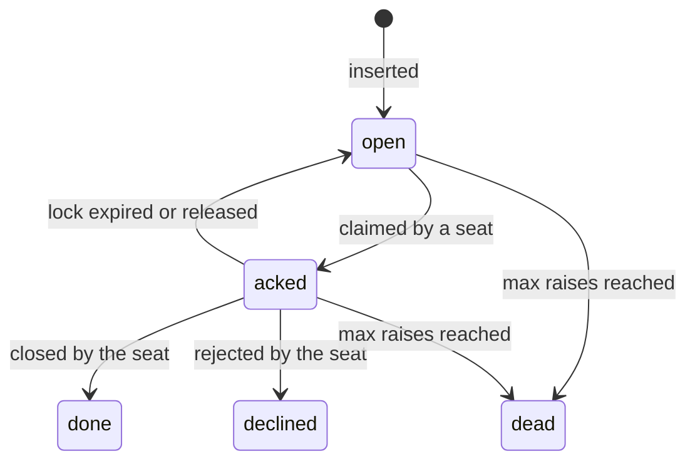

# Review: s134-mistral

Signed against origin/master `28484d78a`.

## 1. Agree / disagree with the draft spec 134

| Section | Agree/Disagree | Reason |
|---|---|---|
| **1. Today: how roles work now** | Agree | Accurate summary of the current single-lease model, its limitations, and the earlier attempts (068, 101). The failures (F1-F7) are well-documented and justify the need for a pool. |
| **2. The owner's model: OD pool** | Agree | The principle of "more working and robust code and less intelligence" is correctly interpreted as a shared table with self-contained rows. The pool model is the right direction. |
| **3. Data, Lock, and Expiry** | Agree | Reusing `fleet_asks` is pragmatic and avoids duplication. The atomic lock and expiry mechanism are sound. The CLI verbs and WUI integration are well-planned. |
| **4. Migration from single lease** | Agree | The steps are logical and shippable. Retiring the single-lease loops and simplifying rotation are necessary. |
| **5. Robust code rules** | Agree | Deterministic lock/expiry in code and tests with red controls are critical for reliability. |
| **6. Build plan (lanes)** | Agree | The build plan is clear and incremental. The separation of concerns (store/hub, CLI, orc actions, WUI) is well-structured. |

## 2. The owner's three asks vs the pool

### (a) No single failure point (at least 2 Grok + 2 Claude doing the work)
- **How the pool meets it**: The pool model ensures that any free OD seat (Claude or Grok) on any box can lock and work a row. With 4 seats per box (2 Claude + 2 Grok), the fleet has 8 seats in total. A single failure (e.g., one seat dead, one box down, or one login at its limit) leaves at least 4 seats available. The atomic lock ensures that only one seat works a row at a time, eliminating contention.
- **Mechanism**: The `fleet_asks` table's `state` and `locked_until` columns, combined with the `SKIP LOCKED` clause in the claim query, ensure that rows are distributed across available seats without overlap. The lease time (`ASKS_LOCK_MIN`) ensures that a stalled seat releases its rows within 5 minutes.
- **Test**: A hermetic test with 8 simulated seats (4 per box) and 100 rows, where 2 seats are killed and 1 box is SIGSTOPPED. Verify that the remaining seats take all rows within 125 seconds (lease expiry + poll interval).

### (b) Broken peer detected quickly, killed, and replaced
- **How the pool meets it**: The box watchdog (spec 093) already monitors seat health (heartbeat, pane stall, login expiry). A stalled or dead seat stops renewing its locks, and its rows become free after `ASKS_LOCK_MIN` (5 minutes). The watchdog kills and replaces the seat within 2 minutes (093's takeover).
- **Mechanism**: The `do_spl_peer_poll` loop checks seat ability (`spl_lease_agent_able`) and progress (`PEER_PROGRESS_MAX`) before renewing locks. A seat that fails either check stops renewing, and its rows expire. The watchdog's `do_spl_wd_takeover` replaces the seat with a fresh session under the same id.
- **Test**: Kill one seat, SIGSTOP another, and expire one login. Verify that the watchdog replaces the dead seat within 2 minutes, and the stalled seat's rows are freed within 125 seconds. The SIGSTOPPED seat's rows are freed after `PEER_PROGRESS_MAX` (10 minutes).

### (c) One kind out (weekly limit, login) -> the other kind takes all seats, and back
- **How the pool meets it**: The `not_by` column in `fleet_asks` routes rows away from a harness that refuses them (e.g., a login at its limit). If all Claude seats are frozen, the two Grok seats on each box take all rows, and vice versa. The `needs=prd` tag (Delta D2 in spec 101) ensures that prd jobs are only offered to seats with the capability.
- **Mechanism**: The claim query excludes seats whose harness is in `not_by`. A seat that refuses a row releases it with `--reason harness-refused:<step>`, adding its harness to `not_by`. The next claim skips it. The `prd=yes|no` flag in `peer/seats/<id>` ensures that prd jobs are only offered to capable seats.
- **Test**: Freeze all Claude logins (simulate a weekly limit). Verify that Grok seats take all rows within 5 seconds. Unfreeze Claude and verify that rows are rebalanced within 5 minutes.

## 3. The row: fields, states, atomic lock, expiry, and how X becomes a row

### Fields
The `fleet_asks` table is expanded to include:

| Field | Type | Purpose |
|---|---|---|
| `kind` | text | `route_post`, `lane_verify`, `box_op` |
| `tenant_id` | text | Workspace scope |
| `task_id` | text | Topic/ask id (for `route_post` and `lane_verify`) |
| `payload` | jsonb | Self-contained context: the topic history, brief, repo state, or box op details |
| `state` | text | `open`, `acked`, `done`, `declined`, `dead` |
| `locked_until` | timestamptz | Lease expiry (hub clock) |
| `acked_by` | text | `<id>@<box>` of the seat that locked it |
| `acked_at` | timestamptz | When it was locked |
| `raised_n` | int | Delivery count |
| `not_by` | text[] | Harnesses that refused it |
| `needs` | text[] | Capabilities required (`prd`, `deploy`) |
| `handled_at`, `handled_how` | timestamptz, text | When and how it was closed |

### States

### Atomic lock and expiry
- **Lock**: `UPDATE fleet_asks SET state = 'acked', acked_by = $seat, locked_until = now() + $ttl WHERE id = $id AND state = 'open' RETURNING *` (compare-and-set).
- **Expiry**: The `do_spl_asks_tick` loop releases rows where `locked_until < now()` and `state = 'acked'`. The next poll of any seat takes them.

### How X becomes a row

| X | `kind` | `payload` | Trigger |
|---|---|---|---|
| Owner post | `route_post` | `{ "topic_id": "...", "history": [...], "brief": "..." }` | `spool-send.sh --to peers` or a human post in a seated workspace |
| Spawn request | `route_post` | `{ "topic_id": "...", "brief": "...", "spawn": true }` | A lane's blocker or a human ask for a new lane |
| ACCEPTED check | `lane_verify` | `{ "lane_id": "...", "task_id": "...", "sha": "..." }` | A lane's `/exit-clean` or a cron job |
| Lane close | `lane_verify` | `{ "lane_id": "...", "task_id": "...", "reason": "..." }` | A lane's `/exit-clean` or a cron job |
| Box op | `box_op` | `{ "op": "...", "args": {...}, "box": "..." }` | A lane's blocker or a human ask for a box operation |

## 4. Migration: steps from today's single leases to the pool

| Step | What | Who acts during it | Rollback |
|---|---|---|---|
| M1 | Add columns to `fleet_asks` (section 3) and the partial index | The pool (seats) is inert until M4 | Drop the columns and index |
| M2 | Build the CLI verbs (`spool ask lock-next`, `spool ask done`) and the WUI "OD Jobs" list | The fleet lease (single orch/dispatch) | Revert the CLI and WUI changes |
| M3 | Rewrite `do_spl_take` and `do_spl_orch_inbox` to consume from the pool | The fleet lease | Revert the actions |
| M4 | **Cut-over**: Disable single-lease cron (`LEASE_CMD=stop`), write `peer/seats` on every box, install peer crons | The pool (seats) | Remove `peer/seats`, restore `lease.conf` and the old crons |
| M5 | Soak: 7 days of the pool on prd, the sweep still running | The pool | M4's rollback |
| M6 | Delete the role code, rewrite fleet-roles | The pool | Git revert + `do_spl_dispatch_setup` |

## 5. Risks

| Risk | Evidence | Mitigation |
|---|---|---|
| **Hub down**: No poll, no web posts, no relays | Spec 093's incident (2026-10-05): a hub outage froze the fleet for 47 minutes | Local lock fallback (093 T011): an `O_EXCL` create of `<spool root>/claims/<msg id>` among a box's own seats for local-origin messages only. No cross-machine duplicate. |
| **Split brain**: One machine reaches the hub, the other does not | Spec 068 F5: a half-applied rank flipped the orch 203 times in 3 hours | The hub is the only arbiter. The cut-off machine's rows move after `ASKS_LOCK_MIN`. Every outward action re-checks `responsible_gen` on the hub. |
| **Duplicate spawns**: Two seats spawn the same lane | Spec 101's incident (2026-10-06): two orchestrators spawned the same task | Delta D5 (intent before act): the lane id is written to the row under the holder's gen (`--park --wait`) BEFORE the spawn, and the spawn refuses an existing lane or worktree. |
| **Prd misroute**: A prd job sent to a seat whose harness refuses it | 2026-10-06: a prd-read request routed to a seat that refused it | Delta D2: a `prd=yes|no` flag per seat, recorded by the seat drill. A `needs=prd` job opens its first round only among capable seats. |
| **Context loss**: A seat's owned topics' context lost on restart | Spec 102: a lane's handoff file is its restart card | The row's `payload` carries the topic history and brief. A follow-up in a topic whose last job is `done` reaches a new owner who reads the topic on the hub. |
| **Config flap**: A half-applied config change | Spec 068 F5: a half-applied rank flipped the orch 203 times in 3 hours | One all-machines action under the `fleet-config` mutex. No ranking left. |

## 6. Owner questions

| Question | A | B | C | Recommendation |
|---|---|---|---|---|
| **Q1**: Should we rename `fleet_asks` to `od_jobs`? | Keep `fleet_asks` in the database, alias as `OD Jobs` in the WUI | Rename the table to `od_jobs` | - | **A**: Avoid a massive migration. The WUI alias is sufficient. |
| **Q2**: What is the optimal lock duration for a routing job vs a box op? | 5 minutes for routing, 60 minutes for box ops | 10 minutes for both | 2 minutes for routing, 30 minutes for box ops | **A**: 5 minutes is enough for routing (a short-lived task), and 60 minutes is safe for box ops (long-running). |
