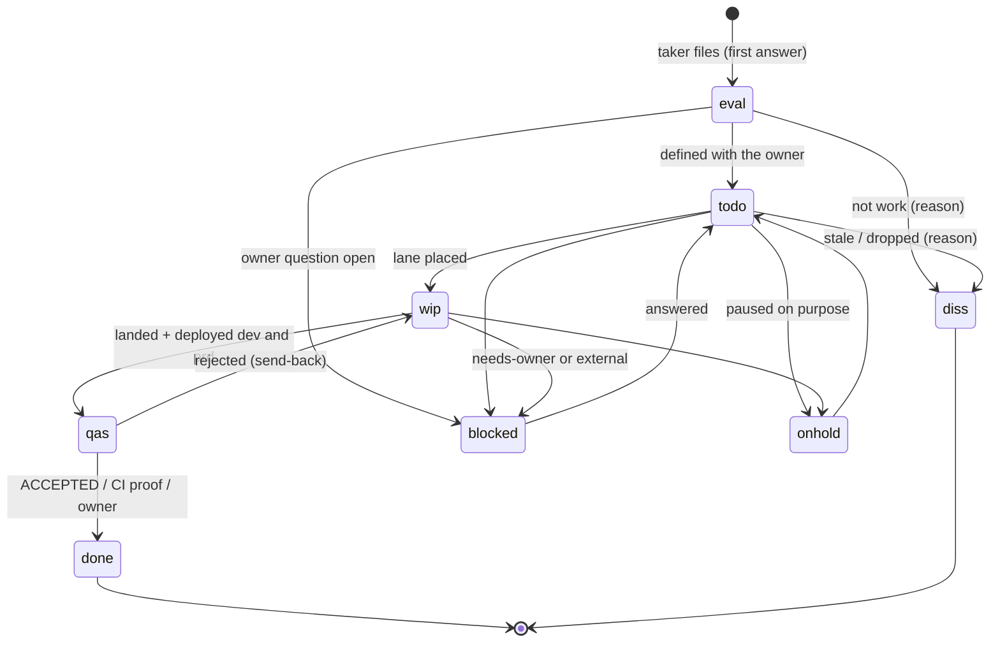

signed against ffd6ebdc1c6c7ff4a801fec7644033f312241e25

# 135 seat s135-claude (claude, EDITOR): the work process

Seat file of the spec 135 panel. Every claim about today cites file:line
on the tree above or the command that showed it. Paths: `api/` =
`csi-spl-api/src/go/spool-hub-api/`, `rdb/` =
`csi-spl-rdb/src/sql/postgres/spool-hub/`, `orc/` = `csi-spl-orc/src/bash/`.

## 0. What today looks like, measured

| fact | evidence |
|---|---|
| The rule already exists, not followed: "Agents do concrete, specced work as issues ... Talk stays in topics and messages" | `csi-spl-doc/specs/039-spool-issues/spec.md:93-97` (FR-008) |
| Commits that cite an issue key | `git log origin/master --since=2026-10-05 --format=%s \| grep -cE 'SPL-[0-9]+'` -> 13 of 1959 subjects (0.7 %); 19 messages cite one anywhere. A subject citing a topic (`t1 <8hex>` or `HUM-10`): 209 |
| Issue statuses, in workflow order | `api/internal/store/issues.go:25-44`: eval, todo, wip, diss, blocked, onhold, qas, done |
| Transitions | none enforced: `applyPatch` sets any status from any (`issues.go:464-475`); `stampStatus` stamps `completed_at` on done, `canceled_at` on diss (`issues.go:484-494`); a new issue is eval (`api/internal/hub/issues.go:323`) |
| History of every change | `issue_events`, trigger-written (`rdb/0181_issue_events.sql:30-47,112`) |
| An issue's own discussion | a topic on `issues.task_id` in the reserved channel `issues` (`api/internal/hub/issues.go:27-31`); comments are notes on that task id (`api/internal/hub/issues_agent.go:263-297`) |
| An issue's link to the discussion it came FROM | none: no column (`rdb/0047_issues.sql:44-75`); only a markdown link in blocker-made issues (`api/internal/hub/blocker_issue.go:66`) |
| A topic's state | no topics table; `topic_heads.card_archived` is the only per-topic state (`rdb/0144_topic_heads.sql:70`); ⏸️ = on hold (`csi-spl-doc/doc/md/SPEC-spool-fleet-roles.md:60-61`) |
| An unanswered blocker becomes an issue, also when it tags the owner | `api/internal/hub/blocker_issue.go:31-41` (tagged "a member HUM-n or a roster agent"), status todo at `:181`, default 3 min |
| Agent front ends | CLI `spool issue` (`api/cmd/spool/issue.go:17-28`), MCP `spool_issue` (`api/internal/mcp/mcp.go:137-140`), desk actions `do_spl_issue_{create,update,comment,list,archive,...}` (`orc/run/spl-issue-*.func.sh`) |
| Spec tasks to issues | `do_spl_spec_import_issues` (`orc/run/spl-spec-import-issues.func.sh:3-16`): one issue per tasks.md entry under the epic "Spec NNN - ..." |
| Stale discard, landed | `do_spl_issue_discard_stale` (a21286f20): diss + reason comment, labels `needs-owner,keep` protect (`orc/run/spl-issue-discard-stale.func.sh:25,155,197-204`) |
| UI-only qas accepted by CI proof, landed | `do_spl_qas_ci_accept` (368450c92): qas -> done when a passing browser e2e covers the key and dev+prd serve it |
| The lane-issue gate, in flight | c-880's worktree (not on master): `spawn-window.sh` files or links an issue at placement (status wip), seed `YOUR ISSUE` block, `/exit-clean` refuses a wip issue with no landed commit citing the key, and a behaviour change with neither a `csi-spl-doc/` change nor `Docs: none (<why>)` |

Not readable from this box: the briefs of c-339, c-341, c-350 (lanes of the other box, no
`/var/spool-hub/c-3{39,41,50}` here). Section 6 judges them by the panel
brief's one-line scope only.

The gap in one line: the hub has the issue machinery; nothing in the flow
from an owner post to a deploy is required to touch it, and nothing links
an issue back to the discussion it came from.

## 1. Objects

| object | created by | states and who moves them | links | ends |
|---|---|---|---|---|
| **discussion** (topic) | a human's post (or an agent's, `c-001` only, `SPEC-spool-fleet-roles.md:51-58`) | open; on hold (⏸️, `do_spl_react`); closed = archived by a human. Agents never close or reopen one | its issues (NEW: `issues.source_task_id`, 3.3 below); the taker's take line (`do_spl_take`) | a human closes it; open issues it spawned stay open and keep their link |
| **issue** | the OD that took the discussion, from its first answer (section 3); a lane placement with no key (c-880); the blocker rule (`blocker_issue.go`); spec import | section 3.2's diagram; every move by a named action, never by hand in SQL | `source_task_id` (the discussion), `task_id` (its own discussion), assignee (the lane id), parent/epic (the spec epic), commits (key in the subject scope), release (v-tag in the qas comment) | done or diss with a comment; archived later (`do_spl_issue_archive`) |
| **lane** (agent + worktree + branch) | `spawn-window.sh` for exactly ONE issue key (c-880 makes the key mandatory) | placed -> working -> landed -> ACCEPTED -> exited; rotation and takeover keep the id and the key | `lifetime/issue` holds the key; branch `<id>-<slug>`; the issue's assignee | `/exit-clean` after ACCEPTED; worktree and branch removed |
| **spec** | a panel (seats + editor) on the owner's ask, `csi-spl-doc/specs/NNN-*/` | draft -> v1.0-rc -> v1.0 signed (editor bumps; seats sign); owner questions decided by the owner | one epic "Spec NNN - ..." in Issues; its tasks become issues (`do_spl_spec_import_issues`) | superseded by a later spec, named in its header |
| **doc page** | the lane whose behaviour change needs it (c-880 docs rule) | no states: git history; one home per rule (`fleet-rules-index.md`) | the commit citing the issue key | never; edited in place |
| **release** (v-tag) | CI on a hub (20) or WUI (30) deploy, `do_release_version` (`orc/run/release-version.func.sh`) | minted once, never edited | commits since the previous tag -> their keys -> their issues | permanent |

### 1.1 Two kinds of issue, one table

The owner (18:07): "Even if the entity of work is to do some kind of
evaluation and some kind of answering my questions, just to keep track".
No new status or kind column is needed: a label.

| label | the work | done means |
|---|---|---|
| (none) | build: code, test, land, deploy | ACCEPTED or the CI proof, after deploy |
| `answer` | an evaluation, an analysis, an answer to the owner | the answer posted in the discussion; the issue's done comment links it |
| `needs-owner` | (on any issue) a decision only the owner makes | removed by the OD when he decides, quoting his message id |

## 2. Roles

| role | does | never does |
|---|---|---|
| **owner** (HUM-10) | posts asks; decides owner questions (A/B); accepts what is labelled owner-acceptance; closes discussions | is asked to move an issue status or paste a command |
| **orchestrator** (`c-001`) | places lanes for an issue key (refuses a placement without one); decisions; prd operations the dispatchers' harness refuses; closes lanes | takes a post the dispatch lease holder took; files issues for someone else's discussion |
| **dispatchers** (`c-002`/`c-003`, the lease holder) | take a post (`do_spl_take`); file the discussion's issue(s) in eval from the first answer; define each with the owner (eval -> todo); move blocked / `needs-owner` while an owner question is open; judge Done (ACCEPTED) -> done; tell the owner in the topic | build code a lane should build; create an issue for a question addressed TO the owner (section 3.1, 4a); set done on a claim it did not check (`SPEC-spool-fleet-roles.md:197-202`) |
| **lane agents** (c-, g-, m-, a-, q-) | one issue; cite its key in every commit subject; comment a checkpoint on the issue at each landing, blocker and rotation (section 5); update the doc page in the same lane; end the issue (diss/onhold/blocked + reason) if they stop without landing | change another issue's status; work without a key; set done on their own issue |
| **panel seats + editor** | one seat file each; the editor merges spec.md, collects signatures; the spec's issue is `answer`-labelled, done at v1.0 | edit another seat's file; decide an owner question |
| **reviewers** (agy, language rule) | last review of multilingual text; their seat is a subtask of the text's issue | ship text unreviewed |
| **CI** | gates, deploys dev and prd, mints the v-tag, proves UI qas issues (`do_spl_qas_ci_accept`) | decides anything; moves an issue except the qas -> done CI proof |

## 3. The flow

### 3.1 End to end

| # | step | status change | who | tool |
|---|---|---|---|---|
| 1 | owner posts | - | owner | WUI |
| 2 | taken within 3 min | - | dispatch lease holder | `do_spl_take` |
| 3 | first answer: the issue(s), even for a pure question (`answer` label); chatter, acks and announcements file none | new -> **eval**, `source_task_id` = the topic | taker | `do_spl_issue_create ISSUE_SOURCE_TOPIC=<uuid>` (NEW variable) |
| 4 | defined with the owner: title, scope, acceptance, `answer` or build | eval -> **todo** (owner said so, or a standing order covers it, e.g. refactoring rounds `SPEC-spool-fleet-roles.md:63-77`) | taker | `do_spl_issue_update` |
| 4a | a question TO the owner (A/B): stays a line in the discussion; no new issue | the asking issue -> **blocked** + `needs-owner` | taker | `do_spl_issue_update ISSUE_LABELS=...` |
| 4b | owner answers | blocked -> todo (or new issues for what he decided), label removed, his msg id in a comment | taker | `do_spl_issue_update` + `do_spl_issue_comment` |
| 5 | a lane placed for the key | todo -> **wip**, assignee = lane | `spawn-window.sh` | `do_spl_lane_issue` (c-880) |
| 6 | branch, commits `feat(<area>, SPL-123): ...`, pre-push gate, push to master | - (checkpoint comment per landed sha) | lane | `git`, `do_check_pre_push`, `do_spl_issue_comment` |
| 7 | CI green, deployed dev AND prd (`do_check_deploy_lag`) | wip -> **qas**, comment: shas, v-tag, release note link | landed-fix rule | c-341's action (key in subject) |
| 8 | accepted | qas -> **done** | dispatcher ACCEPTED; CI proof for UI-only; the owner when labelled owner-acceptance | `do_spl_issue_update`, `do_spl_qas_ci_accept` |
| 9 | docs current | checked at `/exit-clean` | lane | c-880 exit gate |
| 10 | owner told, in the topic, with the issue key and the release | - | taker | `do_spl_desk_reply` |

An `answer` issue skips 5-7: the taker (or a panel lane) answers; done
when the answer is posted.

### 3.2 Issue states

The hub keeps accepting any transition (`issues.go:464-475`); the actions
above are the only writers in the flow, and `issue_events` (rdb 0181)
shows any jump outside the diagram. A hub-side transition check is not
proposed: the owner and the WUI must stay able to fix a wrong status.

### 3.3 The one hub change: link back to the discussion

`issues.source_task_id uuid NULL` (new rdb migration), set on create and
editable; `GET /v1/view/issues?source=<task_id>` lists a discussion's
issues; the WUI shows "from: <topic>" on the issue and "issues: SPL-n" on
the topic header. Until it lands: the description's first line is
`Topic: /t/<uuid>`.

## 4. Branching and deployment

Today (`csi-spl-doc/doc/md/developer-guide.md` 1.1-1.3): one trunk, push
to master after a rebase and the pre-push gate, CI deploys dev and prd on
the push (`grep -n "wanted=(dev prd)"` -> `20_hub-build-deploy.yml:157`,
`30_wui-build-deploy.yml:135`), the v-tag is minted. 4951 commits, 1 merge
(developer guide 1.1).

| option | what | for | against |
|---|---|---|---|
| **A** keep trunk; the issue key rides the commit | every lane commit subject carries its key; the pre-push hook warns one week, then refuses a lane commit to master without a key (role seats, CI bot and rotation commits exempt); deploys unchanged; qas = "deployed both" | no new waiting; the key turns trunk history into issue history; release -> commits -> issues needs no new object | prd gets what master has before acceptance (as today) |
| **B** branch per issue + PR | `issue/SPL-123` branch, CI on the PR, a dispatcher merges | a review point before master | one merge in 4951 commits says the fleet works without it; a merge queue for ~280 commits a day (1959 in 7 days); rebases pile up while PRs wait |

**Recommendation: A.** Deploy: keep dev and prd on the push; acceptance
(qas -> done) stays after deploy. Gating prd on acceptance would hold
every other lane's prd behind one issue's review.

## 5. Context and restart

The issue becomes the durable, human-readable state; `handoff.md`
(`csi-spl-doc/specs/102-agent-lifetime/spec.md:275-311`) stays the machine
detail. A fresh agent starts from: the issue key -> its description (the
brief: owner's words, scope, files not to touch, acceptance) + its last
checkpoint comment + the lane branch + its wip ref (102 5.4).

| trigger | the lane writes on the issue | tool |
|---|---|---|
| a landed sha | `checkpoint: landed <sha>; next: <one line>` | `do_spl_issue_comment` |
| a blocker raised | `checkpoint: blocked on <who>, msg <id>` + status | `do_spl_issue_update` |
| rotation, watchdog restart, takeover | the rotation composes the comment from handoff sections 3, 5, 6 only (no terminal lines: section 4 can carry secrets, 102 5.3) | `do_spl_lane_rotate` / `do_spl_wd_takeover`, NEW step |
| stop without landing | end status + reason | `do_spl_lane_issue LANE_ISSUE_OP=end` (c-880) |

A new session's seed then names the key first; the brief file stays as a
fallback. Proof to build: kill a lane mid-task, respawn it from the key
alone (no handoff file), and it reaches the same next step.

## 6. Today's lanes

| lane | keep / change |
|---|---|
| c-880 | KEEP (placement files or links the key, wip, exit gate, docs rule); ADD `ISSUE_SOURCE_TOPIC` from the brief's topic id |
| c-350 | KEEP the rule; implement it as 3.1 step 4a (blocked + `needs-owner` on the asking issue), and exclude HUM-tagged blockers from the `blocker_issue.go` auto-issues (Q3) |
| c-340 | KEEP as landed (a21286f20): diss with a reason, never delete, `needs-owner` protects |
| c-339 | KEEP the `needs-owner` label and the daily digest; the digest also lists qas issues waiting for the owner's acceptance |
| c-341 | CHANGE: a landed fix moves its issue to **qas** once deployed dev and prd, not to done; done stays acceptance (Q4) |
| g-342..g-347 | KEEP: read-only verdicts, input to c-340's triage |

## 7. Owner questions

| Q | question | A | B | C | recommendation |
|---|---|---|---|---|---|
| Q1 | A question agents ask YOU (an A/B decision): what is it in Issues? | a line in the discussion; the issue it blocks goes blocked + `needs-owner`; your answer creates or unblocks issues | its own issue in eval, labelled `needs-owner` | - | **A**: "should not become an issue until the owner decides" |
| Q2 | Does every discussion an agent takes get an issue? | yes, at least one from the first answer, `answer`-labelled for evaluations and questions; chatter, acks and announcements none | only discussions with build work | - | **A**: your 18:07 "maybe spawn one issue always" |
| Q3 | A blocker that tags YOU turns into a todo issue after 3 min (`blocker_issue.go:31-41,181`) | exclude HUM-tagged blockers; they become `needs-owner` on the issue instead | keep as is | - | **A**: today's code contradicts Q1 A |
| Q4 | Who moves qas -> done? | dispatcher ACCEPTED, or the CI proof for UI-only; you see both in the daily digest | only you | you for `owner-acceptance`-labelled issues, A for the rest | **C** |
| Q5 | Branching | trunk, the key in every commit, pre-push enforces it after one warn week | a branch and PR per issue | - | **A** (section 4) |
| Q6 | Where do the docs change? | build lanes after v1.0 update `developer-guide.md` (a material change: every coder re-acks, its section 6), `SPEC-spool-fleet-roles.md`, `SPEC-spool-task-lifecycle.md` | a new page only, the guide points to it | - | **A**: the guide is where the branching strategy lives |

<!-- version: 0.1.0 · updated: 2026-10-12 · last-edit: 2026-10-12T18:40:00Z -->
