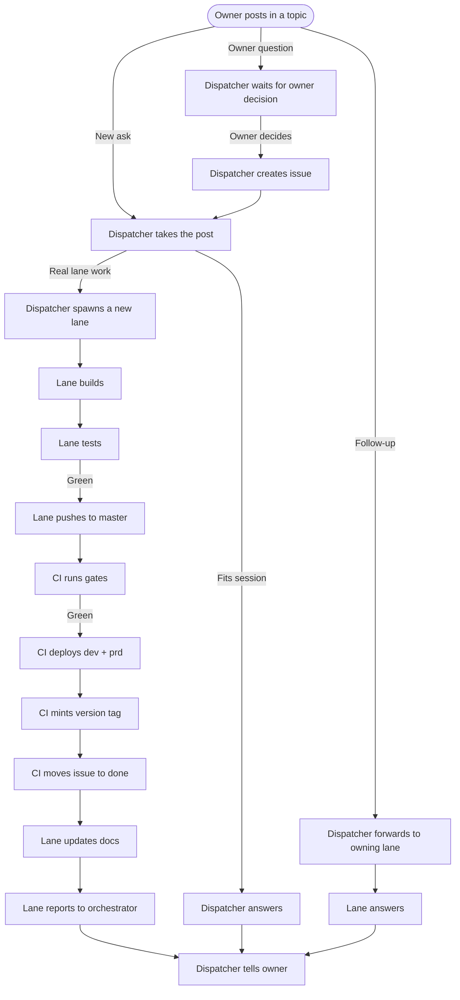

# s135-mistral review: work process panel

**Signed against origin/master 7c90b87f1 (2026-10-12).**

## 1. Objects

| Object          | Created by               | States (who moves them)                                                                 | Links to others                                                                 | Ends when                                                                                     |
|-----------------|--------------------------|---------------------------------------------------------------------------------------|---------------------------------------------------------------------------------|-----------------------------------------------------------------------------------------------|
| **Discussion**  | Owner (human post)       | Open (owner) → On hold (owner/dispatcher) → Archived (owner/dispatcher)               | Topic (task_id) → issue(s)                                                      | Archived or deleted                                                                           |
| **Issue**       | Dispatcher (from discussion) | Eval (dispatcher) → Todo (dispatcher) → WIP (lane) → Blocked (lane/owner) → On hold (owner) → QAS (lane) → Done (CI/rule) / Diss (owner) | Task_id (topic) → lane → commit(s) → release                                    | Done or Diss                                                                                  |
| **Lane**        | Dispatcher (spawn)       | Active (dispatcher) → Closed (orchestrator)                                           | Issue → branch → commit(s) → master                                              | Task verified, or abandoned                                                                   |
| **Spec**        | Owner (request) / Panel   | Draft (panel) → v1.0 (panel consensus) → Implemented (CI) → Archived (owner)          | Issue(s) → lane(s) → doc page(s)                                                | Implemented or abandoned                                                                      |
| **Doc page**    | Lane (build)             | Draft (lane) → Published (CI) → Archived (owner)                                      | Issue → spec → release                                                           | Replaced or archived                                                                          |
| **Release**     | CI (deploy)              | Tagged (CI) → Deployed (CI) → Archived (owner)                                        | Commit(s) → issue(s) → doc page(s)                                              | Replaced by a newer release                                                                   |

### Key rules:
- **Every discussion spawns at least one issue** (owner t1 5ea2e615: "one issue at least, from the first answer").
- **An owner question waits for their decision** before becoming an issue (c-350: "an owner question becomes an issue only when the owner decides").
- **An issue is the thread key** (SPEC-spool-task-lifecycle.md 1): every message carries its `task_id`.
- **A lane is one small task** (SPEC-spool-fleet-roles.md 1.1): one issue, one build-test-land cycle, then closed.
- **Done is automatic** (c-341: a fix landed on master moves its issues to done by rule).

## 2. Roles

| Role            | Does                                                                                     | Never does                                                                                     |
|-----------------|------------------------------------------------------------------------------------------|------------------------------------------------------------------------------------------------|
| **Owner**       | Posts questions, decides what becomes an issue, closes discussions, archives topics/issues | Writes code, routes traffic, deploys                                                           |
| **Orchestrator**| Decides, spawns/closes lanes, verifies claims, runs prd operations harnesses refuse       | Takes routine posts, dispatches (unless holding the lease)                                     |
| **Dispatcher**  | Takes every new post, owns its topic, answers or spawns a lane, delivers owner texts      | Decides, runs prd operations harnesses refuse, touches other lanes' files                     |
| **Lane agent**  | Builds, tests, lands, proves live, reports to orchestrator, updates docs                  | Routes traffic, touches other lanes' files, decides, moves issues (except WIP → QAS)           |
| **Panel seat**  | Reviews spec drafts, signs v1.0, answers editor's review                                 | Edits other seats' files, writes code, moves issues                                            |
| **Editor**      | Folds panel reviews into spec.md, tallies consensus, posts owner questions                | Writes code, moves issues, reviews other seats' files                                          |
| **Reviewer**    | Reviews multilingual text (agy language rule)                                            | Writes code, edits specs, moves issues                                                         |
| **CI**          | Runs gates, deploys dev/prd, mints version tags, moves issues to done, publishes docs     | Decides, routes traffic, writes code                                                           |

### Key rules:
- **Dispatchers answer within 3 minutes** (SPEC-spool-fleet-roles.md 3: the OD that takes a post owns it).
- **No open-ended chatter** (how-to-post.md 7: a post that asks a human a question keeps its own link).
- **A lane stays in its own lane** (AGENTS.md 25: never touch another lane's files).
- **A finding outside your lane goes to the orchestrator** (AGENTS.md 25).
- **The orchestrator holds the lease for prd operations** (repo CLAUDE.md: "Nothing mutates GCP without the owner").

## 3. The flow

### Key rules:
- **Every step is logged in the issue** (c-880: "every lane carries an issue").
- **A lane pushes continuously** (lane-integration-rules.md 1.3: fast parts before slow ones).
- **A lane rebases before every push** (lane-integration-rules.md 2.2).
- **A lane runs the pre-push gate** (repo CLAUDE.md: "Run the cheap gate for the tree you touched").
- **A lane proves it deployed** (lane-integration-rules.md 6: "CI: 'gh run list --commit <sha>'").

## 4. Branching and deployment

### Today's model:
- **Push to trunk**: every lane pushes to `master` (repo CLAUDE.md: "Push directly to trunk").
- **Pre-push gate**: `do_check_pre_push` runs before every push (repo CLAUDE.md: "Run the cheap gate for the tree you touched").
- **CI deploys dev + prd**: wf 10 deploys both environments (repo CLAUDE.md: "Deploy both `dev` and `prd`").
- **Version tags**: CI mints `v<X.Y.Z>` on every deploy (repo CLAUDE.md: "Never roll the version by hand").

### What should change:
- **Option A (recommended)**: Keep push-to-trunk, but add a **per-part CI gate** (spec 133) to skip unrelated jobs.
  - *Why*: Today CI runs every job on every push (wf 10 comment: "deliberately not selective"), which is slow and wasteful.
  - *How*: A `ci-doc-only.sh` for docs, a `ci-hub-only.sh` for hub changes, etc. (spec 133 seat C).
- **Option B**: Switch to short-lived branches for features, with PRs.
  - *Why*: Owner t1 5ea2e615: "the concrete decision on what needs to be done and the tracking of the statuses must be reflected in the issues."
  - *How*: A branch per issue, PR to `master`, CI runs on PR.
  - *Risk*: Rebase conflicts, abandoned branches, harder to audit.

## 5. Context and restart

An issue carries enough state for a fresh agent to restart:
- **Issue fields**: `status`, `assignee`, `task_id` (topic), `description`, `labels`, `deadline`.
- **Lane context**: The issue's `task_id` is the topic; the lane's branch and commits are linked in the issue description.
- **Restart rule**: A lane parks its context in `/var/tmp/c-parent-level/dispatch/hold/<topic>/` (SPEC-spool-fleet-roles.md 1.1).
- **Tools**: `do_spl_desk_reply` answers in the topic, `spool-send.sh --ref <task>` sets the topic ref.

### Key rules:
- **A lane never loses context**: Every commit, test result, and question is logged in the issue.
- **A lane exits cleanly**: `/exit-clean` only on a spool message starting with `ACCEPTED` (seed prompt).

## 6. What today's lanes keep or change

| Lane   | Keeps/Changes                                                                                     |
|--------|---------------------------------------------------------------------------------------------------|
| c-880  | **Keeps**: Every lane carries an issue (brief: "one issue per lane, docs current").              |
| c-350  | **Keeps**: An owner question becomes an issue only when the owner decides (brief).                |
| c-340  | **Keeps**: Discard stale issues (brief: "discard stale issues").                                |
| c-339  | **Keeps**: Needs-owner label + daily digest (brief: "needs-owner label + daily digest").        |
| c-341  | **Changes**: A fix landed on master moves its issues to done (commit 4160581d3).                  |

## 7. Owner questions

| Question                                                                 | Options (A/B/C) + Recommendation                                                                 |
|-------------------------------------------------------------------------|---------------------------------------------------------------------------------------------------|
| Should an owner question become an issue immediately or wait for a decision? | **A**: Wait for owner decision (c-350). **B**: Become an issue immediately. **Recommendation**: A. |
| Should CI skip unrelated jobs on a push?                                | **A**: Yes, add per-part gates (spec 133). **B**: No, keep running everything. **Recommendation**: A. |
| Should issues close automatically when a fix lands?                     | **A**: Yes (c-341). **B**: No, manual close. **Recommendation**: A.                              |
| Should every discussion spawn at least one issue?                        | **A**: Yes (owner t1 5ea2e615). **B**: No, only when needed. **Recommendation**: A.               |
| Should the orchestrator hold the lease for prd operations?               | **A**: Yes (repo CLAUDE.md). **B**: No, dispatchers handle it. **Recommendation**: A.             |