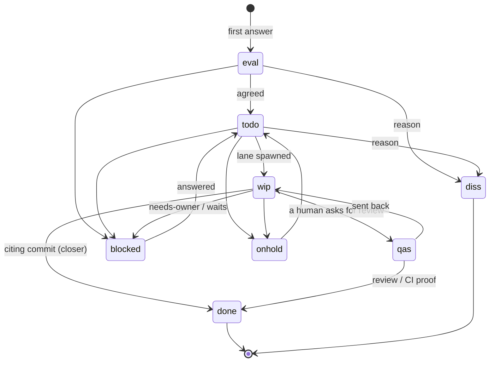

# 135: The work process: discussions, issues, lanes, docs, releases

Status: **v1.0, signed** by all four seats (section 10); rc1 43f203c17 signed unchanged.
Editor s135-claude (c-882). Owner questions Q1-Q8 (section 9) are the owner's to decide.
Merged from the four seat files in `reviews/` against origin/master
28484d78a. Build lanes make every code and doc-page change after v1.0;
this spec changes no code.

Paths: `api/` = `csi-spl-api/src/go/spool-hub-api/`, `rdb/` =
`csi-spl-rdb/src/sql/postgres/spool-hub/`, `orc/` = `csi-spl-orc/src/bash/`.

## 0. The owner's ask

HUM-10, t1 #refactoring, topic 5ea2e615, 2026-10-12, verbatim:

> 18:02 "An owner question should not become an issue until the owner decides that."

> 18:02 "What we have been doing by now is omitting the part of doing some kind of official flow. Rather, we have been super agile in a way that the agents have been taking orders from me directly in the discussions. They have been implementing the features without actually going through the whole process of any certain issues, changing the statuses of the issues, keeping track, and so on and so forth."

> 18:04 "Probably the correct way for this whole system to work will be for the discussions to be discussions, but the concrete decision on what needs to be done and the tracking of the statuses must be reflected in the issues. The agents must be updating those issues constantly and also making sure that the documentation is kept up to date as well, just like a regular software project."

> 18:07 "One discussion might spawn one or more issues, but empty discussions (discussions without issues): why not? ... Maybe spawn one issue always, and the agents should discuss with me how to define the issue properly. ... Even if the entity of work is to do some kind of evaluation and some kind of answering my questions, just to keep track of what is happening. The issues might also be used for the mechanism of keeping the context window smaller and for the mechanism of being able to more quickly stop agents and start new instances of those agents."

> 18:21 "we need a panel with consensus once again to agree on the whole process - what objects are created - what role of what agents what is doing etc." ... "once agreed it will become as part of the overall development life cycle , related to the branching and deployment strategy"

Earlier, the rule the closer codes (t1 dee4081d, msg ea519baa): "Done should be the automatic target".

## 1. Today, measured

| fact | evidence |
|---|---|
| The rule exists, unenforced: "Agents do concrete, specced work as issues ... Talk stays in topics and messages" | `csi-spl-doc/specs/039-spool-issues/spec.md:93-97` (FR-008) |
| Commits citing an issue key | `git log origin/master --since=2026-10-05 --format=%s \| grep -cE 'SPL-[0-9]+'` -> 13 of 1959 subjects (s135-claude) |
| Eight statuses, any transition accepted | `api/internal/store/issues.go:25-44`; `applyPatch` sets any status (`issues.go:464-475`); `done` stamps `completed_at`, `diss` stamps `canceled_at` (`issues.go:484-494`); new = `eval` (`api/internal/hub/issues.go:323`) |
| History of every field change | `issue_events`, trigger-written (`rdb/0181_issue_events.sql:30-47,112`) |
| An issue's own discussion | a topic on `issues.task_id` in the reserved `issues` channel (`api/internal/hub/issues.go:27-31`); comments are notes on it (`api/internal/hub/issues_agent.go:263-297`) |
| Link from an issue to the discussion it came FROM | none: no column (`rdb/0047_issues.sql:44-75`); only blocker-made issues link their message (`api/internal/hub/blocker_issue.go:66`) |
| A blocker that tags anyone, the owner included, becomes a `todo` issue after 3 min | `api/internal/hub/blocker_issue.go:31-41,181` |
| A landed `fix/feat/perf/refactor(…, SPL-n)` commit or a `Closes: SPL-n` trailer sets `done`, hourly | `do_spl_issue_close_landed` (`orc/run/spl-issue-close-landed.func.sh:1-16`, 8202595fe), parse `orc/scripts/issue-close-landed.py:75-84` |
| The parser's header says a `docs` commit never closes; `commit_keys` closes on any `Closes:` trailer | `issue-close-landed.py:25-29` vs `:75-84` (s135-grok) |
| A lane's shas checked for still-open issues | `do_spl_issue_close_check` (4160581d3), not wired into `/exit-clean` (`git grep -l do_spl_issue_close_check` -> the action and its test) |
| Waiting for the owner | `do_spl_issue_needs_owner`: label `needs-owner`, open -> `blocked`, one "Needs owner" line; daily digest `do_spl_owner_digest_post` (both ada13012e) |
| Stale discard | `do_spl_issue_discard_stale` (a21286f20): `diss` + reason, never deletes; `needs-owner`, `keep` protect |
| UI-only `qas` accepted by a CI browser proof | `do_spl_qas_ci_accept` (368450c92) |
| Lane issue at placement, docs rule at exit | c-880, in flight, not on master |
| The deploys are path-filtered; a docs-only push gets no tag | `20_hub-build-deploy.yml:48-64,157`, `30_wui-build-deploy.yml:37-45,135`; the quality gate runs on every push (`10_ci-quality.yml:40-47`) (s135-grok) |

The gap: the hub has the issue machinery and several rules already landed
today. The flow from an owner post to a lane does not require an issue,
and nothing links an issue to the discussion it came from.

## 2. Objects

| object | created by | states, and who moves them | links | ends |
|---|---|---|---|---|
| **discussion** (topic) | whoever posts; the dispatch holder that takes it owns it (`SPEC-spool-fleet-roles.md:126-162`) | open; on hold (⏸️, `do_spl_react`); closed or archived by a human only | its issues: a `Source:` line in each issue, and the taker posts each key back into the topic (7.1) | a human closes it; issues it spawned stay and keep their link |
| **issue** | the dispatch holder, from the first answer (section 4) or before a spawn; the blocker rule; spec import (`do_spl_spec_import_issues`) | section 5's state table; every write by a named action | `Source:` (the discussion), `task_id` (its own discussion), assignee (the lane), parent (feature or spec epic), commits (key in subject scope or `Closes:`), release (the closer's comment) | `done` or `diss` with a comment; archive later |
| **lane** (agent + worktree + branch) | the spawner, for exactly one issue key (c-880: no key, no start) | `live` -> `done` in the lane map (`lane-map.sh put` / `done`); rotation and takeover keep the id and the key | `lifetime/issue`, the issue's assignee, branch `<id>-<slug>` | `/exit-clean` after ACCEPTED; worktree and branch removed |
| **spec** | a panel (seats + editor), `csi-spl-doc/specs/NNN-*/` | draft -> v1.0-rc -> v1.0 signed; owner questions decided by the owner | an issue for the panel itself; a spec epic for its build issues | superseded by a later spec named in its header |
| **doc page** | the lane whose behaviour change needs it | none: git history; one home per rule (`fleet-rules-index.md`, `do_check_fleet_rules_drift`) | the commit citing the issue key | edited in place |
| **release** (v-tag) | CI inside the hub (20) or WUI (30) deploy, `do_release_version` | minted once, never edited | commits since the previous tag -> their keys -> issues | permanent |

### 2.1 Issue kinds, by label

No new status or column (all seats).

| label | the work | done when |
|---|---|---|
| (none) | build: code, test, land | its citing commit lands (section 5) |
| `answer` | an evaluation, an analysis, an answer to the owner | the answer is posted in the discussion; the closing comment links it |
| `needs-owner` | on any issue: a step only the owner can take | the owner acts; `OWNER_STEP_CLEAR=1 do_spl_issue_needs_owner` |

## 3. Roles

| role | does | never does |
|---|---|---|
| **owner** (HUM-10) | says what the work is; agrees the entity of work (eval -> todo); decides owner questions and whether a question becomes an issue; pauses work (`onhold`); reopens a `done` issue; closes discussions | is filed an issue by the blocker rule; is asked to move a status or paste a command |
| **orchestrator** (`c-001`) | decides; places, re-seats and closes lanes; refuses a placement without an issue key; verifies "live" claims; prd operations the dispatchers' harness refuses | takes a post the dispatch holder took; files issues for a discussion it does not own |
| **dispatchers** (`c-002`/`c-003`, the lease holder) | take the post (`do_spl_take`); file the issue(s) in `eval` from the first answer; define each with the owner and set `todo`; mark `needs-owner` while an owner question blocks; spawn the lane; tell the owner in the source topic with the key and the sha | build lane code; file an issue for a question addressed TO the owner; set `done` on a claim nobody checked; dispatch on standby |
| **lane agents** (c-, g-, m-, a-, q-) | one issue; cite its key in the landing commits; keep the issue's restart card current and comment a checkpoint per landed sha, blocker and rotation (section 7); docs in the same lane; end the issue with a reason if they stop without landing | a second task; another issue's status; posting in the owner's topic; setting their own issue `done` by hand |
| **panel seats + editor** | one seat file each against a named sha; the editor merges `spec.md`, tallies, collects signatures; the panel's issue is `answer`-labelled | another seat's file; deciding an owner question |
| **language reviewer** (agy) | the last word on multilingual user-facing text, as a subtask of the text's issue | blocking English rule text or code commits |
| **CI** | the quality gate on every push; hub and WUI deploys to dev and prd with a minted tag; the UI `qas` proof | choosing a status; reviewing a design |
| **the closer** (hourly cron) | `do_spl_issue_close_landed`: sets `done` on a citing commit, with sha and release link | closing an epic or a feature; re-closing what the owner reopened |

## 4. The flow

| # | step | status | who | tool |
|---|---|---|---|---|
| 1 | the owner posts | - | owner | WUI |
| 2 | taken within 3 min | - | dispatch holder | `do_spl_take` |
| 3 | first answer: the issue(s) (Q1); an evaluation or question is an `answer` issue; acks, chatter and announcements file none | new -> `eval` | holder | `do_spl_issue_create`, description starts `Source: /t/<uuid>`; the key posted back in the topic |
| 4 | a question TO the owner stays a line in the discussion (Q2) | the issue it blocks -> `blocked` + `needs-owner` | holder or lane | `do_spl_issue_needs_owner` |
| 5 | the entity of work agreed with the owner, or covered by a standing order (refactoring rounds, `SPEC-spool-fleet-roles.md:63-77`) | `eval` -> `todo` | holder | `do_spl_issue_update` |
| 6 | a lane spawned for the key; several lanes of one decision sit under one `feature` | `todo` -> `wip`, assignee = lane | spawn path | c-880 (`spawn-window.sh`) |
| 7 | branch, commits `feat(<area>, SPL-n): ...`, pre-push gate, rebase, push to master | checkpoint comment per landed sha | lane | `git`, `do_check_pre_push`, `do_spl_issue_comment` |
| 8 | quality gate; hub/WUI deploy to dev and prd with a tag when their paths changed | - | CI | workflows 10, 20, 30 |
| 9 | the citing commit on master | -> `done` (Q3) | the closer, hourly | `do_spl_issue_close_landed` |
| 10 | before exit: no named issue still open; docs changed or `Docs: none (<why>)` | - | lane | `do_spl_issue_close_check` + c-880's docs check in `/exit-clean` |
| 11 | a lane that stops without landing | -> `diss`, `onhold` or `blocked` + reason | lane | `do_spl_lane_issue LANE_ISSUE_OP=end` (c-880) |
| 12 | the owner told, in the source topic, with the key, sha and release | - | holder | `do_spl_desk_reply` |

An `answer` issue skips 6-9: whoever answers posts the answer and closes the
issue with a `Closes:` commit (a panel) or `do_spl_issue_update
ISSUE_STATUS=done` plus a comment linking the answer (no commit).

## 5. Issue states

| from | to | when | who |
|---|---|---|---|
| (new) | `eval` | filed at the first answer | holder |
| `eval` | `todo` | entity of work agreed | holder |
| `eval`, `todo`, `wip`, `onhold` | `blocked` | waits on the owner (`needs-owner`) or on someone named in a comment | holder, lane |
| `blocked` | `todo` / `wip` | answered | holder |
| `todo`, `wip` | `onhold` | paused on purpose (the owner's word) | holder |
| `todo` | `wip` | lane spawned | spawn path |
| `wip` (any open) | `done` | a citing commit on master | the closer |
| `wip` | `qas` | only when a human asks for a review (Q7) | holder |
| `qas` | `done` | the review passes, or the CI browser proof for UI-only | reviewer, `do_spl_qas_ci_accept` |
| `qas` | `wip` | sent back | reviewer |
| any open | `diss` | not work, stale, or dropped, with a reason | holder, `do_spl_issue_discard_stale`, lane at exit |
| `done` | (reopened) | the owner reopens | owner; the closer never re-closes for the same sha |

The hub keeps accepting any transition (`issues.go:464-475`): the owner and
the WUI must stay able to correct a status. The actions above are the only
writers in the flow; `issue_events` shows any jump outside the table.

## 6. Branching and deployment

All four seats: **keep the trunk** (Q5). One `master`; a lane branch is
scratch, removed after the land; fetch, rebase, `do_check_pre_push`, `git
push origin HEAD:master`; CI deploys dev and prd and mints the tag
(`developer-guide.md` 1.1-1.3). The issue rides on this path:

- the key in the landing commit's subject scope, or a `Closes: SPL-n`
  trailer, is the link from trunk history to the issue, and what the closer
  reads;
- a docs-only push gets no deploy and no tag: its issue is `done` when the
  commit lands;
- a `Refs: SPL-n` trailer or a body mention links without closing.

How hard the key is enforced is Q6.

## 7. Context and restart

### 7.1 The card

The issue description starts with a card (s135-grok), kept current by the
lane with `do_spl_issue_update ISSUE_DESCRIPTION_FILE=...` (budget 20000
characters, `issues.go:71`):

    ## Source
    /t/<topic uuid>

    ## Restart
    - key: SPL-n
    - spec: csi-spl-doc/specs/NNN-slug/spec.md (or none)
    - scope: <paths>
    - must not touch: <paths>
    - test: <one command>
    - last citing sha: <sha or none>
    - next: <one line>
    - open question: <one line + who has it, or none>
    - docs: <path, or none: why>

Below it: the owner's words and the acceptance.

### 7.2 Checkpoints

A comment `checkpoint: <what>; next: <one line>` per landed sha, per blocker
raised, and per rotation, watchdog restart or takeover. The rotation composes
it from handoff sections 3, 5 and 6 only, never terminal lines, which can
carry secrets (`specs/102-agent-lifetime/spec.md` 5.3) (s135-claude).

### 7.3 Restart from the issue alone

A fresh agent's brief is `spool issue get <key>`: the card, the last
checkpoint, the lane branch and its wip ref (102 5.4) when the work has not
landed, a new branch off `origin/master` when it has. `handoff.md` stays the
machine detail for the same id; the hold directory
(`SPEC-spool-fleet-roles.md:43`) is a cache of the card, not the source,
because it dies with the box (s135-grok). Role seats are not assignees of
build work: their lanes never end. Proof to build: kill a lane mid-task,
respawn from the key alone, reach the same next step.

## 8. Today's lanes and the build after v1.0

| lane | keep / change |
|---|---|
| c-880 | KEEP: issue at placement, key in the seed, no key no start, exit refuses `wip` with no landed citing sha and no reason, the docs rule. CHANGE: call `do_spl_issue_close_check` for the land half (no second parser); write the `Source:` line and the card |
| c-350 | KEEP the rule. BUILD: `blocker_issue.go` files no issue for a blocker that tags a human with the owner role; the issue that waits gets `needs-owner` instead |
| c-340 | KEEP as landed (a21286f20) |
| c-339 | KEEP as landed (ada13012e): `needs-owner` + daily digest |
| c-341 | KEEP as landed (8202595fe, 4160581d3): `done` is the automatic target. CHANGE: make `issue-close-landed.py:25-29` and `commit_keys` agree |
| slice checks (g-342..) | KEEP read-only; input to the discard and the closer |

Build order: (1) c-350's blocker exclusion; (2) c-880 with the card and
`close_check` in `/exit-clean`; (3) the parser header fix; (4)
`spl-issue-update.func.sh:6-7` still says `in_review` (one-line fix); (5) the
doc pages (Q8): `developer-guide.md`, `SPEC-spool-fleet-roles.md`,
`SPEC-spool-task-lifecycle.md`. No new column, no new status, no branch-model
change.

## 9. Owner questions

| Q | question | A | B | panel | recommendation |
|---|---|---|---|---|---|
| **Q1** | Does every discussion an agent takes get an issue? | yes, at least one from the first answer; evaluations and answers to you are `answer` issues; acks, chatter and announcements none | only when concrete work, evaluations included, is named; pure talk none | A: claude, agy, mistral; B: grok | **A** (your 18:07 "maybe spawn one issue always") |
| **Q2** | A question agents ask YOU (a decision): what is it in Issues? | a line in the discussion; the issue it holds up is `blocked` + `needs-owner` (in your daily digest); your answer unblocks it or creates new issues; a blocker that tags you no longer files an issue | its own `eval` issue, labelled `needs-owner` | A: all four | **A** (your 18:02 rule) |
| **Q3** | When is an issue `done`? | automatically, when its citing commit lands on master (the hourly closer; today's default, set by c-002 from your ea519baa) | `qas` once deployed to dev and prd; `done` on acceptance (dispatcher ACCEPTED, CI proof, or you) | A: grok, agy, mistral; B: claude | **A** (3 to 1) |
| **Q4** | Where do the source link and the restart card live? | the top of the description, the key posted back in the topic; no migration | new columns (`source_task_id`, scope, test, head sha) | A: grok; claude B, yields to A until a gate needs a column | **A** |
| **Q5** | Does the branch model change? | no: trunk, rebase, pre-push gate, push to master, CI deploys dev and prd, minted tags | a branch per issue, merged after `qas` | A: all four | **A** |
| **Q6** | How hard is the issue key enforced on commits? | at the lane's exit (c-880 + `close_check`); the fleet's key rate is measured weekly | also the pre-push hook: one warn week, then a lane push without a key is refused | A: grok; B: claude | **A**, then B if the measured rate stays low after two weeks |
| **Q7** | What is `qas` for? | a review a human asked for; nothing automatic enters it | remove it (a migration and a WUI change) | A: grok, claude | **A** |
| **Q8** | Where do the docs of this process live? | build lanes update `developer-guide.md` (a material change: every coder re-confirms, its section 6), `SPEC-spool-fleet-roles.md`, `SPEC-spool-task-lifecycle.md` | a new page only; the guide points to it | A: claude | **A**: the guide holds the branching strategy |

## 10. Panel and consensus

Seat files: `reviews/s135-claude.md` (c-882, 7c90b87f1),
`reviews/s135-agy.md` (a-353, 6fc84ad75), `reviews/s135-grok.md` (g-351,
303ebfe40), `reviews/s135-mistral.md` (m-352, 465417b10). Each commit is its
own one file (`git show --stat`).

| decision | claude | agy | grok | mistral | in v1.0 |
|---|---|---|---|---|---|
| issue from the first answer, in `eval` | every taken discussion | every discussion | concrete work only | every discussion | every taken discussion (Q1) |
| `answer` issues for evaluations | yes | yes | yes | n/a | yes, label `answer` |
| owner question: no issue until he decides | yes, blocked + `needs-owner` | yes | yes, `do_spl_issue_needs_owner` | yes | yes (Q2) |
| blocker that tags the owner files no issue | yes | n/a | yes | n/a | build (c-350) |
| `done` | `qas` after deploy, then acceptance | automatic on land | automatic on land | automatic on land | automatic (Q3, 3:1) |
| `qas` | acceptance step | review | a human-asked review | lane sets it | a human-asked review (Q7) |
| source link | new column | `task_id` (that is the issue's own topic, not the source) | description line + key posted back | n/a | description line (Q4); since SPL-1593 an enforced link table, rdb 0194 (owner t1 fcf09921, msg 62f96f94; issues-v1 §2.2) |
| restart state | checkpoint comments | hub record + hold dir | the card in the description | logged in the issue | the card + checkpoints (7) |
| branching | trunk | trunk | trunk | trunk (+ per-part CI) | trunk (Q5) |
| key enforcement | pre-push after a warn week | n/a | exit check | n/a | exit check, measured (Q6) |
| docs | c-880 exit gate | when the task needs it | same commits or `Docs: none` | lane updates | same lane, `Docs: none (<why>)` |
| c-341 | to `qas` | keep `done` | keep `done` | keep `done` | keep `done` |

Not folded, with the reason:

- s135-mistral, option A of section 4 (per-part CI gates): spec 133's
  subject, not this process.
- s135-mistral, "should the orchestrator hold the lease for prd operations"
  as an owner question: already the rule (`SPEC-spool-fleet-roles.md:16`).
- s135-mistral, "CI moves issues to done": the hourly closer cron does,
  not a workflow; "wf 10 deploys both environments": workflows 20 and 30
  deploy, 10 is the gate.
- s135-mistral, the quote "one issue at least, from the first answer"
  credited to the owner: it is the panel brief's wording.
- s135-agy, the issue's link to the discussion "via `TaskID`": `task_id`
  is the issue's own discussion (`api/internal/hub/issues.go:27-31`).

Signatures on v1.0-rc1 43f203c17 (replies on `dispatch-5ea2e615`); v1.0 is
that text with this table and the status line filled in:

| seat | signed |
|---|---|
| s135-claude | SIGN (editor, c-882) |
| s135-agy | SIGN (a-353, msg 072a16ee) |
| s135-grok | SIGN (g-351, msg 2f430818) |
| s135-mistral | SIGN (m-352, msg 4cc5d42c) |

<!-- version: 1.0.0 · updated: 2026-10-12 · last-edit: 2026-10-12T19:10:00Z -->
