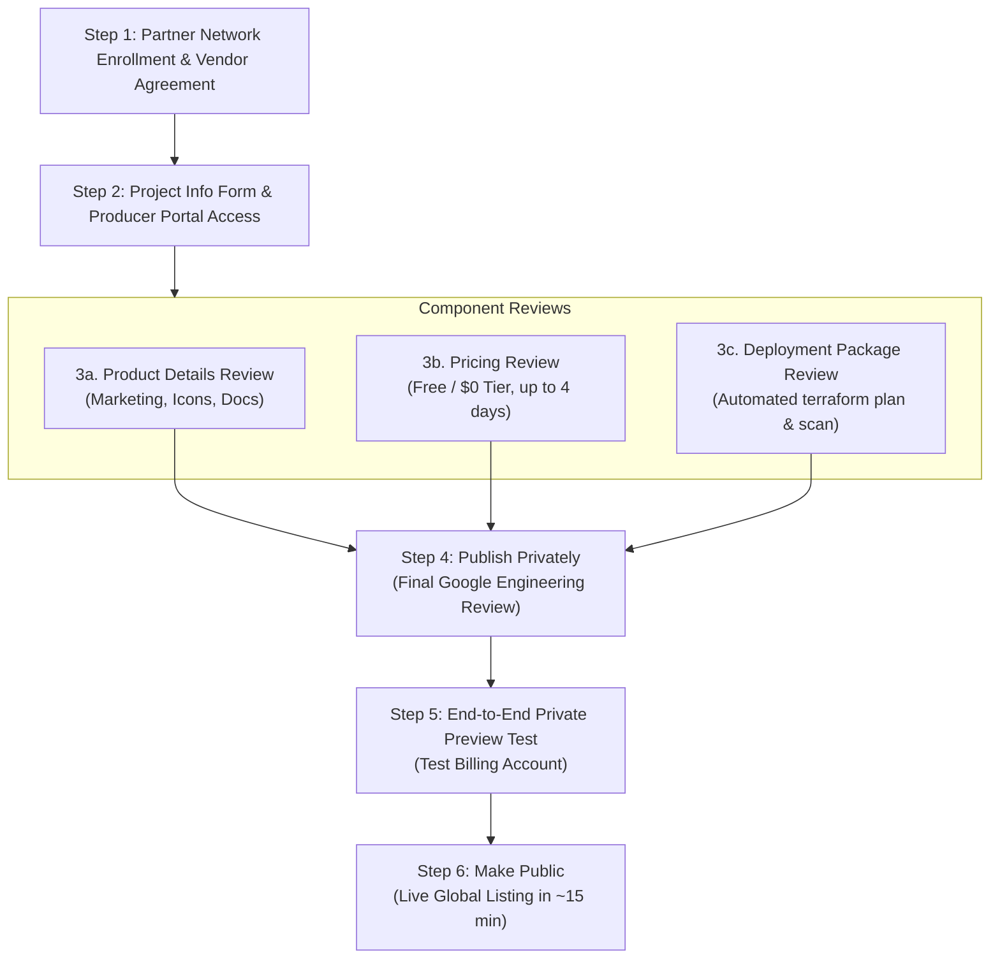

# Spec 156: Google Cloud Marketplace Listing for Spool Hub (Free Open-Source Application)

**Feature ID**: `156-gcp-marketplace-listing` · **Status**: Draft v0.1 · **Epic**: SPL-3035 · **Issue**: SPL-3341  
**Created**: 2026-10-25 · **Lead**: a-719 · **Placement slug**: `c002-spec-gcp-marketplace-listing`  
**Related Specs**: [044 Open Source](../044-spool-open-source/spec.md), [047 Deployability](../047-spool-deployability/deployability-analysis.md), [072 Rapid Deployability](../072-rapid-deployability/spec.md)  
**Authority**: This document for the Google Cloud Marketplace requirements, architectural fit, gaps on origin/master, owner actions, and risk profile. Docs only; this spec introduces no code or infrastructure mutations.

---

## 1. Context & Owner Request

### 1.1 Owner Request (Verbatim)
In discussion topic `203bb2b1-ab15-4a3e-92a9-c49690e7ed35` (prd tenant t1, HUM-10):
- msg `7563498f`: *"submit the whole spool-hub to the applications in GCP"*
- msg `682c6b20`: *"GCP does have some kind of internal market - we should submit it as an open source app to it"*
- msg `2a5c58f9`: *"to make it more popular"*

### 1.2 Purpose
Evaluate and define the requirements, architecture, build plan, owner actions, and risks to list Spool Hub on the **Google Cloud Marketplace** as a free, open-source application deployable into customer-owned Google Cloud projects.

---

## 2. Google Cloud Marketplace Requirements for a Free Open-Source Listing

Every requirement below is verified against Google public partner documentation (`https://docs.cloud.google.com/marketplace/docs/partners/`). Any requirement that cannot be verified without a live Google Partner Advantage portal session is explicitly marked as **unchecked**.

### 2.1 Partner Advantage & Organization Requirements
To list software on Google Cloud Marketplace, an organization must establish and maintain verified standing in Google partner ecosystem:
1. **Google Cloud Partner Network Membership**:
   - The publishing organization must join the **Google Cloud Partner Network** and be authorized as a Technology Partner (Build track) via the [Partner Network Hub](https://docs.cloud.google.com/marketplace/docs/partners/get-started).
   - Sign-up is initiated via [Join Google Cloud Partner Network](https://docs.cloud.google.com/marketplace/docs/partners/offer-products).
2. **Jurisdiction & Legal Entity Incorporation**:
   - The organization must be incorporated in one of Google [supported regions](https://docs.cloud.google.com/marketplace/docs/partners/receive-payments#supported-regions) for Marketplace partners.
3. **Role Requirements**:
   - The individual initiating onboarding and accepting vendor agreements must hold the **Partner Administrator** role in Partner Network Hub.

### 2.2 Marketplace Agreements & Terms
1. **Marketplace Vendor Agreement**:
   - The partner must review and accept the click-through [Marketplace Vendor Agreement](https://docs.cloud.google.com/marketplace/docs/partners/offer-products#vendor-agreement) directly in the Partner Network Hub (under *Partner tasks* > *Initiate onboarding your product to Marketplace*).
2. **Open Source Policy & Compliance**:
   - Per [Open source compliance guidelines](https://docs.cloud.google.com/marketplace/docs/partners/open-source-compliance), products distributing open-source software must comply with all included component licenses.
   - For **allowlisted permissive licenses** (MIT, Apache 2.0, BSD): Full license texts and a component manifest must be bundled with the distributed package/image.
   - For **copyleft licenses** (GPL, LGPL): Full source code and corresponding license texts must be packaged alongside the image.
   - **Prohibited licenses**: The solution must *not* incorporate third-party components whose licenses would compel Google to disclose or distribute Google proprietary software in source code form.
   - **Takedown risk**: Google does not pre-audit license compliance worksheets, but an unresolved copyright/license takedown notice results in immediate listing suspension.
3. **Vendor Account and Payment Profile (Even for Free Listings)**:
   - According to [Requirements for Google Cloud Marketplace](https://docs.cloud.google.com/marketplace/docs/partners/get-started) and [Receiving payments from Google](https://docs.cloud.google.com/marketplace/docs/partners/receive-payments), the publishing organization must establish a **Cloud Marketplace vendor account** and a **Google Payments Profile** in good standing.
   - *Requirement match*: The legal entity name and physical business address on the Payments Profile must exactly match the entity that signed the Marketplace Vendor Agreement.
   - *Why needed for free software*: Google requires the payment profile to anchor legal liability, disclaimers, and tax compliance even when software pricing is configured as $0/free.

### 2.3 Producer Portal & Google Cloud Project Setup
1. **Dedicated Producer Project**:
   - A dedicated Google Cloud project (conventionally named `<partner>-public` or `csi-spl-public`) must be created to hold product definitions, staging registries, and deployment packages ([Setting up your environment](https://docs.cloud.google.com/marketplace/docs/partners/vm/set-up-environment)).
2. **Onboarding Validation & Project Info Form**:
   - The organization must submit the **Cloud Marketplace Onboarding Validation Form** and the **Cloud Marketplace Project Info Form** provided by the Google Cloud Marketplace onboarding team ([Offer software on Cloud Marketplace](https://docs.cloud.google.com/marketplace/docs/partners/offer-products)).
3. **Google Onboarding IAM Delegation**:
   - The producer project must grant the `roles/editor` role to `cloud-commerce-marketplace-onboarding@twosync-src.google.com` so Google automation can validate images and deployment packages.
4. **Producer Portal Access & Team IAM**:
   - Access is granted at `https://console.cloud.google.com/producer-portal?project=YOUR_PROJECT_ID`.
   - Team members require the `roles/commerceproducer.admin` (manage/publish) or `roles/commerceproducer.viewer` IAM roles.

### 2.4 Technical Integration Requirements
1. **Deployment Packaging**:
   - The solution must provide a validated deployment package (Terraform or GKE/VM container) that allows customers to deploy the product into their own Google Cloud project ([Create your deployment package](https://docs.cloud.google.com/marketplace/docs/partners/vm/create-deployment-package)).
2. **Consumption Tracking Integration**:
   - Per [Customer tenant consumption tracking](https://docs.cloud.google.com/marketplace/docs/partners/get-started) and [Track VM products consumption with labels](https://docs.cloud.google.com/marketplace/docs/partners/vm/partner-consumption-tracking), products deployed into customer-owned projects must integrate Google consumption tracking label:
     ```hcl
     provider "google" {
       default_labels = {
         goog-partner-solution = "SOLUTION_URN"
       }
     }
     ```
   - The specific `SOLUTION_URN` is assigned in Producer Portal upon product creation.
3. **Meaningful Cloud Consumption Rule**:
   - Under [Requirements for your product](https://docs.cloud.google.com/marketplace/docs/partners/get-started), the listing must result in meaningful Google Cloud consumption by the procuring customer (e.g. running Cloud SQL, Cloud Run, Cloud Storage).
4. **Parity Rule**:
   - The Marketplace listing must provide feature and functional parity with versions offered outside the Marketplace.

### 2.5 Review Steps & Order of Execution
Google structures the listing review into distinct sequential phases ([Submitting your product](https://docs.cloud.google.com/marketplace/docs/partners/vm/submitting)):



1. **Component Reviews** (may be submitted in parallel):
   - **Product Details Review**: Title, short description, category tags, transparent icon (PNG), screenshots, documentation URL, support URL/email.
   - **Pricing Review**: Submitted under [Choosing a pricing model](https://docs.cloud.google.com/marketplace/docs/partners/vm/select-pricing) as **Free** (customers pay only for underlying Google Cloud infrastructure). Takes up to 4 business days.
   - **Deployment Package Review**: Automated module verification (`terraform plan` with `marketplace_test.tfvars`, taking up to 2 hours) followed by security/CVE scanning by Google partner engineering.
2. **Submit for Final Review / Private Publication**:
   - Once all three component reviews are approved, clicking **Publish** in Producer Portal submits the product for final Google review and launches it in a **private preview state**.
3. **Private Testing**:
   - The partner verifies deployment from the private listing URL using a test billing account and clean test project.
4. **Public Launch**:
   - On the Producer Portal Overview page, click **Enable public display** followed by **Make public**. The listing goes live globally on Google Cloud Marketplace within 15 minutes.

---

## 3. Product Type Fit & Terraform Package Architecture

### 3.1 Existing Spool Hub Stack
As defined across `csi-spl-iac/src/terraform/`:
- **API Server / Hub Core**: Go application container running on **Cloud Run** (`030-cloud-run-hub`).
- **Database**: Relational store on **Cloud SQL for PostgreSQL** (`040-cloud-sql-postgres`).
- **Web UI**: Nuxt 3 single-page application served via **Firebase Hosting** (`019-firebase-static-site`, `021-firebase-hosted-sites`).
- **Secrets & Keys**: **Secret Manager** (`120-github-general-secrets`) and **Cloud KMS** (`055-gcp-kms-marketing`, `057-gcp-kms-vendor-keys`).
- **Persistence & Backups**: **Cloud Storage** buckets (`045-gcs-db-backups`, `050-gcs-files`).
- **Networking & Ingress**: **Cloud DNS** (`025-gcp-dns-zone`) and **Cloud Run Domain Mapping** (`032-gcp-cloud-run-domain-mapping`).

### 3.2 Evaluation of Marketplace Product Types

| Product Type | Google Marketplace Mechanics | Fit for Spool Hub | Verdict |
|---|---|---|---|
| **Container Image Product** | Individual images published to `marketplace.gcr.io` ([docs](https://docs.cloud.google.com/marketplace/docs/partners/container)) | Spool Hub is a multi-tier system requiring managed PostgreSQL, Secret Manager, KMS, and Web UI. A single container cannot self-provision its cloud dependencies. | **Rejected** |
| **GKE / Kubernetes App** | Helm chart / YAML manifest + deployer container deployed to customer GKE ([docs](https://docs.cloud.google.com/marketplace/docs/partners/kubernetes/create-app-package)) | Spool Hub native architecture is serverless (Cloud Run + Cloud SQL). Forcing GKE requires a minimum cluster cost ($70+/mo idle for control plane + nodes) and an IaC rewrite to Helm. | **Rejected** (High idle cost, poor fit) |
| **SaaS Product** | Multi-tenant app hosted by partner; billed via Cloud Commerce Procurement API ([docs](https://docs.cloud.google.com/marketplace/docs/partners/integrated-saas)) | Violates the owner explicit mandate: strangers deploy their own instance in their own cloud with their own DNS (044 verbatim). | **Rejected** (Wrong deployment topology) |
| **Custom Terraform Module (VM & Solutions)** | IaC package deployed via Google Cloud Infrastructure Manager UI or CLI ([docs](https://docs.cloud.google.com/marketplace/docs/partners/vm/configure-terraform-deployment)) | Directly supports provisioning Google Cloud native services (Cloud Run, Cloud SQL, KMS, Secret Manager, GCS, IAM) with customer parameters. | **Selected (Best Fit)** |

> [!NOTE]
> Under Google Cloud Marketplace conventions, custom infrastructure packages using Terraform are categorized under the **Virtual Machine & Cloud Infrastructure Solutions** path ([Configure Terraform deployment](https://docs.cloud.google.com/marketplace/docs/partners/vm/configure-terraform-deployment)). Google Cloud Infrastructure Manager executes the module directly in the customer project.
> 
> *Unchecked condition*: In Producer Portal, custom Terraform modules must be verified to confirm whether the portal permits submission without attaching an active GCE VM image. If Google portal strictly mandates an attached GCE image for the VM & Solutions category, the module must declare a minimal bastion/utility VM or Google partner team must whitelist the non-compute solution.

### 3.3 Can Existing `csi-spl-iac` Terraform Steps Be Reused Directly?

**Verdict: No.** Direct reuse of the existing 20+ steps in `csi-spl-iac/src/terraform/` without modification is impossible.

#### Specific Technical Blockers:
1. **Decomposed Step Structure**: The existing repo decomposes infrastructure into 20+ standalone steps (`000` through `070`), each with its own state backend and local Makefile / `tpl-gen` driver. Marketplace demands a **single cohesive Terraform root module**.
2. **Estate Hardcoding (Spec 047 §1.2 & Spec 072 §4.3)**:
   - Hardcoded regex constraints: 7 files restrict resource names to `^csi-spl-(dev|prd)-*` (`019`, `020`, `028`, `040`, `045`, `050`).
   - Hardcoded organization/folder expectations in bootstrap actions.
3. **Firebase Hosting Complexity**:
   - Step `019-firebase-static-site` relies on Firebase CLI deployment tokens (`firebase deploy`), which cannot execute cleanly inside an unassisted Google Cloud Marketplace Terraform provisioning run.
4. **Approved Provider Constraints**:
   - Google Marketplace restricts custom Terraform modules to an approved list of providers: `google`, `google-beta`, `random`, `null`, `time`, `tls`, `archive`, `cloud-init`, `dns`, `http`. Any third-party provider outside this list causes automated rejection.

#### Solution: A Unified Marketplace Module
The resource definitions in `001-enable-gcp-services`, `030-cloud-run-hub`, `040-cloud-sql-postgres`, KMS, Secret Manager, and GCS must be extracted and synthesized into a dedicated root module:
`csi-spl-iac/src/terraform/marketplace-spool-hub/`.

#### Web UI Delivery Options for One-Click Deploy:
- **Option A (Recommended)**: Serve the pre-built Nuxt 3 static web bundle directly through the Spool Hub Go API container (or a lightweight embedded web server inside the container). This eliminates Firebase Hosting dependencies entirely and deploys the entire stack as a single Cloud Run service + Cloud SQL.
- **Option B**: Cloud Storage bucket configured with website hosting + Cloud CDN load balancer provisioned via Terraform.
- **Option C**: Firebase Hosting provisioned via Terraform `google_firebase_hosting_version` and `google_firebase_hosting_release` (*unchecked* whether full zero-touch initialization works without Google Workspace / Firebase console onboarding).

---

## 4. Gaps on `origin/master`: Build Plan

To enable a Google Cloud Marketplace listing, the following components must be built on the repository. Each item is specified with concrete files and its verification test.

| Build ID | Component | Required File(s) | Verification Test |
|---|---|---|---|
| **GAP-01** | **Marketplace Root Terraform Module** | `csi-spl-iac/src/terraform/marketplace-spool-hub/main.tf`<br>`variables.tf`<br>`outputs.tf`<br>`versions.tf` | `terraform -chdir=csi-spl-iac/src/terraform/marketplace-spool-hub validate`<br>`terraform plan -var-file=marketplace_test.tfvars` |
| **GAP-02** | **Marketplace UI Metadata (BlueprintUI)** | `csi-spl-iac/src/terraform/marketplace-spool-hub/metadata.yaml`<br>`metadata.display.yaml` | `cft blueprint metadata -p csi-spl-iac/src/terraform/marketplace-spool-hub -v` (validates against Google BlueprintMetadata schema) |
| **GAP-03** | **Automated Test Variables** | `csi-spl-iac/src/terraform/marketplace-spool-hub/marketplace_test.tfvars` | Offline `terraform plan` execution checking all variables have complete test defaults. |
| **GAP-04** | **Public Artifact Registry Release Pipeline** | `.github/workflows/25_marketplace-image-publish.yml`<br>`csi-spl-api/docker/Dockerfile.hub-release` | Automated build and push to public Artifact Registry repository (`marketplace.gcr.io` or public GAR); pull smoke test. |
| **GAP-05** | **Unified Web UI Serving in Hub Binary** | `csi-spl-api/src/go/spool-hub-api/static/`<br>`csi-spl-api/src/go/spool-hub-api/web_handler.go` | Go unit test verifying HTTP `GET /` returns HTML and assets without Firebase dependency. |
| **GAP-06** | **Marketplace Packaging & Linter Script** | `csi-spl-iac/src/bash/run/marketplace-pack.func.sh`<br>`csi-spl-iac/src/bash/tests/test-marketplace-pack.sh` | `./run -a do_marketplace_pack` packages `.tar.gz`, verifies checksums, schema, and provider whitelist. |
| **GAP-07** | **Listing Text & Marketing Copy** | `csi-spl-doc/doc/marketplace/listing-details.md` | Linter verifying character limits: Title (<=64 chars), Short description (<=256 chars), Full description, features list. |
| **GAP-08** | **Branding & Graphic Assets** | `csi-spl-doc/doc/marketplace/assets/logo_128x128.png`<br>`logo_256x256.png`<br>`screenshot_01.png` .. `04.png` | Asset inspection script checking PNG transparency, exact pixel dimensions, and absence of compression artifacts. |
| **GAP-09** | **Public Support & Deployer Documentation** | `csi-spl-doc/doc/md/marketplace-deployer-guide.md`<br>Public docs route on web | Link check script verifying HTTP 200 on all public docs and support policy URLs. |
| **GAP-10** | **Consumption Tracking Provider Integration** | `csi-spl-iac/src/terraform/marketplace-spool-hub/versions.tf` | Static check confirming `goog-partner-solution` label in `provider "google"` block. |

---

## 5. Owner Actions (Human / Identity Prerequisites)

The following steps require company Google Workspace credentials, corporate signing authority, legal identity verification, or final portal confirmation. They cannot be executed by an automated agent:

1. **Partner Advantage Registration**:
   - Navigate to [Google Cloud Partner Network](https://partner.cloud.google.com/) using the company administrative Google identity.
   - Enroll the organization in the Google Cloud Partner Advantage program as a Technology Partner (Build track).
2. **Accept Marketplace Vendor Agreement**:
   - In Partner Network Hub, navigate to *View tasks* > *Initiate onboarding your product to Marketplace*.
   - Review and accept the legal **Marketplace Vendor Agreement** (requires Partner Administrator rights).
3. **Submit Marketplace Project Info Form**:
   - Complete and submit the Google Cloud Marketplace Project Info Form received from Google Partner Operations to initiate producer onboarding.
4. **Establish the Dedicated Producer Project**:
   - In Google Cloud Console, create a dedicated project (e.g. `csi-spl-public`).
   - Attach a billing account to the project.
   - Grant `roles/editor` permissions to Google automated onboarding service account:  
     `cloud-commerce-marketplace-onboarding@twosync-src.google.com`.
5. **Set Up Google Payments Profile**:
   - In Google Cloud Console / Producer Portal, navigate to Payments and create a corporate Payments Profile.
   - *Requirement*: Legal entity name and registered physical corporate address must match the organization name on the Marketplace Vendor Agreement.
6. **Assign Producer Portal Permissions**:
   - Grant the `roles/commerceproducer.admin` IAM role to technical leads / integration agents for the producer project.
7. **Create Cloud Storage Release Bucket**:
   - Create a Cloud Storage bucket with **Object Versioning enabled** in the producer project to host deployment package archives (`.tar.gz`).
8. **Approve & Submit Component Reviews in Producer Portal**:
   - In Producer Portal (`https://console.cloud.google.com/producer-portal`), review staged assets and submit:
     - Click **Submit** on *Product Details*.
     - Click **Submit** on *Pricing* (confirming the $0 / Free tier).
     - Click **Validate** and **Submit** on *Deployment Package*.
9. **Authorize Final Private Publication**:
   - Once all component reviews are approved, go to the Overview page and click **Publish** to initiate Google final partner engineering verification.
10. **Execute Final Public Launch Click**:
    - Upon notification of final Google approval, return to Producer Portal Overview, click **Enable public display**, and click **Make public** to release Spool Hub to the global catalog.

---

## 6. Risks, Timeline, and Deployer Costs

### 6.1 Review Latency & Timeline
Getting a product listed on Google Cloud Marketplace is an asynchronous multi-stage review process:

| Stage | Expected Duration | Dependencies |
|---|---|---|
| **Partner Advantage & Agreement Review** | 3 – 10 business days | Corporate identity verification, legal terms acceptance |
| **Pricing Model Review** | 1 – 4 business days | Official Google SLA for pricing review |
| **Deployment Package Validation** | 2 hours (automated) + 2 – 5 days (manual) | Module `terraform plan` check, security & CVE audit |
| **Final Review / Private Preview** | 2 – 5 business days | Partner engineering manual smoke test |
| **Total Lead Time** | **3 – 5 weeks** | Subject to rejection loops or revision requests |

### 6.2 Potential Rejection Triggers
1. **Container Image Vulnerabilities (CVEs)**:
   - Google scans all container images during package validation. Base images containing High or Critical CVEs trigger automated or engineering rejection.
   - *Mitigation*: Build container images from minimal distroless or updated Alpine/Debian slim bases; scan with Trivy prior to submission.
2. **Terraform Validation Failure**:
   - Using unapproved providers or failing `terraform plan` with `marketplace_test.tfvars`.
   - *Mitigation*: Strictly limit providers to `google`, `google-beta`, `random`, `null`, `time`, `tls`, `archive`, `cloud-init`, `dns`, `http`; validate locally with `cft blueprint metadata -v`.
3. **Open-Source Attribution Deficiencies**:
   - Failing to include full license texts or component lists for third-party libraries.
   - *Mitigation*: Ensure the root package contains complete `LICENSE`, third-party notice manifests, and public GitHub repository links.
4. **Cloud Consumption Policy Non-Compliance**:
   - Solutions that do not drive genuine resource usage in the customer project risk rejection under Google meaningful consumption policy.
   - *Mitigation*: Spool Hub actively utilizes Cloud Run, Cloud SQL, KMS, and Cloud Storage, satisfying consumption criteria.

### 6.3 Cost to Deployer (Customer Cloud Bill)
The Spool Hub software listing itself is **100% Free ($0 software fee)**. However, customers incur infrastructure charges directly on their Google Cloud billing account:

| GCP Resource | Minimum Sizing | Estimated Monthly Cost (Idle) | Scaled Production Cost |
|---|---|---|---|
| **Cloud SQL for PostgreSQL** | Shared CPU (`db-f1-micro` or `db-g1-small`), 10 GB SSD | ~$10 – $25 / month | $60 – $150+ / month (Dedicated vCPU, HA enabled) |
| **Cloud Run (Hub API)** | Serverless, min instances = 0 (scale to zero) | ~$0.00 / month (Free tier covers initial 2M requests) | $5 – $30 / month |
| **Cloud Storage (Backups, files)** | Regional Standard storage, < 5 GB | ~$0.10 – $0.50 / month | $2 – $10 / month |
| **Cloud KMS & Secret Manager** | 2 key rings, < 10 active secrets | ~$0.20 – $1.00 / month | $1 – $5 / month |
| **Network Egress & Cloud DNS** | Standard egress, 1 managed zone | ~$0.20 – $1.00 / month | $2 – $10 / month |
| **Total Estimated Bill** | **Baseline Self-Hosted** | **~$12 – $30 / month** | **~$70 – $200+ / month** |

> [!IMPORTANT]
> The primary cost driver for a deployer is **Cloud SQL**. Unlike Cloud Run, Cloud SQL does not scale to zero when idle. The Marketplace listing text and documentation must explicitly state the estimated minimum GCP infrastructure cost (~$15–$30/mo) so deployers are not surprised by their Google Cloud bill.

---

## 7. Unchecked Items Summary

To maintain empirical truth per project standards, the following aspects cannot be confirmed via documentation alone and require live validation during Partner Portal execution:

| Item | Unchecked Condition | Verification Method |
|---|---|---|
| **UNCHECKED-01** | Whether Google Cloud Marketplace Producer Portal permits submission of a custom Terraform module under VM & Solutions with *zero* attached GCE compute images (pure serverless Cloud Run + Cloud SQL). | Attempt module upload in Producer Portal; if refused, package a minimal utility/bastion GCE instance or request Google partner engineering exemption. |
| **UNCHECKED-02** | Whether Firebase Hosting static site distribution can be automated zero-touch within a customer GCP project via Terraform without pre-enabling Firebase in the Google Workspace organization. | Test Option A (unified Go binary serving static WUI) vs Option C in a throwaway GCP project. |
| **UNCHECKED-03** | Exact processing turnaround time for free open-source software listings by Google Partner Operations in 2026. | Track actual ticket duration from initial Onboarding Form submission. |

<!-- version: 0.1.0 · updated: 2026-10-25 · last-edit: 2026-10-25T13:30:00Z -->
