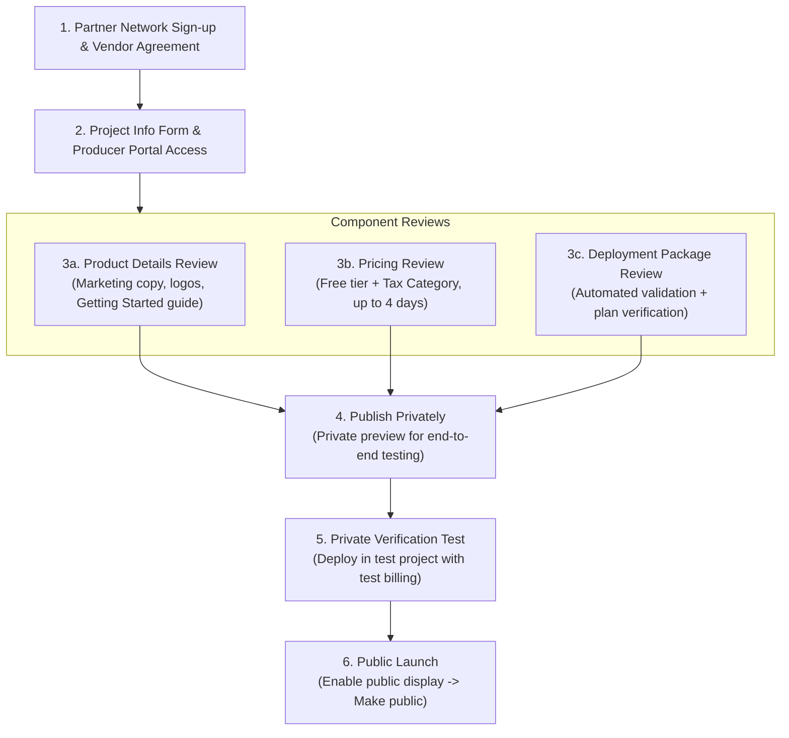

# Spec 156: Google Cloud Marketplace Listing for Spool Hub (Free Open-Source Application)

**Feature ID**: `156-gcp-marketplace-listing` · **Status**: Draft v0.3 · **Epic**: SPL-3035 · **Issue**: SPL-3341  
**Created**: 2026-10-25 · **Lead**: a-719 · **Placement slug**: `c002-spec-gcp-marketplace-listing`  
**Related Specs**: [044 Open Source](../044-spool-open-source/spec.md), [047 Deployability](../047-spool-deployability/deployability-analysis.md), [072 Rapid Deployability](../072-rapid-deployability/spec.md)  
**Authority**: This document for the Google Cloud Marketplace requirements, architectural fit, gaps on origin/master, owner actions, and risk profile. Docs only; this spec introduces no code or infrastructure mutations.

---

## 1. Context & Owner Request

### 1.1 Owner Request (Verbatim)
In discussion topic `203bb2b1-ab15-4a3e-92a9-c49690e7ed35` (prd tenant t1, HUM-10):
- msg `7563498f`: *"submit the whole spool-hub to the applications in GCP"*
- msg `682c6b20`: *"GCP does have some kind of internal market - we should submit it as an open source app to it"*
- msg `2a5c58f9`: *"to make it more popular"*

### 1.2 Purpose
Evaluate and define the requirements, architecture, build plan, owner actions, and risks to list Spool Hub on the **Google Cloud Marketplace** as a free, open-source application deployable by external users.

---

## 2. Google Cloud Marketplace Requirements for a Free Open-Source Listing

Every requirement below is verified against Google public partner documentation (`https://docs.cloud.google.com/marketplace/docs/partners/`). Any requirement that cannot be verified without a live Google Partner Network portal session is explicitly marked as **unchecked**.

### 2.1 Partner Onboarding & Organization Requirements
To offer products on Google Cloud Marketplace, an organization must establish and maintain verified standing in Google partner network:
1. **Google Cloud Partner Network Membership**:
   - The publishing organization must join the **Google Cloud Partner Network** and be authorized as a **Google Cloud Technology Partner** ([Requirements for Google Cloud Marketplace](https://docs.cloud.google.com/marketplace/docs/partners/get-started)).
   - Initial enrollment is initiated via [Join Google Cloud Partner Network](https://docs.cloud.google.com/marketplace/docs/partners/offer-products). *(Note: Google Cloud Partner Network replaced the former Partner Advantage program).*
2. **Jurisdiction & Legal Entity Incorporation**:
   - The organization must be incorporated in one of Google supported regions for Marketplace partners ([Supported regions and currencies](https://docs.cloud.google.com/marketplace/docs/partners/receive-payments#supported-regions)).
3. **Role Requirements**:
   - The individual initiating onboarding and accepting vendor agreements must hold the **Partner Administrator** role in Partner Network Hub ([Offer software on Google Cloud Marketplace](https://docs.cloud.google.com/marketplace/docs/partners/offer-products)).

### 2.2 Marketplace Agreements & Open-Source Terms
1. **Marketplace Vendor Agreement**:
   - The Partner Administrator must review and accept the click-through [Marketplace Vendor Agreement](https://docs.cloud.google.com/marketplace/docs/partners/offer-products#vendor-agreement) directly in the Partner Network Hub (under *View tasks* > *Partner tasks* > *Initiate onboarding your product to Marketplace*).
2. **Open-Source Compliance & License Obligations**:
   - Per [Open source compliance](https://docs.cloud.google.com/marketplace/docs/partners/open-source-compliance), products distributing open-source software must comply with the licensing requirements of all included open-source software.
   - **Repository License**: Spool Hub is licensed under the **GNU Affero General Public License v3.0 (AGPL-3.0)** (`head -2 LICENSE`).
   - For **permissive licenses** (MIT, Apache 2.0, BSD): Google requires installing the license text file along with a component manifest on the instance image.
   - For **copyleft licenses** (GPL, LGPL): Google requires installing the full license text along with the complete source code directly on the instance image. By analogy and strict adherence to AGPL-3.0, the full source code and license must be bundled on the image or container.
   - **No Compliance Worksheet**: Google does not require submitting an open-source compliance worksheet for review.
   - **Takedown Enforcement**: If an open-source copyright holder files a valid license violation notice, Google reserves the right to immediately pull the listing from Cloud Marketplace until the dispute is resolved.
   - *Unchecked condition*: Google public open-source compliance page explicitly lists GPL and LGPL, but does not explicitly name AGPL-3.0. Confirmation that Google Partner Engineering accepts AGPL-3.0 without special licensing riders is tracked in Section 7 (`UNCHECKED-04`).
3. **Vendor Account and Payments Profile (Mandatory for Free Listings)**:
   - Per [Requirements for Google Cloud Marketplace](https://docs.cloud.google.com/marketplace/docs/partners/get-started), the organization must maintain a Cloud Marketplace vendor account and a Google Payments Profile in good standing. Google documentation provides no exemption for free ($0) or open-source software listings.
   - Per [Setting up your payments profile](https://docs.cloud.google.com/marketplace/docs/partners/receive-payments), the legal entity name associated with the payments profile must match the entity that entered into the Marketplace Vendor Agreement, and the physical address associated with the payments profile must be within the country where the company was formed or organized.

### 2.3 Producer Portal & Project Environment Setup
1. **Dedicated Producer Projects**:
   - Per [Set up your Google Cloud environment](https://docs.cloud.google.com/marketplace/docs/partners/vm/set-up-environment), the partner creates:
     - A development/testing project: `PARTNER_NAME-dev`.
     - A dedicated public project: `PARTNER_NAME-public` (e.g. `csi-spl-public`), strictly reserved for creating and hosting published Compute Engine images and deployment packages.
   - Enable the Compute Engine API (`compute.googleapis.com`) on both projects.
   - In the public project, configure a designated security contact ([Managing contacts](https://docs.cloud.google.com/marketplace/docs/partners/vm/set-up-environment)).
2. **Project Info Form**:
   - Complete the **Cloud Marketplace Project Info Form** provided by the Cloud Marketplace onboarding team to unlock access to Producer Portal.
3. **Google Service Account Onboarding Grants**:
   - Per [vm/set-up-environment](https://docs.cloud.google.com/marketplace/docs/partners/vm/set-up-environment), the partner must grant:
     - **Editor** (`roles/editor`) and **Service Management Admin** (`roles/servicemanagement.admin`) to `cloud-commerce-marketplace-onboarding@twosync-src.google.com`.
     - **Config Editor** (`roles/servicemanagement.configEditor`) to `cloud-commerce-producer@system.gserviceaccount.com`.
4. **Producer Portal Access & Team IAM**:
   - Producer Portal is accessed at `https://console.cloud.google.com/producer-portal?project=YOUR_PUBLIC_PROJECT_ID`.
   - Per [Configure access control for Producer Portal users](https://docs.cloud.google.com/marketplace/docs/partners/access-control), team members managing listings require:
     - **Commerce Producer Admin** (`roles/commerceproducer.admin`) and **Service Management API Administrator** (`roles/servicemanagement.admin`) to create and edit products.
     - **Commerce Producer Viewer** (`roles/commerceproducer.viewer`) for view-only access.
     - **Service Management Service Consumer** (`roles/servicemanagement.serviceConsumer`) to preview product listings as customers see them.
     - **Commerce Business Enablement PaymentConfig Admin** (`roles/commercebusinessenablement.paymentConfigAdmin`) for managing payments and tax profiles.

### 2.4 Technical Integration Requirements
1. **Deployment Options**:
   - Partners can offer customers deployment via **Terraform** or **Cloud Deployment Manager** ([Create your deployment package](https://docs.cloud.google.com/marketplace/docs/partners/vm/create-deployment-package)). Terraform is recommended by Google for configurable infrastructure.
2. **Partner Consumption Tracking**:
   - Per [Track your VM products consumption with labels](https://docs.cloud.google.com/marketplace/docs/partners/vm/partner-consumption-tracking) and [Requirements for your product](https://docs.cloud.google.com/marketplace/docs/partners/get-started), solutions deployed into customer-owned projects must integrate Google consumption tracking label:
     ```hcl
     provider "google" {
       default_labels = {
         goog-partner-solution = "SOLUTION_URN"
       }
     }
     ```
   - The `SOLUTION_URN` is retrieved from the Producer Portal Overview page after creating the product entry.
3. **Meaningful Cloud Consumption & Parity Rules**:
   - The product listing must drive meaningful Google Cloud resource consumption by the deployer ([Requirements for your product](https://docs.cloud.google.com/marketplace/docs/partners/get-started)).
   - The product must provide feature parity with versions offered outside the Marketplace.

### 2.5 Review Workflow & Execution Sequence
Google organizes the publishing lifecycle into sequential phases ([Submit your product](https://docs.cloud.google.com/marketplace/docs/partners/vm/submitting)):



1. **Component Reviews** (can be submitted in any order):
   - **Product Details**: Title, tagline, descriptions, category IDs (up to 2), search keywords, transparent icon PNG, screenshots, and an external URL to a Google Cloud-specific Getting Started guide ([vm/set-up-environment](https://docs.cloud.google.com/marketplace/docs/partners/vm/set-up-environment)). Approval takes approximately 2–5 business days.
   - **Pricing Review**: For free software, select **Free** ([Choosing a pricing model](https://docs.cloud.google.com/marketplace/docs/partners/vm/select-pricing)). The partner must select a **tax category**, complete withholding tax information (applicable only for partners with a US payment profile, per select-pricing), and provide an End User License Agreement (EULA) URL. Google reviews pricing models within up to 4 business days.
   - **Deployment Package Review**: Automated validation verifies that the package parses correctly, object versioning is enabled on the storage bucket, and `terraform plan` executes without errors against `marketplace_test.tfvars` ([Configure your VM image for Terraform deployment](https://docs.cloud.google.com/marketplace/docs/partners/vm/configure-terraform-deployment)). Automated validation takes up to 2 hours.
2. **Submit for Final Review / Private Publication**:
   - Once all component reviews are approved, clicking **Publish** in Producer Portal notifies Google and publishes the product privately ([Submit your product](https://docs.cloud.google.com/marketplace/docs/partners/vm/submitting)).
3. **Private Verification**:
   - The partner tests deployment of the private listing end-to-end in a separate Google Cloud project.
4. **Public Launch**:
   - On the Producer Portal Overview page, click **Enable public display** and **Make public**. The listing goes live on Google Cloud Marketplace within a few minutes.

---

## 3. Product Type Evaluation & Architecture

### 3.1 Existing Repository Infrastructure Baseline
An empirical audit of the repository reveals the true state of deployment assets on `origin/master`:
- **Terraform Step Structure**: `csi-spl-iac/src/terraform/` contains **29 numbered steps** ranging from `000-gcp-remote-bucket` up to `120-github-general-secrets`, plus a `modules/` directory (total 30 directories). Step `020` does not exist.
- **Estate Hardcoding**: A search for `regex("^csi-spl"` across `csi-spl-iac/src/terraform/` returns **0 occurrences** (spec 072 action A8 has landed, removing legacy naming regexes).
- **Secret Manager Resources**: Resources of type `google_secret_manager_secret` are defined exclusively in steps `030-cloud-run-hub`, `040-cloud-sql-postgres`, and `057-gcp-kms-vendor-keys`. Step `120-github-general-secrets` manages GitHub Actions repository secrets via `terraform_data`.
- **Firebase Web UI Delivery**: Step `019-firebase-static-site` is pure Terraform (`google_firebase_project`, `google_firebase_hosting_site`, custom domains, DNS). It contains no CLI commands. The Firebase CLI (`firebase-tools@13 deploy`) is executed exclusively in orchestration script `csi-spl-orc/src/bash/run/deploy-wui.func.sh:171` using the environment service account key file.
- **Provider Constraints**: Across all 29 Terraform steps, required providers are strictly: `google` (27 steps), `google-beta` (2 steps), `time` (1 step in 070), and `local` (2 steps, in 060 and 061 only). All are approved by Google Marketplace except `local`.
- **Standalone Docker Compose Stack**: Root `docker-compose.yml` already runs the entire production system on a single machine: PostgreSQL 16 (`pg`), SeaweedFS (`s3`), database migrations (`hub-init`), Spool Hub API (`hub`), and Caddy reverse proxy + static WUI (`web`).

### 3.2 Evaluation of Candidate Marketplace Product Types

| Product Type | Marketplace Packaging Mechanics | Fit for Spool Hub | Verdict |
|---|---|---|---|
| **Container Image Product** | Individual images published to `marketplace.gcr.io` ([docs](https://docs.cloud.google.com/marketplace/docs/partners/container)) | Google lists this product type as "open source containers". Highly effective for driving developer awareness and adoption ("to make it more popular"). However, it only publishes container images; it cannot orchestrate the multi-container stack or managed database. | **Recommended for popularity**, but does not provide one-click full stack deployment. |
| **Virtual Machine (VM) Product running Compose Stack** | Compute Engine image with startup script / container running `docker-compose.yml` ([docs](https://docs.cloud.google.com/marketplace/docs/partners/vm)) | Directly satisfies Google VM image requirements. Reuses our tested, battle-hardened standalone `docker-compose.yml` (Postgres + Hub + Caddy WUI). Requires zero changes to the Go hub binary, zero Firebase dependencies, and provides a true one-click deploy for strangers. | **Selected as Primary Deployment Package** |
| **Custom Terraform Module (Serverless Cloud Run + Cloud SQL)** | IaC package uploaded to Cloud Storage bucket ([docs](https://docs.cloud.google.com/marketplace/docs/partners/vm/configure-terraform-deployment)) | Represents our native hosted architecture. However, Google documentation under `configure-terraform-deployment` explicitly states that custom Terraform modules require Marketplace-owned VM image substitution and `ET_GCE_DISK_IMAGE` property types. A pure VM-less module is not officially documented. | **Secondary / Advanced Track** (Pending confirmation under `UNCHECKED-01`) |
| **GKE / Kubernetes App** | Helm chart / YAML manifest + deployer container deployed to GKE ([docs](https://docs.cloud.google.com/marketplace/docs/partners/kubernetes/create-app-package)) | Requires the deployer to provision a Google Kubernetes Engine cluster (control plane + worker nodes), introducing high minimum idle costs and requiring an IaC rewrite to Helm. | **Rejected** (High idle cost, poor architectural fit) |
| **SaaS Product** | Multi-tenant SaaS billed via Procurement API ([docs](https://docs.cloud.google.com/marketplace/docs/partners/integrated-saas)) | Violates the owner explicit mandate: strangers deploy their own instance in their own cloud with their own DNS (044 verbatim). | **Rejected** (Wrong deployment topology) |

### 3.3 Architecture of the VM Product (Compose on Compute Engine)
The cleanest path to a compliant Google Cloud Marketplace listing that deploys the *whole* Spool Hub without introducing architectural conflicts is a **VM Product**:
1. **Base Compute Engine Image**: Built using standard Debian or Ubuntu LTS base, hardened and pre-loaded with Docker and Docker Compose.
2. **Application Payload**: Bundles the tested root `docker-compose.yml` along with pinned release images (`spool-hub`, `spool-web`, `postgres:16-alpine`, `seaweedfs`).
3. **One-Click Startup**: A systemd unit launches `docker compose up -d` on boot. Caddy automatically provisions a self-signed or Let Encrypt TLS certificate for the instance external IP or custom domain.
4. **Open-Source Attribution on Image**: Full AGPL-3.0 source code archive, license texts, and third-party notices placed directly at `/usr/local/share/doc/spool-hub/` on the VM root disk, satisfying Google open-source compliance requirements.

### 3.4 Rejection of Hub Binary Web UI Embedding (Option A / Former GAP-05)
An earlier proposal suggested embedding the Nuxt 3 static web bundle directly into the Go `spool-hub-api` binary. This proposal is **rejected** for the following architectural reasons:
1. **Architectural Seam Conflicts**: Spec 072 action A3 established a unified runtime `config.json` for "both carriers" (Docker Compose and Firebase Hosting). Spec 072 action A41 established same-origin routing via Firebase Hosting Cloud Run rewrites. Adding an in-binary web server introduces an unvetted third carrier.
2. **Release Coupling**: Coupling the WUI static build into the Go API binary forces hub release workflow 20 and WUI release workflow 30 into a lockstep release dependency, breaking independent front-end deploys.
3. **Unnecessary for Marketplace**: The standalone VM package already runs Caddy in `docker-compose.yml`, which cleanly serves the static WUI and reverse-proxies API requests without modifying Go code.

---

## 4. Gaps on `origin/master`: Concrete Build Plan

Every gap on `origin/master` required to publish the listing is itemized below with concrete files and executable tests.

| Build ID | Component | Required File(s) | Verification Test |
|---|---|---|---|
| **GAP-01** | **Producer Project Bootstrap Action** | `csi-spl-iac/src/bash/run/gcp-marketplace-producer-bootstrap.func.sh` | `./run -a do_gcp_marketplace_producer_bootstrap DRY_RUN=1` (verifies API enablement, IAM grants to Google onboarding SAs, and versioned GCS bucket). |
| **GAP-02** | **VM Deployment Package Module** | `csi-spl-iac/src/terraform/marketplace-spool-vm/main.tf`<br>`variables.tf`<br>`outputs.tf`<br>`versions.tf` | In `csi-spl-orc`: `STEP=marketplace-spool-vm make do-tf-plan` (runs terraform inside `con-csi-csi-spl-tf-runner` container, satisfying repo containerization rules). |
| **GAP-03** | **BlueprintUI Metadata & CFT Validation** | `csi-spl-iac/src/terraform/marketplace-spool-vm/metadata.yaml`<br>`metadata.display.yaml` | Containerized CFT validation: `docker run --rm -v $(pwd)/csi-spl-iac/src/terraform/marketplace-spool-vm:/workspace -w /workspace gcr.io/cloud-foundation-toolkit/cft:latest blueprint metadata -v`. |
| **GAP-04** | **Automated Test Variables File** | `csi-spl-iac/src/terraform/marketplace-spool-vm/marketplace_test.tfvars` | Test script `csi-spl-iac/src/bash/tests/test-marketplace-tfvars.sh` verifying that all declared variables in `variables.tf` have valid default or test values. |
| **GAP-05** | **VM Image Release Bake**<br>(Reuse wf 56 & bake pinned digests into VM image) | `.github/workflows/56_ghcr-images.yml`<br>`docker-compose.yml` | Pull pinned stable tag: `docker pull ${SPOOL_IMAGE_REPO:-ghcr.io/csitea}/spool-hub:${SPOOL_IMAGE_TAG:-stable-2026-10-12} && docker run --rm ${SPOOL_IMAGE_REPO:-ghcr.io/csitea}/spool-hub:${SPOOL_IMAGE_TAG:-stable-2026-10-12} /app/spool-hub-api --version`. |
| **GAP-06** | **Marketplace Packaging & Linter Script** | `csi-spl-iac/src/bash/run/marketplace-pack.func.sh`<br>`csi-spl-iac/src/bash/tests/test-marketplace-pack.sh` | `./run -a do_marketplace_pack` packages `.tar.gz`, verifies SHA256 checksum, schema validation, and provider whitelist (`google`, `google-beta`, `random`, `null`, `time`, `tls`). |
| **GAP-07** | **Listing Details & Marketing Copy** | `csi-spl-doc/doc/marketplace/listing-details.md` | Linter `csi-spl-doc/src/bash/tests/test-marketplace-copy.sh` verifying required sections, category IDs, keyword formatting, and EULA links. |
| **GAP-08** | **Branding & Visual Graphic Assets** | `csi-spl-doc/doc/marketplace/assets/logo_128x128.png`<br>`logo_256x256.png`<br>`screenshot_01.png` .. `04.png` | Linter `csi-spl-doc/src/bash/tests/test-marketplace-assets.sh` checking PNG transparency, exact pixel dimensions, and sRGB color profile. |
| **GAP-09** | **Public Deployer Getting Started Guide** | `csi-spl-doc/doc/md/marketplace-deployer-guide.md` | Live URL probe: `curl -fsIL https://${BASE_DOMAIN}/docs/marketplace` returning HTTP 200. |
| **GAP-10** | **Consumption Tracking Provider Integration** | `csi-spl-iac/src/terraform/marketplace-spool-vm/versions.tf` | Static test verifying `goog-partner-solution` key in `provider "google"` `default_labels`. |

---

## 5. Owner Actions (Human & Governance Steps)

Per repository standards, every infrastructural mutation is automated via named `./run` actions; the owner role is strictly governance, identity verification, legal signing, and providing the explicit **GO** for cloud mutations:

1. **Partner Network Enrollment**:
   - Access [Join Google Cloud Partner Network](https://partner.cloud.google.com/) using the corporate administrative Google Workspace identity.
   - Authorize the company as a **Google Cloud Technology Partner**.
2. **Accept Marketplace Vendor Agreement**:
   - In Partner Network Hub, navigate to *View tasks* > *Partner tasks* > *Initiate onboarding your product to Marketplace*.
   - Read and click to accept the legal **Marketplace Vendor Agreement** (requires Partner Administrator role).
3. **Submit Marketplace Project Info Form**:
   - Complete and submit the Project Info Form sent by Google Partner Operations to initialize the Producer Portal workspace.
4. **Approve Creation of Dedicated Producer Projects (Owner GO)**:
   - Provide explicit GO to execute `./run -a do_gcp_marketplace_producer_bootstrap` to provision `csi-spl-public`, enable APIs, grant onboarding IAM, and create the versioned GCS release bucket.
5. **Establish Google Payments Profile**:
   - In Google Cloud Console / Producer Portal, navigate to Payments and create the corporate Payments Profile.
   - *Requirement*: Registered corporate entity name must match the Vendor Agreement; physical address must reside within the country of incorporation ([receive-payments](https://docs.cloud.google.com/marketplace/docs/partners/receive-payments)).
6. **Assign Team Producer Roles (Owner GO)**:
   - Approve granting `roles/commerceproducer.admin` and `roles/servicemanagement.admin` in `csi-spl-public` to integration agents/leads.
7. **Configure Pricing & Tax Category in Producer Portal**:
   - In Producer Portal > Pricing, select **Free**.
   - Complete the **tax category** selection and, if using a US payment profile, the withholding tax questionnaire (per [select-pricing](https://docs.cloud.google.com/marketplace/docs/partners/vm/select-pricing)).
   - Provide the public EULA URL and submit the pricing model for review.
8. **Submit Product Details & Deployment Package**:
   - Review staged marketing text, logos, and Getting Started guide URL in Producer Portal and click **Submit**.
   - Review uploaded VM deployment package and click **Validate** followed by **Submit**.
9. **Authorize Final Private Publication (Owner Click)**:
   - Once all component reviews are approved, go to the Producer Portal Overview page and click **Publish** to launch into private preview.
10. **Authorize Public Launch (Owner Click)**:
    - Following private preview verification, return to Producer Portal Overview, click **Enable public display**, and click **Make public** to publish Spool Hub globally.

---

## 6. Risks, Review Durations, and Deployer Costs

### 6.1 Review Latency Timelines
Review stages are asynchronous and involve both automated checks and human evaluations:

| Review Stage | Expected Latency | Authority / Evidence |
|---|---|---|
| **Partner Network Enrollment & Agreement** | 3 – 10 business days | Unchecked estimate (`UNCHECKED-03`). |
| **Product Details Review** | 2 – 5 business days | Explicitly cited in [vm/set-up-environment](https://docs.cloud.google.com/marketplace/docs/partners/vm/set-up-environment). |
| **Pricing Model & Tax Review** | Up to 4 business days | Explicitly cited in [vm/select-pricing](https://docs.cloud.google.com/marketplace/docs/partners/vm/select-pricing). |
| **Deployment Package Validation** | Up to 2 hours (automated) | Explicitly cited in [vm/configure-terraform-deployment](https://docs.cloud.google.com/marketplace/docs/partners/vm/configure-terraform-deployment). |
| **Final Review / Private Preview** | 2 – 5 business days | Unchecked estimate (`UNCHECKED-03`); some reviews take up to 2 weeks per `vm/set-up-environment`. |
| **Public Launch Propagation** | Within a few minutes | Cited in [vm/submitting](https://docs.cloud.google.com/marketplace/docs/partners/vm/submitting) and [container](https://docs.cloud.google.com/marketplace/docs/partners/container). |
| **Total End-to-End Duration** | **3 – 5 weeks** | Assumes no re-submission loops. |

### 6.2 Potential Rejection Triggers & Mitigations
1. **Open-Source Copyleft & AGPL-3.0**:
   - *Risk*: Google strictly enforces open-source compliance. While permissive licenses only require text attribution, copyleft requires source code to be bundled directly on the instance image.
   - *Mitigation*: Pre-install complete Spool Hub source code and license files at `/usr/local/share/doc/spool-hub/` on the VM image.
2. **Container Image Vulnerabilities (CVEs)**:
   - *Risk*: Automated Google security scanners flag base images containing Critical or High CVEs, causing validation failure.
   - *Mitigation*: Use minimal, actively patched base images (e.g. Alpine 3.20 or Debian Slim); run pre-submission scans with Trivy/Grype.
3. **Terraform Validation Failure**:
   - *Risk*: Unapproved Terraform providers or undeclared variables in `marketplace_test.tfvars` cause automated `terraform plan` failure during the 2-hour validation window.
   - *Mitigation*: Restrict providers to approved list (`google`, `google-beta`, `random`, `null`, `time`, `tls`); validate offline using `cft blueprint metadata -v`.
4. **Missing or Non-Compliant Documentation**:
   - *Risk*: Product Details review requires a live, Google Cloud-specific Getting Started guide hosted on our domain. Submitting placeholder URLs results in immediate review rejection.
   - *Mitigation*: Author and publish `csi-spl-doc/doc/md/marketplace-deployer-guide.md` (relative doc path `../../doc/md/marketplace-deployer-guide.md`) to `https://${BASE_DOMAIN}/docs/marketplace` prior to submitting Product Details.

### 6.3 Deployer Infrastructure Costs (Customer Cloud Bill)
The Spool Hub application is **100% Free ($0 software fee)**. However, deployers pay Google directly for the underlying infrastructure provisioned in their project:

| Deployment Pattern | Sizing / Components | Estimated Monthly Idle Cost (Unchecked) | Scaled Production Cost (Unchecked) |
|---|---|---|---|
| **VM Product (Compose Stack)** *(Primary)* | 1x `e2-standard-2` (2 vCPU, 8 GB RAM), 50 GB Balanced SSD | **~$50 – $65 / month** | **~$65 – $120 / month** (e2-standard-4) |
| **VM Product (Economy Sizing)** | 1x `e2-medium` (1 vCPU, 4 GB RAM), 30 GB Standard Persistent Disk | **~$25 – $35 / month** | N/A (Constrained RAM for SeaweedFS + PG) |
| **Serverless Stack (Cloud Run + SQL)** *(Secondary)* | Cloud Run (scale-to-zero) + Cloud SQL (`db-f1-micro`, 10 GB SSD) | **~$12 – $30 / month** | **~$70 – $200+ / month** (HA Cloud SQL) |

> [!IMPORTANT]
> A single VM running the Compose stack has a flat, predictable baseline cost (estimated ~$50–$65/mo for primary e2-standard-2, or ~$25–$35/mo for economy e2-medium; unchecked estimates based on standard Google Cloud list pricing) with zero Cloud SQL hourly idle surcharges. All Marketplace listing copy and documentation must clearly state these infrastructure estimates so prospective deployers have full visibility before launching.

---

## 7. Unchecked Items Summary

In compliance with project truth verification standards, the following items cannot be empirically verified through public documentation alone and require live validation during execution:

| Item | Unchecked Condition | Empirical Verification Method |
|---|---|---|
| **UNCHECKED-01** | Whether Google Cloud Marketplace permits submission of a custom Terraform module under VM & Solutions with *zero* attached GCE compute images (pure serverless Cloud Run + Cloud SQL). | Test package submission in Producer Portal; if rejected, proceed with VM product (compose stack). |
| **UNCHECKED-02** | Whether Firebase Hosting static site distribution can be automated zero-touch within a customer GCP project via Terraform without manual Google Workspace / Firebase console activation. | Test `google_firebase_hosting_version` in a clean throwaway GCP project without prior Firebase organization setup. |
| **UNCHECKED-03** | Exact processing turnaround times for Partner Network enrollment and final publication review in 2026. | Log actual ticket timestamps from Google Partner Operations upon submitting Project Info Form. |
| **UNCHECKED-04** | Whether Google Partner Engineering accepts GNU AGPL-3.0 copyleft terms without requiring special legal riders or exemptions. | Confirm during Product Details / Legal terms review with Google Partner Operations. |
| **UNCHECKED-05** | Producer Portal UI character length limits for listing title and short description. | Verify against active input field constraints in Producer Portal Product Info tab. |
| **UNCHECKED-06** | Whether Google requires manual partner engineering CVE inspection in addition to automated vulnerability scanning. | Observe review workflow feedback upon submitting the first VM deployment package. |
| **UNCHECKED-07** | Reason Google mandates a Google Payments Profile for $0 / Free software listings. | Confirmed as required by `get-started`, but the underlying rationale (tax/liability) remains unstated by Google. |

<!-- version: 0.3.0 · updated: 2026-10-25 · last-edit: 2026-10-25T14:25:00Z -->
