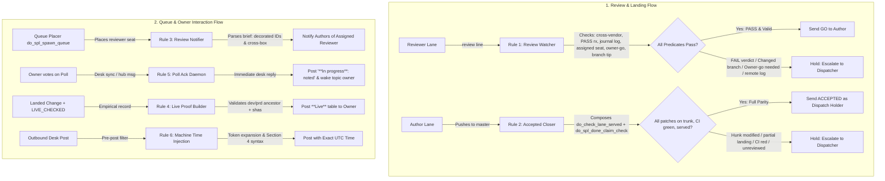
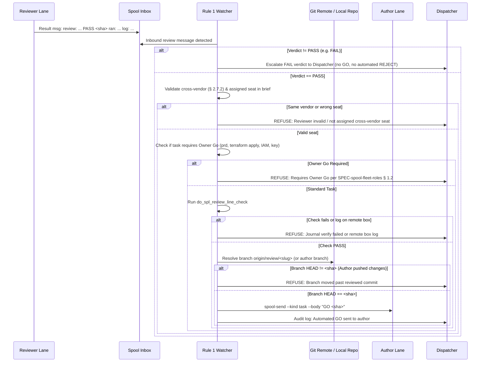
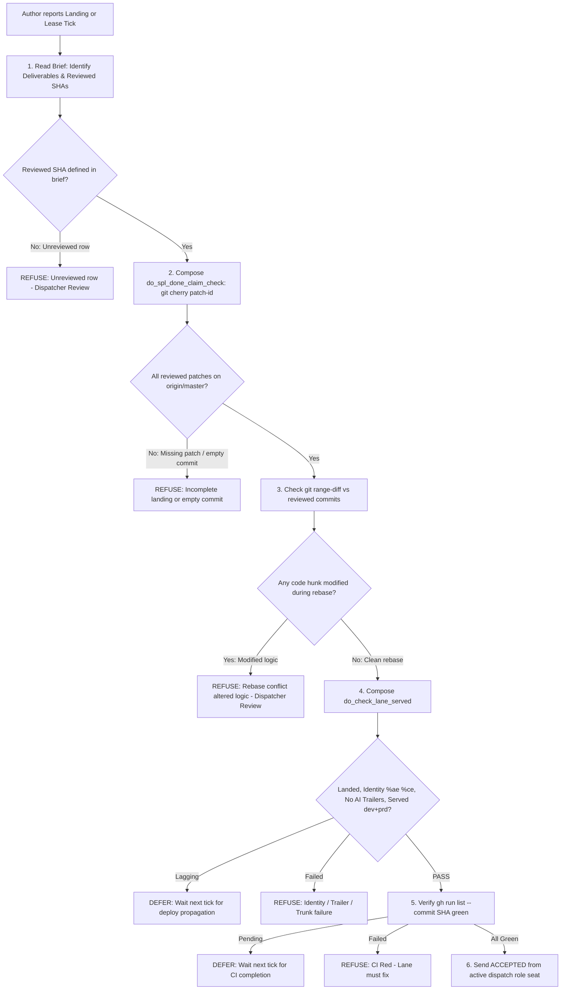
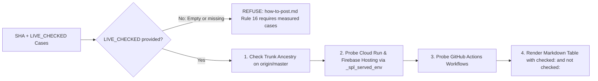
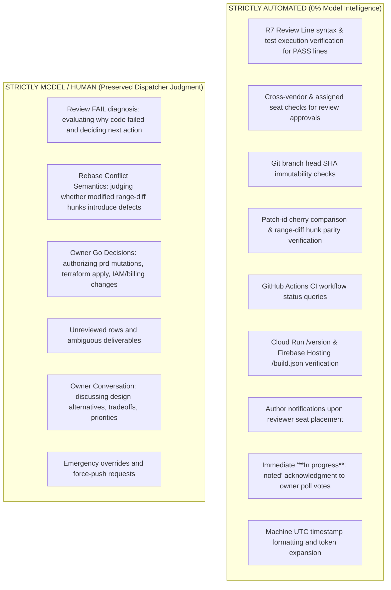
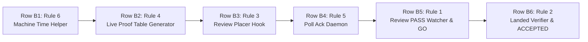

# Spec 157: Dispatch Automation — Deterministic Execution of Mechanical Dispatch Procedures

**Feature ID**: `157-dispatch-automation` · **Status**: Draft v0.2 · **Epic**: SPL-2398 · **Issue**: SPL-3392  
**Created**: 2026-10-25 · **Updated**: 2026-10-25 (incorporating cross-vendor review feedback from `c-220@sat`) · **Lead**: a-213 · **Placement slug**: `c002-spec-157-dispatch-automation`  
**Related Specs & Docs**:  
- [SPEC-spool-fleet-roles.md](../../doc/md/SPEC-spool-fleet-roles.md) (Fleet roles, 3-minute SLA, routing rules, lease failover, owner go gates, and asks ledger)  
- [spec 060 Role Rotation](../060-role-rotation/spec.md) (Hourly rotation, standby states, handoff files)  
- [developer-guide.md](../../doc/md/developer-guide.md) (Trunk branching, deploy lag, coding standards)  
- [rounds-rulebook.md](../../doc/md/rounds-rulebook.md) (R7 review line verification, cross-vendor requirements § 2.7.2, red controls)  
- [how-to-post.md](../../doc/help/how-to-post.md) (Post rules, poll forms, Rule 14 served ancestor, Rule 15 in-progress, Rule 16 Live proof, Section 4 clock times)  
- [lane-integration-rules.md](../../doc/md/lane-integration-rules.md) (Exit-clean ACCEPTED gate, git workflow)  

**Authority**: This document defines the architectural specifications, deterministic safety predicates, refusal invariants, execution topologies, red-control test suites, and build task decomposition for automating the mechanical dispatching actions identified by the owner and the dispatch team on 2026-10-25. Docs only; this specification introduces no immediate code, cron, or infrastructure mutations.

---

## 1. Context & Owner Mandate

### 1.1 The Owner's Direct Words
In topic `99ffa592-3717-4b9e-8a80-62c70456ceff` (`#spool-hub-ops`, prd tenant `t1`, HUM-10):
- **msg `a99676b7`**: *"Also, I would expect some kind of suggestions for improvements on the whole dispatching process. What could be automated to be done without any intelligence?"*
- **msg `1c8a754e`**: *"If he has not done that till now"* (addressing Grok's dispatching performance).
- **poll `6de8b12d`**: Asked whether to (A) grade Grok's 58 hours and build rules 1–6, (B) only grade Grok's 58 hours, or (C) build a 10-hour shadow mode.
- **msg `c9213bd2` (Answer A)**: The owner explicitly voted **Answer A**: *"Grade grok's 58 hours, and build rules 1-6"*.

### 1.2 Empirical Baseline: The 2026-10-25 Shift Measurement
On 2026-10-25, the active dispatcher (`c-002@sat`, post `6de8b12d`) recorded approximately **30 purely mechanical interventions** performed manually over a single operating shift:
1. Manually reading reviewer result messages, checking that the verdict was `PASS` and the git branch head had not moved, and sending a manual `GO` task to the author.
2. Manually inspecting landed commits on `origin/master`, diffing added/removed lines against the reviewed commit to detect rogue rebase modifications, checking GitHub Actions CI status, checking served `/version` (Cloud Run) and `/build.json` (Firebase Hosting) endpoints, and sending an `ACCEPTED` result to allow the lane to exit.
3. Reading newly placed reviewer seat briefs, extracting target author IDs and branches, and manually sending notification messages to each author lane.
4. Manually collecting commit SHAs, deployment proofs across dev/prd, and testing evidence to assemble the `**Live**` proof table demanded by `how-to-post.md` Rule 16.
5. Manually replying with acknowledgments when the owner clicked poll options in active discussions.
6. Manually typing UTC timestamps into status posts, which repeatedly resulted in human/model timezone transposition errors (e.g. typing local EET as UTC).

In parallel, `c-003@sat` (standby dispatcher, message `604472ca` / `17:17:10Z`) documented seven additional mechanical frictions:
- Standby seats being woken by unaddressed channel messages and routine test alerts that could be auto-archived.
- Lanes sending final reports to hardcoded dispatcher IDs rather than dynamically querying the live lease holder.
- Cross-box brief path fragmentation between `sat` and `<box-far>`.
- Repetitive ask bookkeeping (`ask_put`, `ask_ack`, `ask_close`) where task completion could deterministically close the ask.
- Manual drafting of standby handoff text when the queue, ask ledger, and hold notes already contain the complete state.
- Redundant and varied manual checks across lanes to determine if work is done.

### 1.3 The Problem: Cognitive Burden and Model Churn
LLM agents serving as dispatchers (`c-002`, `g-002`, `a-002`) are provisioned to make context-dependent evaluations: understanding human questions, breaking down ambiguous requests into specced work, assigning appropriate lane vendors, and handling unpredicted operational failures.

When dispatchers are forced to spend context tokens, prompt turns, and execution time executing static binary checks (e.g. `is git commit X an ancestor of master?`, `does diff line count match?`, `is CI status == success?`), three systemic failure modes emerge:
1. **Context Window Exhaustion**: A dispatcher's context window rapidly fills with git diffs, curl outputs, and repetitive notification logs, accelerating session degradation and triggering premature rotation.
2. **Turn Latency & Missed Pokes**: The dispatcher becomes occupied executing bash scripts for simple checks, delaying responses to inbound human posts beyond the mandatory 3-minute SLA ([SPEC-spool-fleet-roles.md](../../doc/md/SPEC-spool-fleet-roles.md) § 3).
3. **Model Hallucination & Transcription Errors**: LLMs regularly misread hex SHAs, omit trailing whitespace, or botch timezone calculations (as seen on 2026-10-25 when `c-002` typed incorrect UTC hours).

**Design Principle**: Anything that can be evaluated as a deterministic predicate on disk or via API must be executed by a shell script or daemon. Model intelligence is strictly reserved for judgment, ambiguity, and human conversation (owner: *"the less intelligence, the better"*).

---

## 2. Architecture & Existing Foundation (State on origin/master)



### 2.1 Existing Infrastructure on origin/master

The codebase already contains substantial verification primitives that Rules 1–6 must leverage and compose rather than rebuild:

| Component | Path on origin/master | Existing Capabilities | Missing Automation Gap |
|---|---|---|---|
| **R7 Review Line Check** | `csi-spl-orc/src/bash/run/spl-review-line-check.func.sh` | Strictly validates format of `review: <id>@<box> <vendor> PASS <40-hex sha> ran: ... \| read: ... \| log: <id>@<box>:<path>`. Reads reviewer's session transcript and proves each test named in `ran:` was actually executed. Returns exit 2 if log is on a remote box (never fetched locally). | Invoked manually by dispatcher and called by `spl-done-claim-check.func.sh`. (Pre-push and push-master run `_spl_push_master_review_why`, which checks format, 40-hex sha, and log tag, not journal commands). Does not automatically trigger on inbound review messages, nor does it check branch head immutability or cross-vendor rules. |
| **Lane Served Checker** | `csi-spl-orc/src/bash/run/check-lane-served.func.sh` | Evaluates lane-level landing and deployment: proves commit is on trunk (`git merge-base --is-ancestor`), author/committer identity (`%ae %ce`), absence of AI trailers (`Co-Authored-By:`, `Claude-Session:`), and served status on dev and prd via `do_check_deploy_lag` (recognizing `dev=n/a prd=n/a` when no deployable build inputs changed). | Standalone read-only checker. Does not verify review branch patch-id equivalence against original reviewed commits, does not bind to brief deliverables, and does not emit `ACCEPTED`. |
| **Done Claim Checker** | `csi-spl-orc/src/bash/run/spl-done-claim-check.func.sh` | Checks lane done claims against repository trunk; uses `git cherry` patch-id comparison (`git cherry -`) to verify that rebased review-branch SHAs landed on trunk. | Periodic cron audit; does not emit `ACCEPTED` to unblock lane `/exit-clean`. |
| **Trunk Push Action** | `csi-spl-orc/src/bash/run/spl-push-master.func.sh` | Detached background worker (`do_spl_push_master`). Enforces author identity, verifies R7 review line format on round rows (`_spl_push_master_review_why`), rejects unreviewed commits, handles fetch-and-rebase loops. | Does not verify semantic range-diff parity between reviewed SHA and rebased SHA after rebase conflicts. Does not emit `ACCEPTED`. |
| **Exit-Clean Gate** | `csi-spl-orc/src/bash/features/spawn-agents/scripts/kill-your-self-report.sh` | The `--gate` flag inspects `$SPOOL_ROOT/<id>/{inbox,archive}`. Refuses `/exit-clean` unless an `ACCEPTED` result exists from an authorized sender: a role seat (`c-001..003` / `lease.conf` `LEASE_*`), the lane's spawner/reporter, or `HUM-n` (`ksr_reviewer` / `ksr_is_seat`). | The `ACCEPTED` message is manually authored and sent by a human or model dispatcher typing into a terminal. |
| **Desk Live Proof Validator** | `csi-spl-orc/src/bash/run/spl-desk-live-proof.func.sh` | Evaluates posts opening with `**Live**`. Enforces commit existence on `origin/master`, checks deployment lag via `_spl_served_env` on `dev` and `prd` (`git merge-base --is-ancestor <sha> <served>` per `how-to-post.md` Rule 14), and verifies presence of `checked:` and `not checked:` clauses. | Purely a validator/linter that rejects invalid posts. Cannot synthesize or format the Live proof markdown table from git, CI, and deployment state. |
| **Deploy Lag Checker** | `csi-spl-orc/src/bash/run/check-deploy-lag.func.sh` | `do_check_deploy_lag` queries live Cloud Run `/version` and Firebase Hosting `/build.json`. Accurately determines if a commit is served. | Queried manually by dispatchers during shift work. |
| **Unanswered Post Sweep** | `csi-spl-orc/src/bash/run/spl-unanswered-sweep.func.sh` | Sweeps active channel topics on an interval, classifying unanswered owner posts and escalating to the dispatch holder. | Standing cron sweep on interval; does not provide immediate sub-minute acknowledgment to poll answers. |
| **Queue Placer** | `csi-spl-orc/src/bash/run/spl-spawn-queue.func.sh` | Reads queue TSV (`do_spl_spawn_queue`) and places lane containers/tmux panes when capacity permits. | Does not notify target authors when their designated reviewer seat is placed. |

---

## 3. The Six Core Automation Rules

### Rule 1: Automated GO After Review Approval

> **Objective**: When a designated cross-vendor reviewer approves a lane's work with `PASS`, immediately emit the authorization token (`GO <sha>`) to the author lane without human or model intervention, provided the code has not changed since the review, the reviewer matches the assigned seat, and no owner go is required.



#### 1. Trigger
- An incoming spool message of kind `result` or `note` arrives in the dispatch holder's inbox (or dedicated review topic) containing an R7 review line matching regex:  
  `^review:[[:space:]]+([acgmq]-[0-9]{3,})@([A-Za-z0-9._-]+)[[:space:]]+([a-z]+)[[:space:]]+(PASS|FAIL)[[:space:]]+([0-9a-f]{40})[[:space:]]+ran:[[:space:]]+(.*)[[:space:]]+\|[[:space:]]+read:[[:space:]]+(.*)[[:space:]]+\|[[:space:]]+log:[[:space:]]+([^[:space:]@]+)@([^[:space:]:]+):(/[^\s]+)$`

#### 2. Exact Deterministic Checks (Safe for zero intelligence)
1. **Verdict & Non-PASS Predicate**:
   - The verdict field must literally equal `PASS`.
   - **Critical**: `_spl_review_line_syntax` strictly requires `PASS`. Any line with `FAIL` fails syntax validation (`SYNTAX FAIL`). If the verdict is `FAIL` (or anything other than `PASS`), the script MUST NOT execute `do_spl_review_line_check`, and MUST NOT emit a `GO` or send an automated `REJECT`/send-back. It immediately logs the failure and escalates directly to the dispatcher (judgment preserved).
2. **Cross-Vendor Verification**:
   - The reviewer's vendor (derived from reviewer ID prefix or registry record) must strictly differ from the author's vendor per `rounds-rulebook.md` § 2.7.2 (`same vendor = 0`). If author and reviewer share the same vendor, refuse and escalate to the dispatcher.
3. **Assigned Seat Verification**:
   - Read the row's brief (`/var/spool-hub/dispatch/briefs/<slug>.md`) or queue record. The reviewer ID must match the assigned reviewer seat (or authorized backup). If unassigned, refuse and escalate.
4. **Owner-Go Gate Verification**:
   - Verify whether the target task involves owner-only operations: production mutations, `terraform apply`, GCP billing/IAM changes, service account key minting, root systemd modifications, or cluster restarts per `SPEC-spool-fleet-roles.md` § 1.2 and repo `CLAUDE.md`.
   - If an owner go is required, the script MUST NOT emit `GO`—it logs `REFUSED: task requires owner go` and hands off to the dispatcher.
5. **Review Line & Journal Execution Check**:
   - For `PASS` lines, execute `do_spl_review_line_check REVIEW_LINE="<line>"`.
   - **Remote Log Handling**: If the reviewer's log is on another box (e.g. `<box-remote>` while check runs on `sat`), `do_spl_review_line_check` returns exit code 2 (`REFUSED the log is on box...`). Remote logs are never fetched locally. The check must either be dispatched to run on the reviewer's box or refused and escalated to the dispatcher. It must never attempt to read remote paths locally.
   - For local logs, exit code must be 0 (confirming syntax, log ownership, and that all tests named in `ran:` were executed).
6. **Git Branch Immutability Check**:
   - Resolve author branch ref on `origin` (e.g. `origin/review/<slug>` or worktree branch).
   - Fetch fresh ref: `git fetch -q origin <branch>`.
   - Resolve tip commit: `git rev-parse origin/<branch>`.
   - The resolved commit SHA must exactly match the 40-hex `<sha>` from the review line.
7. **Author Liveness Check**:
   - Author lane must exist and be active in `$SPOOL_ROOT/<author-id>` or the fleet lane map.

#### 3. Refusals & Escalations (Model/Human Judgment Preserved)
- **Verdict == `FAIL`**: The script logs `REVIEW FAIL for author <id>` and escalates to the dispatcher. It sends NO `GO` and NO automated `REJECT`. The dispatcher assesses the root cause and decides whether to send back, replace the lane, or revise the brief.
- **Same-Vendor Review**: Refuses auto-GO (`REFUSED: reviewer shares vendor with author`). Escalates to dispatcher.
- **Unassigned Reviewer**: Refuses auto-GO (`REFUSED: reviewer <id> is not assigned seat`). Escalates to dispatcher.
- **Owner-Go Required**: Refuses auto-GO (`REFUSED: task touches owner-go scope`). Hands off to dispatcher to obtain owner authorization.
- **Branch Head Divergence**: If `git rev-parse origin/<branch>` != `<sha>`, author pushed additional commits during/after review. Script logs `REFUSED: branch moved past reviewed sha` and halts. Re-review is mandatory.
- **Journal Check Failure or Remote Box Refusal**: If `do_spl_review_line_check` exits non-zero (syntax error, missing test command in journal, or remote box exit 2), refuse auto-GO and alert dispatcher.

#### 4. Execution Location
- Integrated hook in `csi-spl-orc/src/bash/run/spl-review-go.func.sh`, triggered upon receipt of review result spool messages or invoked during the dispatch lease tick.

#### 5. Test Plan & Red Controls
- **Test File**: `csi-spl-orc/src/bash/tests/spl-review-go.tst.sh`
- **Red Controls**:
  1. *FAIL verdict*: Feed review message with `FAIL` -> script exits 1, asserts no `GO` emitted, asserts no `REJECT` emitted, asserts escalation logged.
  2. *Same vendor*: Feed review line where author and reviewer are both `claude` -> script exits 2, asserts no `GO` emitted, logs `REFUSED: same vendor`.
  3. *Unassigned reviewer*: Feed review line from unassigned agent -> script exits 3, asserts no `GO` emitted, logs `REFUSED: unassigned reviewer`.
  4. *Owner-go required*: Feed review for task modifying GCP/prd -> script exits 4, asserts no `GO` emitted, logs `REFUSED: task requires owner go`.
  5. *Branch head moved*: Branch ref points to commit different from `<sha>` -> script exits 5, asserts no `GO` emitted, logs `REFUSED: branch moved`.
  6. *Remote box log*: Reviewer log path on remote box -> script exits 6, asserts no local file read attempted, logs remote execution requirement.
- **Green Pass**: Valid cross-vendor `PASS` from assigned reviewer on immutable branch with verified journal and no owner-go required -> script exits 0, executes `spool-send.sh --kind task --body "GO <sha>"`.

---

### Rule 2: Automated ACCEPTED After Landing Verification

> **Objective**: When an author lane lands changes on `origin/master`, compose `do_check_lane_served` and `do_spl_done_claim_check` to verify that every reviewed commit from the brief is present on trunk (via `git cherry` patch-id equivalence), that no logic was altered during rebase, that CI is completely green, and that the change is actively served on dev and prd (if applicable). Upon passing, emit `ACCEPTED: on master <sha>` from the active dispatch role seat, enabling `/exit-clean`.



#### 1. Trigger
- Author lane sends result message on task `dispatch-<slug>` citing landed SHA, or periodic dispatch lease tick (`spl-accepted-close.func.sh`).

#### 2. Exact Deterministic Checks (Safe for zero intelligence)
1. **Brief Deliverables & Reviewed SHA Binding (Preventing Partial / Spurious Landing)**:
   - Read author lane's brief at `/var/spool-hub/dispatch/briefs/<slug>.md`.
   - Extract the required deliverables, tracked issue key (`SPL-XXXX`), and reviewed SHA(s) or review branch ref.
   - **Invariable Refusal**: If the brief does not define reviewed SHA(s) (e.g. an unreviewed row or exploratory seat), automated acceptance is strictly REFUSED. Judgment remains with the dispatcher.
2. **Patch-ID Completeness & Done Claim Verification (`do_spl_done_claim_check`)**:
   - Compose the verification algorithm from `do_spl_done_claim_check`:
     - Fetch `origin/master`.
     - Run `git cherry origin/master <review-sha>`: must return `-` for every reviewed commit (proving that the exact patch-id is already on trunk).
     - **Multi-Commit Coverage**: For multi-commit branches, every individual reviewed commit patch must be present on master. A partial landing (e.g. landing 1 of 3 commits) is REFUSED.
     - **Anti-Triviality / Anti-Empty Guard**: Verify that the landed commit contains non-zero additions/deletions matching the touched deliverables (guarding against `m-689`'s empty commit and `T008`'s tasks.md-only tick).
3. **Semantic Parity via Range-Diff**:
   - Run `git range-diff <reviewed-sha>^..<reviewed-sha> <landed-sha>^..<landed-sha>` across each landed commit.
   - Diff hunks must contain zero substantive code changes (only commit SHAs and line offset numbers may vary).
4. **Lane Served Verification (`do_check_lane_served`)**:
   - Execute `do_check_lane_served SHA=<landed-sha> BASE=<parent>`:
     - *Trunk ancestry*: Verifies `git merge-base --is-ancestor <landed-sha> origin/master`.
     - *Committer identity*: Verifies `%ae %ce` match `LANE_EMAIL` (the canonical committer email per `developer-guide.md` § 2.9).
     - *Trailers*: Verifies absence of forbidden AI trailers (`Co-Authored-By:`, `Claude-Session:`).
     - *Issue Key*: Verifies commit subject cites `SPL-XXXX` or carries `Closes: SPL-XXXX`.
     - *Served status*: Verifies `dev=served prd=served` via `do_check_deploy_lag` (or `dev=n/a prd=n/a` for docs/orc).
5. **CI Quality Gate**:
   - Query `gh run list --commit <landed-sha> --json status,conclusion`. Every workflow must be `status: "completed"` and `conclusion: "success"`.

#### 3. Sender Identity Architecture (Exit-Clean Gate Compliance)
- The exit-clean gate in `kill-your-self-report.sh` (`ksr_reviewer` / `ksr_is_seat`) strictly requires that an `ACCEPTED` result originate from:
  - An authorized role seat (`c-001..003` or `lease.conf` `LEASE_*`)
  - The lane's spawner/reporter (`REP_TO`)
  - Or `HUM-n`
- To prevent forged identities (`m-857`), Rule 2 executes as a sub-process of the active dispatch lease holder daemon (`$SPOOL_ROOT/dispatch/lease`), emitting the message with `--from "$DISPATCH_HOLDER"` (e.g. `c-002@sat`). It does not modify `kill-your-self-report.sh`.

#### 4. Refusals & Escalations (Model/Human Judgment Preserved)
- **Substantive Rebase Conflict Resolution**: If `git range-diff` reveals modified code hunks (the author altered logic during conflict resolution), the script MUST NOT send `ACCEPTED`. It logs `REFUSED: rebase altered code logic` and escalates to the dispatcher for manual inspection.
- **Partial or Incomplete Landing**: If any reviewed patch is missing from master, or the commit is empty, script logs `REFUSED: incomplete landing` and escalates.
- **Unreviewed Row**: If row lacks a reviewed SHA, script logs `REFUSED: unreviewed row` and escalates.
- **CI Failure**: If CI reports `failure`, script emits an alert; lane cannot exit until fixed.
- **Deploy Lag**: If CI is green but deployment is propagating, defer execution to the next tick.

#### 5. Execution Location
- Integrated into `csi-spl-orc/src/bash/run/spl-accepted-close.func.sh`, executed on the 60-second dispatch lease tick.

#### 6. Test Plan & Red Controls
- **Test File**: `csi-spl-orc/src/bash/tests/spl-accepted-close.tst.sh`
- **Red Controls**:
  1. *Empty commit*: Fabricate landed commit with no file changes -> script exits 1, asserts no `ACCEPTED` emitted, logs refusal.
  2. *Partial landing*: 2-commit review branch where only 1 commit landed -> script exits 2, asserts no `ACCEPTED` emitted, logs missing patch.
  3. *Rebase logic change*: Range-diff detects altered code hunk -> script exits 3, asserts no `ACCEPTED` emitted, logs hunk mismatch.
  4. *Unreviewed row*: Brief without reviewed SHA -> script exits 4, asserts no `ACCEPTED` emitted, logs unreviewed row.
  5. *CI red*: Workflow failed -> script exits 5, asserts no `ACCEPTED` emitted.
- **Green Pass**: All patches present via cherry patch-id, `do_check_lane_served` PASS, green CI -> script exits 0, executes `spool-send.sh --from "$DISPATCH_HOLDER" --to <lane> --kind result --body "ACCEPTED: on master <sha>"`.

---

### Rule 3: Automated Reviewer Notification to Author Lanes

> **Objective**: When the queue placer spawns a reviewer seat, immediately and deterministically parse the reviewer brief and notify every referenced author lane across boxes, eliminating author idle time and dispatcher manual lookups.

#### 1. Trigger
- The queue placer (`do_spl_spawn_queue` in `csi-spl-orc/src/bash/run/spl-spawn-queue.func.sh`) successfully places and starts a reviewer seat whose placement brief indicates review duties (`*-reviewer*`, `*-review`, or class `review`). (Note: `do_spl_spawn_seat` and `do_spl_spawn_lane` do not exist).

#### 2. Exact Deterministic Checks (Safe for zero intelligence)
1. **Brief Parsing**: Read the placed seat's brief file at `/var/spool-hub/dispatch/briefs/<slug>.md`.
2. **Robust Author Extraction**:
   - Scan for table rows matching markdown table syntax with decorated author cells:  
     `\|[[:space:]]*([acgmq]-[0-9]{3,})(@[A-Za-z0-9._-]+)?([[:space:]]*\([^)]+\))?[[:space:]]*\|`  
     (Correctly handles cells such as `| a-213@sat (agy) | ... |` and handles 3+ digit IDs).
   - Scan for explicit author headers:  
     `^Author:[[:space:]]*([acgmq]-[0-9]{3,})(@[A-Za-z0-9._-]+)?`
   - Extract `<author-id>` and optional `<box>`.
3. **Cross-Box Author Liveness Verification**:
   - Query the fleet lane map (`bash /opt/csi/csi-spl/csi-spl-orc/src/bash/features/spawn-agents/scripts/lane-map.sh --check <author-id>`) or cross-box registry.
   - Do NOT assume author exists in local `$SPOOL_ROOT/<id>`. If author is hosted on a remote box (e.g. `<box-remote>`), route the message via `spool-send.sh --to <id>@<box>`.

#### 3. Refusals & Escalations
- **Brief Lacks Author Identifiers**: If brief contains no extractable author IDs, log a warning to `dispatch/queue.log` and notify the dispatcher.
- **Retired Author**: If the extracted author lane has already retired, skip messaging that lane and log `SKIP: author <id> already retired`.

#### 4. Execution Location
- Post-spawn hook `csi-spl-orc/src/bash/run/spl-spawn-review-notify.func.sh`, invoked by `do_spl_spawn_queue` immediately after successful container/tmux pane provisioning.

#### 5. Test Plan & Red Controls
- **Test File**: `csi-spl-orc/src/bash/tests/spl-spawn-review-notify.tst.sh`
- **Red Controls**:
  1. *Malformed brief*: Brief with no author IDs -> hook logs warning, exits 1, sends 0 spool messages.
  2. *Decorated cell verification*: Brief with `| a-213@sat (agy) |` must NOT fail to match (red control asserts author `a-213` is successfully extracted).
  3. *Retired author*: Author marked retired in registry -> hook skips send, logs skip notice.
- **Green Pass**: Reviewer brief referencing authors `a-213@sat` and `c-168@<box-remote>` -> hook exits 0, sends notifications to both lanes with reviewer ID and review branch.

---

### Rule 4: Automated Live Proof Table Generation for Owner Posts

> **Objective**: Programmatically construct the complete Markdown `**Live**` proof table adhering strictly to `how-to-post.md` Rule 14 (served ancestor check) and Rule 16 (`checked:` must name measured test cases), eliminating manual markdown construction and post gate rejections.



#### 1. Trigger
- Invoked via named action:  
  `./run -a do_spl_desk_live_proof_render SHA=<sha> LIVE_CHECKED="<measured cases>" [LIVE_NOT_CHECKED="<not checked cases>"]`

#### 2. Exact Deterministic Checks (Safe for zero intelligence)
1. **Mandatory Measured Cases Input (`how-to-post.md` Rule 16)**:
   - Per `how-to-post.md` Rule 16, `checked:` MUST name the measured test and verification cases (the owner's *"every card"* requirement, SPL-2122). A machine cannot invent functional test cases.
   - The parameter `LIVE_CHECKED` is mandatory. If omitted or empty, the action REFUSES to generate a `**Live**` post: `FATAL: LIVE_CHECKED is required by how-to-post.md Rule 16`.
2. **Trunk Ancestry Check**:
   - Execute `git merge-base --is-ancestor <sha> origin/master`. Must return exit code 0.
3. **Component Touchpoints**:
   - Inspect files modified by `<sha>` via `git diff-tree --no-commit-id --name-only -r <sha>` to identify relevant targets (`hub`, `wui`, `iac`, `orc`, `doc`).
4. **Served Status Probing (`how-to-post.md` Rule 14)**:
   - Probe dev and prd using `_spl_served_env`.
   - **Crucial Rule 14 Implementation**: Served status requires that the commit served on Cloud Run (`/version`) and Firebase Hosting (`/build.json`) contains `<sha>` via `git merge-base --is-ancestor <sha> <served>` (not string equality).
5. **CI Status Probing**:
   - Validate workflow conclusions via `gh run list --commit <sha>`.
6. **Table Synthesis**:
   Assemble standard markdown table:
   ```markdown
   | target | commit / version | dev | prd | CI |
   |---|---|---|---|---|
   | hub | <short-sha> (`<version>`) | served | served | green |
   | wui | <short-sha> (`<version>`) | served | served | green |

   checked: <LIVE_CHECKED>
   not checked: <LIVE_NOT_CHECKED:-none>
   ```

#### 3. Refusals & Escalations
- **Missing `LIVE_CHECKED`**: Action halts with exit code 1 (`REFUSED: LIVE_CHECKED required`).
- **Commit Not on Trunk**: If `<sha>` is not an ancestor of `origin/master`, halts with exit code 2.
- **Deploy Incomplete**: If deployment is lagging, formats table header as `**Landed, not live yet**` rather than `**Live**`, preventing `spl_desk_live_proof` FATAL errors.

#### 4. Execution Location
- Named action `do_spl_desk_live_proof_render` in `csi-spl-orc/src/bash/run/spl-desk-live-proof-render.func.sh`.

#### 5. Test Plan & Red Controls
- **Test File**: `csi-spl-orc/src/bash/tests/spl-desk-live-proof-render.tst.sh`
- **Red Controls**:
  1. *Omitted `LIVE_CHECKED`*: Action exits 1, asserts refusal, no table rendered.
  2. *Unlanded SHA*: Action exits 2, logs `REFUSED: not on master`.
  3. *Lagging deploy*: Action renders `**Landed, not live yet**` and marks lagging environment.
- **Green Pass**: Deployed SHA with valid `LIVE_CHECKED` -> action renders table, passes `spl_desk_live_proof` with exit code 0.

---

### Rule 5: Automated Acknowledgement of Owner Poll Answers

> **Objective**: Instantly reply to owner poll submissions with an immediate confirmation post ("**In progress**: noted."), assuring the human owner their input is received while dispatch logic is engaged.

#### 1. Trigger
- An inbound spool message in the active dispatch holder's inbox (delivered from the hub via the channel subscriptions delivery loop) containing a new post from a human owner (`HUM-<n>`) in an active channel topic that matches an active poll option. (Note: `do_spl_desk_poll_check` is the outgoing poll form validator before sending, not the incoming receiver).

#### 2. Exact Deterministic Checks (Safe for zero intelligence)
1. **Sender Authentication**:
   - Message author must match authorized human owner format: `HUM-<n>` (e.g. `HUM-10` in tenant `t1`).
   - Never check `env.gcp.gcp_account_owner_email` (which is a GCP bootstrap credential reserved exclusively for gcp-000..004 per repo `CLAUDE.md`).
2. **Topic Context & Poll Match**:
   - Query topic history to verify preceding message contains a valid ````poll` block.
   - Confirm incoming message body corresponds to a valid poll option (e.g. `(A)`, `(B)`, or option label).
3. **De-duplication Check**:
   - Verify no agent reply has been posted in the topic since the owner's answer timestamp.
4. **Immediate Acknowledgment Body (`how-to-post.md` Rule 15)**:
   - The acknowledgment body must strictly adhere to `how-to-post.md` Rule 15:  
     `**In progress**: noted.` or `**In progress**: noted (<option>).`  
   - **Never** say "Acting on option (A)" before anyone acts! The model/dispatcher acts after being woken.
5. **Topic Owner Wakeup**:
   - Immediately send a spool poke/task to the topic owner or active dispatch lease holder, waking the agent to execute the substantive work.
6. **Relationship to `do_spl_unanswered_sweep`**:
   - Complements the standing `do_spl_unanswered_sweep` cron (which sweeps and escalates unanswered owner posts across topics on an interval) by providing sub-minute instant acknowledgment to satisfy human interactive responsiveness.

#### 3. Refusals & Escalations
- **Non-Owner Response**: If poll answer is from an agent or non-owner, ignore.
- **Already Answered**: If an agent reply exists, abort to avoid duplicate posts.
- **Closed Topic**: If topic is locked/closed, abort.

#### 4. Execution Location
- Desk message handler daemon in `csi-spl-orc/src/bash/run/spl-desk-poll-ack.func.sh`.

#### 5. Test Plan & Red Controls
- **Test File**: `csi-spl-orc/src/bash/tests/spl-desk-poll-ack.tst.sh`
- **Red Controls**:
  1. *Non-owner response*: Agent ID `c-168` voting on poll -> script exits silently 0, sends 0 posts.
  2. *Duplicate reply prevention*: Topic where reply was already sent -> script exits silently 0.
- **Green Pass**: Valid owner `HUM-10` vote on option (A) -> script executes `do_spl_desk_reply` posting `**In progress**: noted.`, and pokes topic owner.

---

### Rule 6: Machine-Stamped ISO / UTC Clock Times in Posts

> **Objective**: Standardize and automate time generation across all dispatcher posts, eliminating manually calculated time strings and enforcing `how-to-post.md` Section 4 compliance.

#### 1. Trigger
- An agent or script prepares a post body containing time template tokens or invokes `do_spl_desk_reply` / `do_spl_desk_post`.

#### 2. Exact Deterministic Checks (Safe for zero intelligence)
1. **Machine Token Expansion**:
   - `{{NOW_UTC}}` -> Formatted as `HH:MM:SSZ` (e.g. `17:15:30Z`).
   - `{{TODAY_UTC}}` -> Formatted as `YYYY-MM-DD` (e.g. `2026-10-25`).
   - `{{NOW_ISO}}` -> Formatted as `YYYY-MM-DDTHH:MM:SSZ`.
   - **The 10-25 Defect Insight**: On 2026-10-25, an agent typed the wrong UTC hour WITH a `Z` suffix (typing local EET time as UTC). No syntax linter can detect an incorrect hour number when it is syntactically valid `Z`; only deterministic machine token expansion eliminates this error class entirely.
2. **Supported Time Grammar (`how-to-post.md` Section 4)**:
   - Accept short UTC times: `HH:MM:SSZ`, `HH:MMZ`, `10:4xZ` (x = "about"), and ranges `10:15-10:17Z`, `09:53Z..10:23Z`.
   - Accept ISO 8601 date-times with a zone: `Z` or timezone offset such as `+03:00` (which `how-to-post.md` Section 4 explicitly permits and translates for the reader).
3. **Refusal Invariant (No Guessing)**:
   - Do NOT attempt to "automatically convert" raw colloquial times (e.g. "at 3pm local"). Guessing the timezone can introduce severe errors. Unrecognized or ambiguous times must be REFUSED with a clear linter error.

#### 3. Refusals & Escalations
- **Ambiguous Relative Time**: If post body contains colloquial times without a timezone, pre-post linter halts with error.

#### 4. Execution Location
- Filter library `csi-spl-orc/src/bash/run/spl-post-time.func.sh`, integrated into `csi-spl-orc/src/bash/run/spl-desk-reply.func.sh` and `csi-spl-orc/src/bash/run/spl-desk-post.func.sh`.

#### 5. Test Plan & Red Controls
- **Test File**: `csi-spl-orc/src/bash/tests/spl-post-time.tst.sh`
- **Red Controls**:
  1. *Ambiguous time*: Body containing `at 3pm today` without zone -> linter rejects with error.
- **Green Passes**:
  1. Draft containing `Taken at {{NOW_UTC}}` -> expands to exact current machine UTC time.
  2. Draft containing valid Section 4 forms (`10:4xZ`, ISO with `+03:00`) -> passes unaltered.

---

## 4. Analysis of Secondary Mechanical Steps & Queued Bug Rows

In message `604472ca`, standby dispatcher `c-003@sat` highlighted seven candidate friction points. Here we evaluate their disposition and confirm disjointness against queued bug rows:

| # | Candidate Mechanical Step | Operational Problem | Proposed Solution & Architecture | Fit & Disposition |
|---|---|---|---|---|
| **C1** | **Standby Inbox Auto-Archive** | Standby dispatcher (`c-003` while `c-002` holds lease) receives pokes for broadcast messages and channel copies, waking model needlessly. | Daemon monitors `$SPOOL_ROOT/<standby-id>/inbox/`. When in `STANDBY`, auto-archives unaddressed copies. | **Accepted**: Extension row B7 (`spl-standby-archive.func.sh`). |
| **C2** | **Dynamic Dispatch Holder Routing** | Lanes send final reports to hardcoded `c-002`, failing when `c-003` holds lease. | Route to active lease holder. Queued bug row `c002-bug-ksr-reporter-dispatch-holder` fixes `ksr_reporter` in `kill-your-self-report.sh`. Spool-send dynamic resolution is complementary. | **Handled**: Covered by `c002-bug-ksr-reporter-dispatch-holder`. Do not modify its files in rows B1–B6. |
| **C3** | **Cross-Box Path / File Inlining** | `<box-far>` cannot read local files on `sat` (`/var/spool-hub/...`). Cross-box messages citing local paths fail. | Update `spool-fleet-relay.sh`: detect referenced sat file paths in message body and embed contents as payload attachments when relaying across boxes. | **Accepted**: Extension row B8 (`spool-fleet-relay.sh`). Note: Does NOT solve or collide with `c002-bug-placer-brief-other-box` (which fixes placer brief reading in `spl-spawn-place.func.sh`). |
| **C4** | **Deterministic Ask Bookkeeping** | Dispatchers manually run `ask_put`, `ask_ack`, and `ask_close` when handling asks. | Automatically mark ask `done` when an outgoing message of kind `result` (or task completion) on the matching task ID succeeds. **Never** close on an `In progress` note! | **Accepted**: Extension row B9 (`spl-asks-auto-close.func.sh`). |
| **C5** | **DM Reply Starter Fallback** | Owner DM waited 35 minutes because only session starter could reply. | Add fallback authorization allowing active dispatch lease holder to answer DMs when starter session is dead. | **Handled**: Already queued in bug row `c003-bug-dm-reply-starter-gone`. |
| **C6** | **Deterministic Handoff Generation** | Each rotation requires manually writing open items handoff file. | Synthesize handoff file from active queue state (`do_spl_spawn_queue`), open asks (`asks.json`), and hold notes. | **Accepted**: Extension row B10 (`spl-handoff-render.func.sh`). |
| **C7** | **Unified `do_spl_verify_done`** | Multiple disjoint checks to confirm whether a lane is done. | Compose `do_check_lane_served` and `do_spl_done_claim_check` into a single action returning binary `PASS` or `FAIL`. | **Accepted**: Incorporated directly into Rule 2 (Row B6). |

### Queued Bug Row Disjointness Confirmation:
1. `c002-bug-ksr-reporter-dispatch-holder`: touches `kill-your-self-report.sh` (`ksr_reporter`) and `spl-asks-tick.func.sh`. Build rows B1–B6 touch neither file.
2. `c002-bug-lane-issue-end-apply-only`: touches `spl-lane-issue.func.sh`. Build rows B1–B6 touch neither file.
3. `c002-bug-placer-brief-other-box`: touches `spl-spawn-place.func.sh`. Build rows B1–B6 touch neither file (Row B3 touches `spl-spawn-queue.func.sh` only).

---

## 5. Boundary Matrix: Deterministic Script vs. Model Intelligence

To prevent automation overreach and protect operational safety, the operational boundaries between scripts and models are strictly partitioned:



### 5.1 Hard Automation Safety Invariants
1. **Never Bypass an Access Gate**: Automated scripts must never override pre-push hooks, skip review line checks, or force-push commits.
2. **Fail Closed**: Any network timeout, git ambiguity, missing file, or unexpected exit code immediately halts automation and leaves state untouched.
3. **Comprehensive Audit Trail**: Every automated action must write a structured log entry to `$SPOOL_ROOT/dispatch/automation.log` specifying timestamp, action taken, actor, input SHAs, and verification receipts. The log file and directory `$SPOOL_ROOT/dispatch/` are initialized on first append (`mkdir -p "$SPOOL_ROOT/dispatch" && touch ...`) introduced in build row B3 upon its first logged event and used by B4, B5, and B6.

---

## 6. Implementation Plan: Build Rows B1..B6 & Extension Rows

### 6.1 Build Rows (Smallest first, completely disjoint files)



| Row | Target Rule | Primary Files Touched | Hooked Subsystem / Integration Point | Scope & Deliverable | Test & Red Controls | Size | Order |
|---|---|---|---|---|---|---|---|
| **B1** | **Rule 6** | `csi-spl-orc/src/bash/run/spl-post-time.func.sh`<br>`csi-spl-orc/src/bash/tests/spl-post-time.tst.sh` | Integrated into `spl-desk-reply.func.sh` and `spl-desk-post.func.sh` | Function `spl_post_timestamp` & template replacer for `{{NOW_UTC}}`, `{{TODAY_UTC}}`, `{{NOW_ISO}}`. Enforces Section 4 syntax. | Control: colloquial time rejected. Passes on valid token expansion and Section 4 times. | Small | 1 |
| **B2** | **Rule 4** | `csi-spl-orc/src/bash/run/spl-desk-live-proof-render.func.sh`<br>`csi-spl-orc/src/bash/tests/spl-desk-live-proof-render.tst.sh` | Standalone named action `do_spl_desk_live_proof_render` (composes `_spl_served_env` and `do_check_deploy_lag`) | Synthesizes verified Markdown `**Live**` table requiring `LIVE_CHECKED`. Uses `merge-base --is-ancestor` for served check. | Control: omitted `LIVE_CHECKED` refused; unlanded SHA refused; deployed commit outputs verified table. | Small | 2 |
| **B3** | **Rule 3** | `csi-spl-orc/src/bash/run/spl-spawn-review-notify.func.sh`<br>`csi-spl-orc/src/bash/tests/spl-spawn-review-notify.tst.sh` | Post-spawn hook in `spl-spawn-queue.func.sh` (post-spawn). Does NOT touch `spl-spawn-place.func.sh`. | Parses reviewer brief with decorated cells (`\| a-213@sat (agy) \|`) and notifies authors across boxes. | Control: decorated cell matches; malformed brief logs warning; valid brief notifies authors. | Small | 3 |
| **B4** | **Rule 5** | `csi-spl-orc/src/bash/run/spl-desk-poll-ack.func.sh`<br>`csi-spl-orc/src/bash/tests/spl-desk-poll-ack.tst.sh` | Desk sync / message ingress loop | Evaluates incoming `HUM-<n>` poll votes. Emits immediate `**In progress**: noted.` post via `do_spl_desk_reply` and wakes topic owner. | Control: non-owner vote ignored; duplicate vote ignored; owner vote immediately replied. | Medium | 4 |
| **B5** | **Rule 1** | `csi-spl-orc/src/bash/run/spl-review-go.func.sh`<br>`csi-spl-orc/src/bash/tests/spl-review-go.tst.sh` | Spool inbox listener / dispatch lease tick (composes `do_spl_review_line_check`) | Evaluates cross-vendor `PASS` review lines, assigned seats, owner-go scopes, and branch immutability. Emits `GO <sha>`. | Controls: `FAIL` escalates without GO/REJECT; same vendor refused; owner go refused; remote log refused. Valid `PASS` emits `GO`. | Medium | 5 |
| **B6** | **Rule 2** | `csi-spl-orc/src/bash/run/spl-accepted-close.func.sh`<br>`csi-spl-orc/src/bash/tests/spl-accepted-close.tst.sh` | Dispatch lease tick (composes `do_check_lane_served` and `do_spl_done_claim_check`). Runs under active dispatch role seat (`--from "$DISPATCH_HOLDER"`). Does NOT touch `kill-your-self-report.sh`. | Verifies cherry patch-id presence on master, range-diff hunk parity, CI green, and served build. Emits `ACCEPTED`. | Controls: empty commit refused; partial landing refused; rebase logic change refused; unreviewed row refused. Valid landing emits `ACCEPTED`. | Medium | 6 |

### 6.2 Secondary Extension Rows (Post-Rules 1–6)
- **Row B7 (C1 Standby Auto-Archive)**: `csi-spl-orc/src/bash/run/spl-standby-archive.func.sh` — background daemon auto-archiving unaddressed notifications for standby seats.
- **Row B8 (C3 Cross-Box Relay Inliner)**: `csi-spl-orc/src/bash/features/spawn-agents/scripts/spool-fleet-relay.sh` — embeds local file attachments into payloads crossing between `sat` and `<box-far>`. (Enhancement to relay inlining; independent of placer brief reading).
- **Row B9 (C4 Ask Auto-Closer)**: `csi-spl-orc/src/bash/run/spl-asks-auto-close.func.sh` — marks open asks `done` ONLY upon successful outbound message of kind `result` (or verified task completion) on the matching task ID.
- **Row B10 (C6 Standby Handoff Synthesizer)**: `csi-spl-orc/src/bash/run/spl-handoff-render.func.sh` — generates standby handover markdown from live queue and ask registries.

---

## 7. Invariants & Acceptance Criteria

### 7.1 System Invariants
1. **Safety First**: No automated script may execute an action if any prerequisite check yields ambiguous or non-zero return codes.
2. **Dispatcher Judgment Preserved**: Any review `FAIL` verdict, rebase conflict with modified diff hunks, unreviewed row, or task touching owner-go scope (production mutations, `terraform apply`, IAM/billing) MUST be escalated to the dispatcher. Automation never rejects or authorizes these cases.
3. **Immutable History**: Automated `ACCEPTED` decisions must record the exact reviewed SHA, landed SHA, and verification receipts in `$SPOOL_ROOT/dispatch/automation.log`.
4. **No Phantom Closes**: A lane must never be issued `ACCEPTED` unless all reviewed commits from its brief are proven present on `origin/master` (via cherry patch-id equivalence), verified by CI, and actively served on dev/prd.

### 7.2 Acceptance Criteria for Build Rows
1. Every build row must deliver its named `./run` action and test in the same commit.
2. Every test must include verified red controls proving every refusal path before demonstrating the passing assertion.
3. Distribution hygiene (`do_check_dist_hygiene`) must remain 100% clean across all new files.
4. Fast pre-push lint (`do_check_pre_push_lint`) must pass with zero errors.
