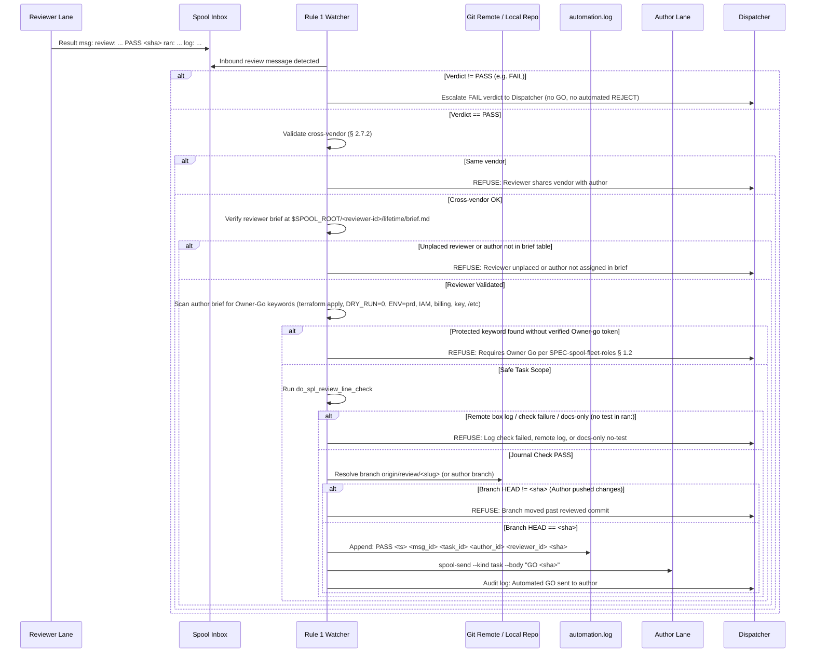
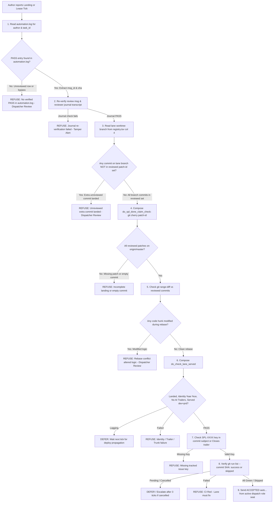
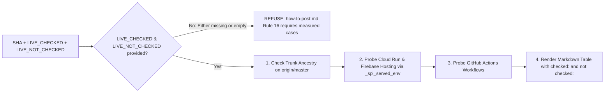
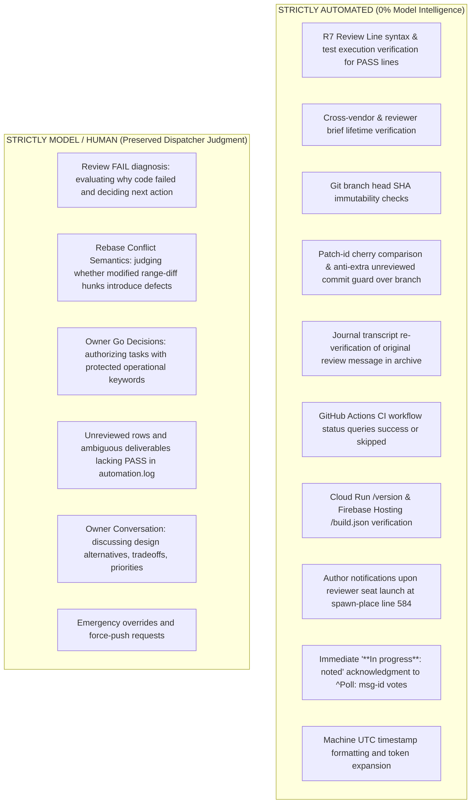
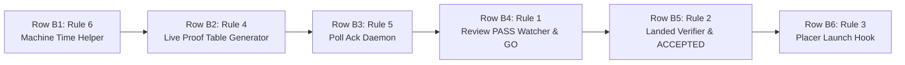

# Spec 157: Dispatch Automation — Deterministic Execution of Mechanical Dispatch Procedures

**Feature ID**: `157-dispatch-automation` · **Status**: Draft v0.4 · **Epic**: SPL-2398 · **Issue**: SPL-3392  
**Created**: 2026-10-25 · **Updated**: 2026-10-25 (incorporating cross-vendor review feedback from `c-220@sat` resolving X1–X6) · **Lead**: a-213 · **Placement slug**: `c002-spec-157-dispatch-automation`  
**Related Specs & Docs**:  
- [SPEC-spool-fleet-roles.md](../../doc/md/SPEC-spool-fleet-roles.md) (Fleet roles, 3-minute SLA, routing rules, lease failover, owner go gates, and asks ledger)  
- [spec 060 Role Rotation](../060-role-rotation/spec.md) (Hourly rotation, standby states, handoff files)  
- [developer-guide.md](../../doc/md/developer-guide.md) (Trunk branching, deploy lag, coding standards)  
- [rounds-rulebook.md](../../doc/md/rounds-rulebook.md) (R7 review line verification, cross-vendor requirements § 2.7.2, red controls)  
- [how-to-post.md](../../doc/help/how-to-post.md) (Post rules, poll forms, Rule 14 served ancestor, Rule 15 in-progress, Rule 16 Live proof, Section 4 clock times)  
- [lane-integration-rules.md](../../doc/md/lane-integration-rules.md) (Exit-clean ACCEPTED gate, git workflow)  

**Authority**: This document defines the architectural specifications, deterministic safety predicates, refusal invariants, execution topologies, red-control test suites, and build task decomposition for automating the mechanical dispatching actions identified by the owner and the dispatch team on 2026-10-25. Docs only; this specification introduces no immediate code, cron, or infrastructure mutations.

---

## 1. Context & Owner Mandate

### 1.1 The Owner's Direct Words
In topic `99ffa592-3717-4b9e-8a80-62c70456ceff` (`#spool-hub-ops`, prd tenant `t1`, HUM-10):
- **msg `a99676b7`**: *"Also, I would expect some kind of suggestions for improvements on the whole dispatching process. What could be automated to be done without any intelligence?"*
- **msg `1c8a754e`**: *"If he has not done that till now"* (addressing Grok's dispatching performance).
- **poll `6de8b12d`**: Asked whether to (A) grade Grok's 58 hours and build rules 1–6, (B) only grade Grok's 58 hours, or (C) build a 10-hour shadow mode.
- **msg `c9213bd2` (Answer A)**: The owner explicitly voted **Answer A**: *"Grade grok's 58 hours, and build rules 1-6"*.

### 1.2 Empirical Baseline: The 2026-10-25 Shift Measurement
On 2026-10-25, the active dispatcher (`c-002@sat`, post `6de8b12d`) recorded approximately **30 purely mechanical interventions** performed manually over a single operating shift:
1. Manually reading reviewer result messages, checking that the verdict was `PASS` and the git branch head had not moved, and sending a manual `GO` task to the author.
2. Manually inspecting landed commits on `origin/master`, diffing added/removed lines against the reviewed commit to detect rogue rebase modifications, checking GitHub Actions CI status, checking served `/version` (Cloud Run) and `/build.json` (Firebase Hosting) endpoints, and sending an `ACCEPTED` result to allow the lane to exit.
3. Reading newly placed reviewer seat briefs, extracting target author IDs and branches, and manually sending notification messages to each author lane.
4. Manually collecting commit SHAs, deployment proofs across dev/prd, and testing evidence to assemble the `**Live**` proof table demanded by `how-to-post.md` Rule 16.
5. Manually replying with acknowledgments when the owner clicked poll options in active discussions.
6. Manually typing UTC timestamps into status posts, which repeatedly resulted in human/model timezone transposition errors (e.g. typing local EET as UTC).

In parallel, `c-003@sat` (standby dispatcher, message `604472ca` / `17:17:10Z`) documented seven additional mechanical frictions:
- Standby seats being woken by unaddressed channel messages and routine test alerts that could be auto-archived.
- Lanes sending final reports to hardcoded dispatcher IDs rather than dynamically querying the live lease holder.
- Cross-box brief path fragmentation between `sat` and `<box-far>`.
- Repetitive ask bookkeeping (`ask_put`, `ask_ack`, `ask_close`) where task completion could deterministically close the ask.
- Manual drafting of standby handoff text when the queue, ask ledger, and hold notes already contain the complete state.
- Redundant and varied manual checks across lanes to determine if work is done.

### 1.3 The Problem: Cognitive Burden and Model Churn
LLM agents serving as dispatchers (`c-002`, `g-002`, `a-002`) are provisioned to make context-dependent evaluations: understanding human questions, breaking down ambiguous requests into specced work, assigning appropriate lane vendors, and handling unpredicted operational failures.

When dispatchers are forced to spend context tokens, prompt turns, and execution time executing static binary checks (e.g. `is git commit X an ancestor of master?`, `does diff line count match?`, `is CI status == success?`), three systemic failure modes emerge:
1. **Context Window Exhaustion**: A dispatcher's context window rapidly fills with git diffs, curl outputs, and repetitive notification logs, accelerating session degradation and triggering premature rotation.
2. **Turn Latency & Missed Pokes**: The dispatcher becomes occupied executing bash scripts for simple checks, delaying responses to inbound human posts beyond the mandatory 3-minute SLA ([SPEC-spool-fleet-roles.md](../../doc/md/SPEC-spool-fleet-roles.md) § 3).
3. **Model Hallucination & Transcription Errors**: LLMs regularly misread hex SHAs, omit trailing whitespace, or botch timezone calculations (as seen on 2026-10-25 when `c-002` typed incorrect UTC hours).

**Design Principle**: Anything that can be evaluated as a deterministic predicate on disk or via API must be executed by a shell script or daemon. Model intelligence is strictly reserved for judgment, ambiguity, and human conversation (owner: *"the less intelligence, the better"*).

---

## 2. Architecture & Existing Foundation (State on origin/master)

```mermaid
flowchart TD
    subgraph ReviewAndLanding["1. Review & Landing Flow"]
        Rev[Reviewer Lane] -->|review line| R1[Rule 1: Review Watcher]
        R1 -->|Checks: cross-vendor, PASS rx, reviewer lifetime brief, owner-go keyword scan, branch tip| R1Check{All Predicates Pass?}
        R1Check -->|Yes: PASS & Valid| GoMsg[Send GO to Author & Append to automation.log]
        R1Check -->|FAIL verdict / Moved branch / Owner-go needed / remote log / docs no-test| Esc1[Hold: Escalate to Dispatcher]
        
        Author[Author Lane] -->|Pushes to master| R2[Rule 2: Accepted Closer]
        R2 -->|Reads msg_id & sha from automation.log| R2CheckLog{Review entry found?}
        R2CheckLog -->|No| Esc2[Hold: Escalate to Dispatcher]
        R2CheckLog -->|Yes| R2Recheck[Re-verify original review msg & journal transcript]
        R2Recheck --> R2CheckBranch[Verify all commits on lane worktree branch match reviewed patch-id set]
        R2CheckBranch -->|Extra unreviewed commit landed| Esc3[Hold: Escalate to Dispatcher]
        R2CheckBranch -->|All patches match, no extras, CI green, served| AccMsg[Send ACCEPTED auto... from Dispatch Holder]
    end

    subgraph QueueAndProof["2. Queue & Owner Interaction Flow"]
        QP[Seat Placer spl-spawn-place.func.sh:584] -->|Places reviewer seat| R3[Rule 3: Review Notifier]
        R3 -->|Parses brief: decorated cells & registry| AuthNotif[Notify Authors across boxes]
        
        OwnerPoll[Owner votes on Poll] -->|Spool delivery to dispatcher| R5[Rule 5: Poll Ack Daemon]
        R5 -->|Matches ^Poll: msg-id| AckPost[Post '**In progress**: noted.' & wake topic owner]
        
        DeployVerif[Landed Change + LIVE_CHECKED + LIVE_NOT_CHECKED] -->|Empirical record| R4[Rule 4: Live Proof Builder]
        R4 -->|Validates dev/prd ancestor + shas| LiveTable[Post **Live** table to Owner]
        
        AnyPost[Outbound Desk Post] -->|Pre-post filter| R6[Rule 6: Machine Time Injection]
        R6 -->|Token expansion & Section 4 syntax| FormattedPost[Post with Exact UTC Time]
    end
```



### 2.1 Existing Infrastructure on origin/master

The codebase already contains substantial verification primitives that Rules 1–6 must leverage and compose rather than rebuild:

| Component | Path on origin/master | Existing Capabilities | Missing Automation Gap |
|---|---|---|---|
| **R7 Review Line Check** | `csi-spl-orc/src/bash/run/spl-review-line-check.func.sh` | Strictly validates format of `review: <id>@<box> <vendor> PASS <40-hex sha> ran: ... \| read: ... \| log: <id>@<box>:<path>`. Requires test names in `ran:` (`_spl_review_line_names`). Reads reviewer session transcript and proves each test named in `ran:` was executed. Returns exit 2 if log is on a remote box (never fetched locally). Exits non-zero (exit 1 syntax fail / exit 3 missing) for docs-only reviews naming no module tests. | Invoked manually by dispatcher and called by `spl-done-claim-check.func.sh`. (Pre-push and push-master run `_spl_push_master_review_why`, which checks format, 40-hex sha, and log tag, not journal commands). Does not automatically trigger on inbound review messages, nor does it check branch head immutability, reviewer lifetime brief assignments, or cross-vendor rules. |
| **Lane Served Checker** | `csi-spl-orc/src/bash/run/check-lane-served.func.sh` | Evaluates lane landing and deployment: proves commit is on trunk (`git merge-base --is-ancestor`), author/committer identity (`%ae %ce`), absence of AI trailers (`Co-Authored-By:`, `Claude-Session:`), and served status on dev and prd via `do_check_deploy_lag`. Does NOT check commit subject issue key (`SPL-XXXX`). | Standalone read-only checker. Does not verify review branch patch-id equivalence against original reviewed commits, does not check issue keys, and does not emit `ACCEPTED`. |
| **Done Claim Checker** | `csi-spl-orc/src/bash/run/spl-done-claim-check.func.sh` | Checks lane done claims against repository trunk; uses `git cherry` patch-id comparison (`git cherry -`) to verify that rebased review-branch SHAs landed on trunk. | Periodic cron audit; does not check for unreviewed extra commits landed alongside reviewed patches, and does not emit `ACCEPTED`. |
| **Trunk Push Action** | `csi-spl-orc/src/bash/run/spl-push-master.func.sh` | Detached background worker (`do_spl_push_master`). Enforces author identity, verifies R7 review line format on round rows (`_spl_push_master_review_why`), rejects unreviewed commits, handles fetch-and-rebase loops. | Does not verify semantic range-diff parity between reviewed SHA and rebased SHA after rebase conflicts. Does not emit `ACCEPTED`. |
| **Exit-Clean Gate** | `csi-spl-orc/src/bash/features/spawn-agents/scripts/kill-your-self-report.sh` | The `--gate` flag inspects `$SPOOL_ROOT/<id>/{inbox,archive}`. Performs case-sensitive prefix matching `[[ "$body" == ACCEPTED* ]]` (line 173) from an authorized sender: a role seat (`c-001..003` / `lease.conf` `LEASE_*`), the lane's spawner/reporter, or `HUM-n`. | The `ACCEPTED` message is manually authored and sent by a human or model dispatcher typing into a terminal. |
| **Desk Live Proof Validator** | `csi-spl-orc/src/bash/run/spl-desk-live-proof.func.sh` | Evaluates posts opening with `**Live**`. Enforces commit existence on `origin/master`, checks deployment lag via `_spl_served_env` on `dev` and `prd` (`git merge-base --is-ancestor <sha> <served>` per `how-to-post.md` Rule 14), and verifies presence of `checked:` and `not checked:` clauses per Rule 16. | Purely a validator/linter that rejects invalid posts. Cannot synthesize or format the Live proof markdown table from git, CI, and deployment state. |
| **Deploy Lag Checker** | `csi-spl-orc/src/bash/run/check-deploy-lag.func.sh` | `do_check_deploy_lag` queries live Cloud Run `/version` and Firebase Hosting `/build.json`. Accurately determines if a commit is served. | Queried manually by dispatchers during shift work. |
| **Unanswered Post Sweep** | `csi-spl-orc/src/bash/run/spl-unanswered-sweep.func.sh` | Sweeps active channel topics on an interval, classifying unanswered owner posts and escalating to the dispatch holder. | Standing cron sweep on interval; does not provide immediate sub-minute acknowledgment to poll answers. |
| **Seat Placer & Launcher** | `csi-spl-orc/src/bash/run/spl-spawn-place.func.sh` | `do_spl_spawn_place` reads the queue from the hub DB (`do_spl_spawn_queue`) and launches lane containers/tmux panes via `spawn-window.sh` inside `spl_spawn_place_launch` at line 584. | Does not notify target authors when their designated reviewer seat is placed and launched. |

---

## 3. The Six Core Automation Rules

### Rule 1: Automated GO After Review Approval

> **Objective**: When a designated cross-vendor reviewer approves a lane's work with `PASS`, immediately append an audit entry (`PASS <ts> <msg_id> <task_id> <author_id> <reviewer_id> <sha>`) into `$SPOOL_ROOT/dispatch/automation.log` and emit the authorization token (`GO <sha>`) to the author lane without human or model intervention, provided the code has not changed since the review, the reviewer is confirmed via `$SPOOL_ROOT/<reviewer-id>/lifetime/brief.md`, and the author brief contains no unapproved owner-go keywords.



#### 1. Trigger
- An incoming spool message of kind `result` or `note` arrives in the dispatch holder's inbox (or dedicated review task) containing an R7 review line matching regex:  
  `^review:[[:space:]]+([acgmq]-[0-9]{3,})@([A-Za-z0-9._-]+)[[:space:]]+([a-z]+)[[:space:]]+(PASS|FAIL)[[:space:]]+([0-9a-f]{40})[[:space:]]+ran:[[:space:]]+(.*)[[:space:]]+\|[[:space:]]+read:[[:space:]]+(.*)[[:space:]]+\|[[:space:]]+log:[[:space:]]+([^[:space:]@]+)@([^[:space:]:]+):(/[^\s]+)$`

#### 2. Exact Deterministic Checks (Safe for zero intelligence)
1. **Verdict & Non-PASS Predicate**:
   - The verdict field must literally equal `PASS`.
   - **Critical**: `_spl_review_line_syntax` strictly requires `PASS`. Any line with `FAIL` fails syntax validation (`SYNTAX FAIL`). If the verdict is `FAIL` (or anything other than `PASS`), the script MUST NOT execute `do_spl_review_line_check`, and MUST NOT emit a `GO` or send an automated `REJECT`/send-back. It immediately logs the failure and escalates directly to the dispatcher (judgment preserved).
2. **Cross-Vendor Verification**:
   - The reviewer's vendor (derived from reviewer ID prefix or registry record) must strictly differ from the author's vendor per `rounds-rulebook.md` § 2.7.2 (`same vendor = 0`). If author and reviewer share the same vendor, refuse and escalate to the dispatcher.
3. **Placed Reviewer Seat Verification (Resolves N5, X5)**:
   - Author briefs do not name a specific reviewer ID (they specify only requirements such as "a claude seat reviews it").
   - To strictly verify that the reviewer was legitimately placed for this specific review duty, Rule 1 reads the placed reviewer's brief directly from disk:  
     `$SPOOL_ROOT/<reviewer-id>/lifetime/brief.md` (the local brief copy provisioned by `spl-spawn-share.func.sh:108` during seat placement).
   - Rule 1 verifies that `$SPOOL_ROOT/<reviewer-id>/lifetime/brief.md` exists, is non-empty, and contains the author `<author-id>` in its target review table row (`| author | branch | sha | task |`).
   - If the file is missing or the author is not listed, REFUSE: `REFUSED: unplaced reviewer or author not assigned in reviewer brief` and escalate.
4. **Owner-Go Keyword Scan & Verification (Resolves N5, X1)**:
   - In the fleet, `spl-spawn-enqueue.func.sh:60` strictly restricts classes to `^(ci|refactor|bug|feature)$`. Real tasks that touch infrastructure, apply Terraform steps, or mutate production are classified under `bug`, `feature`, or `refactor` (measured on sat: 129 briefs mentioning `terraform apply` or `ENV=prd` belong to classes `bug`, `feature`, or `refactor`).
   - Therefore, to deterministically detect protected operations without human judgment, Rule 1 scans the author brief for a fixed list of protected operational keywords:  
     `terraform apply`, `DRY_RUN=0`, `ENV=prd`, `prd`, `IAM`, `billing`, `key`, `/etc/`.
   - If ANY of these keywords match in the author brief:
     - The task is classified as requiring owner-go authorization.
     - Rule 1 checks if an explicit `Owner-go: <msg-id>` line exists in the author brief, and verifies that `<msg-id>` represents an authentic authorization message from human owner `HUM-<n>`.
     - **Default Refusal Invariant**: If protected keywords match and no verified `Owner-go:` line is present, Rule 1 strictly REFUSES: `REFUSED: task contains owner-go keywords without verified Owner-go token` and hands off to the dispatcher.
5. **Review Line & Journal Execution Check (Resolves Minor item)**:
   - For `PASS` lines, execute `do_spl_review_line_check REVIEW_LINE="<line>"`.
   - **Remote Log Handling**: If the reviewer's log is on another box (e.g. `<box-remote>` while check runs on `sat`), `do_spl_review_line_check` returns exit code 2 (`REFUSED the log is on box...`). Remote logs are never fetched locally. The check must either be dispatched to run on the reviewer's box or refused and escalated to the dispatcher. It must never attempt to read remote paths locally.
   - **Docs-Only Reviews with No Tests**: `do_spl_review_line_check` requires test names in `ran:` (`_spl_review_line_names`). A documentation or specification review (such as a review of `spec.md`) runs commands like `git diff` or hygiene checks without `.tst.sh` test files, returning `SYNTAX FAIL no test names found in ran:` (or exit 3 if missing). Therefore, docs-only reviews exit non-zero and automatically escalate to the dispatcher (judgment preserved). Automated `GO` applies strictly to reviews containing verified module test executions.
   - For local logs with tests, exit code must be 0 (confirming syntax, log ownership, and that all tests named in `ran:` were executed).
6. **Git Branch Immutability Check**:
   - Resolve author branch ref on `origin` (e.g. `origin/review/<slug>` or worktree branch).
   - Fetch fresh ref: `git fetch -q origin <branch>`.
   - Resolve tip commit: `git rev-parse origin/<branch>`.
   - The resolved commit SHA must exactly match the 40-hex `<sha>` from the review line.
7. **Author Liveness Check**:
   - Author lane must exist and be active in `$SPOOL_ROOT/<author-id>` or the fleet registry `$SPOOL_ROOT/registry.tsv`.
8. **Authoritative Review Record Emission (Resolves N1, X2)**:
   - Upon successful verification of all predicates 1–7, Rule 1 appends an authoritative audit entry to `$SPOOL_ROOT/dispatch/automation.log`:  
     `PASS <timestamp> <msg_id> <task_id> <author_id> <reviewer_id> <40-hex-sha>`  
   - This log entry records the exact review message ID `<msg_id>` and verified SHA consumed by Rule 2.

#### 3. Refusals & Escalations (Model/Human Judgment Preserved)
- **Verdict == `FAIL`**: The script logs `REVIEW FAIL for author <id>` and escalates to the dispatcher. It sends NO `GO` and NO automated `REJECT`.
- **Same-Vendor Review**: Refuses auto-GO (`REFUSED: reviewer shares vendor with author`). Escalates to dispatcher.
- **Unassigned or Unplaced Reviewer (X5)**: Refuses auto-GO (`REFUSED: unplaced reviewer or author not assigned in brief`). Escalates to dispatcher.
- **Owner-Go Keyword Match Lacking Token (X1)**: Refuses auto-GO (`REFUSED: task touches protected scope without Owner-go token`). Hands off to dispatcher.
- **Branch Head Divergence**: If `git rev-parse origin/<branch>` != `<sha>`, author pushed additional commits during/after review. Script logs `REFUSED: branch moved past reviewed sha` and halts. Re-review is mandatory.
- **Journal Check Failure, Remote Log, or Docs-Only No-Test**: If `do_spl_review_line_check` exits non-zero, refuse auto-GO and alert dispatcher.

#### 4. Execution Location & Cron Installation (Resolves N10, X6)
- Named action `do_spl_review_go` in `csi-spl-orc/src/bash/run/spl-review-go.func.sh`, executed on a 60-second cron on the active dispatch box or invoked upon spool inbox review results.
- **Cron Installation**: Installed by `csi-spl-orc/src/bash/run/spl-review-go-install-cron.func.sh` under the OS user configured by `env.box.box_agent_user` in `csi-spl-cnf/csi-spl/all.env.yaml`.
- The action queries `do_spl_dispatch_lease show` (read-only); if the local machine does not hold the dispatch lease, it exits 0 immediately without mutating state. Does NOT modify or touch `spl-dispatch-lease*`.

#### 5. Test Plan & Red Controls
- **Test File**: `csi-spl-orc/src/bash/tests/spl-review-go.tst.sh`
- **Red Controls**:
  1. *FAIL verdict*: Feed review message with `FAIL` -> script exits 1, asserts no `GO` emitted, asserts no `REJECT` emitted, asserts escalation logged.
  2. *Same vendor*: Feed review line where author and reviewer are both `claude` -> script exits 2, asserts no `GO` emitted, logs `REFUSED: same vendor`.
  3. *Unassigned reviewer (X5)*: Feed review line where author is not listed in reviewer brief table -> script exits 3, asserts no `GO` emitted, logs `REFUSED: unassigned reviewer`.
  4. *Owner-go keyword without token (X1)*: Feed review for `Class: bug` brief containing `"terraform apply"` lacking `Owner-go:` line -> script exits 4, asserts no `GO` emitted, logs `REFUSED: task touches owner-go scope`.
  5. *Branch head moved*: Branch ref points to commit different from `<sha>` -> script exits 5, asserts no `GO` emitted, logs `REFUSED: branch moved`.
  6. *Remote box log*: Reviewer log path on remote box -> script exits 6, asserts no local file read attempted, logs remote execution requirement.
- **Green Pass**: Valid cross-vendor `PASS` from assigned reviewer on immutable branch with verified journal and no unapproved owner-go keywords -> script exits 0, writes `PASS ... <sha>` to `automation.log`, and executes `spool-send.sh --kind task --body "GO <sha>"`.

---

## Rule 2: Automated ACCEPTED After Landing Verification

> **Objective**: When an author lane lands changes on `origin/master`, compose `do_check_lane_served` and `do_spl_done_claim_check` to re-verify the original review message from `automation.log`, verify that every commit on the author's worktree branch matches a patch-id in the reviewed set (with zero extra unreviewed commits), verify that no logic was altered during rebase, that CI is completely green, and that the change is actively served on dev and prd. Upon passing, emit `ACCEPTED (auto, spec 157 rule 2, automation.log <id>): on master <sha>` from the active dispatch role seat, enabling `/exit-clean`.



#### 1. Trigger
- Author lane sends result message on task `dispatch-<slug>` citing landed SHA, or periodic dispatch cron execution (`spl-accepted-close.func.sh`).

#### 2. Exact Deterministic Checks (Safe for zero intelligence)
1. **Authoritative Reviewed Commit Resolution (Resolves N1, X2)**:
   - Do NOT attempt to read reviewed SHAs from the author lane's brief (author briefs name only `review/<slug>` branches, not 40-hex SHAs, and branch tips can move after review; briefs may also cite other lanes' foreign branches).
   - Rule 2 reads the verified entry from `$SPOOL_ROOT/dispatch/automation.log` for that `<task_id>` / `<author_id>` to extract `<msg_id>` and `<sha>`.
   - **Invariable Refusal**: If no `PASS` entry exists in `automation.log` for that task/author, automated acceptance is strictly REFUSED: `REFUSED: no verified PASS record in automation.log`. Judgment remains with the dispatcher.
2. **Cryptographic & Journal Re-Verification (Resolves X2)**:
   - Because `automation.log` is located in `$SPOOL_ROOT/dispatch/` (group-writable by `spool-agents`), Rule 2 treats `automation.log` as a pointer rather than an unverified truth source.
   - Rule 2 locates the original review message `<msg_id>` in `$SPOOL_ROOT/<dispatch-holder>/archive/` (or inbox).
   - Rule 2 re-executes `do_spl_review_line_check` against that review message.
   - **Why this is tamper-proof**: `do_spl_review_line_check` reads the reviewer's private session transcript stored under the reviewer's home directory (mode 700, owned by the reviewer, where other agents cannot write). A spoofed `automation.log` entry fails journal transcript verification and halts execution.
3. **Anti-Extra Guard Across Lane Worktree Branch (Resolves N2, X3)**:
   - Take the author lane's worktree branch from `$SPOOL_ROOT/registry.tsv` (column 3: worktree path, column 4: branch).
   - Query all commits belonging to that branch sequence landed on master: `git rev-list $(git merge-base origin/master <branch>)..<branch>`.
   - **Anti-Extra Guard**: Every single commit on the lane's branch MUST have its patch-id match a commit in the verified reviewed set. If any commit on the branch was landed without prior review (e.g. an extra commit slipped in before or after the reviewed commit, even if it cites no issue key), Rule 2 strictly REFUSES: `REFUSED: unreviewed extra commit landed on master (<extra-sha>)` and escalates.
   - **Cherry Patch-ID Verification (`do_spl_done_claim_check`)**:
     - Run `git cherry origin/master <review-sha>`: must return `-` for every reviewed commit (proving that the exact patch-id is on trunk).
     - **Multi-Commit Coverage**: For multi-commit branches, every individual reviewed commit patch must be present on master. A partial landing (e.g. landing 1 of 3 commits) is REFUSED.
     - **Anti-Empty Guard**: Verify that the landed commit contains non-zero additions/deletions matching the touched deliverables (guarding against `m-689`'s empty commit and `T008`'s tasks.md-only tick).
4. **Semantic Parity via Range-Diff**:
   - Run `git range-diff <reviewed-sha>^..<reviewed-sha> <landed-sha>^..<landed-sha>` across each landed commit.
   - Diff hunks must contain zero substantive code changes (only commit SHAs and line offset numbers may vary).
5. **Lane Served Verification (`do_check_lane_served`)**:
   - Execute `do_check_lane_served SHA=<landed-sha> BASE=<parent>`:
     - *Trunk ancestry*: Verifies `git merge-base --is-ancestor <landed-sha> origin/master`.
     - *Committer identity*: Verifies `%ae %ce` match `LANE_EMAIL` (the canonical committer email per `developer-guide.md` § 2.9).
     - *Trailers*: Verifies absence of forbidden AI trailers (`Co-Authored-By:`, `Claude-Session:`).
     - *Served status*: Verifies `dev=served prd=served` via `do_check_deploy_lag` (or `dev=n/a prd=n/a` for docs/orc).
6. **Issue Key Verification (Resolves N6)**:
   - `do_check_lane_served` does NOT check the issue key.
   - Rule 2 (new code in B5) explicitly verifies that the commit subject cites `SPL-XXXX` or contains `Closes: SPL-XXXX` in the commit body. If missing, refuse acceptance.
7. **CI Quality Gate & Cancellation Handling (Resolves Minor items)**:
   - Query `gh run list --commit <landed-sha> --json name,status,conclusion`.
   - Every relevant workflow must have `status: "completed"`.
   - Workflow conclusions must be `success` or `skipped` (where `skipped` represents workflows not triggered by the commit's touched file paths).
   - If any workflow reports `failure`, REFUSE.
   - If any workflow is `in_progress` or `queued`, DEFER to the next tick.
   - If any workflow is `cancelled` (e.g. superseded deploy), DEFER for up to 3 ticks (3 minutes); if still cancelled with no newer succeeding workflow on trunk, escalate to the dispatcher (`HOLD: CI workflow cancelled`).

#### 3. Sender Identity & Message Body Architecture (Resolves N3, X4)
- **Honest Automated Attribution**:
  To prevent the `m-857` forged-ACCEPTED shape (where a script speaks in the persona of `c-002`), the emitted message body MUST explicitly state its automated origin:  
  `ACCEPTED (auto, spec 157 rule 2, automation.log <id>): on master <sha>`
- The exit-clean gate in `kill-your-self-report.sh` line 173 performs case-sensitive prefix matching `[[ "$body" == ACCEPTED* ]]`, so `ACCEPTED (auto...)` passes the gate cleanly.
- Both human dispatchers and automated audit scans can immediately distinguish automated acceptances from model-judged acceptances.
- **Process Architecture (Resolves N3, N10, X6)**:
  Rule 2 runs under the OS user configured by `env.box.box_agent_user` via named action `do_spl_accepted_close` in `csi-spl-orc/src/bash/run/spl-accepted-close.func.sh`, executed on a 60-second cron on the box holding the dispatch lease.
  It queries `do_spl_dispatch_lease show` (read-only); if this box does not hold the dispatch lease, it exits cleanly.
  It emits messages using `--from "$DISPATCH_HOLDER"`, operating within the authority of the active dispatch lease. It does NOT modify `kill-your-self-report.sh` or `spl-dispatch-lease*`.

#### 4. Refusals & Escalations (Model/Human Judgment Preserved)
- **No Reviewed Record**: If row lacks a verified `PASS` in `automation.log`, log `REFUSED: no verified PASS in automation.log` and escalate.
- **Journal Re-verification Failure (X2)**: If transcript check fails or does not match message, log `REFUSED: journal transcript re-verification failed` and escalate.
- **Unreviewed Extra Commit (Resolves N2, X3)**: If author's branch contains commits not present in the reviewed patch-id set, log `REFUSED: unreviewed extra commit landed on master` and escalate.
- **Substantive Rebase Conflict Resolution**: If `git range-diff` reveals modified code hunks, log `REFUSED: rebase altered code logic` and escalate.
- **Partial or Incomplete Landing**: If any reviewed patch is missing from master, or the commit is empty, log `REFUSED: incomplete landing` and escalate.
- **CI Failure / Persistent Cancellation**: If CI reports `failure`, emit an alert; lane cannot exit until fixed. If `cancelled` persists past 3 ticks, escalate.
- **Deploy Lag**: Defer execution to next tick.

#### 5. Execution Location & Cron Installation (Resolves N10, X6)
- Named action `do_spl_accepted_close` in `csi-spl-orc/src/bash/run/spl-accepted-close.func.sh`, executed on a 60-second cron on the active dispatch box.
- **Cron Installation**: Installed by `csi-spl-orc/src/bash/run/spl-accepted-close-install-cron.func.sh` under `env.box.box_agent_user`. Queries `do_spl_dispatch_lease show` (read-only); does NOT touch `spl-dispatch-lease*`.

#### 6. Test Plan & Red Controls
- **Test File**: `csi-spl-orc/src/bash/tests/spl-accepted-close.tst.sh`
- **Red Controls**:
  1. *Empty commit*: Fabricate landed commit with no file changes -> script exits 1, asserts no `ACCEPTED` emitted, logs refusal.
  2. *Partial landing*: 2-commit review branch where only 1 commit landed -> script exits 2, asserts no `ACCEPTED` emitted, logs missing patch.
  3. *Unreviewed extra commit before reviewed commit (Resolves N2, X3)*: Landed branch contains 1 extra commit before reviewed commit lacking issue key -> script exits 3, asserts no `ACCEPTED` emitted, logs unreviewed extra commit.
  4. *Forged log entry (Resolves X2)*: Append fake PASS line to `automation.log` without valid reviewer journal transcript -> script exits 4, asserts no `ACCEPTED` emitted, logs journal failure.
  5. *Rebase logic change*: Range-diff detects altered code hunk -> script exits 5, asserts no `ACCEPTED` emitted, logs hunk mismatch.
  6. *Unreviewed row (Resolves N1)*: No `PASS` entry in `automation.log` -> script exits 6, asserts no `ACCEPTED` emitted, logs unreviewed row.
  7. *CI red*: Workflow failed -> script exits 7, asserts no `ACCEPTED` emitted.
- **Green Pass**: All landed commits on branch match reviewed set in `automation.log`, journal re-verified, `do_check_lane_served` PASS, green/skipped CI -> script exits 0, executes `spool-send.sh --from "$DISPATCH_HOLDER" --to <lane> --kind result --body "ACCEPTED (auto, spec 157 rule 2, automation.log <id>): on master <sha>"`.

---

## Rule 3: Automated Reviewer Notification to Author Lanes

> **Objective**: When the seat placer spawns and launches a reviewer seat, immediately and deterministically parse the reviewer brief and notify every referenced author lane across boxes, eliminating author idle time and dispatcher manual lookups.

#### 1. Trigger (Resolves N4, X4)
- The seat placer in `csi-spl-orc/src/bash/run/spl-spawn-place.func.sh` inside `spl_spawn_place_launch` at line 584 (`spawn-window.sh`) successfully places and starts a reviewer seat (`*-reviewer*`, `*-review`, or class `review`).

#### 2. Exact Deterministic Checks (Safe for zero intelligence)
1. **Brief Parsing**: Read the placed seat's brief file at `/var/spool-hub/dispatch/briefs/<slug>.md`.
2. **Robust Author Extraction**:
   - Scan for table rows matching markdown table syntax with decorated author cells:  
     `\|[[:space:]]*([acgmq]-[0-9]{3,})(@[A-Za-z0-9._-]+)?([[:space:]]*\([^)]+\))?[[:space:]]*\|`  
     (Correctly handles cells such as `| a-213@sat (agy) | ... |` and handles 3+ digit IDs).
   - Scan for explicit author headers:  
     `^Author:[[:space:]]*([acgmq]-[0-9]{3,})(@[A-Za-z0-9._-]+)?`
   - Extract `<author-id>` and optional `<box>`.
3. **Cross-Box Author Existence & Routing (Resolves N9, X4)**:
   - Check author lane existence via local `$SPOOL_ROOT/<author-id>` or fleet registry `$SPOOL_ROOT/registry.tsv` (and `$SPOOL_ROOT/registry.retired.tsv`).
   - (Note: `lane-map.sh --check` takes file path arguments, not agent IDs).
   - Route to the destination box `<box>` extracted directly from the reviewer brief cell (e.g. `a-213@sat` routes to `sat`, `c-168@<box-remote>` routes to `<box-remote>` via `spool-send.sh --to <id>@<box>`).

#### 3. Refusals & Escalations
- **Brief Lacks Author Identifiers**: If brief contains no extractable author IDs, log a warning to `dispatch/queue.log` and notify the dispatcher.
- **Retired Author (X4)**: If the extracted author lane has already retired in `$SPOOL_ROOT/registry.retired.tsv`, skip messaging that lane and log `SKIP: author <id> already retired`.

#### 4. Execution Location & Dependency (Resolves N4, X4)
- Post-spawn hook in `csi-spl-orc/src/bash/run/spl-spawn-place.func.sh`, invoked inside `spl_spawn_place_launch` immediately after successful seat launch at line 584 (`spawn-window.sh`).
- **Ordering Dependency**: Because `spl-spawn-place.func.sh` is touched by queued bug row `c002-bug-placer-brief-other-box` and `c-187`'s open change, Rule 3 (Row B6) touches `spl-spawn-place.func.sh` and **MUST be ordered AFTER `c002-bug-placer-brief-other-box`**.

#### 5. Test Plan & Red Controls
- **Test File**: `csi-spl-orc/src/bash/tests/spl-spawn-review-notify.tst.sh`
- **Red Controls**:
  1. *Malformed brief*: Brief with no author IDs -> hook logs warning, exits 1, sends 0 spool messages.
  2. *Decorated cell verification*: Brief with `| a-213@sat (agy) |` must NOT fail to match (red control asserts author `a-213` is successfully extracted).
  3. *Retired author (X4)*: Author marked retired in `registry.retired.tsv` -> hook skips send, logs skip notice.
- **Green Pass**: Reviewer brief referencing authors `a-213@sat` and `c-168@<box-remote>` -> hook exits 0, sends notifications to both lanes with reviewer ID and review branch.

---

## Rule 4: Automated Live Proof Table Generation for Owner Posts

> **Objective**: Programmatically construct the complete Markdown `**Live**` proof table adhering strictly to `how-to-post.md` Rule 14 (served ancestor check) and Rule 16 (`checked:` and `not checked:` must name measured test cases), eliminating manual markdown construction and post gate rejections.



#### 1. Trigger (Resolves N7)
- Invoked via named action:  
  `./run -a do_spl_desk_live_proof_render SHA=<sha> LIVE_CHECKED="<measured cases>" LIVE_NOT_CHECKED="<not checked cases>"`

#### 2. Exact Deterministic Checks (Safe for zero intelligence)
1. **Mandatory Measured Cases Inputs (Resolves N7)**:
   - Per `how-to-post.md` Rule 16, `checked:` and `not checked:` MUST explicitly state the measured test and verification cases (the owner's *"every card"* requirement, SPL-2122).
   - Both `LIVE_CHECKED` and `LIVE_NOT_CHECKED` are **mandatory**. If either parameter is omitted or empty, the action REFUSES to generate a `**Live**` post:  
     `FATAL: LIVE_CHECKED and LIVE_NOT_CHECKED are required by how-to-post.md Rule 16 (pass literal 'none' to LIVE_NOT_CHECKED if all checked)`.
   - Defaulting `not checked:` to `none` without explicit caller input is strictly forbidden.
2. **Trunk Ancestry Check**:
   - Execute `git merge-base --is-ancestor <sha> origin/master`. Must return exit code 0.
3. **Component Touchpoints**:
   - Inspect files modified by `<sha>` via `git diff-tree --no-commit-id --name-only -r <sha>` to identify relevant targets (`hub`, `wui`, `iac`, `orc`, `doc`).
4. **Served Status Probing (`how-to-post.md` Rule 14)**:
   - Probe dev and prd using `_spl_served_env`.
   - **Crucial Rule 14 Implementation**: Served status requires that the commit served on Cloud Run (`/version`) and Firebase Hosting (`/build.json`) contains `<sha>` via `git merge-base --is-ancestor <sha> <served>` (not string equality).
5. **CI Status Probing**:
   - Validate workflow conclusions via `gh run list --commit <sha>`.
6. **Table Synthesis**:
   Assemble standard markdown table:
   ```markdown
   | target | commit / version | dev | prd | CI |
   |---|---|---|---|---|
   | hub | <short-sha> (`<version>`) | served | served | green |
   | wui | <short-sha> (`<version>`) | served | served | green |

   checked: <LIVE_CHECKED>
   not checked: <LIVE_NOT_CHECKED>
   ```

#### 3. Refusals & Escalations (Resolves N7)
- **Missing `LIVE_CHECKED` or `LIVE_NOT_CHECKED`**: Action halts with exit code 1 (`REFUSED: LIVE_CHECKED and LIVE_NOT_CHECKED required`).
- **Commit Not on Trunk**: If `<sha>` is not an ancestor of `origin/master`, halts with exit code 2.
- **Deploy Incomplete**: If deployment is lagging, formats table header as `**Landed, not live yet**` rather than `**Live**`, preventing `spl_desk_live_proof` FATAL errors.

#### 4. Execution Location
- Named action `do_spl_desk_live_proof_render` in `csi-spl-orc/src/bash/run/spl-desk-live-proof-render.func.sh`.

#### 5. Test Plan & Red Controls (Resolves N7)
- **Test File**: `csi-spl-orc/src/bash/tests/spl-desk-live-proof-render.tst.sh`
- **Red Controls**:
  1. *Omitted `LIVE_CHECKED`*: Action exits 1, asserts refusal, no table rendered.
  2. *Omitted `LIVE_NOT_CHECKED` (Resolves N7)*: Action exits 1, asserts refusal, no table rendered.
  3. *Unlanded SHA*: Action exits 2, logs `REFUSED: not on master`.
  4. *Lagging deploy*: Action renders `**Landed, not live yet**` and marks lagging environment.
- **Green Pass**: Deployed SHA with valid `LIVE_CHECKED` and `LIVE_NOT_CHECKED` -> action renders table, passes `spl_desk_live_proof` with exit code 0.

---

## Rule 5: Automated Acknowledgement of Owner Poll Answers

> **Objective**: Instantly reply to owner poll submissions with an immediate confirmation post ("**In progress**: noted."), assuring the human owner their input is received while dispatch logic is engaged.

#### 1. Trigger (Resolves N8, Minor item)
- An inbound spool message in the active dispatch holder's inbox (delivered from the hub via the desk delivery loop to `$SPOOL_ROOT/<id>/inbox/`) matching the WUI poll reply format. (Note: `do_spl_desk_poll_check` is the outgoing poll form validator before sending, not the incoming receiver).

#### 2. Exact Deterministic Checks (Safe for zero intelligence)
1. **Sender Authentication**:
   - Message author must match authorized human owner format: `HUM-<n>` (e.g. `HUM-10` in tenant `t1`).
   - Never check `env.gcp.gcp_account_owner_email` (which is a GCP bootstrap credential reserved exclusively for gcp-000..004 per repo `CLAUDE.md`).
2. **Deterministic Poll Message Matching (Resolves N8)**:
   - Match on the deterministic format emitted by the WUI poll component (`csi-spl-wui/src/utils/poll.mjs` line 201 `answerBody`):  
     Line 1: `^Poll:[[:space:]]*([0-9a-f]{8}(-[0-9a-f]{4}){3}-[0-9a-f]{12})`  
     Line 2: `^Answer([[:space:]]+[0-9]+)?:[[:space:]]+([A-Za-z0-9,]+)`  
   - Extract `<poll-msg-id>` from Line 1 and option key(s) from Line 2.
   - Confirm that `<poll-msg-id>` corresponds to an active poll in the topic.
   - Drops all subjective "explicit voting text" matching.
3. **De-duplication Check**:
   - Verify no agent reply has been posted in the topic since the owner's answer timestamp.
4. **Immediate Acknowledgment Body (`how-to-post.md` Rule 15)**:
   - The acknowledgment body must strictly adhere to `how-to-post.md` Rule 15:  
     `**In progress**: noted.` or `**In progress**: noted (<head>).`  
   - **Never** say "Acting on option (A)" before anyone acts! The model/dispatcher acts after being woken.
5. **Topic Owner Wakeup**:
   - Immediately send a spool poke/task to the topic owner or active dispatch lease holder, waking the agent to execute the substantive work.
6. **Relationship to `do_spl_unanswered_sweep`**:
   - Complements the standing `do_spl_unanswered_sweep` cron (which sweeps and escalates unanswered owner posts across topics on an interval) by providing sub-minute instant acknowledgment to satisfy human interactive responsiveness.

#### 3. Refusals & Escalations
- **Non-Owner Response**: If poll answer is from an agent or non-owner, ignore.
- **Already Answered**: If an agent reply exists, abort to avoid duplicate posts.
- **Closed Topic**: If topic is locked/closed, abort.

#### 4. Execution Location & Cron Installation (Resolves N10, X6)
- Named action `do_spl_desk_poll_ack` in `csi-spl-orc/src/bash/run/spl-desk-poll-ack.func.sh`, executed on a 60-second cron or inbox event hook on the active dispatch box.
- **Cron Installation**: Installed by `csi-spl-orc/src/bash/run/spl-desk-poll-ack-install-cron.func.sh` (or integrated into `desk-reconcile-cron.sh`) under `env.box.box_agent_user`. Queries `do_spl_dispatch_lease show` (read-only); does NOT touch `spl-dispatch-lease*`.

#### 5. Test Plan & Red Controls
- **Test File**: `csi-spl-orc/src/bash/tests/spl-desk-poll-ack.tst.sh`
- **Red Controls**:
  1. *Non-owner response*: Agent ID `c-168` voting on poll -> script exits silently 0, sends 0 posts.
  2. *Duplicate reply prevention*: Topic where reply was already sent -> script exits silently 0.
- **Green Pass**: Valid owner `HUM-10` vote with `Poll: <uuid>` -> script executes `do_spl_desk_reply` posting `**In progress**: noted.`, and pokes topic owner.

---

## Rule 6: Machine-Stamped ISO / UTC Clock Times in Posts

> **Objective**: Standardize and automate time generation across all dispatcher posts, eliminating manually calculated time strings and enforcing `how-to-post.md` Section 4 compliance.

#### 1. Trigger
- An agent or script prepares a post body containing time template tokens or invokes `do_spl_desk_reply` / `do_spl_desk_post`.

#### 2. Exact Deterministic Checks (Safe for zero intelligence)
1. **Machine Token Expansion**:
   - `{{NOW_UTC}}` -> Formatted as `HH:MM:SSZ` (e.g. `17:15:30Z`).
   - `{{TODAY_UTC}}` -> Formatted as `YYYY-MM-DD` (e.g. `2026-10-25`).
   - `{{NOW_ISO}}` -> Formatted as `YYYY-MM-DDTHH:MM:SSZ`.
   - **The 10-25 Defect Insight**: On 2026-10-25, an agent typed the wrong UTC hour WITH a `Z` suffix (typing local EET time as UTC). No syntax linter can detect an incorrect hour number when it is syntactically valid `Z`; only deterministic machine token expansion eliminates this error class entirely.
2. **Supported Time Grammar (`how-to-post.md` Section 4)**:
   - Accept short UTC times: `HH:MM:SSZ`, `HH:MMZ`, `10:4xZ` (x = "about"), and ranges `10:15-10:17Z`, `09:53Z..10:23Z`.
   - Accept ISO 8601 date-times with a zone: `Z` or timezone offset such as `+03:00` (which `how-to-post.md` Section 4 explicitly permits and translates for the reader).
3. **Refusal Invariant (No Guessing)**:
   - Do NOT attempt to "automatically convert" raw colloquial times (e.g. "at 3pm local"). Guessing the timezone can introduce severe errors. Unrecognized or ambiguous times must be REFUSED with a clear linter error.

#### 3. Refusals & Escalations
- **Ambiguous Relative Time**: If post body contains colloquial times without a timezone, pre-post linter halts with error.

#### 4. Execution Location
- Filter library `csi-spl-orc/src/bash/run/spl-post-time.func.sh`, integrated into `csi-spl-orc/src/bash/run/spl-desk-reply.func.sh` and `csi-spl-orc/src/bash/run/spl-desk-post.func.sh`.

#### 5. Test Plan & Red Controls
- **Test File**: `csi-spl-orc/src/bash/tests/spl-post-time.tst.sh`
- **Red Controls**:
  1. *Ambiguous time*: Body containing `at 3pm today` without zone -> linter rejects with error.
- **Green Passes**:
  1. Draft containing `Taken at {{NOW_UTC}}` -> expands to exact current machine UTC time.
  2. Draft containing valid Section 4 forms (`10:4xZ`, ISO with `+03:00`) -> passes unaltered.

---

## 4. Analysis of Secondary Mechanical Steps & Queued Bug Rows

In message `604472ca`, standby dispatcher `c-003@sat` highlighted seven candidate friction points. Here we evaluate their disposition and confirm disjointness against queued bug rows:

| # | Candidate Mechanical Step | Operational Problem | Proposed Solution & Architecture | Fit & Disposition |
|---|---|---|---|---|
| **C1** | **Standby Inbox Auto-Archive** | Standby dispatcher (`c-003` while `c-002` holds lease) receives pokes for broadcast messages and channel copies, waking model needlessly. | Daemon monitors `$SPOOL_ROOT/<standby-id>/inbox/`. When in `STANDBY`, auto-archives unaddressed copies. | **Accepted**: Extension row B7 (`spl-standby-archive.func.sh`). |
| **C2** | **Dynamic Dispatch Holder Routing** | Lanes send final reports to hardcoded `c-002`, failing when `c-003` holds lease. | Route to active lease holder. Queued bug row `c002-bug-ksr-reporter-dispatch-holder` fixes `ksr_reporter` in `kill-your-self-report.sh`. Spool-send dynamic resolution is complementary. | **Handled**: Covered by `c002-bug-ksr-reporter-dispatch-holder`. Do not modify its files in rows B1–B6. |
| **C3** | **Cross-Box Path / File Inlining** | `<box-far>` cannot read local files on `sat` (`/var/spool-hub/...`). Cross-box messages citing local paths fail. | Update `spool-fleet-relay.sh`: detect referenced sat file paths in message body and embed contents as payload attachments when relaying across boxes. | **Accepted**: Extension row B8 (`spool-fleet-relay.sh`). Note: Does NOT solve or collide with `c002-bug-placer-brief-other-box` (which fixes placer brief reading in `spl-spawn-place.func.sh`). |
| **C4** | **Deterministic Ask Bookkeeping** | Dispatchers manually run `ask_put`, `ask_ack`, and `ask_close` when handling asks. | Automatically mark ask `done` when an outgoing message of kind `result` (or task completion) on the matching task ID succeeds. **Never** close on an `In progress` note! | **Accepted**: Extension row B9 (`spl-asks-auto-close.func.sh`). |
| **C5** | **DM Reply Starter Fallback** | Owner DM waited 35 minutes because only session starter could reply. | Add fallback authorization allowing active dispatch lease holder to answer DMs when starter session is dead. | **Handled**: Already queued in bug row `c003-bug-dm-reply-starter-gone`. |
| **C6** | **Deterministic Handoff Generation** | Each rotation requires manually writing open items handoff file. | Synthesize handoff file from active queue state (`do_spl_spawn_place`), open asks (`asks.json`), and hold notes. | **Accepted**: Extension row B10 (`spl-handoff-render.func.sh`). |
| **C7** | **Unified `do_spl_verify_done`** | Multiple disjoint checks to confirm whether a lane is done. | Compose `do_check_lane_served` and `do_spl_done_claim_check` into a single action returning binary `PASS` or `FAIL`. | **Accepted**: Incorporated directly into Rule 2 (Row B5). |

### Queued Bug Row Disjointness Confirmation (Resolves N4, N10, N11, X6):
1. `c002-bug-ksr-reporter-dispatch-holder` (Resolves N11): touches `csi-spl-orc/src/bash/features/spawn-agents/scripts/kill-your-self-report.sh` (`ksr_reporter`) and `test-kill-your-self-report.sh`. (Does NOT touch `spl-asks-tick.func.sh`, which is listed under "Must NOT touch"). Build rows B1–B6 touch neither of those files.
2. `c002-bug-lane-issue-end-apply-only`: touches `spl-lane-issue.func.sh`. Build rows B1–B6 touch neither file.
3. `c002-bug-placer-brief-other-box` (Resolves N4, X4): touches `spl-spawn-place.func.sh`. Row B6 (Rule 3) touches `spl-spawn-place.func.sh:584` (`spl_spawn_place_launch`) and is therefore **strictly ordered AFTER `c002-bug-placer-brief-other-box`**.
4. `c-184@sat` lease scripts (Resolves N10, X6): rows B1–B6 do NOT touch `spl-dispatch-lease*` or `spl-orch-lease*`. They perform read-only lease queries via `do_spl_dispatch_lease show`.

---

## 5. Boundary Matrix: Deterministic Script vs. Model Intelligence

To prevent automation overreach and protect operational safety, the operational boundaries between scripts and models are strictly partitioned:



### 5.1 Hard Automation Safety Invariants
1. **Never Bypass an Access Gate**: Automated scripts must never override pre-push hooks, skip review line checks, or force-push commits.
2. **Fail Closed**: Any network timeout, git ambiguity, missing file, or unexpected exit code immediately halts automation and leaves state untouched.
3. **Comprehensive Audit Trail**: Every automated action must write a structured log entry to `$SPOOL_ROOT/dispatch/automation.log` specifying timestamp, message ID, action taken, actor, input SHAs, and verification receipts. The log file and directory `$SPOOL_ROOT/dispatch/` are initialized on first append (`mkdir -p "$SPOOL_ROOT/dispatch" && touch ...`) introduced in build row B4 upon its first logged event and used by B4, B5, and B6.

---

## 6. Implementation Plan: Build Rows B1..B6 & Extension Rows

### 6.1 Build Rows (Smallest first, completely disjoint files, ordered for safety) (Resolves N4, N10, X6)



| Row | Target Rule | Primary Files Touched | Hooked Subsystem / Integration Point | Scope & Deliverable | Test & Red Controls | Size | Order |
|---|---|---|---|---|---|---|---|
| **B1** | **Rule 6** | `csi-spl-orc/src/bash/run/spl-post-time.func.sh`<br>`csi-spl-orc/src/bash/tests/spl-post-time.tst.sh` | Integrated into `spl-desk-reply.func.sh` and `spl-desk-post.func.sh` | Function `spl_post_timestamp` & template replacer for `{{NOW_UTC}}`, `{{TODAY_UTC}}`, `{{NOW_ISO}}`. Enforces Section 4 syntax. | Control: colloquial time rejected. Passes on valid token expansion and Section 4 times. | Small | 1 |
| **B2** | **Rule 4** | `csi-spl-orc/src/bash/run/spl-desk-live-proof-render.func.sh`<br>`csi-spl-orc/src/bash/tests/spl-desk-live-proof-render.tst.sh` | Standalone named action `do_spl_desk_live_proof_render` (composes `_spl_served_env` and `do_check_deploy_lag`) | Synthesizes verified Markdown `**Live**` table. Requires mandatory `LIVE_CHECKED` and `LIVE_NOT_CHECKED`. Uses `merge-base --is-ancestor` for served check. | Control: omitted `LIVE_CHECKED` or `LIVE_NOT_CHECKED` refused; unlanded SHA refused; deployed commit outputs verified table. | Small | 2 |
| **B3** | **Rule 5** | `csi-spl-orc/src/bash/run/spl-desk-poll-ack.func.sh`<br>`csi-spl-orc/src/bash/run/spl-desk-poll-ack-install-cron.func.sh`<br>`csi-spl-orc/src/bash/tests/spl-desk-poll-ack.tst.sh` | Standalone named action `do_spl_desk_poll_ack` on 1-minute cron installed under `env.box.box_agent_user`. Queries `do_spl_dispatch_lease show` ro. Does NOT touch `spl-dispatch-lease*`. | Evaluates incoming `HUM-<n>` poll votes matching `^Poll: <msg-id>`. Emits immediate `**In progress**: noted.` post via `do_spl_desk_reply` and wakes topic owner. | Control: non-owner vote ignored; duplicate vote ignored; owner vote immediately replied. | Medium | 3 |
| **B4** | **Rule 1** | `csi-spl-orc/src/bash/run/spl-review-go.func.sh`<br>`csi-spl-orc/src/bash/run/spl-review-go-install-cron.func.sh`<br>`csi-spl-orc/src/bash/tests/spl-review-go.tst.sh` | Standalone named action `do_spl_review_go` on 1-minute cron installed under `env.box.box_agent_user`. Queries `do_spl_dispatch_lease show` ro. Does NOT touch `spl-dispatch-lease*`. | Evaluates cross-vendor `PASS` review lines, verifies reviewer via `$SPOOL_ROOT/<id>/lifetime/brief.md`, scans for protected owner-go keywords, branch immutability, and local module tests in `ran:`. Records verified `PASS <ts> <msg_id> ... <sha>` in `automation.log` and emits `GO <sha>`. | Controls: `FAIL` escalates without GO/REJECT; same vendor refused; unassigned reviewer refused; owner-go keyword refused; remote log refused. Valid `PASS` emits `GO`. | Medium | 4 |
| **B5** | **Rule 2** | `csi-spl-orc/src/bash/run/spl-accepted-close.func.sh`<br>`csi-spl-orc/src/bash/run/spl-accepted-close-install-cron.func.sh`<br>`csi-spl-orc/src/bash/tests/spl-accepted-close.tst.sh` | Standalone named action `do_spl_accepted_close` on 1-minute cron installed under `env.box.box_agent_user`. Queries `do_spl_dispatch_lease show` ro. Does NOT touch `kill-your-self-report.sh` or `spl-dispatch-lease*`. | Composes `do_check_lane_served` and `do_spl_done_claim_check`. Reads `<msg_id>` from `automation.log` and re-verifies reviewer journal transcript; enforces anti-extra unreviewed commit guard across lane worktree branch; verifies cherry patch-id presence, range-diff hunk parity, CI green/skipped, issue key, and served build. Emits `ACCEPTED (auto...)`. | Controls: empty commit refused; partial landing refused; unreviewed extra commit refused; journal transcript failure refused; rebase logic change refused; unreviewed row refused. Valid landing emits `ACCEPTED (auto...)`. | Medium | 5 |
| **B6** | **Rule 3** | `csi-spl-orc/src/bash/run/spl-spawn-review-notify.func.sh`<br>`csi-spl-orc/src/bash/tests/spl-spawn-review-notify.tst.sh` | Post-spawn hook in `spl-spawn-place.func.sh:584` (`spl_spawn_place_launch`). Ordered AFTER `c002-bug-placer-brief-other-box`. | Parses reviewer brief with decorated cells (`\| a-213@sat (agy) \|`) and notifies authors across boxes using registry. | Control: decorated cell matches; malformed brief logs warning; valid brief notifies authors. | Medium | 6 |

### 6.2 Secondary Extension Rows (Post-Rules 1–6)
- **Row B7 (C1 Standby Auto-Archive)**: `csi-spl-orc/src/bash/run/spl-standby-archive.func.sh` — background daemon auto-archiving unaddressed notifications for standby seats.
- **Row B8 (C3 Cross-Box Relay Inliner)**: `csi-spl-orc/src/bash/features/spawn-agents/scripts/spool-fleet-relay.sh` — embeds local file attachments into payloads crossing between `sat` and `<box-far>`. (Enhancement to relay inlining; independent of placer brief reading).
- **Row B9 (C4 Ask Auto-Closer)**: `csi-spl-orc/src/bash/run/spl-asks-auto-close.func.sh` — marks open asks `done` ONLY upon successful outbound message of kind `result` (or verified task completion) on the matching task ID.
- **Row B10 (C6 Standby Handoff Synthesizer)**: `csi-spl-orc/src/bash/run/spl-handoff-render.func.sh` — generates standby handover markdown from live queue and ask registries.

---

## 7. Invariants & Acceptance Criteria

### 7.1 System Invariants
1. **Safety First**: No automated script may execute an action if any prerequisite check yields ambiguous or non-zero return codes.
2. **Dispatcher Judgment Preserved**: Any review `FAIL` verdict, rebase conflict with modified diff hunks, unreviewed row, unreviewed extra commit landed on master, task touching protected owner-go keywords (`terraform apply`, `DRY_RUN=0`, `ENV=prd`, `prd`, `IAM`, `billing`, `key`, `/etc`), or docs-only review lacking test executions MUST be escalated to the dispatcher. Automation never rejects or authorizes these cases.
3. **Immutable History**: Automated `ACCEPTED` decisions must record the exact reviewed SHA, landed SHA, original review message ID, and verification receipts in `$SPOOL_ROOT/dispatch/automation.log`.
4. **No Phantom Closes**: A lane must never be issued `ACCEPTED` unless all reviewed commits from its verified `PASS` record in `automation.log` are proven present on `origin/master` (via cherry patch-id equivalence), zero unreviewed extra commits are present on the lane branch, the original review message is re-verified against the reviewer's private transcript, verified by CI (success or skipped), and actively served on dev/prd.

### 7.2 Acceptance Criteria for Build Rows
1. Every build row must deliver its named `./run` action and test in the same commit.
2. Every test must include verified red controls proving every refusal path before demonstrating the passing assertion.
3. Distribution hygiene (`do_check_dist_hygiene`) must remain 100% clean across all new files.
4. Fast pre-push lint (`do_check_pre_push_lint`) must pass with zero errors.
