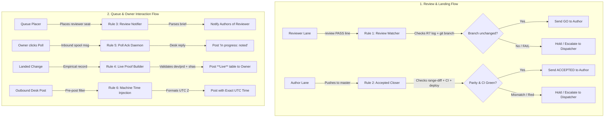
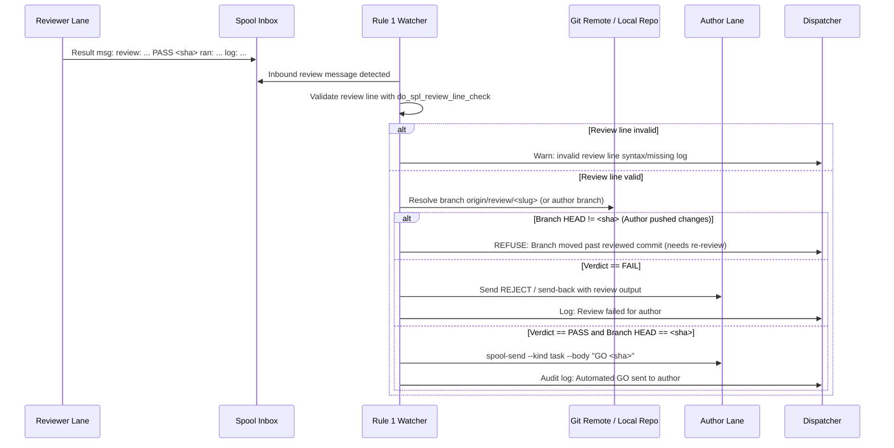
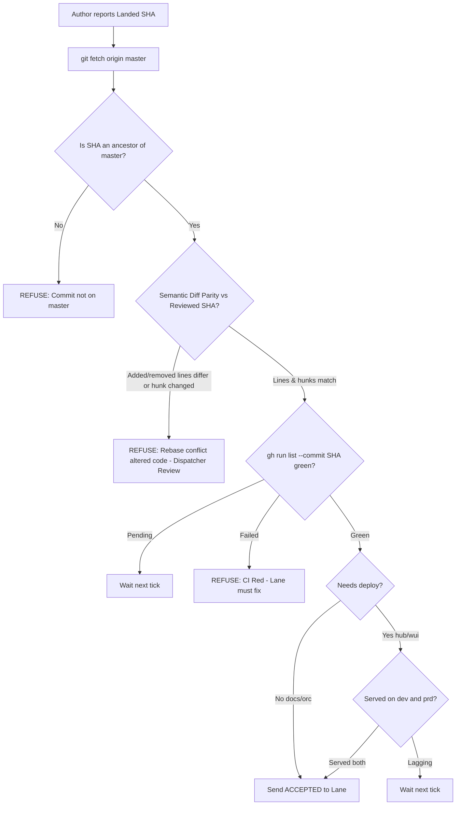
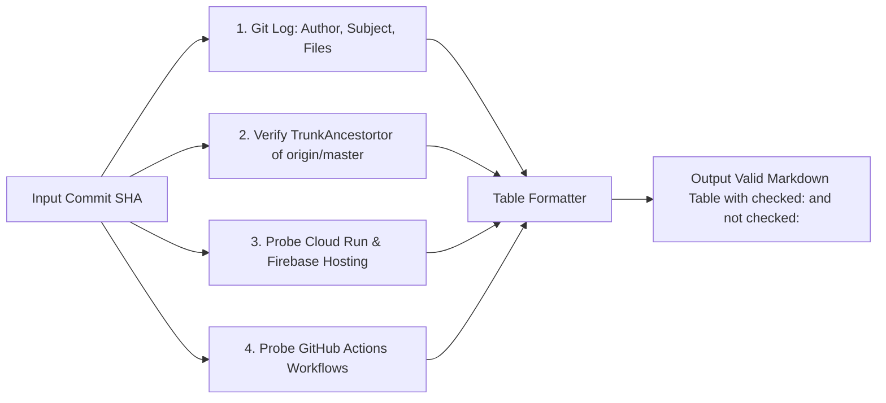
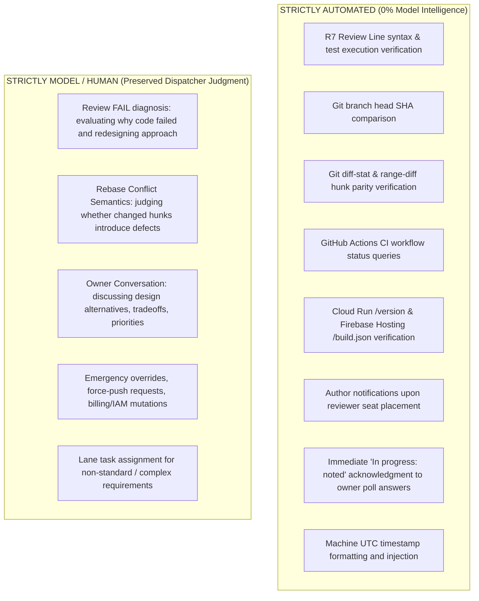
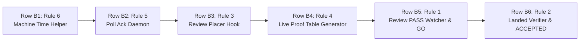

# Spec 157: Dispatch Automation — Deterministic Execution of Mechanical Dispatch Procedures

**Feature ID**: `157-dispatch-automation` · **Status**: Draft v0.1 · **Epic**: SPL-2398 · **Issue**: SPL-3392  
**Created**: 2026-10-25 · **Lead**: a-213 · **Placement slug**: `c002-spec-157-dispatch-automation`  
**Related Specs & Docs**:  
- [SPEC-spool-fleet-roles.md](../../doc/md/SPEC-spool-fleet-roles.md) (Fleet roles, 3-minute SLA, routing rules, lease failover, and asks ledger)  
- [spec 060 Role Rotation](../060-role-rotation/spec.md) (Hourly rotation, standby states, handoff files)  
- [developer-guide.md](../../doc/md/developer-guide.md) (Trunk branching, deploy lag, coding standards)  
- [rounds-rulebook.md](../../doc/md/rounds-rulebook.md) (R7 review line verification, red controls)  
- [how-to-post.md](../../doc/help/how-to-post.md) (Post rules, poll forms, Rule 16 Live proof, Section 4 clock times)  
- [lane-integration-rules.md](../../doc/md/lane-integration-rules.md) (Exit-clean ACCEPTED gate, git workflow)  

**Authority**: This document defines the architectural specifications, deterministic safety predicates, refusal invariants, execution topologies, red-control test suites, and build task decomposition for automating the mechanical dispatching actions identified by the owner and the dispatch team on 2026-10-25. Docs only; this specification introduces no immediate code, cron, or infrastructure mutations.

---

## 1. Context & Owner Mandate

### 1.1 The Owner's Direct Words
In topic `99ffa592-3717-4b9e-8a80-62c70456ceff` (`#spool-hub-ops`, prd tenant `t1`, HUM-10):
- **msg `a99676b7`**: *"Also, I would expect some kind of suggestions for improvements on the whole dispatching process. What could be automated to be done without any intelligence?"*
- **msg `1c8a754e`**: *"If he has not done that till now"* (addressing Grok's dispatching performance).
- **poll `6de8b12d`**: Asked whether to (A) grade Grok's 58 hours and build rules 1–6, (B) only grade Grok's 58 hours, or (C) build a 10-hour shadow mode.
- **msg `c9213bd2` (Answer A)**: The owner explicitly voted **Answer A**: *"Grade grok's 58 hours, and build rules 1-6"*.

### 1.2 Empirical Baseline: The 2026-10-25 Shift Measurement
On 2026-10-25, the active dispatcher (`c-002@sat`, post `6de8b12d`) recorded approximately **30 purely mechanical interventions** performed manually over a single operating shift:
1. Manually reading reviewer result messages, checking that the verdict was `PASS` and the git branch head had not moved, and sending a manual `GO` task to the author.
2. Manually inspecting landed commits on `origin/master`, diffing added/removed lines against the reviewed commit to detect rogue rebase modifications, checking GitHub Actions CI status, checking served `/version` (Cloud Run) and `/build.json` (Firebase Hosting) endpoints, and sending an `ACCEPTED` result to allow the lane to exit.
3. Reading newly placed reviewer seat briefs, extracting the target author IDs and branches, and manually sending notification messages to each author lane.
4. Manually collecting commit SHAs, deployment proofs across dev/prd, and testing evidence to assemble the `**Live**` proof table demanded by `how-to-post.md` Rule 16.
5. Manually replying with acknowledgments when the owner clicked poll options in active discussions.
6. Manually typing UTC timestamps into status posts, which repeatedly resulted in human/model timezone transposition errors (e.g. typing local EET as UTC).

In parallel, `c-003@sat` (standby dispatcher, message `604472ca` / `17:17:10Z`) documented seven additional mechanical frictions:
- Standby seats being woken by unaddressed channel messages and routine test alerts that could be auto-archived.
- Lanes sending final reports to hardcoded dispatcher IDs rather than dynamically querying the live lease holder.
- Cross-box brief path fragmentation between `sat` and `<box-far>`.
- Repetitive ask bookkeeping (`ask_put`, `ask_ack`, `ask_close`) where task completion could deterministically close the ask.
- Manual drafting of standby handoff text when the queue, ask ledger, and hold notes already contain the complete state.
- Redundant and varied manual checks across lanes to determine if work is done.

### 1.3 The Problem: Cognitive Burden and Model Churn
LLM agents serving as dispatchers (`c-002`, `g-002`, `a-002`) are provisioned to make context-dependent evaluations: understanding human questions, breaking down ambiguous requests into specced work, assigning appropriate lane vendors, and handling unpredicted operational failures.

When dispatchers are forced to spend context tokens, prompt turns, and execution time executing static binary checks (e.g. `is git commit X an ancestor of master?`, `does diff line count match?`, `is CI status == success?`), three systemic failure modes emerge:
1. **Context Window Exhaustion**: A dispatcher's context window rapidly fills with git diffs, curl outputs, and repetitive notification logs, accelerating session degradation and triggering premature rotation.
2. **Turn Latency & Missed Pokes**: The dispatcher becomes occupied executing bash scripts for simple checks, delaying responses to inbound human posts beyond the mandatory 3-minute SLA ([SPEC-spool-fleet-roles.md](../../doc/md/SPEC-spool-fleet-roles.md) § 3).
3. **Model Hallucination & Transcription Errors**: LLMs regularly misread hex SHAs, omit trailing whitespace, or botch timezone calculations (as seen on 2026-10-25 when `c-002` typed incorrect UTC hours).

**Design Principle**: Anything that can be evaluated as a deterministic predicate on disk or via API must be executed by a shell script or daemon. Model intelligence is strictly reserved for judgment, ambiguity, and human conversation.

---

## 2. Architecture & Existing Foundation (State on origin/master)



### 2.1 Existing Infrastructure on origin/master

The codebase already contains substantial verification primitives that Rules 1–6 can leverage without reinventing the wheel:

| Component | Path on origin/master | Existing Capabilities | Missing Automation Gap |
|---|---|---|---|
| **R7 Review Line Check** | `csi-spl-orc/src/bash/run/spl-review-line-check.func.sh` | Validates format of `review: <id>@<box> <vendor> <verdict> <sha> ran: ... \| read: ... \| log: ...`. Reads reviewer's session transcript and proves each test named in `ran:` was actually executed. | Runs only when invoked manually by dispatcher or in pre-push. Does not automatically trigger on incoming reviewer spool message, nor does it verify that the author's branch tip still equals `<sha>` before issuing `GO`. |
| **Trunk Push Action** | `csi-spl-orc/src/bash/run/spl-push-master.func.sh` | Detached background worker (`do_spl_push_master`). Enforces author identity, verifies R7 review line on round rows (`_spl_push_master_unreviewed`), rejects unreviewed commits, handles fetch-and-rebase loops. | Does not verify semantic range-diff parity between reviewed SHA and rebased SHA after rebase conflicts. Does not emit `ACCEPTED`. |
| **Exit-Clean Gate** | `csi-spl-orc/src/bash/features/spawn-agents/scripts/kill-your-self-report.sh` | The `--gate` flag inspects `$SPOOL_ROOT/<id>/{inbox,archive}`. Refuses `/exit-clean` unless an `ACCEPTED` result exists from the dispatch holder or spawner that is strictly newer than any `REJECT`. | The `ACCEPTED` message is authored and transmitted by a human or model dispatcher typing into a terminal. |
| **Desk Live Proof Validator** | `csi-spl-orc/src/bash/run/spl-desk-live-proof.func.sh` | Evaluates posts opening with `**Live**`. Enforces commit existence on `origin/master`, checks deployment lag via `_spl_served_env` on `dev` and `prd`, and verifies presence of `checked:` and `not checked:` clauses. | Purely a validator/linter that rejects invalid posts. It cannot synthesize or format the Live proof markdown table from git and deployment state. |
| **Deploy Lag Checker** | `csi-spl-orc/src/bash/run/check-deploy-lag.func.sh` | `do_check_deploy_lag` queries live Cloud Run `/version` and Firebase Hosting `/build.json`. Accurately determines if a commit is served. | Queried manually by dispatchers during shift work. |
| **Fleet Role & Asks Ledger** | `csi-spl-orc/src/bash/run/spl-dispatch-lease.func.sh`, `spl-asks-tick.func.sh` | Heartbeat lease mechanism for `orch` and `dispatch`. Centralized ask log with ack/close semantics. | Standby dispatchers still receive wake pokes for messages not addressed to them. Asks are not closed automatically when corresponding reply tasks are sent. |
| **Queue Placer** | `csi-spl-orc/src/bash/run/spl-spawn-queue.func.sh` | Reads queue TSV and spawns lane containers/tmux panes when capacity permits. | Does not notify target authors when their designated reviewer seat is placed. |

---

## 3. The Six Core Automation Rules

### Rule 1: Automated GO After Review Approval

> **Objective**: When a designated reviewer approves a lane's work, immediately emit the authorization token (`GO <sha>`) to the author lane without human or model intervention, provided the code has not changed since the review.



#### 1. Trigger
- An incoming spool message of kind `result` or `note` arrives in the dispatch holder's inbox (or dedicated review topic) containing an R7 review line matching regex:  
  `^review:[[:space:]]+([acgmq]-[0-9]{3})@([a-z0-9-]+)[[:space:]]+([a-z0-9_-]+)[[:space:]]+(PASS|FAIL)[[:space:]]+([0-9a-f]{7,40})[[:space:]]+ran:[[:space:]]+(.*)[[:space:]]+\|[[:space:]]+read:[[:space:]]+(.*)[[:space:]]+\|[[:space:]]+log:[[:space:]]+(.*)$`

#### 2. Exact Deterministic Checks (Safe for zero intelligence)
1. **Review Line Verification**: Execute `do_spl_review_line_check REVIEW_LINE="<line>"`. Must exit code 0 (proves valid syntax, existence of journal file on named box, and command execution match for every test named in `ran:`).
2. **Verdict Check**: The verdict field must literally equal `PASS`.
3. **Git Branch Immutability Check**:
   - Resolve the target author's branch ref on `origin` (e.g. `origin/review/<slug>` or the author's worktree branch `origin/<lane-branch>`).
   - Run `git fetch -q origin <branch>`.
   - Run `git rev-parse origin/<branch>`.
   - The resolved commit SHA must exactly match the reviewed SHA (`<sha>` from the review line).
4. **Author Liveness Check**: Author lane exists in `$SPOOL_ROOT/<author-id>` and is marked active in `workdirs.tsv` or `registry.tsv`.

#### 3. Refusals & Escalations (Model/Human Judgment Preserved)
- **Verdict == `FAIL`**: The script MUST NOT issue a `GO`. It routes the review failure details to the author as a `reject`/`send-back` note, alerts the dispatcher, and leaves diagnosis to the author and dispatcher.
- **Branch Head Divergence**: If `git rev-parse origin/<branch>` != `<sha>`, the author pushed additional commits during or after the review. The script logs `REFUSED: branch moved past reviewed sha` and halts. Re-review is mandatory.
- **Log Verification Failure**: If `do_spl_review_line_check` exits non-zero (e.g. log missing, test commands not found in journal), the script refuses to act and alerts the reviewer lane to re-run or fix the journal path.
- **Reviewer Ambiguity**: If the reviewer was not the assigned seat for this row, flag for dispatcher verification.

#### 4. Execution Location
- Daemonized spool hook in `csi-spl-orc/src/bash/run/spl-review-go.func.sh`, triggered upon receipt of review task results, or invoked via the dispatch lease loop tick (every 60 s).

#### 5. Test Plan & Red Control
- **Test File**: `csi-spl-orc/src/bash/tests/spl-review-go.tst.sh`
- **Red Control**:
  1. Feed a fixture message with a `FAIL` verdict -> script exits 1, asserts no `GO` message emitted, logs `REFUSED: review verdict is FAIL`.
  2. Feed a fixture message where the branch has an unreviewed commit (`HEAD` != `<sha>`) -> script exits 2, asserts no `GO` emitted, logs `REFUSED: branch has unreviewed commits`.
  3. Feed a fixture message with a fabricated `log:` path -> `do_spl_review_line_check` fails, script exits 3, asserts no `GO` emitted.
- **Green Pass**: Feed a valid `PASS` message with matching branch SHA and verifiable test log -> script exits 0, verifies `spool-send.sh` invoked with `--kind task --body "GO <sha>"`.

---

### Rule 2: Automated ACCEPTED After Landing Verification

> **Objective**: When an author lane lands a commit on `origin/master`, verify that the landed commit is functionally and semantically identical to the reviewed commit, that CI is completely green, and that the change is actively served on dev and prd (if applicable). Upon passing, emit `ACCEPTED: on master <sha>`, enabling the lane's `/exit-clean`.



#### 1. Trigger
- Author lane sends a result message on task `dispatch-<slug>` citing landed SHA, or cron watcher (`spl-accepted-close.func.sh`) detects an issue in `eval`/`todo` cited by a new commit on `origin/master`.

#### 2. Exact Deterministic Checks (Safe for zero intelligence)
1. **Trunk TrunkAncestortry**:  
   Execute `git merge-base --is-ancestor <landed-sha> origin/master`. Must return exit code 0.
2. **Semantic Diff Parity (Range-Diff & Stat Check)**:  
   Compare the reviewed SHA (`<reviewed-sha>`) against the landed SHA (`<landed-sha>`):
   - Line counts: Added and deleted lines from `git diff --shortstat <parent> <landed-sha>` must exactly match `git diff --shortstat <rev-parent> <reviewed-sha>`.
   - Patch comparison: Run `git range-diff <reviewed-sha>^..<reviewed-sha> <landed-sha>^..<landed-sha>`. The hunks must show 0 modified diff lines (only rebase commit SHAs and line offset numbers may differ; no code changes allowed).
3. **CI Quality Gate**:  
   Execute `gh run list --commit <landed-sha> --json status,conclusion`. Every workflow (`10_ci-quality`, scanner checks) must report `status: "completed"` and `conclusion: "success"`.
4. **Deploy Gate (Dev & Prd Verification)**:  
   - Evaluate `_spl_served_needs_deploy <wt> <landed-sha>^ <landed-sha>`.
   - If `no`: Commit touches only documentation, tooling, or orchestration; deploy check passes immediately with reason `no deploy`.
   - If `yes`: Query `_spl_served_env dev <wt> <landed-sha>` and `_spl_served_env prd <wt> <landed-sha>`. Both must return `served` (confirming SHA is embedded in Cloud Run `/version` or Firebase Hosting `/build.json`).

#### 3. Refusals & Escalations (Model/Human Judgment Preserved)
- **Substantive Rebase Conflict Resolution**: If `git range-diff` shows modified diff hunks (the author altered logic while resolving merge conflicts on master), the script MUST NOT send `ACCEPTED`. It flags `REFUSED: landed commit differs from reviewed commit` and escalates to the dispatcher.
- **CI Failure**: If any CI run is `failure` or `startup_failure`, emit a failure alert. The lane cannot be closed; it must address the failure.
- **Deployment Lag**: If CI is green but Cloud Run or Firebase Hosting has not updated, do not refuse—defer execution to the next tick until the deploy completes.

#### 4. Execution Location
- Integrated into `csi-spl-orc/src/bash/run/spl-accepted-close.func.sh`, executed on a 60-second cron cycle or triggered upon git push completion.

#### 5. Test Plan & Red Control
- **Test File**: `csi-spl-orc/src/bash/tests/spl-accepted-close.tst.sh`
- **Red Control**:
  1. Fabricate a landed commit where an extra line was injected during rebase -> `git range-diff` detects mismatch, script exits 2, asserts no `ACCEPTED` emitted, logs `REFUSED: hunk mismatch`.
  2. Simulate pending CI run (`conclusion: ""` or `status: "in_progress"`) -> script exits 3, asserts no `ACCEPTED` emitted, logs `DEFERRED: CI in progress`.
  3. Simulate failed CI run (`conclusion: "failure"`) -> script exits 4, asserts no `ACCEPTED` emitted, logs `REFUSED: CI failure`.
- **Green Pass**: Valid landed commit matching reviewed commit with green CI and verified deploy -> script exits 0, calls `spool-send.sh --to <lane> --kind result --body "ACCEPTED: on master <sha>"`.

---

### Rule 3: Automated Reviewer Notification to Author Lanes

> **Objective**: When the queue placer spawns a reviewer seat, immediately and deterministically notify every author lane referenced in that seat's brief, eliminating author idle time and dispatcher manual lookups.

#### 1. Trigger
- The queue placer (`do_spl_spawn_queue`) successfully places and starts a reviewer seat (`do_spl_spawn_seat` or `do_spl_spawn_lane`) whose placement brief or slug indicates review duties (e.g. `*-reviewer*`, `*-review`, class `review`).

#### 2. Exact Deterministic Checks (Safe for zero intelligence)
1. **Brief Parsing**: Read the placed seat's brief file at `/var/spool-hub/dispatch/briefs/<slug>.md`.
2. **Author Extraction**: Extract target author lane IDs using regex scanning for:
   - Explicit author field: `^Author:[[:space:]]*([acgmq]-[0-9]{3})`
   - Row specification tables containing lane IDs: `\|[[:space:]]*([acgmq]-[0-9]{3})[[:space:]]*\|`
   - Referenced branches: `review/([a-zA-Z0-9_-]+)`
3. **Author Liveness Verification**: Verify each extracted author lane exists in `$SPOOL_ROOT/<id>` and is active.

#### 3. Refusals & Escalations
- **Brief Lacks Author Identifiers**: If the brief does not match standard review seat structure, log a warning to `dispatch/queue.log` and notify the dispatcher to verify the assignment manually.
- **Retired Author**: If an extracted author lane has already retired, skip messaging that lane and log `SKIP: author <id> already retired`.

#### 4. Execution Location
- Post-spawn hook in `csi-spl-orc/src/bash/run/spl-spawn-review-notify.func.sh`, executed immediately following successful seat provisioning in `spl-spawn-queue.func.sh`.

#### 5. Test Plan & Red Control
- **Test File**: `csi-spl-orc/src/bash/tests/spl-spawn-review-notify.tst.sh`
- **Red Control**:
  1. Pass a malformed brief containing no lane IDs -> hook logs `WARN: no author lanes found in brief`, exits 1, sends 0 spool messages.
  2. Pass an author lane that is not present in `$SPOOL_ROOT` -> hook logs `WARN: author lane <id> not found`, skips send.
- **Green Pass**: Pass a standard reviewer brief referencing authors `c-168` and `a-166` -> hook exits 0, verifies two spool messages sent: `"Your reviewer is <reviewer-id> for branch <branch>"`.

---

### Rule 4: Automated Live Proof Table Generation for Owner Posts

> **Objective**: Programmatically construct the complete, verified Markdown `**Live**` proof table adhering strictly to `how-to-post.md` Rule 16 and `spl_desk_live_proof`, eliminating manual markdown construction and post gate rejections.



#### 1. Trigger
- Dispatcher runs `./run -a do_spl_desk_live_proof_render SHA=<sha>` or automated release pipeline prepares topic announcement.

#### 2. Exact Deterministic Checks (Safe for zero intelligence)
1. **Trunk TrunkAncestortry**: `git merge-base --is-ancestor <sha> origin/master` must be true.
2. **Component Touchpoints**: Determine whether `<sha>` modified hub API (`csi-spl-api/**`), WUI (`csi-spl-wui/**`), IAC (`csi-spl-iac/**`), or docs (`csi-spl-doc/**`) via `git diff-tree --no-commit-id --name-only -r <sha>`.
3. **Deploy Status Probing**:
   - Query dev and prd endpoints using `_spl_served_env`.
   - Hub: verify Cloud Run `/version` returns `<sha>`.
   - WUI: verify Firebase Hosting `/build.json` returns `<sha>`.
4. **CI Status Probing**: Validate workflow conclusions via `gh run list --commit <sha>`.
5. **Table Synthesis**: Assemble markdown table format:
   ```markdown
   | target | commit / version | dev | prd | CI |
   |---|---|---|---|---|
   | hub | <short-sha> (`<version>`) | served | served | green |
   | wui | <short-sha> (`<version>`) | served | served | green |

   checked: `_spl_served_env` on dev and prd, GitHub Actions workflow 10 & 20.
   not checked: none.
   ```

#### 3. Refusals & Escalations
- **Commit Not on Trunk**: If `<sha>` is not an ancestor of `origin/master`, refuse generation with: `REFUSED: commit <sha> has not landed on origin/master`.
- **Deploy Incomplete**: If deployment is pending or lagging, format the table with header `**Landed, not live yet**` rather than `**Live**`, preventing `spl_desk_live_proof` FATAL errors.
- **Customer Repo Handling**: If `LIVE_REPO` is set, adapt queries to external repository checkout per SPL-2420.

#### 4. Execution Location
- Named action `do_spl_desk_live_proof_render` in `csi-spl-orc/src/bash/run/spl-desk-live-proof-render.func.sh`.

#### 5. Test Plan & Red Control
- **Test File**: `csi-spl-orc/src/bash/tests/spl-desk-live-proof-render.tst.sh`
- **Red Control**:
  1. Pass an unlanded branch SHA -> action exits 1, emits `REFUSED: not on master`.
  2. Mock a lagging prd deploy -> action renders `**Landed, not live yet**` and marks prd as `lagging (expected <sha>, served <old>)`.
- **Green Pass**: Pass fully deployed SHA -> action renders table, pipes output to `spl_desk_live_proof`, verifies 0 fatal exit.

---

### Rule 5: Automated Acknowledgement of Owner Poll Answers

> **Objective**: Instantly reply to owner poll submissions with an immediate confirmation post ("In progress: noted"), assuring the owner their input is received while dispatch logic is engaged.

#### 1. Trigger
- Inbound spool message from desk receiver (`do_spl_desk_poll_check` / desk sidecar) indicating a human (`HUM-10` or tenant admin) voted on or answered a poll form in an active channel topic.

#### 2. Exact Deterministic Checks (Safe for zero intelligence)
1. **Sender Authentication**: Message sender must match authorized owner identity (`HUM-10` / `env.gcp.gcp_account_owner_email`).
2. **Topic Context**:
   - Query topic history to verify preceding message contains a valid ````poll` block.
   - Parse inbound response body to confirm it matches one of the poll's valid options (e.g. `(A)`, `(B)`, `(C)`) or contains explicit voting text.
3. **De-duplication Check**: Check topic messages; verify no agent acknowledgment or reply has been posted since the owner's answer timestamp.

#### 3. Refusals & Escalations
- **Non-Owner Response**: If a poll response originates from a bot, lane agent, or unrecognized user, ignore auto-acknowledgment.
- **Closed / Archived Topic**: If topic is marked closed, archived, or locked, do not post.
- **Pre-existing Reply**: If another agent or dispatcher already posted an answer within the elapsed seconds, abort to prevent double-posting.

#### 4. Execution Location
- Desk message handler daemon in `csi-spl-orc/src/bash/run/spl-desk-poll-ack.func.sh`.

#### 5. Test Plan & Red Control
- **Test File**: `csi-spl-orc/src/bash/tests/spl-desk-poll-ack.tst.sh`
- **Red Control**:
  1. Feed incoming message from agent ID `c-168` voting on poll -> script exits silently 0 with `SKIP: not human owner`.
  2. Feed poll vote in topic where an agent already replied -> script exits silently 0 with `SKIP: already answered`.
- **Green Pass**: Feed valid owner poll vote on option (A) -> script executes `do_spl_desk_reply` posting:  
  `In progress: noted. Acting on option (A).` and notifies topic owner.

---

### Rule 6: Machine-Stamped ISO / UTC Clock Times in Posts

> **Objective**: Standardize and automate time generation across all dispatcher posts, eliminating manually calculated time strings and enforcing `how-to-post.md` Section 4 compliance.

#### 1. Trigger
- An agent or script prepares a post body containing time markers or invokes `do_spl_desk_reply` / `do_spl_desk_post`.

#### 2. Exact Deterministic Checks (Safe for zero intelligence)
1. **Template Placeholder Replacement**:  
   Pre-process outgoing body text. Replace machine tokens:
   - `{{NOW_UTC}}` -> Formatted as `HH:MM:SSZ` (e.g. `17:15:30Z`).
   - `{{TODAY_UTC}}` -> Formatted as `YYYY-MM-DD` (e.g. `2026-10-25`).
   - `{{NOW_ISO}}` -> Formatted as `YYYY-MM-DDTHH:MM:SSZ`.
2. **Linter & Timezone Guard**:  
   Scan the body for erroneous non-UTC timezone suffixes (e.g. `EEST`, `CEST`, `+02:00`, `+03:00`). Flag or automatically convert to canonical UTC `Z` format.
3. **Clock Time Validation**:  
   Ensure all standalone timestamps adhere to `how-to-post.md` Section 4 grammar (`HH:MM:SSZ`, `HH:MMZ`, `HH:MM-HH:MMZ`).

#### 3. Refusals & Escalations
- **Ambiguous Relative Time**: If post body contains raw colloquial time references like "at 3pm local time" without a timezone, the pre-post linter warns the authoring process.

#### 4. Execution Location
- Filter library `csi-spl-orc/src/bash/run/spl-post-time.func.sh`, integrated into `do_spl_desk_reply` body preparation pipeline.

#### 5. Test Plan & Red Control
- **Test File**: `csi-spl-orc/src/bash/tests/spl-post-time.tst.sh`
- **Red Control**:
  1. Pass draft body with non-UTC timezone string `15:30 EEST` -> linter flags violation, replaces or exits with error.
- **Green Pass**: Pass draft containing `Taken at {{NOW_UTC}}` -> expands to exact current UTC time `Taken at 20:45:12Z`.

---

## 4. Analysis of Secondary Mechanical Steps (c-003's Candidates & Queued Bugs)

In message `604472ca`, standby dispatcher `c-003@sat` highlighted seven candidate friction points. Here we evaluate their technical feasibility and architectural fit:

| # | Candidate Mechanical Step | Operational Problem | Proposed Solution & Architecture | Fit & Disposition |
|---|---|---|---|---|
| **C1** | **Standby Inbox Auto-Archive** | Standby dispatcher (`c-003` while `c-002` holds lease) receives pokes for broadcast messages, channel copies, and bench notes, waking the model needlessly. | A background daemon monitors `$SPOOL_ROOT/<standby-id>/inbox/`. When local node is in `STANDBY`, auto-archives incoming copies of channel traffic that do not mention the standby ID. | **Accepted**: Extension row B7. Reduces standby model wakeups to near zero. |
| **C2** | **Dynamic Dispatch Holder Routing** | Lanes hardcode reports to `c-002`, failing when `c-003` holds the lease or roles rotate across boxes. | Enhance `spool-send.sh --to dispatch-holder`: resolves recipient dynamically from `$SPOOL_ROOT/dispatch/lease` at send time. | **Accepted**: Covered by queued bug row `c002-bug-ksr-reporter-dispatch-holder`. High priority. |
| **C3** | **Cross-Box Path / File Inlining** | `<box-far>` cannot read local files on `sat` (`/var/spool-hub/...`). Cross-box messages citing local paths fail. | Update `spool-fleet-relay.sh`: detect referenced sat file paths in message body and embed contents as payload attachments when relaying to another machine. | **Accepted**: Extension row B8. Solves cross-box brief access (`c002-bug-placer-brief-other-box`). |
| **C4** | **Deterministic Ask Bookkeeping** | Dispatchers manually run `ask_put`, `ask_ack`, and `ask_close` when handling asks. | Automatically mark an ask `done` when an outgoing message on the same task ID is successfully transmitted via `spool-send.sh`. | **Accepted**: Extension row B9. Eliminates ask state leaks. |
| **C5** | **DM Reply Starter Fallback** | Owner DM waited 35 minutes because only the session starter was permitted to reply. | Add fallback authorization allowing the active dispatch lease holder to answer DMs when the starter session is dead. | **Handled**: Already queued in bug row `c003-bug-dm-reply-starter-gone`. |
| **C6** | **Deterministic Handoff Generation** | Each rotation requires manually writing an open items handoff markdown file. | Synthesize the handoff file from active queue state (`do_spl_spawn_queue`), open asks (`asks.json`), and hold notes. | **Accepted**: Extension row B10. Simplifies role rotation (`spec 060`). |
| **C7** | **Unified `do_spl_verify_done`** | Multiple disjoint checks to confirm whether a lane is done. | Build a single named action `do_spl_verify_done AGENT_ID=<id>` that runs checks 1–4 of Rule 2 and outputs binary `PASS` or `FAIL`. | **Accepted**: Incorporated directly into Rule 2 (Row B6). |

---

## 5. Boundary Matrix: Deterministic Script vs. Model Intelligence

To prevent automation overreach and protect operational safety, the operational boundaries between scripts and models are strictly partitioned:



### 5.1 Hard Automation Safety Invariants
1. **Never Bypass an Access Gate**: Automated scripts must never override pre-push hooks, skip review line checks, or force-push commits.
2. **Fail Closed**: Any network timeout, git ambiguity, missing file, or unexpected exit code immediately halts automation and leaves state untouched.
3. **Comprehensive Audit Trail**: Every automated action must write a structured log entry to `$SPOOL_ROOT/dispatch/automation.log` specifying timestamp, action taken, actor, input SHAs, and verification receipts.

---

## 6. Implementation Plan: Build Rows B1..B6 & Extension Rows

### 6.1 Build Rows (Smallest first, completely disjoint files)



| Row | Target Rule | Subsystem & Files Touched | Scope & Deliverable | Test & Red Control | Size | Order |
|---|---|---|---|---|---|---|
| **B1** | **Rule 6** | `csi-spl-orc/src/bash/run/spl-post-time.func.sh`<br>`csi-spl-orc/src/bash/tests/spl-post-time.tst.sh` | Function `spl_post_timestamp` & template replacer for `{{NOW_UTC}}`, `{{TODAY_UTC}}`. Enforces UTC `Z` format. | Control: non-UTC time string rejected. Passes on valid template expansion. | Small | 1 |
| **B2** | **Rule 5** | `csi-spl-orc/src/bash/run/spl-desk-poll-ack.func.sh`<br>`csi-spl-orc/src/bash/tests/spl-desk-poll-ack.tst.sh` | Daemon/hook evaluating inbound poll submissions from `HUM-10`. Emits immediate `In progress: noted` desk reply. | Control: bot/lane vote ignored; owner vote immediately replied. | Small | 2 |
| **B3** | **Rule 3** | `csi-spl-orc/src/bash/run/spl-spawn-review-notify.func.sh`<br>`csi-spl-orc/src/bash/tests/spl-spawn-review-notify.tst.sh` | Placer post-hook parsing reviewer brief and messaging referenced author lanes. | Control: malformed brief logs warning; valid brief notifies authors. | Small | 3 |
| **B4** | **Rule 4** | `csi-spl-orc/src/bash/run/spl-desk-live-proof-render.func.sh`<br>`csi-spl-orc/src/bash/tests/spl-desk-live-proof-render.tst.sh` | Named action `do_spl_desk_live_proof_render` synthesizing verified Markdown `**Live**` table from git/CI/deploy probes. | Control: unlanded commit refused; deployed commit outputs verified table. | Medium | 4 |
| **B5** | **Rule 1** | `csi-spl-orc/src/bash/run/spl-review-go.func.sh`<br>`csi-spl-orc/src/bash/tests/spl-review-go.tst.sh` | Automated watcher evaluating R7 review lines via `do_spl_review_line_check` and emitting `GO` if branch unchanged. | Control: `FAIL` verdict or moved branch refused; valid `PASS` emits `GO`. | Medium | 5 |
| **B6** | **Rule 2** | `csi-spl-orc/src/bash/run/spl-accepted-close.func.sh`<br>`csi-spl-orc/src/bash/tests/spl-accepted-close.tst.sh` | Unified landed verifier evaluating range-diff, CI, and served build. Emits `ACCEPTED` on master. | Control: modified rebase hunk or red CI refused; green deploy emits `ACCEPTED`. | Medium | 6 |

### 6.2 Secondary Extension Rows (Post-Rules 1–6)
- **Row B7 (C1 Standby Auto-Archive)**: `csi-spl-orc/src/bash/run/spl-standby-archive.func.sh` — background daemon auto-archiving unaddressed notifications for standby seats.
- **Row B8 (C3 Cross-Box Relay Inliner)**: `csi-spl-orc/src/bash/features/spawn-agents/scripts/spool-fleet-relay.sh` — embeds local file attachments into payloads crossing between `sat` and `<box-far>`.
- **Row B9 (C4 Ask Auto-Closer)**: `csi-spl-orc/src/bash/run/spl-asks-auto-close.func.sh` — automatically commits `done` on open asks when outbound replies on matching task IDs succeed.
- **Row B10 (C6 Standby Handoff Synthesizer)**: `csi-spl-orc/src/bash/run/spl-handoff-render.func.sh` — generates standby handover markdown from live queue and ask registries.

---

## 7. Invariants & Acceptance Criteria

### 7.1 System Invariants
1. **Safety First**: No automated script may execute an action if any prerequisite check yields ambiguous or non-zero return codes.
2. **Immutable History**: Automated `ACCEPTED` decisions must record the exact reviewed SHA and landed SHA in `$SPOOL_ROOT/dispatch/automation.log`.
3. **No Phantom Closes**: A lane must never be issued `ACCEPTED` unless its changes are proven to be on `origin/master` and verified by CI.

### 7.2 Acceptance Criteria for Build Rows
1. Every build row must deliver its named `./run` action and test in the same commit.
2. Every test must include a verified red control proving the failure path before demonstrating the passing assertion.
3. Distribution hygiene (`do_check_dist_hygiene`) must remain 100% clean across all new files.
4. Fast pre-push lint (`do_check_pre_push_lint`) must pass with zero errors.
